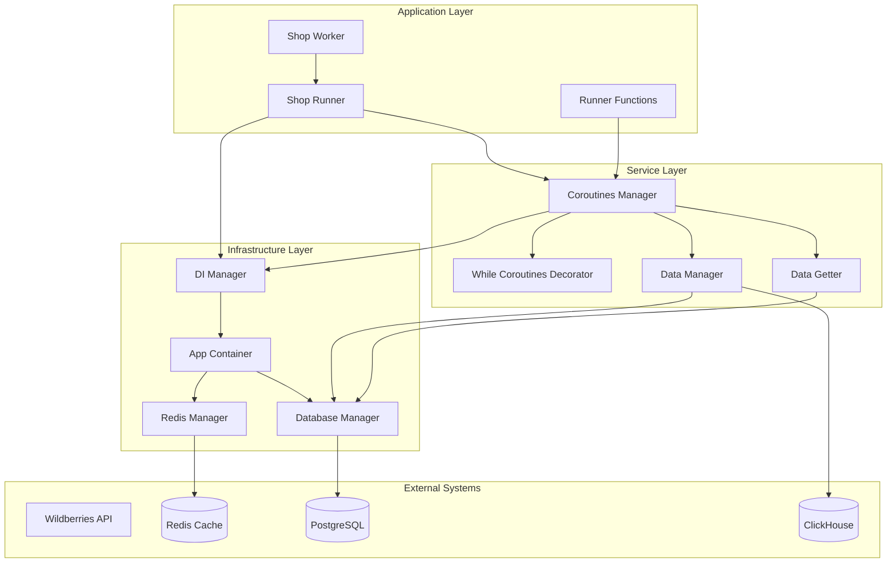
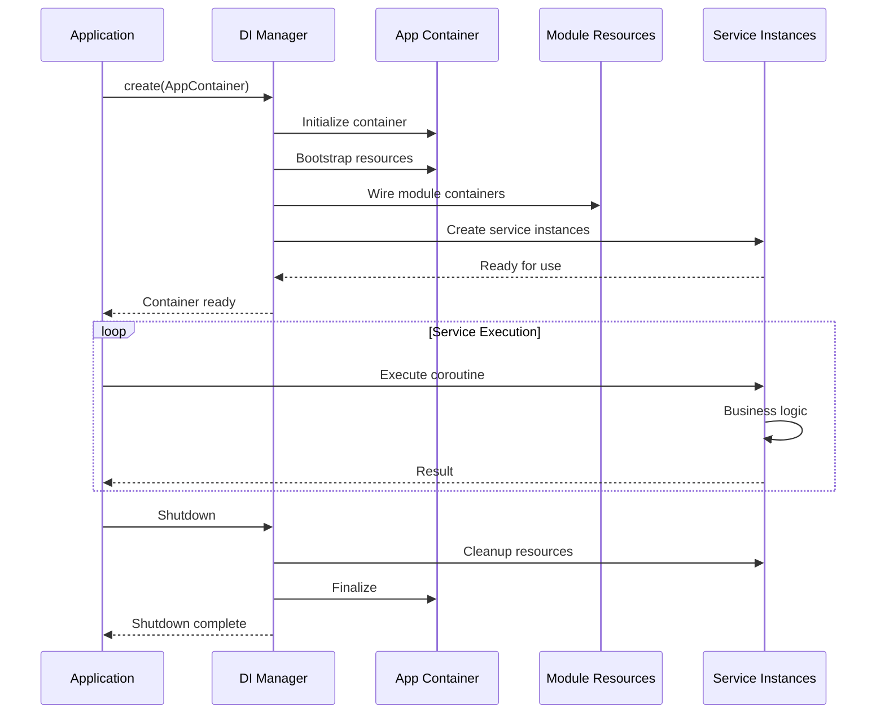
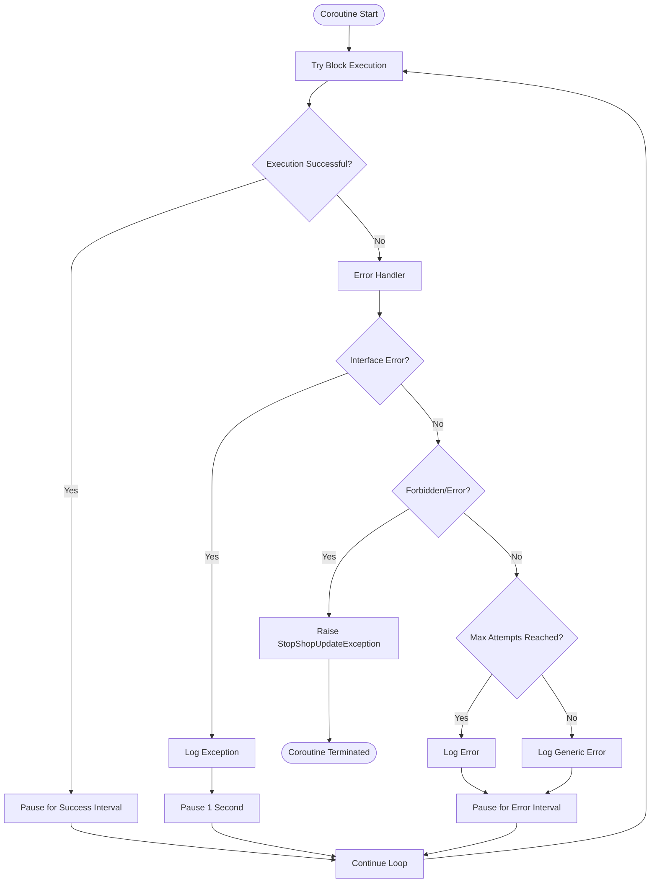
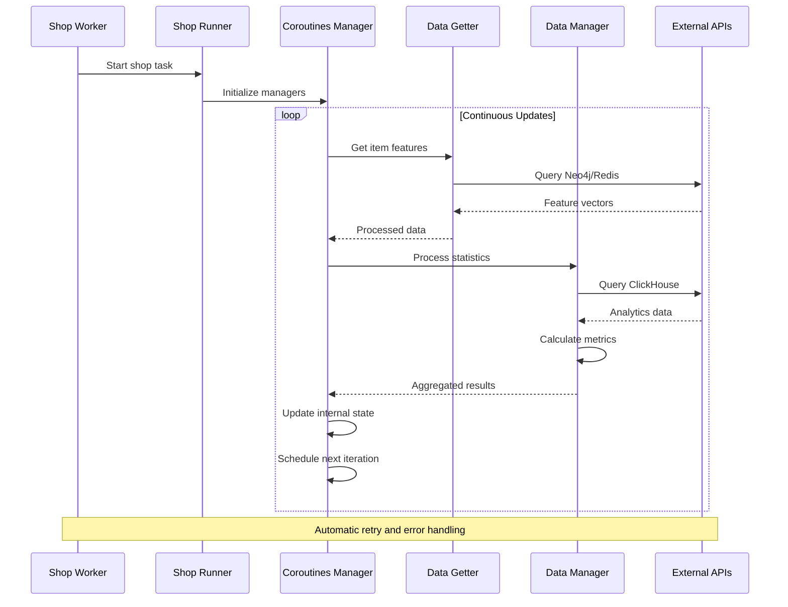
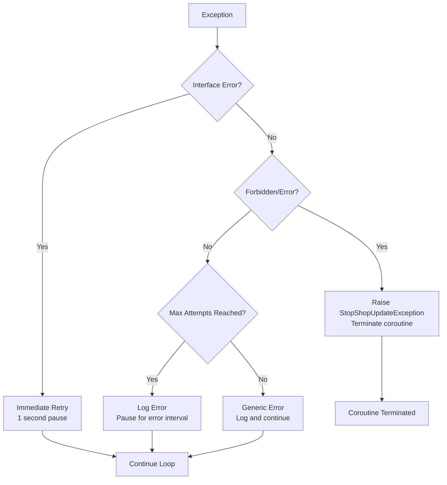
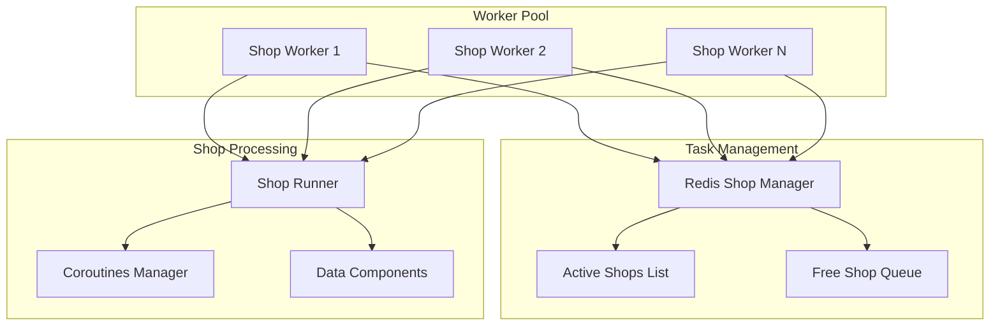

# Long-Running Coroutine Runners

<cite>
**Referenced Files in This Document**
- [runner.py](file://app/modules/wb_adv_updater/runner.py)
- [data_getter.py](file://app/modules/wb_adv_updater/data_getter.py)
- [data_manager.py](file://app/modules/wb_adv_updater/data_manager.py)
- [while_coroutines_decorator.py](file://app/modules/shop_runner/service_manager/while_coroutines_decorator.py)
- [manager.py](file://app/modules/shop_runner/service_manager/manager.py)
- [wb_shop.py](file://app/modules/shop_runner/wb_shop.py)
- [run_process_func.py](file://app/modules/shop_runner/run_process_func.py)
- [worker.py](file://app/modules/shop_runner/shop_run_worker/worker/worker.py)
- [update_active_shop_ids_in_redis.py](file://app/modules/shop_runner/shop_run_worker/update_active_shop_ids_in_redis.py)
- [ml_data_manager.py](file://app/modules/wb_adv_updater/ml_data_manager.py)
- [di_manager.py](file://app/core/di/di_manager.py)
- [app_container.py](file://app/core/di/app_container.py)
</cite>

## Table of Contents
1. [Introduction](#introduction)
2. [Architecture Overview](#architecture-overview)
3. [Core Components](#core-components)
4. [DI Container Lifecycle Management](#di-container-lifecycle-management)
5. [Decorator Pattern Implementation](#decorator-pattern-implementation)
6. [Data Flow Architecture](#data-flow-architecture)
7. [Exception Handling and Recovery](#exception-handling-and-recovery)
8. [Resource Management](#resource-management)
9. [Integration Patterns](#integration-patterns)
10. [Best Practices and Guidelines](#best-practices-and-guidelines)
11. [Troubleshooting Guide](#troubleshooting-guide)
12. [Conclusion](#conclusion)

## Introduction

The long-running coroutine architecture in this Wildberries advertising automation system provides a robust foundation for continuous background processing. This architecture enables persistent, fault-tolerant operations that maintain state across iterations while integrating seamlessly with dependency injection containers and providing comprehensive error handling mechanisms.

The system is built around several key principles:
- **Continuous Operation**: Services run indefinitely with automatic restart capabilities
- **Fault Isolation**: Individual coroutines can fail without affecting others
- **Resource Management**: Proper cleanup and lifecycle management of external resources
- **State Persistence**: Maintaining state across coroutine iterations
- **Graceful Shutdown**: Controlled termination with resource cleanup

## Architecture Overview

The coroutine architecture follows a layered approach with clear separation of concerns:



**Diagram sources**
- [runner.py](file://app/modules/wb_adv_updater/runner.py#L1-L145)
- [manager.py](file://app/modules/shop_runner/service_manager/manager.py#L1-L277)
- [di_manager.py](file://app/core/di/di_manager.py#L1-L95)

## Core Components

### Runner Functions

The runner module serves as the primary orchestrator for long-running background tasks. It defines several key coroutine functions that handle different aspects of the system:

```python
async def run_update_all_keywords_on_wb() -> None:
    async with await DIManager.create(AppContainer):
        async with ClientSession() as client_session:
            while True:
                try:
                    await wb_manager.update_all_keywords_on_wb(client_session)
                except Exception:
                    logger.error("Ошибка обновления фраз", exc_info=True)
                await asyncio.sleep(5)
```

Key characteristics:
- **DI Integration**: Automatic dependency injection container management
- **Client Session Management**: Proper HTTP client lifecycle
- **Continuous Loop**: Infinite execution with controlled pauses
- **Error Isolation**: Exception handling prevents cascade failures

### Data Access Components

The system employs specialized data access components that integrate with the coroutine architecture:

#### DataGetter Component
```python
class DataGetter(AbcManager):
    async def get_item_features_from_neo(self, nmids_batch):
        result = await self._gds.get_nmid_vectors(nmids_batch)
        return result
        
    async def get_keyword_features_from_redis(self, keywords):
        result = await redis_manager.get_keywords_vectors(keywords)
        return result
```

#### Data Manager Functions
```python
async def get_keywords_statistic_clickhouse(adv_setting, pass_time, last_views):
    async with get_clickhouse_client() as ch_client:
        # Complex analytics queries with proper resource management
        result = await ch_client.query(query)
        return result
```

**Section sources**
- [runner.py](file://app/modules/wb_adv_updater/runner.py#L25-L45)
- [data_getter.py](file://app/modules/wb_adv_updater/data_getter.py#L10-L54)
- [data_manager.py](file://app/modules/wb_adv_updater/data_manager.py#L60-L120)

## DI Container Lifecycle Management

The dependency injection container provides sophisticated lifecycle management for long-running services:



**Diagram sources**
- [di_manager.py](file://app/core/di/di_manager.py#L30-L58)
- [app_container.py](file://app/core/di/app_container.py#L1-L50)

### Startup Process

The DI manager handles container initialization through a structured bootstrap process:

```python
async def _bootstrap(self) -> None:
    container = self._container
    # Initialize global container resources
    init_result = getattr(container, 'init_resources', lambda: None)()
    if isinstance(init_result, Awaitable):
        await init_result
        
    # Wire root container if configured
    try:
        if isinstance(container, containers.DeclarativeContainer) and getattr(container, 'wiring_config', None):
            container.wire()
    except Exception:
        logger.exception("Не удалось выполнить wiring корневого контейнера")
        
    # Wire module containers
    self._wire_module_containers()
```

### Shutdown Process

Proper resource cleanup during shutdown:

```python
async def __aexit__(self, exc_type: Optional[type], exc_val: Optional[BaseException],
                    exc_tb: Any) -> None:
    container = self._container
    shutdown_result = getattr(container, 'shutdown_resources', lambda: None)()
    if isinstance(shutdown_result, Awaitable):
        await shutdown_result
```

**Section sources**
- [di_manager.py](file://app/core/di/di_manager.py#L30-L95)
- [app_container.py](file://app/core/di/app_container.py#L15-L50)

## Decorator Pattern Implementation

The `while_coroutines_decorator` provides a powerful mechanism for creating resilient, continuously running coroutines:



**Diagram sources**
- [while_coroutines_decorator.py](file://app/modules/shop_runner/service_manager/while_coroutines_decorator.py#L20-L56)

### Decorator Implementation

```python
def while_coroutine_decorator(
    pause_on_success: int, pause_on_error: int = 5
) -> Callable[
    [Callable[F_Spec, Awaitable[T_Result]]], Callable[F_Spec, Awaitable[T_Result]]
]:
    def decorator(
        func: Callable[F_Spec, Awaitable[T_Result]],
    ) -> Callable[F_Spec, Awaitable[T_Result]]:
        @wraps(func)
        async def wrapper(*args: F_Spec.args, **kwargs: F_Spec.kwargs) -> T_Result:
            while True:
                try:
                    await func(*args, **kwargs)
                    await asyncio.sleep(pause_on_success)
                    continue
                except InterfaceError:
                    logger.exception(f"Корутина: {func.__name__}")
                    await asyncio.sleep(1)
                except (NotFoundActiveAdvCompany, ApiForbiddenError) as exc:
                    raise StopShopUpdateException from exc
                except MaxAttemptsError as exc:
                    logger.error(f"Максимальное количество попыток для {func.__name__} достигнуто: {exc}")
                    await asyncio.sleep(pause_on_error)
                except Exception as exc:
                    logger.error(f"Ошибка: {exc}", exc_info=True)
                    await asyncio.sleep(pause_on_error)
        return wrapper
    return decorator
```

### Usage Patterns

The decorator supports various usage patterns:

```python
@while_coroutine_decorator(60, 60)  # 1-minute success, 1-minute error pause
async def update_cpm_bid(self) -> None:
    adv_settings = await self._wb_shop_data_manager.get_active_advs()
    if not adv_settings:
        return None
    # Business logic here
    return None

@while_coroutine_decorator(5 * 60)  # 5-minute pause on success
async def update_common_sale_stat(self) -> None:
    # Analytics update logic
    pass

@while_coroutine_decorator(60, 1)  # 1-second pause on error
async def update_advs_data_from_wb_to_pg(self) -> None:
    # Data synchronization logic
    pass
```

**Section sources**
- [while_coroutines_decorator.py](file://app/modules/shop_runner/service_manager/while_coroutines_decorator.py#L20-L56)
- [manager.py](file://app/modules/shop_runner/service_manager/manager.py#L50-L150)

## Data Flow Architecture

The system implements a sophisticated data flow architecture that handles complex asynchronous operations:



**Diagram sources**
- [worker.py](file://app/modules/shop_runner/shop_run_worker/worker/worker.py#L1-L82)
- [wb_shop.py](file://app/modules/shop_runner/wb_shop.py#L1-L43)
- [manager.py](file://app/modules/shop_runner/service_manager/manager.py#L1-L277)

### Data Processing Pipeline

The data processing pipeline handles multiple concurrent operations:

```python
async def update_full_adv_stat(self) -> None:
    wb_api = self._wb_api
    auto_advs: list[AdvSetting] = await self._wb_shop_data_manager.get_active_advs()

    all_adv_ids = set()
    for adv in auto_advs:
        all_adv_ids.add(adv.adv_id)
        if auction_adv_id := adv.search_adv_id:
            all_adv_ids.add(auction_adv_id)

    full_stats: list[FullAdvStat] = await wb_data_getter.get_full_adv_stat_for_adv_ids(
        wb_api, all_adv_ids, threshold_dates=settings.FULL_STAT_THRESHOLD_DATES
    )
    
    if full_stats:
        await self._update_full_stat_in_click_house(full_stats)
        date_time = datetime.now()
        for stat in full_stats:
            await data_manager.set_last_full_stat_update(stat.advertId, date_time)
```

### Concurrent Processing

The system leverages asyncio.gather for efficient concurrent execution:

```python
async def run(self) -> None:
    wb_api = self._wb_api
    coroutines_manager = CoroutinesManager(wb_api)
    await asyncio.gather(
        self._alive_worker_run(),
        coroutines_manager.parsing_keywords_run(),
        coroutines_manager.update_advs_data_from_wb_to_pg(),
        coroutines_manager.update_cards_data_from_wb_to_pg(),
        coroutines_manager.update_cpm_bid(),
        coroutines_manager.update_common_sale_stat(),
        coroutines_manager.update_full_adv_stat(),
        coroutines_manager.adv_settings_auto_update(),
        coroutines_manager.update_top_key_in_advs(),
        coroutines_manager.update_predict_ctr(),
    )
```

**Section sources**
- [manager.py](file://app/modules/shop_runner/service_manager/manager.py#L100-L150)
- [wb_shop.py](file://app/modules/shop_runner/wb_shop.py#L15-L30)

## Exception Handling and Recovery

The system implements comprehensive exception handling strategies to ensure resilience:

### Error Classification



**Diagram sources**
- [while_coroutines_decorator.py](file://app/modules/shop_runner/service_manager/while_coroutines_decorator.py#L30-L50)

### Exception Types and Handlers

The decorator handles specific exception types with appropriate strategies:

```python
try:
    await func(*args, **kwargs)
    await asyncio.sleep(pause_on_success)
    continue
except InterfaceError:
    # Database connection issues, network timeouts
    logger.exception(f"Корутина: {func.__name__}")
    await asyncio.sleep(1)
except (NotFoundActiveAdvCompany, ApiForbiddenError) as exc:
    # Permanent failure conditions
    raise StopShopUpdateException from exc
except MaxAttemptsError as exc:
    # Temporary failures with retry limits
    logger.error(f"Максимальное количество попыток для {func.__name__} достигнуто: {exc}")
    await asyncio.sleep(pause_on_error)
except Exception as exc:
    # Generic error handling
    logger.error(f"Ошибка: {exc}", exc_info=True)
    await asyncio.sleep(pause_on_error)
```

### Graceful Termination

The system provides mechanisms for graceful termination:

```python
async def run_shop_task(shop_id: str, client_session: ClientSession, redis_manager: RedisShopManager) -> None:
    while True:
        try:
            access = await super_cabinet_manager.get_access_for_wb_cabinet(shop_id)
            wb_api = WBApi(access, client_session)
            wb_shop = WBShop(wb_api, redis_manager)
            await wb_shop.run()
        except StopShopUpdateException:
            return None  # Graceful termination
        except Exception as exc:
            logger.error(f"Ошибка обработки магазина {shop_id}, {exc}", exc_info=True)
            raise exc
```

**Section sources**
- [while_coroutines_decorator.py](file://app/modules/shop_runner/service_manager/while_coroutines_decorator.py#L30-L56)
- [run_process_func.py](file://app/modules/shop_runner/run_process_func.py#L20-L40)

## Resource Management

The system implements sophisticated resource management patterns to ensure proper cleanup and lifecycle management:

### Redis Resource Management

```python
class RedisShopManager:
    DEFAULT_TTL = 300  # 5 minutes
    
    async def renew_shop_ttl(self, shop_id: str) -> None:
        """Renew TTL for shop session"""
        await self.client.expire(f"shop:{shop_id}", self.DEFAULT_TTL)
    
    async def remove_shops(self, shop_ids: list[str]) -> None:
        """Remove shops from active list"""
        pipe = self.client.pipeline()
        for shop_id in shop_ids:
            pipe.delete(f"shop:{shop_id}")
        await pipe.execute()
```

### Database Session Management

```python
async def get_keywords_statistic_clickhouse(adv_setting, pass_time, last_views):
    async with get_clickhouse_client() as ch_client:
        # Automatic client lifecycle management
        query = _build_clickhouse_query(advs, pass_time, last_views)
        result = await ch_client.query(query)
        return result
```

### Client Session Management

```python
async def run_update_all_keywords_on_wb() -> None:
    async with await DIManager.create(AppContainer):
        async with ClientSession() as client_session:  # Automatic cleanup
            while True:
                try:
                    await wb_manager.update_all_keywords_on_wb(client_session)
                except Exception:
                    logger.error("Ошибка обновления фраз", exc_info=True)
                await asyncio.sleep(5)
```

**Section sources**
- [worker.py](file://app/modules/shop_runner/shop_run_worker/worker/worker.py#L40-L60)
- [data_manager.py](file://app/modules/wb_adv_updater/data_manager.py#L80-L120)
- [runner.py](file://app/modules/wb_adv_updater/runner.py#L25-L35)

## Integration Patterns

### Worker Pool Pattern

The system implements a worker pool pattern for managing multiple shop updates:



**Diagram sources**
- [worker.py](file://app/modules/shop_runner/shop_run_worker/worker/worker.py#L1-L82)
- [run_process_func.py](file://app/modules/shop_runner/run_process_func.py#L1-L102)

### Dynamic Task Management

```python
async def _update_tasks(active_tasks: dict[str, Task[None]], client_session: ClientSession) -> None:
    # Query active shops with bot activation
    stmt = (
        select(WBCabinet.shop_id)
        .distinct()
        .join(WBCabinet.adv_settings)
        .filter(
            WBCabinet.adv_settings.any(AdvSetting.bot_active.is_(True)),
        )
    )
    
    redis_manager = RedisShopManager()
    async with sm() as session:
        result = await session.execute(stmt)
        all_needs_for_run_shop_ids = result.scalars().all()
        
        # Add new tasks
        for shop_id in all_needs_for_run_shop_ids:
            if shop_id not in active_tasks:
                task = asyncio.create_task(
                    run_shop_task(shop_id, client_session, redis_manager)
                )
                active_tasks[shop_id] = task
                
        # Remove completed/cancelled tasks
        for shop_id in list(active_tasks.keys()):
            if shop_id not in all_needs_for_run_shop_ids:
                task = active_tasks.pop(shop_id)
                if not task.done():
                    task.cancel()
```

### Service Discovery Pattern

```python
async def update_active_shop_ids(redis_manager: RedisShopManager) -> None:
    stmt = (
        select(WBCabinet.shop_id)
        .distinct()
        .join(WBCabinet.adv_settings)
        .filter(
            WBCabinet.adv_settings.any(AdvSetting.bot_active == True),
        )
    )
    
    shop_filter_list: list[str] = settings.SHOP_FILTER_LIST
    if shop_filter_list:
        stmt = stmt.filter(WBCabinet.shop_id.in_(shop_filter_list))
        
    async with sm() as session:
        result = await session.execute(stmt)
        all_needs_for_run_shop_ids = list(result.scalars().all())
    
    if not all_needs_for_run_shop_ids:
        return
        
    shop_ids: list[str] = list(all_needs_for_run_shop_ids)
    await redis_manager.update_active_shops(shop_ids)
```

**Section sources**
- [run_process_func.py](file://app/modules/shop_runner/run_process_func.py#L40-L80)
- [update_active_shop_ids_in_redis.py](file://app/modules/shop_runner/shop_run_worker/update_active_shop_ids_in_redis.py#L10-L40)

## Best Practices and Guidelines

### Adding New Coroutine-Based Services

When adding new coroutine-based services, follow these guidelines:

1. **Use the Decorator Pattern**:
```python
@while_coroutine_decorator(success_interval, error_interval)
async def new_coroutine_service(self) -> None:
    # Service implementation
    pass
```

2. **Implement Proper Error Handling**:
```python
try:
    # Business logic
    await business_operation()
except SpecificException as e:
    logger.error(f"Specific error: {e}")
    # Handle gracefully
except Exception as e:
    logger.error(f"Unexpected error: {e}", exc_info=True)
    # Log and continue
```

3. **Manage Dependencies with DI**:
```python
async def new_service(self) -> None:
    async with await DIManager.create(AppContainer):
        # Service logic with injected dependencies
        pass
```

4. **Implement Resource Cleanup**:
```python
async def service_with_cleanup(self) -> None:
    try:
        # Service logic
        await operation()
    finally:
        # Cleanup resources
        await cleanup_operation()
```

### Performance Optimization

1. **Batch Operations**: Process multiple items in batches to reduce API calls
2. **Concurrent Execution**: Use asyncio.gather for parallel operations
3. **Connection Pooling**: Reuse HTTP connections where possible
4. **Caching**: Implement caching strategies for frequently accessed data

### Monitoring and Logging

1. **Structured Logging**: Use consistent log formats and levels
2. **Metrics Collection**: Track key performance indicators
3. **Health Checks**: Implement health monitoring for critical services
4. **Alerting**: Set up alerts for critical failures

## Troubleshooting Guide

### Common Issues and Solutions

#### 1. Connection Timeouts
**Symptoms**: Frequent timeout errors in logs
**Solution**: Adjust timeout values and implement exponential backoff

```python
@while_coroutine_decorator(60, 30)  # Longer error pause
async def service_with_retry(self) -> None:
    try:
        await risky_operation()
    except TimeoutError:
        logger.warning("Operation timed out, will retry")
        await asyncio.sleep(30)  # Longer wait before retry
```

#### 2. Memory Leaks
**Symptoms**: Increasing memory usage over time
**Solution**: Implement proper resource cleanup and monitor object creation

```python
async def memory_efficient_service(self) -> None:
    async with get_resource() as resource:  # Automatic cleanup
        await process_data(resource)
```

#### 3. Deadlocks
**Symptoms**: Coroutines hanging indefinitely
**Solution**: Use timeouts and proper lock ordering

```python
async def deadlock_aware_service(self) -> None:
    try:
        async with asyncio.timeout(30):  # 30-second timeout
            await locked_operation()
    except asyncio.TimeoutError:
        logger.error("Operation timed out")
```

#### 4. Redis Connection Issues
**Symptoms**: Redis-related errors and disconnections
**Solution**: Implement connection pooling and retry logic

```python
async def redis_aware_service(self) -> None:
    redis_manager = RedisShopManager()
    try:
        await redis_manager.renew_shop_ttl(shop_id)
    except redis.exceptions.ConnectionError:
        logger.error("Redis connection lost, reconnecting...")
        await redis_manager.reconnect()
```

### Debugging Techniques

1. **Enable Debug Logging**: Set log level to DEBUG for detailed traces
2. **Use Profiling**: Monitor performance bottlenecks
3. **Monitor Resource Usage**: Track memory and CPU consumption
4. **Test Isolation**: Test individual components separately

**Section sources**
- [while_coroutines_decorator.py](file://app/modules/shop_runner/service_manager/while_coroutines_decorator.py#L30-L56)
- [worker.py](file://app/modules/shop_runner/shop_run_worker/worker/worker.py#L20-L50)

## Conclusion

The long-running coroutine architecture provides a robust foundation for continuous background processing in the Wildberries advertising automation system. Key strengths include:

- **Fault Tolerance**: Comprehensive error handling and recovery mechanisms
- **Scalability**: Efficient resource management and concurrent processing
- **Maintainability**: Clear separation of concerns and modular design
- **Extensibility**: Well-defined patterns for adding new services

The architecture successfully addresses the challenges of building reliable, long-running services while maintaining clean code organization and proper resource management. Future enhancements could include advanced monitoring capabilities, dynamic scaling based on workload, and improved error recovery mechanisms.

This documentation serves as a comprehensive guide for understanding, maintaining, and extending the coroutine-based architecture, ensuring continued reliability and performance of the background processing system.