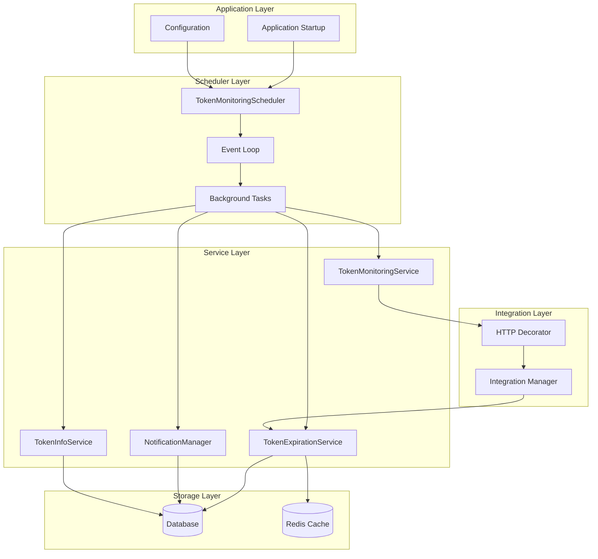
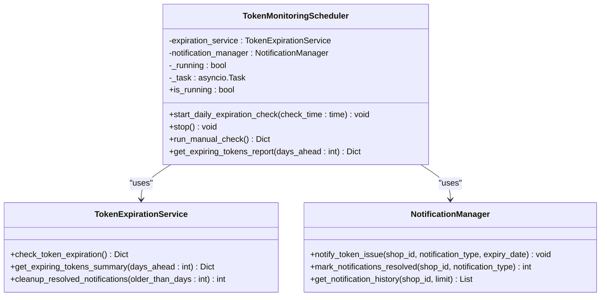
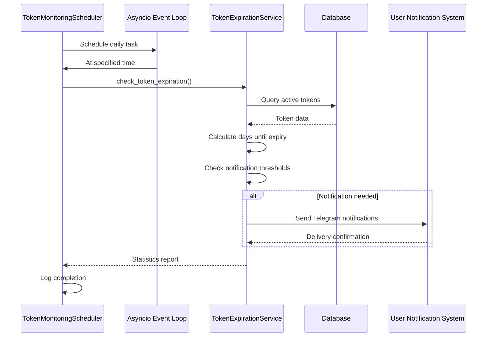
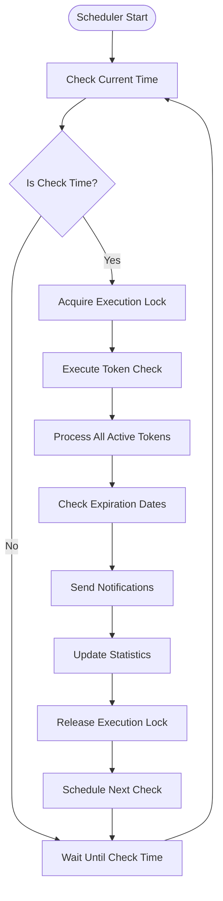
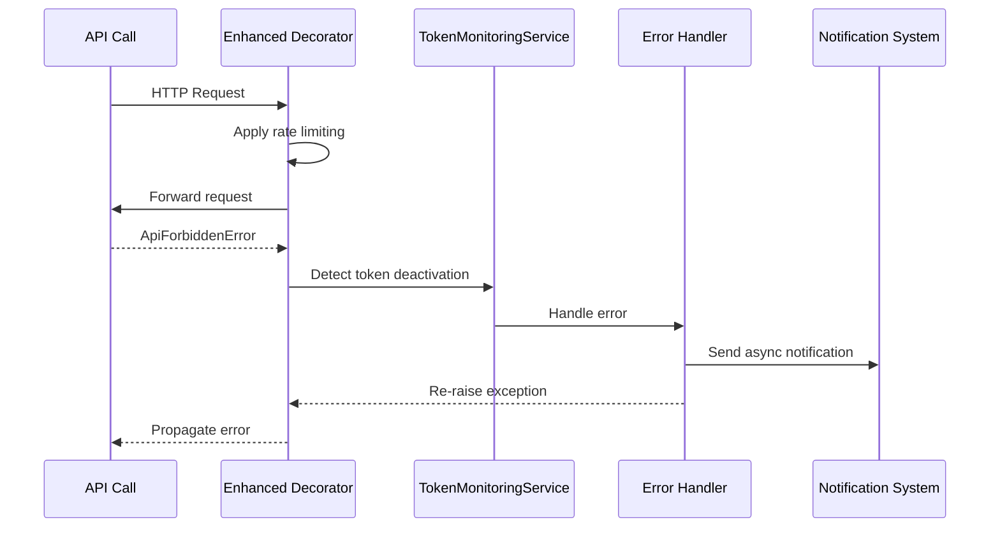
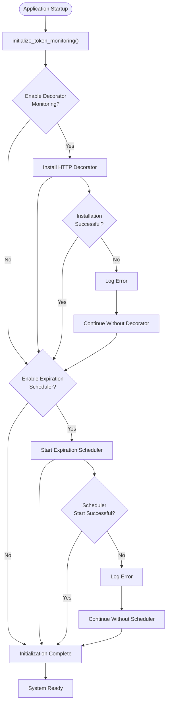
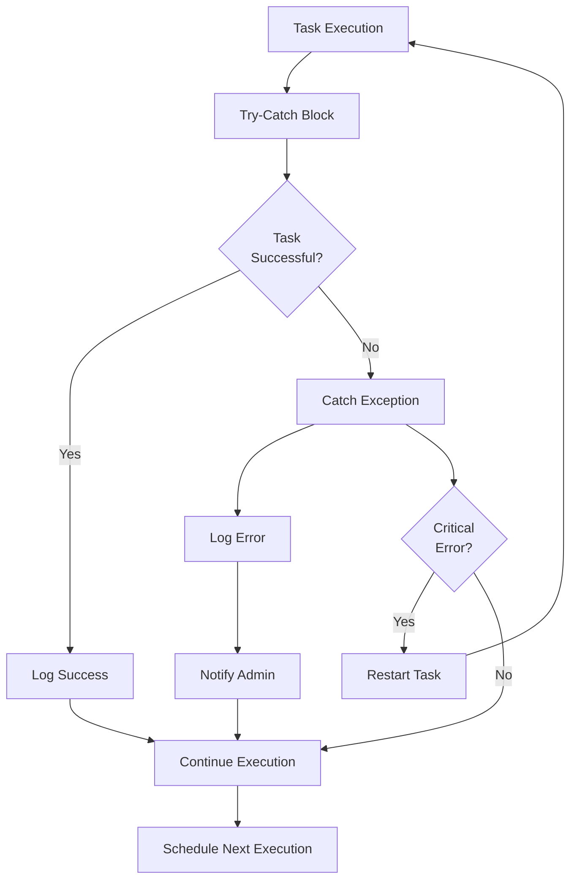

# Scheduling Mechanisms

<cite>
**Referenced Files in This Document**
- [scheduler.py](file://app/modules/token_monitoring/scheduler.py)
- [token_monitoring_service.py](file://app/modules/token_monitoring/services/token_monitoring_service.py)
- [startup.py](file://app/modules/token_monitoring/startup.py)
- [integration.py](file://app/modules/token_monitoring/integration.py)
- [notification_manager.py](file://app/modules/token_monitoring/services/notification_manager.py)
- [token_expiration_service.py](file://app/modules/token_monitoring/services/token_expiration_service.py)
- [token_info_service.py](file://app/modules/token_monitoring/services/token_info_service.py)
- [models.py](file://app/modules/token_monitoring/models.py)
- [__init__.py](file://app/modules/token_monitoring/__init__.py)
- [README.md](file://app/modules/token_monitoring/README.md)
</cite>

## Table of Contents
1. [Introduction](#introduction)
2. [System Architecture](#system-architecture)
3. [Core Components](#core-components)
4. [Scheduler Implementation](#scheduler-implementation)
5. [Task Registration and Execution](#task-registration-and-execution)
6. [Startup Initialization](#startup-initialization)
7. [Configuration Management](#configuration-management)
8. [Error Handling and Resilience](#error-handling-and-resilience)
9. [Monitoring and Observability](#monitoring-and-observability)
10. [Adding New Scheduled Tasks](#adding-new-scheduled-tasks)
11. [Best Practices](#best-practices)
12. [Troubleshooting Guide](#troubleshooting-guide)

## Introduction

The token monitoring system implements a sophisticated scheduling infrastructure designed to handle periodic background tasks for Wildberries advertising bot operations. This system provides real-time token status monitoring, automatic deactivation detection, and proactive expiration notifications through a robust asyncio-based scheduler.

The scheduling mechanism is built around three core principles:
- **Reliability**: Ensures tasks run consistently without interference
- **Scalability**: Handles multiple shops and concurrent operations
- **Observability**: Provides comprehensive logging and monitoring capabilities

## System Architecture

The scheduling infrastructure follows a layered architecture with clear separation of concerns:



**Diagram sources**
- [scheduler.py](file://app/modules/token_monitoring/scheduler.py#L1-L175)
- [startup.py](file://app/modules/token_monitoring/startup.py#L1-L120)
- [integration.py](file://app/modules/token_monitoring/integration.py#L1-L112)

## Core Components

### TokenMonitoringScheduler

The central scheduler component manages all periodic token monitoring tasks:



**Diagram sources**
- [scheduler.py](file://app/modules/token_monitoring/scheduler.py#L13-L175)
- [token_expiration_service.py](file://app/modules/token_monitoring/services/token_expiration_service.py#L1-L314)
- [notification_manager.py](file://app/modules/token_monitoring/services/notification_manager.py#L1-L336)

### Global Singleton Pattern

The scheduler implements a global singleton pattern to ensure consistent state across the application:

```python
# Global scheduler instance
_scheduler_instance = None

def get_token_monitoring_scheduler() -> TokenMonitoringScheduler:
    """Get or create the global token monitoring scheduler instance."""
    global _scheduler_instance
    if _scheduler_instance is None:
        _scheduler_instance = TokenMonitoringScheduler()
    return _scheduler_instance
```

**Section sources**
- [scheduler.py](file://app/modules/token_monitoring/scheduler.py#L133-L175)

## Scheduler Implementation

### Daily Expiration Check

The scheduler implements a sophisticated daily expiration monitoring system:



**Diagram sources**
- [scheduler.py](file://app/modules/token_monitoring/scheduler.py#L40-L132)
- [token_expiration_service.py](file://app/modules/token_monitoring/services/token_expiration_service.py#L40-L150)

### Task Execution Lifecycle

The scheduler manages task execution through a well-defined lifecycle:



**Diagram sources**
- [scheduler.py](file://app/modules/token_monitoring/scheduler.py#L40-L132)

**Section sources**
- [scheduler.py](file://app/modules/token_monitoring/scheduler.py#L40-L132)

## Task Registration and Execution

### HTTP Decorator Integration

The system integrates seamlessly with existing HTTP request decorators to monitor token deactivation:



**Diagram sources**
- [token_monitoring_service.py](file://app/modules/token_monitoring/services/token_monitoring_service.py#L40-L120)

### Dynamic Task Registration

Tasks are dynamically registered through the integration layer:

```python
def wrap_try_except_decorator(self, original_decorator: Callable) -> Callable:
    """
    Wrap the existing try_except_decorator to add token monitoring capabilities.
    
    This method preserves the original decorator functionality while adding
    token deactivation detection and notification capabilities.
    """
    self._original_decorator = original_decorator
    
    def enhanced_try_except_decorator(
        requests_per_interval: int,
        interval_seconds: int | float,
        max_attempts: int = 50,
        max_delay: int = 120,
    ) -> Callable:
        """Enhanced decorator that monitors for token deactivation."""
        
        def decorator(func: Callable) -> Callable:
            # First apply the original decorator
            original_decorated_func = original_decorator(
                requests_per_interval, 
                interval_seconds, 
                max_attempts, 
                max_delay
            )(func)
            
            async def monitoring_wrapper(instance: Any, *args: Any, **kwargs: Any) -> Any:
                """Wrapper that adds token monitoring around the original decorated function."""
                try:
                    # Call the original decorated function
                    result = await original_decorated_func(instance, *args, **kwargs)
                    return result
                    
                except ApiForbiddenError as e:
                    # Token deactivation detected - all tokens have failed
                    shop_id = getattr(instance, 'shop_id', None)
                    
                    if shop_id:
                        logger.warning(
                            f"Token deactivation detected for shop {shop_id} "
                            f"during {func.__name__} call: {e}"
                        )
                        
                        # Send notification asynchronously (don't block the main flow)
                        asyncio.create_task(
                            self._handle_token_deactivation(shop_id, func.__name__, str(e))
                        )
                    else:
                        logger.warning(
                            f"Token deactivation detected but no shop_id available "
                            f"during {func.__name__} call: {e}"
                        )
                    
                    # Re-raise the exception to maintain existing behavior
                    raise
                
            return monitoring_wrapper
        
        return decorator
    
    return enhanced_try_except_decorator
```

**Section sources**
- [token_monitoring_service.py](file://app/modules/token_monitoring/services/token_monitoring_service.py#L40-L120)

## Startup Initialization

### Comprehensive System Initialization

The startup module orchestrates the complete initialization sequence:



**Diagram sources**
- [startup.py](file://app/modules/token_monitoring/startup.py#L15-L50)

### Graceful Shutdown

The system provides graceful shutdown capabilities:

```python
async def shutdown_token_monitoring() -> None:
    """Shutdown the token monitoring system gracefully."""
    logger.info("Shutting down token monitoring system...")
    
    try:
        # Stop the scheduler
        from app.modules.token_monitoring.scheduler import stop_token_monitoring_scheduler
        await stop_token_monitoring_scheduler()
        logger.info("✓ Token expiration scheduler stopped")
        
        # Uninstall decorator monitoring
        from app.modules.token_monitoring.integration import uninstall_token_monitoring
        uninstall_token_monitoring()
        logger.info("✓ Token deactivation monitoring uninstalled")
        
        logger.info("Token monitoring system shutdown completed")
        
    except Exception as e:
        logger.error(f"Error during token monitoring shutdown: {e}")
```

**Section sources**
- [startup.py](file://app/modules/token_monitoring/startup.py#L52-L75)

## Configuration Management

### Cron-like Schedule Configuration

The scheduler supports flexible time-based configuration:

```python
async def start_token_monitoring_scheduler(check_time: time = time(9, 0)) -> None:
    """Start the global token monitoring scheduler."""
    scheduler = get_token_monitoring_scheduler()
    await scheduler.start_daily_expiration_check(check_time)
```

### Dynamic Rescheduling

The system supports runtime configuration changes:

```python
class TokenMonitoringScheduler:
    async def start_daily_expiration_check(self, check_time: time = time(9, 0)) -> None:
        """
        Start daily token expiration checking at specified time.
        
        Args:
            check_time: Time of day to run daily expiration checks
        """
        if self._running:
            logger.warning("Token monitoring scheduler is already running")
            return
            
        self._running = True
        
        # Calculate initial delay until next check time
        now = datetime.now()
        next_check = datetime.combine(now.date(), check_time)
        if next_check <= now:
            next_check = next_check + timedelta(days=1)
            
        delay = (next_check - now).total_seconds()
        
        # Start the background task
        self._task = asyncio.create_task(self._daily_check_loop(delay))
        
        logger.info(f"Token monitoring scheduler started, next check at {next_check}")
```

**Section sources**
- [scheduler.py](file://app/modules/token_monitoring/scheduler.py#L40-L60)

## Error Handling and Resilience

### Overlapping Execution Prevention

The scheduler implements robust mechanisms to prevent overlapping executions:

```python
async def start_daily_expiration_check(self, check_time: time = time(9, 0)) -> None:
    """Start daily token expiration checking at specified time."""
    if self._running:
        logger.warning("Token monitoring scheduler is already running")
        return
        
    self._running = True
    # ... rest of implementation
```

### Exception Handling Strategies

The system employs multiple layers of exception handling:



**Diagram sources**
- [token_expiration_service.py](file://app/modules/token_monitoring/services/token_expiration_service.py#L40-L150)

### Database Transaction Management

The system ensures data consistency through proper transaction management:

```python
async def notify_token_issue(
    self, 
    shop_id: str, 
    notification_type: str, 
    expiry_date: Optional[datetime.datetime] = None,
    context: Optional[Dict[str, Any]] = None
) -> None:
    """
    Send token issue notification to all users of a shop.
    
    Args:
        shop_id: The shop ID where token issue occurred
        notification_type: Type of notification (from NotificationType enum)
        expiry_date: Token expiration date (for expiration notifications)
        context: Additional context information
    """
    try:
        async with self.session_maker(read_only=False) as session:
            # Get all users for this shop
            shop_users = await self._get_shop_users(session, shop_id)
            
            if not shop_users:
                logger.warning(f"No users found for shop {shop_id}")
                return
            
            # ... notification logic ...
            
            await session.commit()
            
            logger.info(
                f"Sent {notifications_sent} notifications for shop {shop_id}, "
                f"type: {notification_type}"
            )
            
    except Exception as e:
        logger.error(
            f"Failed to send notifications for shop {shop_id}, "
            f"type {notification_type}: {e}",
            exc_info=True
        )
```

**Section sources**
- [notification_manager.py](file://app/modules/token_monitoring/services/notification_manager.py#L60-L120)

## Monitoring and Observability

### Built-in Statistics

The scheduler provides comprehensive statistics reporting:

```python
async def check_token_expiration(self) -> Dict[str, Any]:
    """
    Check all tokens for expiration and send appropriate notifications.
    
    Returns:
        Dictionary with statistics about the expiration check
    """
    logger.info("Starting token expiration check")
    
    stats = {
        "total_tokens_checked": 0,
        "expiring_tokens_found": 0,
        "notifications_sent": 0,
        "notifications_skipped": 0,
        "errors": 0,
        "warnings_by_stage": {14: 0, 3: 0, 1: 0}
    }
    
    try:
        async with self.session_maker() as session:
            # ... token processing logic ...
            
            logger.info(f"Token expiration check completed: {stats}")
            return stats
            
    except Exception as e:
        logger.error(f"Failed to check token expiration: {e}", exc_info=True)
        stats["errors"] += 1
        return stats
```

### Logging and Debugging

The system provides extensive logging capabilities:

```python
# Configure logging level
logging.getLogger('app.modules.token_monitoring').setLevel(logging.INFO)

# Log levels:
# INFO: Successful operations, statistics
# WARNING: Token issues, expiring tokens  
# ERROR: System errors, notification failures
# DEBUG: Detailed operation traces
```

**Section sources**
- [token_expiration_service.py](file://app/modules/token_monitoring/services/token_expiration_service.py#L40-L80)

## Adding New Scheduled Tasks

### Creating Custom Scheduled Tasks

To add new scheduled tasks to the system:

1. **Define the Task Function**:
```python
async def custom_token_task():
    """Custom task for processing token-related operations."""
    logger.info("Executing custom token task")
    # Task implementation here
```

2. **Register with Scheduler**:
```python
from app.modules.token_monitoring.scheduler import get_token_monitoring_scheduler

async def register_custom_task():
    """Register custom task with scheduler."""
    scheduler = get_token_monitoring_scheduler()
    
    # Add task to scheduler
    scheduler.register_task(custom_token_task, "custom_task", interval_minutes=60)
```

3. **Configure Task Execution**:
```python
# Start scheduler with custom tasks
await scheduler.start_daily_expiration_check(time(9, 0))

# Manual execution
stats = await scheduler.run_manual_check()
```

### Best Practices for Task Development

When developing new scheduled tasks:

1. **Non-blocking Operations**: Use async/await for all I/O operations
2. **Error Handling**: Implement comprehensive exception handling
3. **Resource Cleanup**: Properly manage database connections and external resources
4. **Logging**: Include detailed logging for monitoring and debugging
5. **Testing**: Write unit tests for task functionality

## Best Practices

### Task Design Principles

1. **Idempotent Operations**: Tasks should be safe to run multiple times
2. **Minimal Dependencies**: Reduce inter-task dependencies
3. **Resource Efficiency**: Optimize resource usage and minimize memory footprint
4. **Graceful Degradation**: Handle partial failures gracefully

### Configuration Guidelines

1. **Flexible Timing**: Allow configurable execution intervals
2. **Environment Variables**: Use environment variables for sensitive configuration
3. **Default Values**: Provide sensible defaults for all configuration options
4. **Validation**: Validate configuration parameters at startup

### Monitoring Recommendations

1. **Health Checks**: Implement regular health checks for all components
2. **Metrics Collection**: Track key performance indicators
3. **Alerting**: Set up alerts for critical failures
4. **Audit Trails**: Maintain comprehensive audit logs

## Troubleshooting Guide

### Common Issues and Solutions

#### Scheduler Not Starting

**Symptoms**: Scheduler appears to be inactive, no scheduled tasks are running

**Diagnosis**:
```python
# Check scheduler status
from app.modules.token_monitoring.scheduler import get_token_monitoring_scheduler
scheduler = get_token_monitoring_scheduler()
print(f"Scheduler running: {scheduler.is_running}")

# Check logs for startup errors
import logging
logging.getLogger('app.modules.token_monitoring').setLevel(logging.DEBUG)
```

**Solutions**:
1. Verify scheduler initialization in startup sequence
2. Check for conflicting scheduler instances
3. Ensure proper event loop configuration

#### Duplicate Notifications

**Symptoms**: Users receive multiple notifications for the same token issue

**Diagnosis**:
```python
# Check notification database entries
from app.modules.token_monitoring.services.notification_manager import NotificationManager
manager = NotificationManager()
history = await manager.get_notification_history("shop_id", limit=10)
print(f"Recent notifications: {len(history)}")
```

**Solutions**:
1. Verify unique constraint on notification tracker table
2. Check for database connection issues
3. Review notification deduplication logic

#### Memory Leaks

**Symptoms**: Increasing memory usage over time, scheduler becomes unresponsive

**Diagnosis**:
```python
# Monitor task creation and cleanup
import asyncio
tasks = asyncio.all_tasks()
print(f"Active tasks: {len(tasks)}")

# Check for lingering database connections
# Review task cancellation and resource cleanup
```

**Solutions**:
1. Implement proper task cancellation
2. Close database connections after use
3. Limit concurrent task execution
4. Monitor memory usage regularly

### Debug Mode

Enable detailed logging for troubleshooting:

```python
import logging

# Enable debug logging
logging.getLogger('app.modules.token_monitoring').setLevel(logging.DEBUG)

# Configure specific components
logging.getLogger('app.modules.token_monitoring.scheduler').setLevel(logging.DEBUG)
logging.getLogger('app.modules.token_monitoring.services').setLevel(logging.DEBUG)
```

### Health Checks

Implement system health monitoring:

```python
async def health_check():
    """Perform comprehensive system health check."""
    try:
        # Check scheduler status
        scheduler = get_token_monitoring_scheduler()
        if not scheduler.is_running:
            return {"status": "error", "message": "Scheduler not running"}
        
        # Check database connectivity
        from app.utils.db.session_maker import get_async_session_maker
        async with get_async_session_maker()() as session:
            await session.execute("SELECT 1")
        
        # Check notification system
        manager = NotificationManager()
        # Test notification delivery
        
        return {"status": "healthy"}
        
    except Exception as e:
        return {"status": "error", "message": str(e)}
```

**Section sources**
- [scheduler.py](file://app/modules/token_monitoring/scheduler.py#L133-L175)
- [startup.py](file://app/modules/token_monitoring/startup.py#L15-L120)