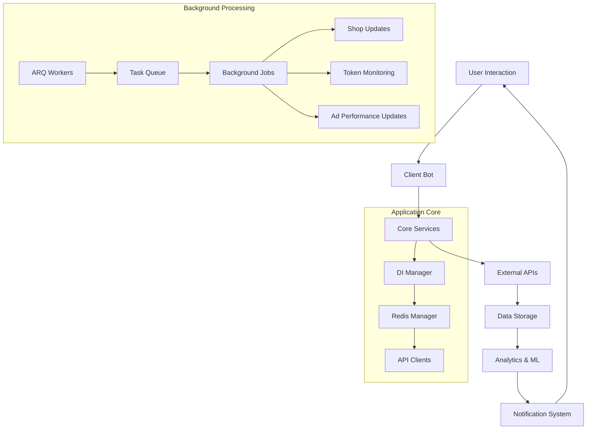
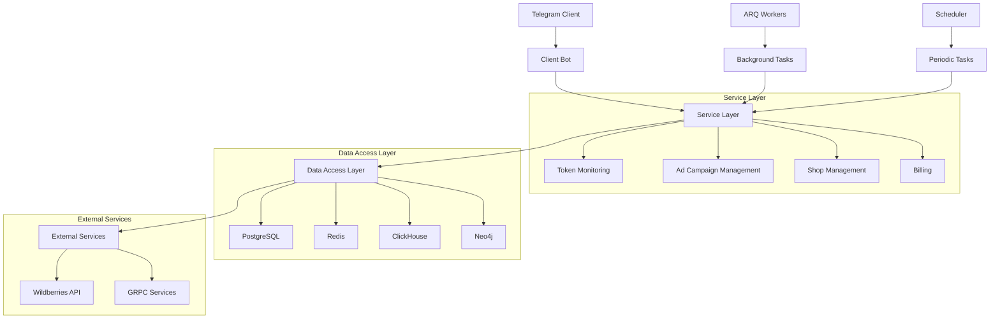
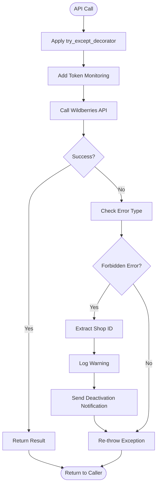
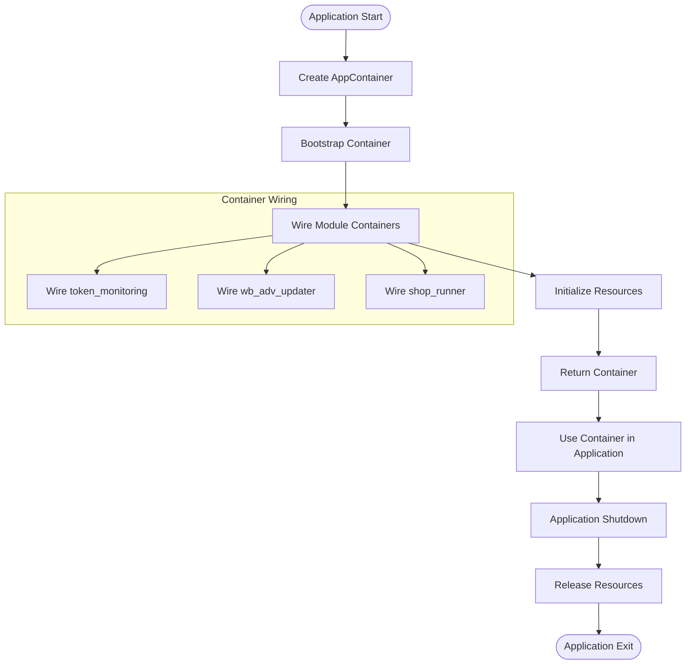
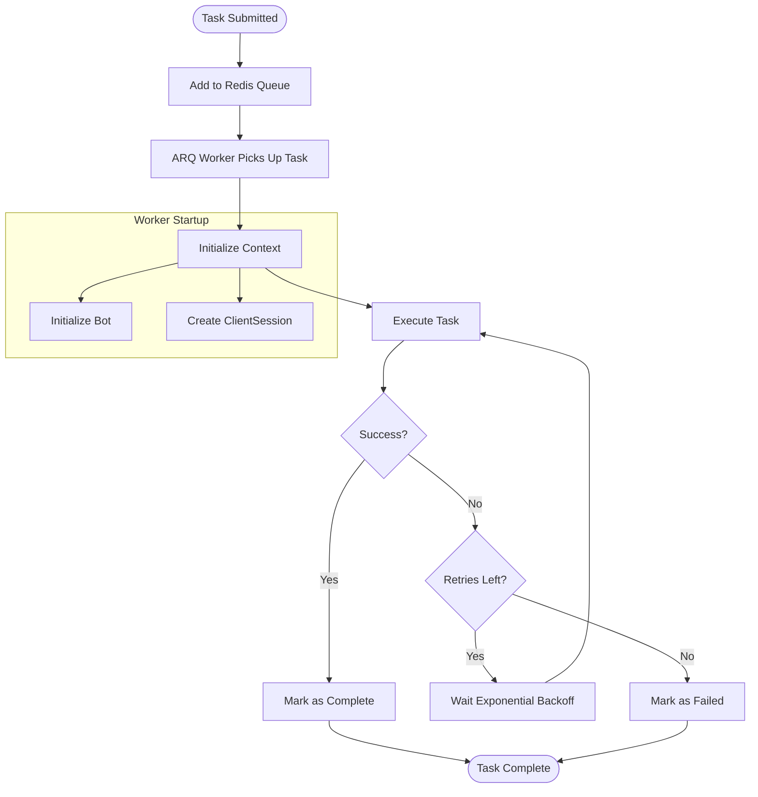
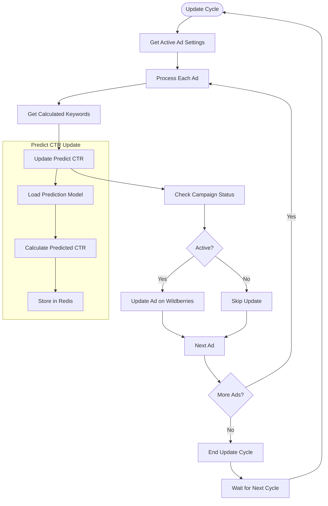
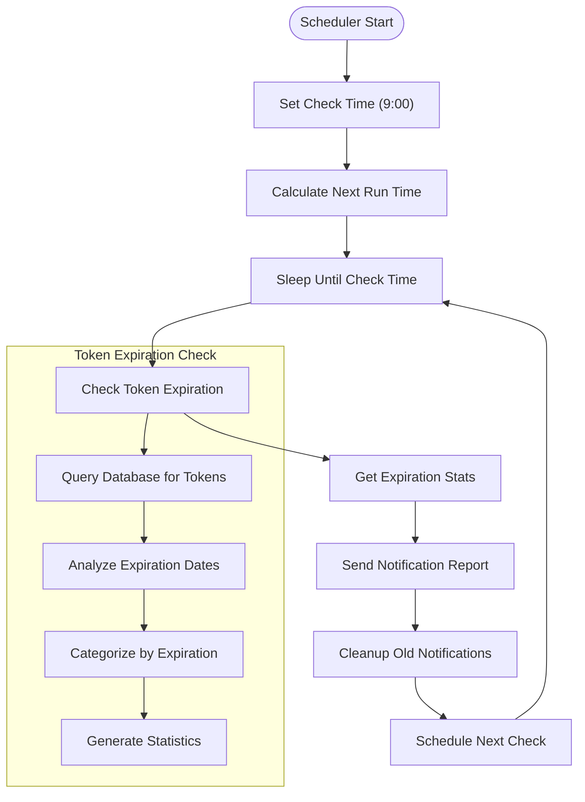
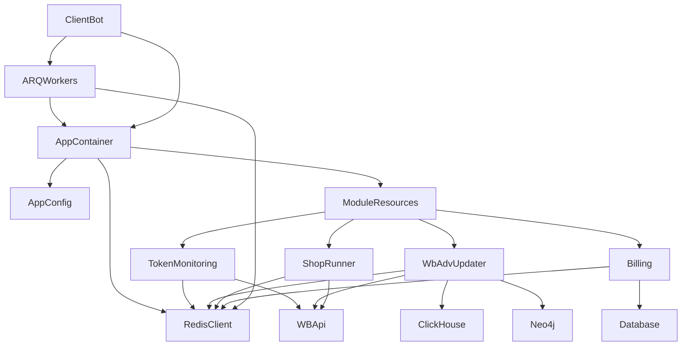

# Data Flow Diagrams

<cite>
**Referenced Files in This Document**   
- [token_monitoring_service.py](file://app/modules/token_monitoring/services/token_monitoring_service.py)
- [wb_manager.py](file://app/modules/wb_adv_updater/wb_manager.py)
- [workers.py](file://app/arq_workers/workers.py)
- [app_container.py](file://app/core/di/app_container.py)
- [di_manager.py](file://app/core/di/di_manager.py)
- [scheduler.py](file://app/modules/token_monitoring/scheduler.py)
- [data_manager.py](file://app/modules/wb_adv_updater/data_manager.py)
- [runner.py](file://app/modules/wb_adv_updater/runner.py)
- [ml_data_manager.py](file://app/modules/wb_adv_updater/ml_data_manager.py)
</cite>

## Table of Contents
1. [Introduction](#introduction)
2. [Project Structure](#project-structure)
3. [Core Components](#core-components)
4. [Architecture Overview](#architecture-overview)
5. [Detailed Component Analysis](#detailed-component-analysis)
6. [Dependency Analysis](#dependency-analysis)
7. [Performance Considerations](#performance-considerations)
8. [Troubleshooting Guide](#troubleshooting-guide)
9. [Conclusion](#conclusion)

## Introduction
This document provides comprehensive data flow documentation for the adv-bot system, mapping the complete data lifecycle from user interaction to external API synchronization. It covers both synchronous flows (user command → bot handler → service → response) and asynchronous flows (scheduled token monitoring, keyword parsing jobs, ad performance updates). The documentation illustrates how DIManager orchestrates service initialization and how ARQ workers process background tasks, showing data transformation at each stage with examples from token_monitoring_service and wb_adv_updater. Error recovery paths and retry mechanisms are included, along with timing diagrams for critical operations like shop update cycles and prediction model updates.

## Project Structure

The adv-bot system follows a modular architecture with clear separation of concerns. The core application resides in the `app` directory, which contains several key subdirectories:

- `arq_workers`: Contains ARQ worker configurations for background task processing
- `client_bot`: Implements the Telegram bot interface and user interaction handlers
- `core`: Houses core infrastructure including dependency injection (DI), Redis management, and API clients
- `modules`: Contains business logic modules such as token monitoring, ad updating, and shop management
- `configs`: Configuration management for the application
- `utils`: Utility functions and shared components

The system uses Alembic for database migrations, with migration scripts in the `alembic/versions` directory. External service integrations include Redis for caching and message queuing, Neo4j for graph data storage, and ClickHouse for analytics data.

**Diagram sources**
- [app_container.py](file://app/core/di/app_container.py)
- [workers.py](file://app/arq_workers/workers.py)

**Section sources**
- [app_container.py](file://app/core/di/app_container.py)
- [workers.py](file://app/arq_workers/workers.py)

## Core Components

The adv-bot system consists of several core components that work together to manage advertising campaigns on Wildberries. The key components include:

1. **Token Monitoring Service**: Monitors API token status and handles deactivation events
2. **WB Advertiser Updater**: Manages ad campaign updates and performance tracking
3. **ARQ Workers**: Processes background tasks using Redis as a message broker
4. **DI Manager**: Orchestrates dependency injection and service initialization
5. **Scheduler**: Manages periodic tasks and maintenance operations

These components work together to provide a robust system for managing advertising campaigns, with comprehensive error handling and recovery mechanisms.

**Section sources**
- [token_monitoring_service.py](file://app/modules/token_monitoring/services/token_monitoring_service.py)
- [wb_manager.py](file://app/modules/wb_adv_updater/wb_manager.py)
- [di_manager.py](file://app/core/di/di_manager.py)

## Architecture Overview

The adv-bot system follows a layered architecture with clear separation between presentation, business logic, and data access layers. The system uses dependency injection to manage service dependencies and configuration.

**Diagram sources**
- [app_container.py](file://app/core/di/app_container.py)
- [di_manager.py](file://app/core/di/di_manager.py)
- [workers.py](file://app/arq_workers/workers.py)

## Detailed Component Analysis

### Token Monitoring Service Analysis

The Token Monitoring Service is responsible for detecting and handling token deactivation events during API calls to Wildberries. It wraps existing API decorators to add token monitoring capabilities without modifying the core API client code.

**Diagram sources**
- [token_monitoring_service.py](file://app/modules/token_monitoring/services/token_monitoring_service.py)

**Section sources**
- [token_monitoring_service.py](file://app/modules/token_monitoring/services/token_monitoring_service.py)

### DI Manager Analysis

The DI Manager orchestrates service initialization and dependency injection throughout the application. It uses the Dependency Injector library to manage service lifecycles and configuration.

**Diagram sources**
- [di_manager.py](file://app/core/di/di_manager.py)
- [app_container.py](file://app/core/di/app_container.py)

**Section sources**
- [di_manager.py](file://app/core/di/di_manager.py)
- [app_container.py](file://app/core/di/app_container.py)

### ARQ Workers Analysis

The ARQ Workers process background tasks using Redis as a message broker. The system uses a worker pattern to handle long-running operations asynchronously.

**Diagram sources**
- [workers.py](file://app/arq_workers/workers.py)

**Section sources**
- [workers.py](file://app/arq_workers/workers.py)

### WB Advertiser Updater Analysis

The WB Advertiser Updater manages the lifecycle of advertising campaigns, including keyword updates, performance tracking, and predictive analytics.

**Diagram sources**
- [wb_manager.py](file://app/modules/wb_adv_updater/wb_manager.py)
- [data_manager.py](file://app/modules/wb_adv_updater/data_manager.py)
- [ml_data_manager.py](file://app/modules/wb_adv_updater/ml_data_manager.py)

**Section sources**
- [wb_manager.py](file://app/modules/wb_adv_updater/wb_manager.py)
- [data_manager.py](file://app/modules/wb_adv_updater/data_manager.py)
- [ml_data_manager.py](file://app/modules/wb_adv_updater/ml_data_manager.py)

### Token Monitoring Scheduler Analysis

The Token Monitoring Scheduler manages periodic tasks related to token expiration and health checks.

**Diagram sources**
- [scheduler.py](file://app/modules/token_monitoring/scheduler.py)

**Section sources**
- [scheduler.py](file://app/modules/token_monitoring/scheduler.py)

## Dependency Analysis

The adv-bot system has a well-defined dependency structure with clear boundaries between components. The core dependencies are managed through the DI container, which provides services to various modules.

**Diagram sources**
- [app_container.py](file://app/core/di/app_container.py)
- [di_manager.py](file://app/core/di/di_manager.py)

**Section sources**
- [app_container.py](file://app/core/di/app_container.py)
- [di_manager.py](file://app/core/di/di_manager.py)

## Performance Considerations

The adv-bot system is designed with performance in mind, using several optimization techniques:

1. **Caching**: Extensive use of Redis for caching frequently accessed data
2. **Batch Processing**: Operations are batched to minimize API calls
3. **Asynchronous Processing**: Long-running tasks are handled asynchronously
4. **Connection Pooling**: Database and API connections are pooled
5. **Exponential Backoff**: Retry mechanisms use exponential backoff to avoid overwhelming services

The system also includes monitoring and logging to track performance metrics and identify bottlenecks. Critical operations are timed and logged for performance analysis.

## Troubleshooting Guide

When troubleshooting issues with the adv-bot system, consider the following common scenarios:

1. **Token Deactivation**: If API calls are failing with 403 errors, check the token monitoring logs and verify that tokens are still valid.

2. **Background Task Failures**: Check the ARQ worker logs for failed tasks and examine the retry mechanisms.

3. **Performance Issues**: Monitor Redis memory usage and database query performance. Consider scaling resources if needed.

4. **Dependency Injection Problems**: Verify that all required services are properly wired in the DI container.

5. **Configuration Issues**: Ensure that all environment variables and configuration files are correctly set.

The system includes comprehensive logging that can help diagnose issues. Logs are structured to include timestamps, component names, and relevant context information.

**Section sources**
- [token_monitoring_service.py](file://app/modules/token_monitoring/services/token_monitoring_service.py)
- [workers.py](file://app/arq_workers/workers.py)
- [di_manager.py](file://app/core/di/di_manager.py)

## Conclusion

The adv-bot system provides a comprehensive solution for managing advertising campaigns on Wildberries. Its modular architecture with clear separation of concerns makes it maintainable and extensible. The use of dependency injection, asynchronous processing, and comprehensive error handling ensures reliability and performance.

Key strengths of the system include:
- Robust token monitoring and recovery mechanisms
- Efficient background task processing with ARQ workers
- Comprehensive data flow from user interaction to external API synchronization
- Well-structured dependency management through DI
- Detailed logging and monitoring for troubleshooting

The system is well-positioned to handle current requirements and can be extended to support additional features as needed.