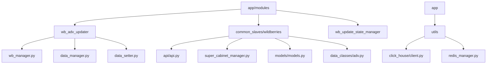
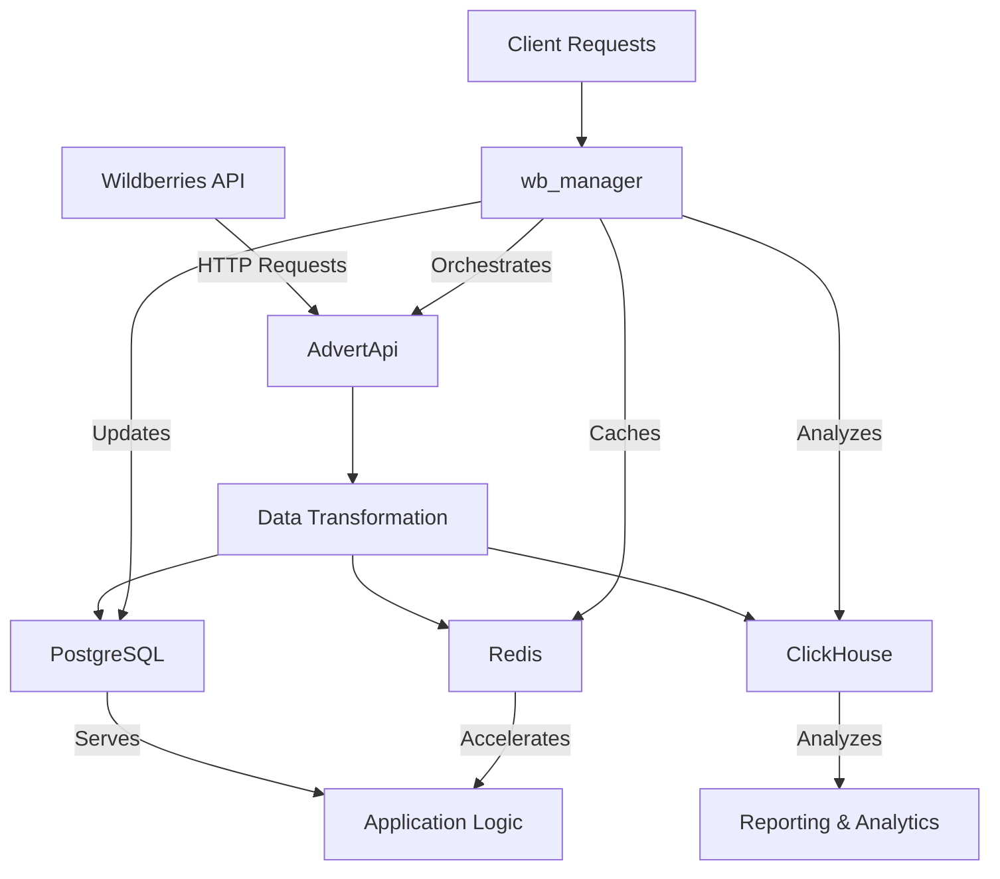
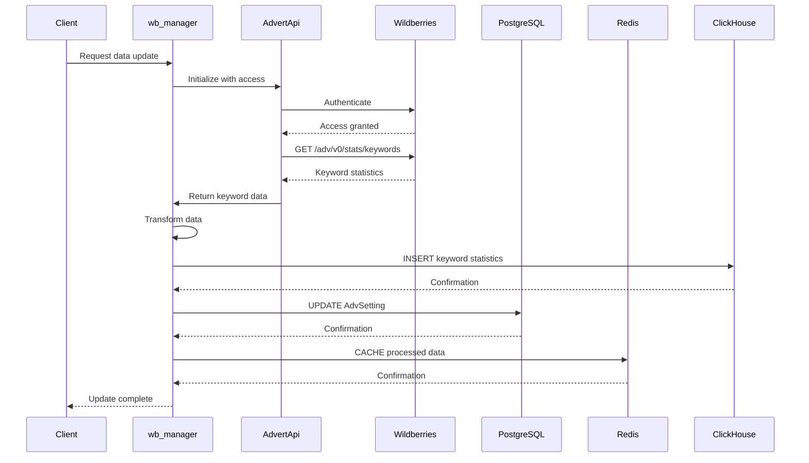
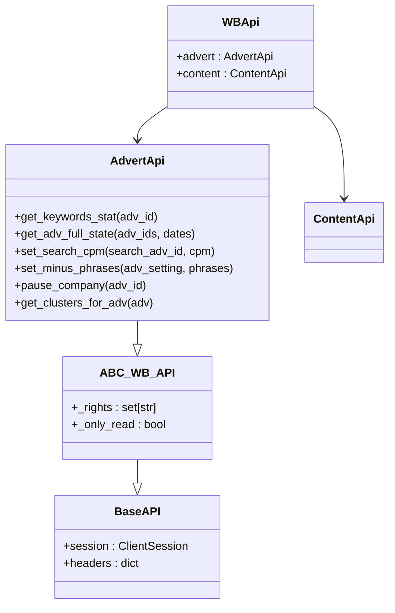
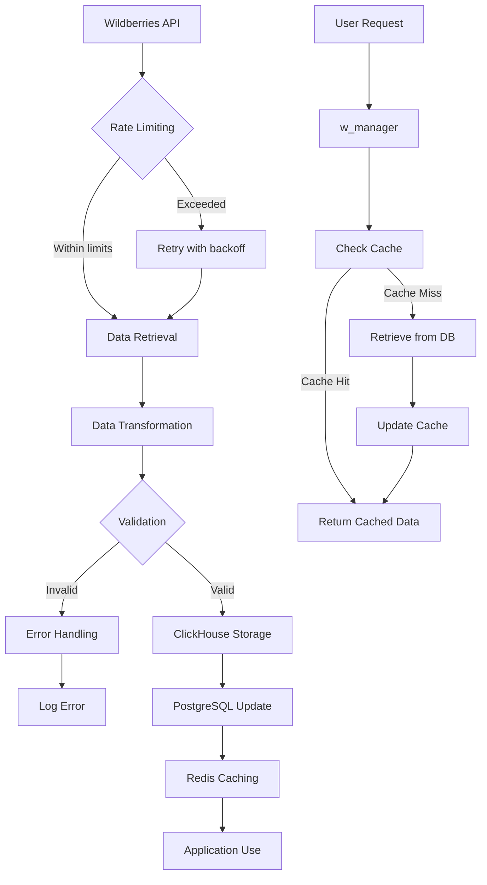
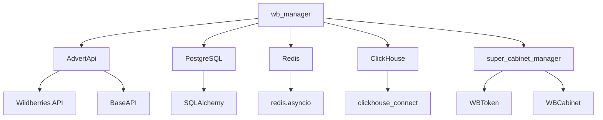

# Advertising Data Synchronization

<cite>
**Referenced Files in This Document**   
- [wb_manager.py](file://app/modules/wb_adv_updater/wb_manager.py)
- [api.py](file://app/modules/common_slaves/wildberries/api/api.py)
- [adv.py](file://app/modules/common_slaves/wildberries/data_classes/adv.py)
- [models.py](file://app/modules/common_slaves/wildberries/models/models.py)
- [client.py](file://app/utils/click_house/client.py)
- [super_cabinet_manager.py](file://app/modules/common_slaves/wildberries/super_cabinet_manager.py)
- [data_manager.py](file://app/modules/wb_adv_updater/data_manager.py)
</cite>

## Table of Contents
1. [Introduction](#introduction)
2. [Project Structure](#project-structure)
3. [Core Components](#core-components)
4. [Architecture Overview](#architecture-overview)
5. [Detailed Component Analysis](#detailed-component-analysis)
6. [Dependency Analysis](#dependency-analysis)
7. [Performance Considerations](#performance-considerations)
8. [Troubleshooting Guide](#troubleshooting-guide)
9. [Conclusion](#conclusion)

## Introduction
The advertising data synchronization system in the adv-bot application enables bidirectional data flow between the internal system and Wildberries advertising API. This document details the workflow for retrieving advertising campaign data (CPM, bids, status) from Wildberries, transforming it for internal use, and updating local databases (PostgreSQL, Redis, ClickHouse). The system orchestrates ad data updates through the wb_manager component, implements robust error handling for failed API calls, and ensures reliable communication with Wildberries advertising endpoints through the AdvertApi implementation. The workflow incorporates rate limiting, caching strategies, and data consistency patterns to maintain system reliability and performance.

## Project Structure
The advertising data synchronization functionality is organized across multiple modules within the adv-bot application. The core components are distributed across the following directory structure:

**Diagram sources**
- [wb_manager.py](file://app/modules/wb_adv_updater/wb_manager.py)
- [api.py](file://app/modules/common_slaves/wildberries/api/api.py)

**Section sources**
- [wb_manager.py](file://app/modules/wb_adv_updater/wb_manager.py)
- [api.py](file://app/modules/common_slaves/wildberries/api/api.py)

## Core Components
The advertising data synchronization workflow consists of several core components that work together to retrieve, transform, and store advertising data. The wb_manager orchestrates the entire process, coordinating between the Wildberries API client, data transformation logic, and database operations. The AdvertApi implementation provides a reliable interface for communicating with Wildberries advertising endpoints, handling authentication, rate limiting, and error recovery. Data is stored in multiple databases: PostgreSQL for relational data, Redis for caching and temporary storage, and ClickHouse for analytical data.

**Section sources**
- [wb_manager.py](file://app/modules/wb_adv_updater/wb_manager.py)
- [api.py](file://app/modules/common_slaves/wildberries/api/api.py)

## Architecture Overview
The advertising data synchronization architecture follows a layered approach with clear separation of concerns. The system retrieves data from Wildberries API, processes it through transformation layers, and stores it in multiple databases for different use cases.

**Diagram sources**
- [wb_manager.py](file://app/modules/wb_adv_updater/wb_manager.py)
- [api.py](file://app/modules/common_slaves/wildberries/api/api.py)

## Detailed Component Analysis

### wb_manager Analysis
The wb_manager component serves as the central orchestrator for advertising data synchronization. It coordinates the retrieval of advertising data from Wildberries, processes the data, and updates internal databases.

**Diagram sources**
- [wb_manager.py](file://app/modules/wb_adv_updater/wb_manager.py)
- [api.py](file://app/modules/common_slaves/wildberries/api/api.py)

**Section sources**
- [wb_manager.py](file://app/modules/wb_adv_updater/wb_manager.py)

### AdvertApi Implementation
The AdvertApi implementation provides a reliable interface for communicating with Wildberries advertising endpoints. It handles authentication, rate limiting, and error recovery to ensure stable communication.

**Diagram sources**
- [api.py](file://app/modules/common_slaves/wildberries/api/api.py)

**Section sources**
- [api.py](file://app/modules/common_slaves/wildberries/api/api.py)

### Data Flow Analysis
The data flow for advertising synchronization follows a specific pattern from Wildberries API to internal storage and back.

**Diagram sources**
- [wb_manager.py](file://app/modules/wb_adv_updater/wb_manager.py)
- [api.py](file://app/modules/common_slaves/wildberries/api/api.py)

**Section sources**
- [wb_manager.py](file://app/modules/wb_adv_updater/wb_manager.py)

## Dependency Analysis
The advertising data synchronization components have specific dependencies that enable their functionality. These dependencies include database connections, API clients, and utility modules.

**Diagram sources**
- [wb_manager.py](file://app/modules/wb_adv_updater/wb_manager.py)
- [api.py](file://app/modules/common_slaves/wildberries/api/api.py)
- [models.py](file://app/modules/common_slaves/wildberries/models/models.py)

**Section sources**
- [wb_manager.py](file://app/modules/wb_adv_updater/wb_manager.py)
- [api.py](file://app/modules/common_slaves/wildberries/api/api.py)

## Performance Considerations
The advertising data synchronization system incorporates several performance optimizations to handle large volumes of data efficiently. The ClickHouse client implements connection pooling and multiprocessing synchronization to manage database connections effectively. The system uses Redis for caching frequently accessed data, reducing database load and improving response times. Data retrieval from Wildberries API is batched to minimize the number of HTTP requests, and the system implements rate limiting to prevent API throttling.

**Section sources**
- [client.py](file://app/utils/click_house/client.py)
- [wb_manager.py](file://app/modules/wb_adv_updater/wb_manager.py)

## Troubleshooting Guide
When troubleshooting issues with the advertising data synchronization workflow, consider the following common scenarios:

1. **Authentication failures**: Verify that WBToken records are valid and not expired. Check the token's permissions and shop_id association.
2. **Data retrieval timeouts**: Ensure the system is respecting Wildberries API rate limits. Check network connectivity and API endpoint availability.
3. **Database connection issues**: Verify that PostgreSQL, Redis, and ClickHouse services are running and accessible. Check connection pool settings.
4. **Data consistency problems**: Confirm that data transformation logic is correctly handling edge cases and data type conversions.
5. **Caching issues**: Clear Redis cache if stale data is suspected. Verify cache key generation and expiration settings.

**Section sources**
- [wb_manager.py](file://app/modules/wb_adv_updater/wb_manager.py)
- [api.py](file://app/modules/common_slaves/wildberries/api/api.py)
- [super_cabinet_manager.py](file://app/modules/common_slaves/wildberries/super_cabinet_manager.py)

## Conclusion
The advertising data synchronization workflow in the adv-bot system provides a robust mechanism for integrating with Wildberries advertising API. The architecture, centered around the wb_manager orchestrator and AdvertApi interface, ensures reliable data flow between external and internal systems. By leveraging multiple database technologies (PostgreSQL, Redis, ClickHouse) and implementing proper error handling and rate limiting, the system maintains data consistency and performance under various conditions. The modular design allows for future enhancements and adaptations to changing requirements.