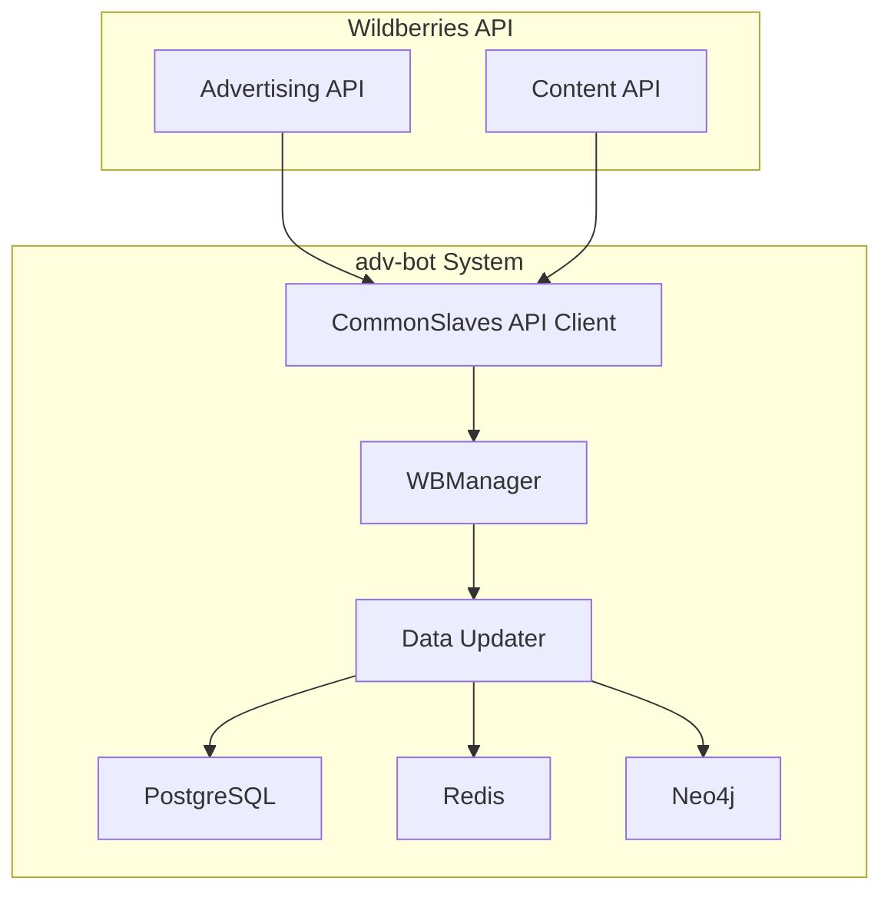
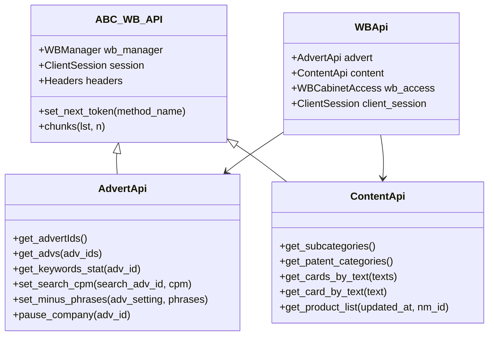
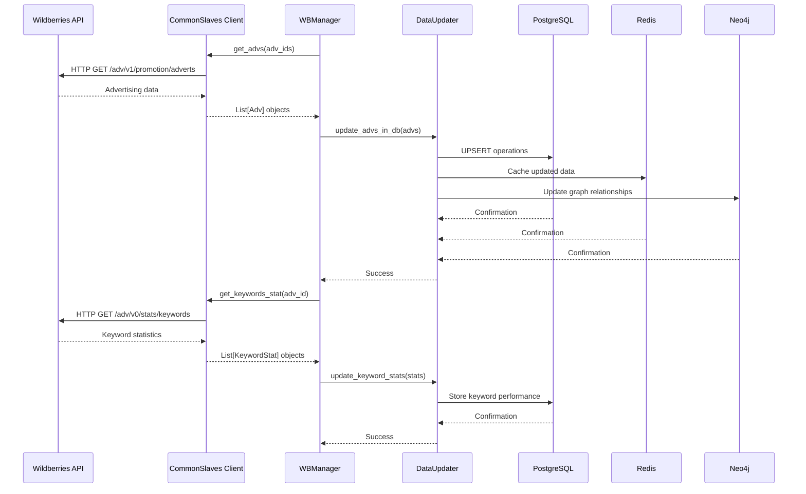

# Data Synchronization Flows

<cite>
**Referenced Files in This Document**   
- [wb_api.py](file://app/modules/common_slaves/wildberries/wb_api.py)
- [manager.py](file://app/modules/common_slaves/wildberries/manager.py)
- [shops_data_updater.py](file://app/modules/common_slaves/wildberries/shops_data_updater.py)
- [super_cabinet_manager.py](file://app/modules/common_slaves/wildberries/super_cabinet_manager.py)
- [http_request.py](file://app/modules/common_slaves/wildberries/http_request.py)
- [wb_db_manager.py](file://app/modules/common_slaves/wildberries/wb_db_manager.py)
- [models.py](file://app/modules/common_slaves/wildberries/models/models.py)
- [data_classes/adv.py](file://app/modules/common_slaves/wildberries/data_classes/adv.py)
- [data_classes/keywordstat.py](file://app/modules/common_slaves/wildberries/data_classes/keywordstat.py)
</cite>

## Table of Contents
1. [Introduction](#introduction)
2. [Data Synchronization Architecture](#data-synchronization-architecture)
3. [WBManager Synchronization Logic](#wbmanager-synchronization-logic)
4. [CommonSlaves API Client Implementation](#commonslaves-api-client-implementation)
5. [Data Flow Workflows](#data-flow-workflows)
6. [Rate Limiting and Error Recovery](#rate-limiting-and-error-recovery)
7. [Caching and Data Consistency](#caching-and-data-consistency)
8. [Synchronization Scenarios](#synchronization-scenarios)
9. [Troubleshooting Guide](#troubleshooting-guide)

## Introduction
The adv-bot system implements a comprehensive data synchronization framework for integrating with Wildberries API to manage advertising campaigns, keyword positions, and shop statistics. This document details the complete workflow of data retrieval, transformation, and update operations between the adv-bot system and Wildberries API. The synchronization architecture is designed to handle advertising data, keyword performance metrics, and shop-level statistics through a robust system of API clients, data managers, and storage mechanisms. The system utilizes PostgreSQL for persistent storage, Redis for caching, and Neo4j for graph-based data relationships, ensuring data consistency across multiple storage layers. The synchronization processes are designed to be resilient, with comprehensive error recovery mechanisms and rate limiting to ensure reliable communication with the Wildberries API.

## Data Synchronization Architecture
The data synchronization architecture in the adv-bot system follows a layered approach with clear separation of concerns between API communication, data processing, and storage operations. The architecture is built around the CommonSlaves module, which serves as the primary interface for Wildberries API interactions. This module contains specialized API clients for different Wildberries services, including advertising and content APIs, which handle the low-level HTTP communication. Above this layer, the WBManager orchestrates synchronization operations, coordinating data retrieval and update workflows. The system employs a multi-storage strategy with PostgreSQL serving as the primary relational database for persistent data storage, Redis providing high-speed caching for frequently accessed data, and Neo4j offering graph-based storage for complex relationships between advertising entities. Data flows through a well-defined pipeline from the Wildberries API to internal storage systems, with transformation and validation occurring at each stage to ensure data integrity.

**Diagram sources**
- [wb_api.py](file://app/modules/common_slaves/wildberries/wb_api.py)
- [manager.py](file://app/modules/common_slaves/wildberries/manager.py)
- [shops_data_updater.py](file://app/modules/common_slaves/wildberries/shops_data_updater.py)

**Section sources**
- [wb_api.py](file://app/modules/common_slaves/wildberries/wb_api.py)
- [manager.py](file://app/modules/common_slaves/wildberries/manager.py)

## WBManager Synchronization Logic
The WBManager class serves as the central coordination point for data synchronization operations between the adv-bot system and Wildberries API. Implemented as a singleton pattern, the WBManager orchestrates the complete lifecycle of data synchronization for advertising campaigns, keyword positions, and shop statistics. The synchronization logic follows a systematic approach that begins with authentication and access validation through the WBCabinetAccess system, which manages API tokens and permissions for different Wildberries cabinets. Once access is established, the WBManager initiates data retrieval operations through specialized API clients for advertising and content services. The synchronization process includes multiple phases: initial data discovery to identify available advertising campaigns, detailed data retrieval for specific campaign metrics, transformation of raw API responses into internal data models, and finally, storage operations that update the PostgreSQL database, Redis cache, and Neo4j graph database. The manager implements parallel processing capabilities through an asynchronous queue system, allowing multiple synchronization tasks to execute concurrently while maintaining resource constraints.

**Section sources**
- [manager.py](file://app/modules/common_slaves/wildberries/manager.py)
- [super_cabinet_manager.py](file://app/modules/common_slaves/wildberries/super_cabinet_manager.py)

## CommonSlaves API Client Implementation
The CommonSlaves API client provides a reliable and resilient interface for external communication with Wildberries API services. Implemented as a set of specialized classes inheriting from the ABC_WB_API base class, the client handles both advertising and content-related API endpoints. The implementation follows a modular design with separate classes for different API domains: AdvertApi for advertising operations and ContentApi for product and catalog operations. The client incorporates comprehensive error handling through the try_except_decorator, which implements retry logic with exponential backoff for transient failures. Authentication is managed through the Headers class, which automatically attaches the appropriate Authorization header using valid API tokens. The client also implements token rotation logic, automatically switching to alternative tokens when the current token encounters permission errors or rate limiting. HTTP communication is handled through the aiohttp library with request/response logging for debugging purposes, and the http_request module provides centralized error handling for common API response codes including rate limiting (429), authentication failures (401), and bad requests (400).

**Diagram sources**
- [wb_api.py](file://app/modules/common_slaves/wildberries/wb_api.py)
- [ABC_WB_API.py](file://app/modules/common_slaves/wildberries/ABC_WB_API.py)
- [http_request.py](file://app/modules/common_slaves/wildberries/http_request.py)

**Section sources**
- [wb_api.py](file://app/modules/common_slaves/wildberries/wb_api.py)
- [ABC_WB_API.py](file://app/modules/common_slaves/wildberries/ABC_WB_API.py)
- [http_request.py](file://app/modules/common_slaves/wildberries/http_request.py)

## Data Flow Workflows
The data flow workflows in the adv-bot system follow a well-defined sequence from Wildberries API to internal storage systems and back. For data retrieval operations, the workflow begins with the WBManager initiating a request through the appropriate API client, which constructs the HTTP request with proper authentication headers. The request is sent to the Wildberries API, and the response is processed through the http_request module, which handles error conditions and rate limiting. Successful responses are parsed into structured data models defined in the data_classes module, such as Adv and KeywordStat. These models are then passed to data updater components that transform the data into database-compatible formats and coordinate storage operations. For data update operations, the workflow reverses, with changes originating in the application logic, being validated and transformed, and then sent to the Wildberries API through the appropriate API client methods. The system implements a multi-stage storage strategy where data is written to PostgreSQL for persistence, cached in Redis for rapid access, and represented in Neo4j for relationship analysis.

**Diagram sources**
- [wb_api.py](file://app/modules/common_slaves/wildberries/wb_api.py)
- [shops_data_updater.py](file://app/modules/common_slaves/wildberries/shops_data_updater.py)
- [wb_db_manager.py](file://app/modules/common_slaves/wildberries/wb_db_manager.py)

**Section sources**
- [wb_api.py](file://app/modules/common_slaves/wildberries/wb_api.py)
- [shops_data_updater.py](file://app/modules/common_slaves/wildberries/shops_data_updater.py)
- [wb_db_manager.py](file://app/modules/common_slaves/wildberries/wb_db_manager.py)

## Rate Limiting and Error Recovery
The adv-bot system implements comprehensive rate limiting and error recovery mechanisms to ensure reliable communication with the Wildberries API. Rate limiting is handled at multiple levels, with the http_request module detecting HTTP 429 responses and implementing automatic retry logic with exponential backoff. The try_except_decorator applied to API methods specifies retry counts and delay intervals, allowing transient errors to be automatically recovered without application-level intervention. For authentication failures (HTTP 401), the system implements token rotation through the set_next_token method in the ABC_WB_API class, which switches to alternative API tokens when the current token becomes invalid. The system also implements circuit breaker patterns to prevent cascading failures during extended API outages. When all available tokens for a cabinet have been exhausted or invalidated, the system can automatically deactivate the cabinet to prevent further failed requests. Error logging is comprehensive, with detailed context captured for debugging purposes, including request URLs, response codes, and payload information. The system distinguishes between recoverable errors (rate limiting, temporary network issues) and non-recoverable errors (invalid credentials, permanent API changes), applying appropriate recovery strategies for each category.

**Section sources**
- [http_request.py](file://app/modules/common_slaves/wildberries/http_request.py)
- [ABC_WB_API.py](file://app/modules/common_slaves/wildberries/ABC_WB_API.py)
- [exceptions.py](file://app/modules/common_slaves/wildberries/exceptions.py)

## Caching and Data Consistency
The adv-bot system employs a sophisticated caching strategy to optimize performance and ensure data consistency across multiple storage systems. Redis is used as the primary caching layer, storing frequently accessed data such as advertising campaign configurations, keyword statistics, and product information. The system implements cache invalidation policies based on time-to-live (TTL) and event-driven updates, ensuring that cached data remains synchronized with the source systems. For data consistency, the system follows a write-through caching pattern where updates are written to both the cache and the primary database (PostgreSQL) simultaneously. The wb_db_manager module implements UPSERT operations with conflict resolution to handle concurrent updates and prevent data loss. The system also maintains consistency between relational and graph databases by coordinating updates through the data updater components, which ensure that changes to advertising entities are reflected in both PostgreSQL tables and Neo4j nodes and relationships. Cache warming strategies are employed during system startup and after major updates to preload frequently accessed data and minimize latency for subsequent requests.

**Section sources**
- [wb_db_manager.py](file://app/modules/common_slaves/wildberries/wb_db_manager.py)
- [models.py](file://app/modules/common_slaves/wildberries/models/models.py)
- [redis_manager.py](file://app/core/redis_manager/base_redis_manager.py)

## Synchronization Scenarios
The adv-bot system handles various synchronization scenarios for both successful and failed operations. In a successful advertising data synchronization scenario, the WBManager retrieves campaign information from Wildberries API, transforms it into internal data models, and updates the PostgreSQL database with the latest campaign status, budget, and performance metrics. The system then updates the Redis cache with the new data and propagates changes to the Neo4j graph database to maintain relationship consistency. For keyword position updates, the system retrieves keyword performance data for the past seven days, processes it to calculate trends and metrics, and stores the results in both the primary database and cache. In failure scenarios, such as API rate limiting or temporary network outages, the system implements retry mechanisms with exponential backoff, preserving the synchronization state and resuming operations when connectivity is restored. When API tokens become invalid, the system automatically rotates to alternative tokens and notifies administrators through the token monitoring system. The system also handles partial failures, such as when some but not all advertising campaigns can be updated, by isolating the failed operations and continuing with the successful ones.

**Section sources**
- [wb_api.py](file://app/modules/common_slaves/wildberries/wb_api.py)
- [shops_data_updater.py](file://app/modules/common_slaves/wildberries/shops_data_updater.py)
- [wb_db_manager.py](file://app/modules/common_slaves/wildberries/wb_db_manager.py)

## Troubleshooting Guide
When troubleshooting synchronization issues in the adv-bot system, begin by checking the application logs for error messages related to API communication, particularly HTTP 429 (rate limiting) and HTTP 401 (authentication) responses. Verify that valid API tokens are configured for the affected Wildberries cabinet and that they have not expired. Check the Redis cache status to ensure it is operational and has sufficient memory capacity. For database-related issues, verify connectivity to PostgreSQL and check for any constraint violations or schema mismatches. When synchronization tasks are failing repeatedly, examine the token rotation mechanism to ensure alternative tokens are available and valid. For performance issues, review the parallel processing queue to identify bottlenecks and adjust the concurrency limits if necessary. Monitor the system's handling of large data payloads, as some API endpoints may have size limitations that require pagination or batching. Finally, validate that the data transformation logic correctly handles all possible API response formats and edge cases, particularly when Wildberries API introduces changes to its response structure.

**Section sources**
- [http_request.py](file://app/modules/common_slaves/wildberries/http_request.py)
- [ABC_WB_API.py](file://app/modules/common_slaves/wildberries/ABC_WB_API.py)
- [exceptions.py](file://app/modules/common_slaves/wildberries/exceptions.py)