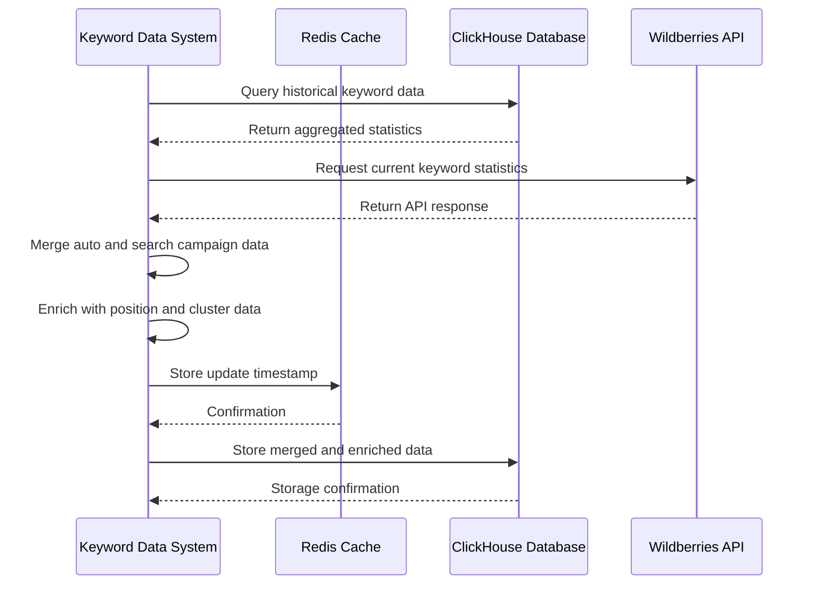
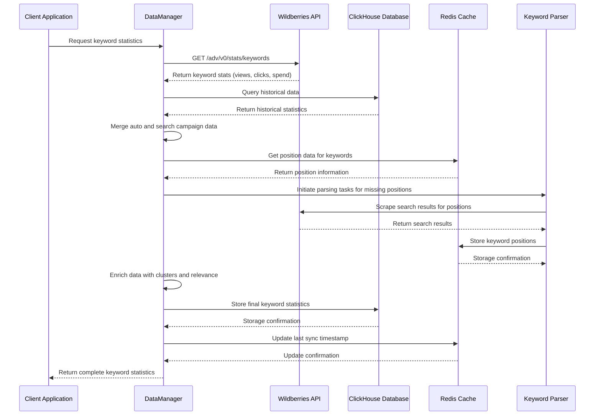

# Keyword Data Synchronization

<cite>
**Referenced Files in This Document**   
- [commot_adv_keyword_stat_update_for_auto_and_search_adv.py](file://app/modules/wb_update_state_manager/state_managers/commot_adv_keyword_stat_update_for_auto_and_search_adv.py)
- [data_manager.py](file://app/modules/wb_adv_updater/data_manager.py)
- [keywordstat.py](file://app/modules/common_slaves/wildberries/data_classes/keywordstat.py)
- [keywordstat_from_db.py](file://app/modules/common_slaves/wildberries/data_classes/keywordstat_from_db.py)
- [parser_worker.py](file://app/modules/wb_keywords_parser/parser_worker.py)
- [parsing_task.py](file://app/modules/wb_keywords_parser/parsing_task.py)
- [wb_api.py](file://app/modules/common_slaves/wildberries/wb_api.py)
</cite>

## Table of Contents
1. [Introduction](#introduction)
2. [Keyword Data Retrieval from Wildberries API](#keyword-data-retrieval-from-wildberries-api)
3. [Data Transformation and Enrichment](#data-transformation-and-enrichment)
4. [Keyword Statistics Merging Process](#keyword-statistics-merging-process)
5. [Keyword Parsing Task Initiation](#keyword-parsing-task-initiation)
6. [Data Storage in ClickHouse and Redis](#data-storage-in-clickhouse-and-redis)
7. [Data Flow Sequence Diagram](#data-flow-sequence-diagram)
8. [Data Enrichment: Relevance and Cluster Assignment](#data-enrichment-relevance-and-cluster-assignment)
9. [Handling Incomplete or Missing Data](#handling-incomplete-or-missing-data)
10. [Troubleshooting Guide](#troubleshooting-guide)

## Introduction
This document details the keyword data synchronization workflow between the adv-bot system and Wildberries API. The process involves retrieving keyword statistics (views, clicks, spend) from Wildberries, transforming this data for internal analysis, and storing it in ClickHouse and Redis databases. The document explains the common_keyword_stat_update function's logic for merging data from auto and search campaigns, describes the parsing_keywords_run method's role in initiating keyword parsing tasks, and provides sequence diagrams showing the complete keyword data flow. It also covers the data enrichment process including relevance analysis and cluster assignment, with examples of handling incomplete or missing keyword data.

## Keyword Data Retrieval from Wildberries API
The keyword data retrieval process begins with API calls to Wildberries to obtain keyword statistics for advertising campaigns. The system retrieves data for a 7-day period using the get_keywords_stat method, which makes GET requests to the Wildberries advertising API endpoint. The retrieved data includes key metrics such as views, clicks, and spend for each keyword associated with an advertising campaign.

The retrieval process follows these steps:
1. Determine the date range (current date to 6 days prior)
2. Construct the API URL with the advertising ID and date parameters
3. Make an authenticated GET request to the Wildberries API
4. Parse the JSON response containing keyword statistics
5. Handle cases where no keyword data is available

The system handles both auto and search campaigns by retrieving statistics from their respective advertising IDs, which are then merged in subsequent processing stages.

**Section sources**
- [wb_api.py](file://app/modules/common_slaves/wildberries/wb_api.py#L126-L150)

## Data Transformation and Enrichment
After retrieving keyword statistics from the Wildberries API, the data undergoes transformation and enrichment to prepare it for internal analysis. The transformation process converts raw API data into structured objects that can be further processed and analyzed.

The primary data transformation occurs in the get_keywords_statistic_clickhouse function, which:
1. Queries ClickHouse database for historical keyword data
2. Aggregates statistics across multiple advertising IDs (auto and search campaigns)
3. Ensures data consistency by validating that clicks do not exceed views
4. Creates CalculatedKeyword objects with the transformed data

The enrichment process adds additional context to the keyword data, including:
- Predicted CTR values from machine learning models
- Position data from Redis cache
- Cluster and preset information
- Relevance status from user settings
- Hard status indicators (blacklist, whitelist, etc.)

This enriched data provides a comprehensive view of keyword performance beyond the basic metrics provided by the Wildberries API.

**Section sources**
- [data_manager.py](file://app/modules/wb_adv_updater/data_manager.py#L631-L663)

## Keyword Statistics Merging Process
The common_keyword_stat_update function, implemented as the KeywordStatUpdateState class, manages the merging of keyword statistics from auto and search campaigns. This process ensures that keyword data from both campaign types is combined to provide a complete picture of keyword performance.

The merging logic follows these steps:
1. Retrieve keyword statistics from both auto and search campaigns
2. Aggregate metrics (views, clicks, spend) across campaigns
3. Apply data enrichment processes to the merged dataset
4. Store the update timestamp in Redis to track synchronization status

The KeywordStatUpdateState class uses Redis to store timestamps of the last update for each advertising ID, allowing the system to track when keyword statistics were last synchronized. This prevents redundant API calls and ensures data consistency across the system.



**Diagram sources**
- [commot_adv_keyword_stat_update_for_auto_and_search_adv.py](file://app/modules/wb_update_state_manager/state_managers/commot_adv_keyword_stat_update_for_auto_and_search_adv.py)
- [data_manager.py](file://app/modules/wb_adv_updater/data_manager.py)

**Section sources**
- [commot_adv_keyword_stat_update_for_auto_and_search_adv.py](file://app/modules/wb_update_state_manager/state_managers/commot_adv_keyword_stat_update_for_auto_and_search_adv.py)
- [data_manager.py](file://app/modules/wb_adv_updater/data_manager.py)

## Keyword Parsing Task Initiation
The parsing_keywords_run method initiates keyword parsing tasks through the ParserWorker system. This process is responsible for creating and managing parsing tasks that retrieve keyword position data from Wildberries search results.

The task initiation workflow:
1. Creates ParsingTask objects containing the keyword and associated nmids
2. Adds tasks to the GlobalParsingQueueManager
3. Processes tasks through the ParserWorker with controlled parallelism
4. Executes the actual parsing via the wb_parser module

The ParserWorker class manages a pool of worker tasks (default 3 parallel tasks) that continuously check the global parsing queue for new tasks. When a task is available, it is processed by calling the parser.add_wb_positions method with the specified parameters including delay and page limits.

```mermaid
sequenceDiagram
participant Client as Client System
participant Queue as GlobalParsingQueueManager
participant Worker as ParserWorker
participant Parser as wb_parser
Client->>Queue : Submit ParsingTask(keyword, nmids)
Queue-->>Client : Task accepted
loop Worker Polling
Worker->>Queue : Request next task
alt Task available
Queue-->>Worker : Return ParsingTask
Worker->>Parser : add_wb_positions(keyword, nmids)
Parser-->>Worker : Processing complete
Worker->>Queue : Mark task complete
else No task available
Queue-->>Worker : No task
Worker : Wait 1 second
end
end
```

**Diagram sources**
- [parser_worker.py](file://app/modules/wb_keywords_parser/parser_worker.py)
- [parsing_task.py](file://app/modules/wb_keywords_parser/parsing_task.py)

**Section sources**
- [parser_worker.py](file://app/modules/wb_keywords_parser/parser_worker.py)
- [parsing_task.py](file://app/modules/wb_keywords_parser/parsing_task.py)

## Data Storage in ClickHouse and Redis
The keyword data synchronization system utilizes both ClickHouse and Redis for data storage, each serving distinct purposes in the workflow. ClickHouse serves as the primary analytical database for long-term storage of keyword statistics, while Redis provides low-latency caching for frequently accessed data.

ClickHouse storage includes:
- Historical keyword performance data (views, clicks, spend)
- Aggregated statistics by date and advertising ID
- Versioned records to handle data updates
- Data partitioned by date for efficient querying

Redis storage includes:
- Timestamps of the last keyword statistics update
- Keyword position data with expiration
- Predicted CTR values and cluster assignments
- Temporary caches for frequently accessed data
- Task queues for the parsing system

The system writes to ClickHouse through direct INSERT operations, ensuring data persistence and enabling complex analytical queries. Redis operations include SET commands for storing data and GET commands for retrieving cached values, with appropriate key naming conventions to organize related data.

**Section sources**
- [data_manager.py](file://app/modules/wb_adv_updater/data_manager.py)
- [parser_worker.py](file://app/modules/wb_keywords_parser/parser_worker.py)

## Data Flow Sequence Diagram
The complete keyword data flow from initial API request to final storage involves multiple components working in concert to synchronize data between the adv-bot system and Wildberries API.



**Diagram sources**
- [wb_api.py](file://app/modules/common_slaves/wildberries/wb_api.py)
- [data_manager.py](file://app/modules/wb_adv_updater/data_manager.py)
- [parser_worker.py](file://app/modules/wb_keywords_parser/parser_worker.py)
- [commot_adv_keyword_stat_update_for_auto_and_search_adv.py](file://app/modules/wb_update_state_manager/state_managers/commot_adv_keyword_stat_update_for_auto_and_search_adv.py)

## Data Enrichment: Relevance and Cluster Assignment
The data enrichment process adds valuable context to raw keyword statistics by incorporating relevance analysis and cluster assignment. This transformation turns basic performance metrics into actionable insights for advertising optimization.

Relevance analysis determines whether keywords are relevant to the advertised products by:
- Checking against user-defined white and black lists
- Evaluating machine learning predictions of keyword relevance
- Considering historical performance data
- Applying business rules for relevance determination

Cluster assignment groups related keywords into thematic clusters based on:
- Semantic similarity of keyword texts
- Shared product categories (nmids)
- User-defined clustering rules
- Machine learning-based clustering algorithms

The enrichment process occurs in the convert_keyword_stats_in_clusters function, which:
1. Retrieves cluster and preset information from Redis
2. Groups keywords by preset values
3. Creates cluster-level statistics by aggregating individual keyword metrics
4. Assigns cluster names to grouped keywords
5. Preserves relationships between cluster keywords and their child keywords

This enriched data enables higher-level analysis of advertising performance by category or theme, rather than just individual keywords.

**Section sources**
- [data_manager.py](file://app/modules/wb_adv_updater/data_manager.py)

## Handling Incomplete or Missing Data
The system implements several strategies to handle incomplete or missing keyword data, ensuring robust operation even when data sources are unavailable or incomplete.

For missing API data:
- The system returns empty lists when Wildberries API returns no keyword data
- Timestamp tracking prevents repeated failed requests for the same period
- Fallback to cached data when available

For incomplete keyword records:
- Views are adjusted when clicks exceed views (setting views equal to clicks)
- Default values are used for missing metrics (0 for numeric values)
- Position data is retrieved from multiple sources with fallback mechanisms

For missing position data:
- The system initiates parsing tasks to retrieve current positions
- Cached positions are used when current data is unavailable
- Cluster-level positions are used as fallback for individual keywords

The data validation process includes assertions to ensure all required fields are present and valid, with appropriate error handling when validation fails.

**Section sources**
- [data_manager.py](file://app/modules/wb_adv_updater/data_manager.py)
- [wb_api.py](file://app/modules/common_slaves/wildberries/wb_api.py)

## Troubleshooting Guide
This section provides guidance for diagnosing and resolving common issues in the keyword data synchronization workflow.

**Missing Keyword Statistics**
- Verify that the advertising ID is correct and active
- Check Redis for the last update timestamp using the adv_keyword_stat_update:{adv_id} key
- Confirm that the date range for the API request is correct
- Examine logs for API request failures or authentication issues

**Incomplete Position Data**
- Verify that parsing tasks are being created in the GlobalParsingQueueManager
- Check that the ParserWorker is running and processing tasks
- Confirm that nmids are correctly associated with advertising IDs
- Validate that the wb_parser can access Wildberries search results

**Data Inconsistencies**
- Check for discrepancies between ClickHouse and Redis data
- Verify that the merging logic for auto and search campaigns is functioning correctly
- Confirm that data enrichment processes are applying consistently
- Validate that timestamps are being updated properly after synchronization

**Performance Issues**
- Monitor the number of parallel parsing tasks (default: 3)
- Check for bottlenecks in the global parsing queue
- Verify that database queries are properly indexed
- Monitor API rate limits with Wildberries

**Section sources**
- [data_manager.py](file://app/modules/wb_adv_updater/data_manager.py)
- [parser_worker.py](file://app/modules/wb_keywords_parser/parser_worker.py)
- [wb_api.py](file://app/modules/common_slaves/wildberries/wb_api.py)