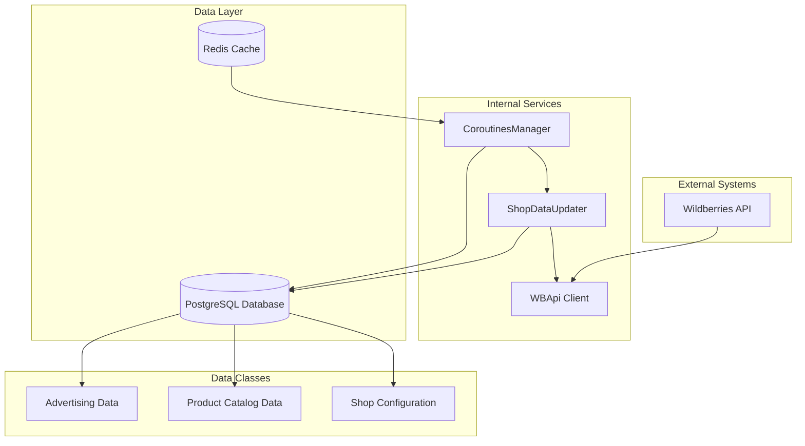
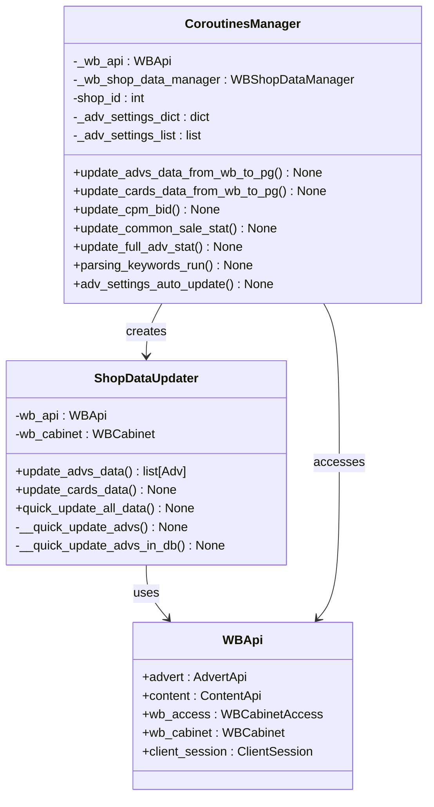
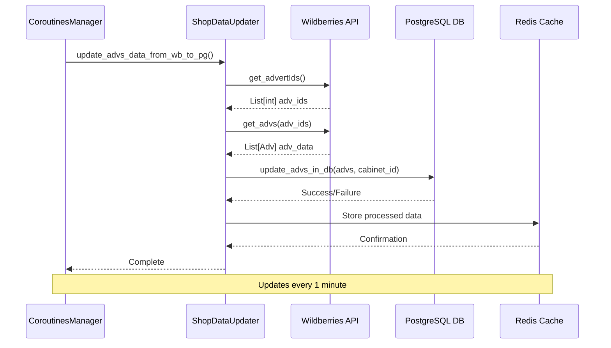
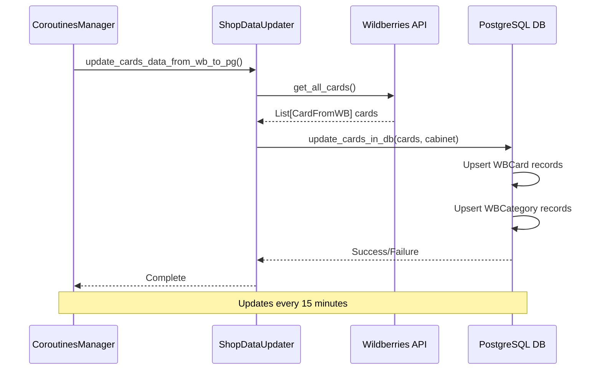
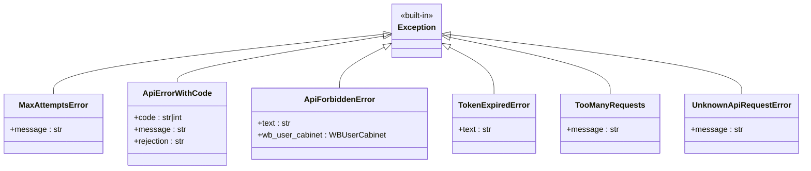

# Shop Data Synchronization Workflow

<cite>
**Referenced Files in This Document**
- [shops_data_updater.py](file://app/modules/common_slaves/wildberries/shops_data_updater.py)
- [manager.py](file://app/modules/shop_runner/service_manager/manager.py)
- [wb_db_manager.py](file://app/modules/common_slaves/wildberries/wb_db_manager.py)
- [api.py](file://app/modules/common_slaves/wildberries/api/api.py)
- [card_from_wb.py](file://app/modules/common_slaves/wildberries/data_classes/card_from_wb.py)
- [models.py](file://app/modules/common_slaves/wildberries/models/models.py)
- [while_coroutines_decorator.py](file://app/modules/shop_runner/service_manager/while_coroutines_decorator.py)
- [http_request.py](file://app/core/wb_api/http_request.py)
- [exceptions.py](file://app/core/wb_api/exceptions.py)
</cite>

## Table of Contents
1. [Introduction](#introduction)
2. [System Architecture](#system-architecture)
3. [Core Components](#core-components)
4. [Data Synchronization Process](#data-synchronization-process)
5. [CoroutinesManager Implementation](#coroutinesmanager-implementation)
6. [ShopDataUpdater Implementation](#shopdataupdater-implementation)
7. [Database Operations](#database-operations)
8. [Error Handling and Recovery](#error-handling-and-recovery)
9. [API Rate Limiting and Throttling](#api-rate-limiting-and-throttling)
10. [Performance Considerations](#performance-considerations)
11. [Troubleshooting Guide](#troubleshooting-guide)
12. [Conclusion](#conclusion)

## Introduction

The shop data synchronization system in the adv-bot platform facilitates seamless data exchange between the Wildberries API and the internal PostgreSQL database. This system ensures that advertising campaigns, product catalogs, and campaign settings are consistently synchronized between the external Wildberries platform and the internal database, enabling real-time updates and maintaining data integrity across the entire ecosystem.

The synchronization process involves two primary data flows: advertising data synchronization (via `update_advs_data_from_wb_to_pg`) and product catalog data synchronization (via `update_cards_data_from_wb_to_pg`). These processes are managed by the CoroutinesManager, which orchestrates periodic updates with intelligent error handling and recovery mechanisms.

## System Architecture

The shop data synchronization system follows a layered architecture with clear separation of concerns:



**Diagram sources**
- [manager.py](file://app/modules/shop_runner/service_manager/manager.py#L1-L50)
- [shops_data_updater.py](file://app/modules/common_slaves/wildberries/shops_data_updater.py#L1-L30)

## Core Components

### CoroutinesManager

The CoroutinesManager serves as the central orchestrator for all data synchronization operations. It manages the lifecycle of various synchronization tasks and implements intelligent scheduling with configurable intervals.



**Diagram sources**
- [manager.py](file://app/modules/shop_runner/service_manager/manager.py#L35-L50)
- [shops_data_updater.py](file://app/modules/common_slaves/wildberries/shops_data_updater.py#L35-L45)

### ShopDataUpdater

The ShopDataUpdater is responsible for the actual data retrieval and storage operations. It implements both full and incremental update strategies to optimize performance and minimize API calls.

**Section sources**
- [shops_data_updater.py](file://app/modules/common_slaves/wildberries/shops_data_updater.py#L35-L103)

## Data Synchronization Process

### Advertising Data Synchronization Flow

The advertising data synchronization follows a structured process that ensures data consistency and handles various edge cases:



**Diagram sources**
- [manager.py](file://app/modules/shop_runner/service_manager/manager.py#L115-L125)
- [shops_data_updater.py](file://app/modules/common_slaves/wildberries/shops_data_updater.py#L75-L90)

### Product Catalog Synchronization Flow

The product catalog synchronization focuses on maintaining accurate product information and category mappings:



**Diagram sources**
- [manager.py](file://app/modules/shop_runner/service_manager/manager.py#L145-L155)
- [shops_data_updater.py](file://app/modules/common_slaves/wildberries/shops_data_updater.py#L95-L103)

**Section sources**
- [manager.py](file://app/modules/shop_runner/service_manager/manager.py#L115-L155)
- [shops_data_updater.py](file://app/modules/common_slaves/wildberries/shops_data_updater.py#L75-L103)

## CoroutinesManager Implementation

### Update Methods

The CoroutinesManager implements two primary update methods for data synchronization:

#### update_advs_data_from_wb_to_pg

This method synchronizes advertising campaign data from Wildberries API to PostgreSQL database:

```python
@while_coroutine_decorator(1 * 60)
async def update_advs_data_from_wb_to_pg(self) -> None:
    wb_api = self._wb_api
    shop_data_updater = ShopDataUpdater(wb_api)
    await shop_data_updater.update_advs_data()
```

Key characteristics:
- **Frequency**: Runs every 1 minute
- **Purpose**: Synchronizes active advertising campaigns
- **Scope**: Retrieves all advertising data and updates the database
- **Error Handling**: Implements retry logic with exponential backoff

#### update_cards_data_from_wb_to_pg

This method synchronizes product catalog data from Wildberries API to PostgreSQL database:

```python
@while_coroutine_decorator(60 * 15)
async def update_cards_data_from_wb_to_pg(self) -> None:
    wb_api = self._wb_api
    shop_data_updater = ShopDataUpdater(wb_api)
    await self._update_cards_data_from_wb_to_pg(shop_data_updater)
```

Key characteristics:
- **Frequency**: Runs every 15 minutes
- **Purpose**: Synchronizes product catalog and category information
- **Scope**: Updates product cards and maintains category mappings
- **Error Handling**: Implements robust error recovery mechanisms

### Decorator Implementation

The `while_coroutine_decorator` provides essential error handling and scheduling capabilities:

```python
def while_coroutine_decorator(
    pause_on_success: int, pause_on_error: int = 5
) -> Callable[[Callable[F_Spec, Awaitable[T_Result]]], Callable[F_Spec, Awaitable[T_Result]]]:
    def decorator(func: Callable[F_Spec, Awaitable[T_Result]]) -> Callable[F_Spec, Awaitable[T_Result]]:
        @wraps(func)
        async def wrapper(*args: F_Spec.args, **kwargs: F_Spec.kwargs) -> T_Result:
            while True:
                try:
                    await func(*args, **kwargs)
                    await asyncio.sleep(pause_on_success)
                    continue
                except InterfaceError:
                    logger.exception(f"Корутина: {func.__name__}")
                    await asyncio.sleep(1)
                except (NotFoundActiveAdvCompany, ApiForbiddenError) as exc:
                    raise StopShopUpdateException from exc
                except MaxAttemptsError as exc:
                    logger.error(f"Максимальное количество попыток для {func.__name__} достигнуто: {exc}")
                    await asyncio.sleep(pause_on_error)
                except Exception as exc:
                    logger.error(f"Ошибка: {exc}", exc_info=True)
                    await asyncio.sleep(pause_on_error)
        return wrapper
    return decorator
```

**Section sources**
- [manager.py](file://app/modules/shop_runner/service_manager/manager.py#L115-L155)
- [while_coroutines_decorator.py](file://app/modules/shop_runner/service_manager/while_coroutines_decorator.py#L20-L50)

## ShopDataUpdater Implementation

### Data Retrieval Strategies

The ShopDataUpdater implements sophisticated data retrieval strategies to optimize performance and handle various scenarios:

#### Quick Update Mechanism

```python
async def quick_update_all_data(self):
    await self.__quick_update_advs()

async def __quick_update_advs(self):
    wb_api = self.wb_api
    advert_api = wb_api
    adv_ids: list[int] = await advert_api.get_advertIds()
    async with sm() as session:
        stmt = select(models.AdvSetting).where(models.AdvSetting.adv_id.in_(adv_ids))
        exist_advs_result = (await session.execute(stmt)).unique()
        existing_advs: list[models.AdvSetting] = exist_advs_result.scalars().all()
        existind_advs_ids: set[int] = {adv.adv_id for adv in existing_advs}
        not_existing_adv_ids: set[int] = set(adv_ids) - existind_advs_ids
        
        if not_existing_adv_ids:
            await self.__quick_update_advs_in_db(not_existing_adv_ids)
        
        func = self.__quick_update_advs_in_db(existind_advs_ids)
        await _coroutine_parallel_run_queue.put(func)
```

#### Full Update Process

```python
async def update_advs_data(self) -> list[Adv]:
    wb_api: WBApi = self.wb_api
    advert_api = wb_api
    adv_ids: list[int] = await advert_api.get_advertIds()
    if not adv_ids:
        return []
    
    logger.debug(f"Получены adv_ids: {len(adv_ids)} штук")
    advs: list[Adv] = await advert_api.get_advs()
    await wb_db_manager.update_advs_in_db(advs, self.wb_cabinet.id)
    logger.debug("Обновление в базе advs завершено")
    return advs
```

### Parallel Processing Queue

The system implements a parallel processing queue to handle multiple concurrent operations efficiently:

```python
_coroutine_parallel_run_queue = asyncio.Queue()

async def consumer():
    logger.info("Consumer started")
    active_tasks = []
    while True:
        logger.info("Consumer waiting for task")
        if _coroutine_parallel_run_queue.empty() and active_tasks:
            logger.info("Consumer waiting for task")
            done, _ = await asyncio.wait(active_tasks, return_when=asyncio.FIRST_COMPLETED)
        else:
            coroutine: asyncio.Future = await _coroutine_parallel_run_queue.get()
            task = asyncio.create_task(coroutine)
            task.add_done_callback(lambda t, lst=active_tasks: lst.remove(t))
            active_tasks.append(task)
        await asyncio.sleep(1)
```

**Section sources**
- [shops_data_updater.py](file://app/modules/common_slaves/wildberries/shops_data_updater.py#L45-L103)

## Database Operations

### PostgreSQL Integration

The system uses SQLAlchemy ORM with PostgreSQL dialect for efficient database operations. The database operations are designed to handle high-volume data updates with minimal latency.

#### Upsert Operations

The database manager implements UPSERT operations to handle both new and existing records:

```python
async def update_advs_in_db(advs: list[AuctionAdv], wb_cabinet_id: int) -> None:
    part = 10
    for i in range(0, len(advs), part):
        advs_part = advs[i : i + part]
        await _update_advs_in_db(advs_part, wb_cabinet_id)

async def _update_advs_in_db(advs: list[AuctionAdv], wb_cabinet_id: int) -> None:
    adv_data = [
        {
            "adv_id": adv.advertId,
            "name": adv.name,
            "wb_cabinet_id": wb_cabinet_id,
            "nmids": adv.nmids,
            "active_status": adv.status_native,
            "type": adv.type,
            "cpm": adv.cpm,
        }
        for adv in advs
    ]
    
    stmt = insert(AdvSetting).values(adv_data)
    stmt = stmt.on_conflict_do_update(
        index_elements=["adv_id"],
        set_={
            "name": stmt.excluded.name,
            "wb_cabinet_id": stmt.excluded.wb_cabinet_id,
            "nmids": stmt.excluded.nmids,
            "active_status": stmt.excluded.active_status,
            "type": stmt.excluded.type,
            "cpm": stmt.excluded.cpm,
        },
    )
    async with _sm() as session:
        await session.execute(stmt)
        await session.commit()
```

#### Product Card Updates

```python
async def update_cards_in_db(cards: list[CardFromWB], wb_cabinet: WBCabinet) -> None:
    if not cards:
        return
    
    part = 3
    for i in range(0, len(cards), part):
        cards_part = cards[i : i + part]
        await _update_cards_in_db(cards_part, wb_cabinet)
```

### Data Validation and Conflict Resolution

The system implements several mechanisms for data validation and conflict resolution:

1. **Duplicate Detection**: Removes duplicate NMIDs during product card updates
2. **Category Management**: Automatically creates missing categories
3. **Upsert Strategy**: Uses PostgreSQL ON CONFLICT DO UPDATE for atomic operations
4. **Transaction Safety**: Ensures all database operations are wrapped in transactions

**Section sources**
- [wb_db_manager.py](file://app/modules/common_slaves/wildberries/wb_db_manager.py#L15-L130)

## Error Handling and Recovery

### Exception Hierarchy

The system implements a comprehensive exception hierarchy for different types of errors:



**Diagram sources**
- [exceptions.py](file://app/core/wb_api/exceptions.py#L1-L85)

### Retry Mechanisms

The HTTP request layer implements sophisticated retry mechanisms with exponential backoff:

```python
def try_except_decorator(
    requests_per_interval: int,
    interval_seconds: int | float,
    max_attempts: int = 50,
    max_delay: int = 120,
) -> Callable[[F], F]:
    def decorator(func: F) -> F:
        async def wrapper(instance: TypeWBAPIProtocol, *args: Any, **kwargs: Any) -> Any:
            if not hasattr(instance, "api_call_state"):
                instance.api_call_state = {}
            
            method_name = func.__name__
            if method_name not in instance.api_call_state:
                instance.api_call_state[method_name] = {
                    "_last_query_time": None,
                    "_current_pause": interval_seconds / requests_per_interval,
                    "_attempts": 0,
                }
            
            state = instance.api_call_state[method_name]
            shop_id = instance.shop_id
            
            while state["_attempts"] < max_attempts:
                # Calculate wait time based on last query time
                last_query_time: float | None = state["_last_query_time"]
                if last_query_time:
                    current_time = time.time()
                    time_since_last_query = current_time - last_query_time
                    time_to_wait = max(state["_current_pause"] - time_since_last_query, 0)
                    await asyncio.sleep(time_to_wait)
                
                try:
                    state["_last_query_time"] = time.time()
                    result = await func(instance, *args, **kwargs)
                    logger.debug(f"Запрос {method_name} выполнен успешно для {shop_id}")
                    
                    # Adjust pause time for next request
                    next_pause = (interval_seconds / requests_per_interval + state["_current_pause"]) / 2
                    state["_current_pause"] = next_pause
                    state["_attempts"] = 0
                    return result
                    
                except ApiForbiddenError:
                    await instance.set_next_token(method_name)
                    state["_current_pause"] = 0
                    
                except (TooManyRequests, BadRequestError, UnknownApiRequestError, 
                       NotValidDataError, ClientOSError, ServerDisconnectedError, 
                       ClientResponseError, ClientConnectionError, NotMatchWBApiError) as e:
                    if state["_attempts"] >= max_attempts:
                        raise MaxAttemptsError(f"Не удалось выполнить {method_name} за {max_attempts} попыток для shop_id={shop_id}") from e
                    
                    state["_attempts"] += 1
                    state["_current_pause"] = min(max(state["_current_pause"], 1) * 2, max_delay)
                    logger.debug(f"Следующая пауза между запросами: {state['_current_pause']} секунд для shop_id: {shop_id}")
                    
                except Exception as e:
                    raise e
        
        return cast(F, wrapper)
    return decorator
```

### Error Recovery Strategies

1. **Token Rotation**: Automatic token rotation for expired tokens
2. **Exponential Backoff**: Gradually increasing delays between retries
3. **Circuit Breaker**: Temporary suspension of operations after repeated failures
4. **Graceful Degradation**: Continuing operations with reduced functionality when possible

**Section sources**
- [http_request.py](file://app/core/wb_api/http_request.py#L40-L150)
- [exceptions.py](file://app/core/wb_api/exceptions.py#L1-L85)

## API Rate Limiting and Throttling

### Adaptive Rate Limiting

The system implements adaptive rate limiting that adjusts based on API response times and error rates:

```python
# Rate limiting configuration
@try_except_decorator(
    requests_per_interval=1,      # 1 request per interval
    interval_seconds=60,          # 60 seconds interval
    max_attempts=50,              # Maximum 50 attempts
    max_delay=120                 # Maximum delay of 120 seconds
)
async def get_advertIds(self) -> list[int]:
    # Implementation
```

### Request Batching

To optimize API usage, the system implements request batching:

```python
async def get_advs(self, adv_ids: list[int] = None) -> list[Adv]:
    if not adv_ids:
        adv_ids: list[int] = await self.get_advertIds()
    
    all_advs = []
    part = 50  # Batch size of 50
    for i in range(0, len(adv_ids), part):
        part_of_advs = adv_ids[i : i + part]
        advs = await self._get_advs(part_of_advs)
        all_advs.extend(advs)
    return all_advs
```

### Concurrent Request Management

The system manages concurrent requests to prevent overwhelming the API:

```python
# Parallel processing queue
_coroutine_parallel_run_queue = asyncio.Queue()

async def consumer():
    logger.info("Consumer started")
    active_tasks = []
    while True:
        if _coroutine_parallel_run_queue.empty() and active_tasks:
            done, _ = await asyncio.wait(active_tasks, return_when=asyncio.FIRST_COMPLETED)
        else:
            coroutine: asyncio.Future = await _coroutine_parallel_run_queue.get()
            task = asyncio.create_task(coroutine)
            task.add_done_callback(lambda t, lst=active_tasks: lst.remove(t))
            active_tasks.append(task)
        await asyncio.sleep(1)
```

**Section sources**
- [api.py](file://app/modules/common_slaves/wildberries/api/api.py#L350-L400)
- [shops_data_updater.py](file://app/modules/common_slaves/wildberries/shops_data_updater.py#L25-L40)

## Performance Considerations

### Optimization Strategies

1. **Batch Processing**: Large datasets are processed in batches to reduce memory usage and improve throughput
2. **Parallel Execution**: Multiple operations are executed concurrently using asyncio queues
3. **Connection Pooling**: Efficient database connection management
4. **Caching**: Strategic caching of frequently accessed data

### Memory Management

The system implements several memory optimization techniques:

```python
# Batch processing for large datasets
part = 10  # Process 10 items at a time
for i in range(0, len(advs), part):
    advs_part = advs[i : i + part]
    await _update_advs_in_db(advs_part, wb_cabinet_id)
```

### Database Indexing

The PostgreSQL database is optimized with strategic indexing:

```python
# Composite index for frequent queries
Index("ix_adv_settings_cabinet_type_update", "wb_cabinet_id", "type", "last_update")

# Category indexing
Index("ix_wb_category_name", "wb_category_name")

# Product card indexing
Index("ix_advsetting_name_pattern", "name", postgresql_using="gin", postgresql_ops={"name": "gin_trgm_ops"})
```

## Troubleshooting Guide

### Common Issues and Solutions

#### API Rate Limiting

**Symptoms**: `TooManyRequests` exceptions, slow response times
**Solutions**:
1. Check rate limiting configuration in `try_except_decorator`
2. Verify batch sizes and intervals
3. Monitor API usage patterns

#### Database Connection Issues

**Symptoms**: `InterfaceError` exceptions, connection timeouts
**Solutions**:
1. Verify database connectivity
2. Check connection pool settings
3. Review transaction isolation levels

#### Token Expiration

**Symptoms**: `ApiForbiddenError` exceptions
**Solutions**:
1. Implement automatic token rotation
2. Check token validity before API calls
3. Monitor token expiration timestamps

#### Data Consistency Issues

**Symptoms**: Duplicate records, missing data
**Solutions**:
1. Verify UPSERT operations
2. Check for race conditions
3. Review transaction boundaries

### Monitoring and Logging

The system implements comprehensive logging for troubleshooting:

```python
# Debug logging
logger.debug(f"Получены adv_ids: {len(adv_ids)} штук")
logger.debug("Обновление в базе advs завершено")

# Error logging
logger.error(f"Максимальное количество попыток для {func.__name__} достигнуто: {exc}")
logger.exception(f"Корутина: {func.__name__}")

# Information logging
logger.info("Consumer started")
logger.info("Consumer waiting for task")
```

### Health Checks

Implement health checks for critical components:

1. **API Connectivity**: Test Wildberries API endpoints
2. **Database Connectivity**: Verify database connections
3. **Token Validity**: Check token expiration and permissions
4. **Queue Status**: Monitor processing queues

**Section sources**
- [http_request.py](file://app/core/wb_api/http_request.py#L150-L213)
- [manager.py](file://app/modules/shop_runner/service_manager/manager.py#L115-L155)

## Conclusion

The shop data synchronization system provides a robust, scalable solution for maintaining data consistency between Wildberries API and internal PostgreSQL databases. The system's architecture emphasizes reliability, performance, and maintainability through:

- **Modular Design**: Clear separation of concerns with dedicated components
- **Intelligent Scheduling**: Configurable intervals with adaptive rate limiting
- **Robust Error Handling**: Comprehensive exception hierarchy with retry mechanisms
- **Performance Optimization**: Batch processing, parallel execution, and strategic caching
- **Monitoring and Logging**: Extensive logging for troubleshooting and monitoring

The CoroutinesManager orchestrates the synchronization process with built-in error recovery, while the ShopDataUpdater handles the actual data operations with UPSERT strategies for optimal database performance. The system is designed to handle various failure scenarios gracefully and maintain data integrity across all operations.

Future enhancements could include distributed processing capabilities, advanced caching strategies, and enhanced monitoring dashboards to further improve the system's reliability and performance.