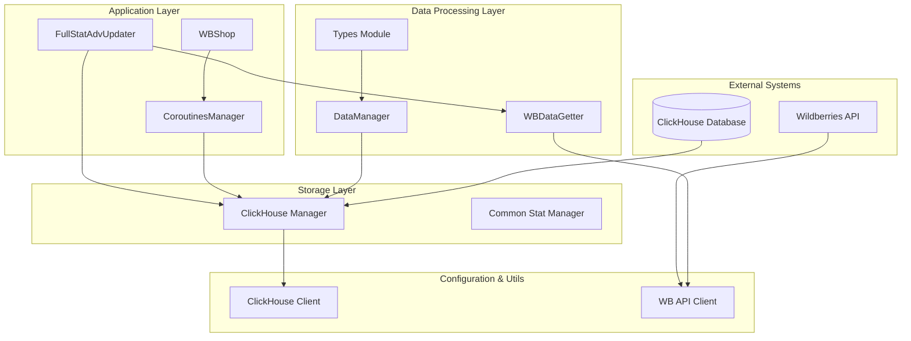
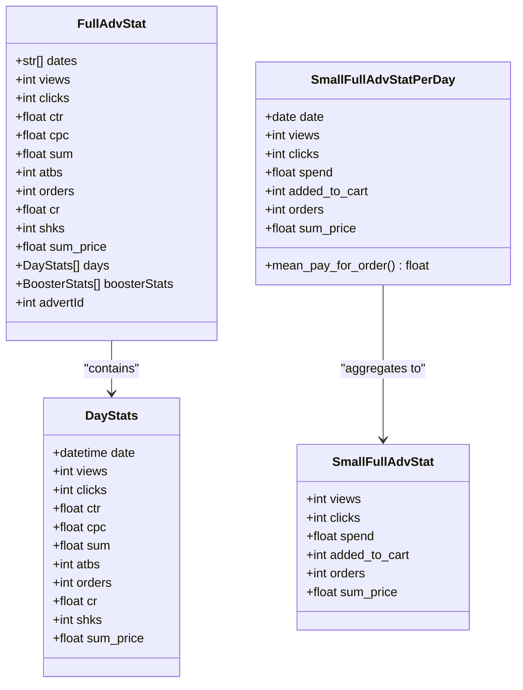
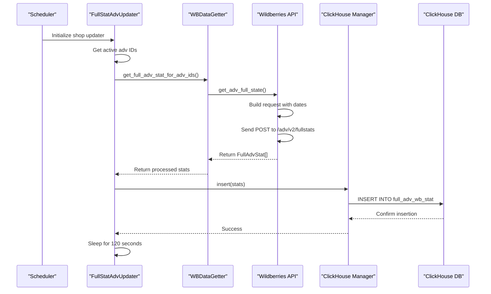
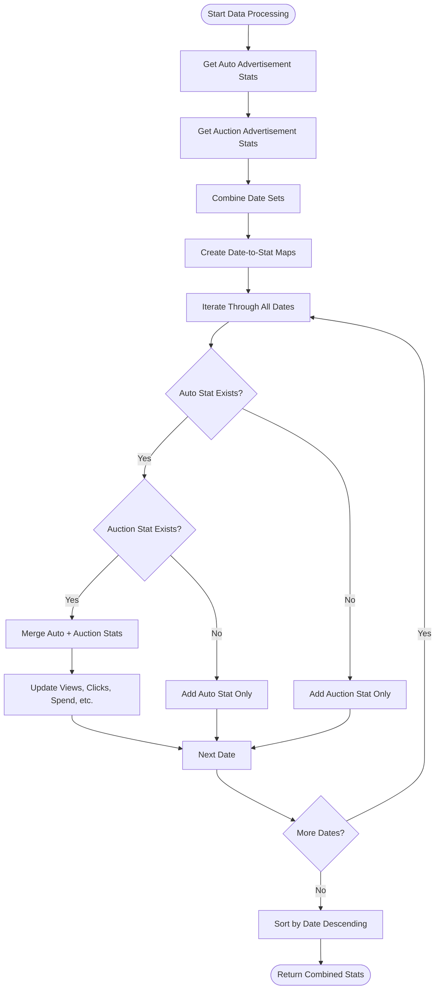

# Statistical Data Synchronization Workflow

<cite>
**Referenced Files in This Document**
- [app/modules/full_stat_adv_updater/main.py](file://app/modules/full_stat_adv_updater/main.py)
- [app/modules/full_stat_adv_updater/types/full_adv_stat.py](file://app/modules/full_stat_adv_updater/types/full_adv_stat.py)
- [app/modules/full_stat_adv_updater/db_data_manager.py](file://app/modules/full_stat_adv_updater/db_data_manager.py)
- [app/modules/full_stat_adv_updater/wb_data_getter.py](file://app/modules/full_stat_adv_updater/wb_data_getter.py)
- [app/modules/shop_runner/wb_stat_manager/clickhouse_manager/full_wb_adv_stat.py](file://app/modules/shop_runner/wb_stat_manager/clickhouse_manager/full_wb_adv_stat.py)
- [app/modules/wb_adv_updater/data_manager.py](file://app/modules/wb_adv_updater/data_manager.py)
- [upload_full_adv_stat.py](file://upload_full_adv_stat.py)
- [app/utils/click_house/client.py](file://app/utils/click_house/client.py)
- [app/modules/common_slaves/wildberries/wb_api.py](file://app/modules/common_slaves/wildberries/wb_api.py)
- [app/modules/shop_runner/service_manager/manager.py](file://app/modules/shop_runner/service_manager/manager.py)
- [app/modules/shop_runner/wb_shop.py](file://app/modules/shop_runner/wb_shop.py)
</cite>

## Table of Contents
1. [Introduction](#introduction)
2. [System Architecture](#system-architecture)
3. [Core Components](#core-components)
4. [Data Flow Analysis](#data-flow-analysis)
5. [Full Advertisement Statistics Updater](#full-advertisement-statistics-updater)
6. [ClickHouse Integration](#clickhouse-integration)
7. [API Integration](#api-integration)
8. [Performance Optimization](#performance-optimization)
9. [Error Handling and Monitoring](#error-handling-and-monitoring)
10. [Troubleshooting Guide](#troubleshooting-guide)
11. [Best Practices](#best-practices)

## Introduction

The statistical data synchronization workflow in the adv-bot system manages the complete lifecycle of retrieving comprehensive advertising performance metrics from Wildberries API, transforming the data for analytics, and storing it in ClickHouse for efficient querying and analysis. This system handles critical KPIs including views, clicks, orders, revenue, and conversion rates across multiple advertising campaigns and shops.

The workflow encompasses several key processes:
- **Data Retrieval**: Fetching full advertising statistics from Wildberries API
- **Data Transformation**: Converting raw API responses into structured analytics-ready formats
- **Data Storage**: Inserting processed data into ClickHouse for high-performance analytics
- **Aggregation**: Combining statistics from auto and auction advertisements
- **Time-Series Management**: Handling historical data and maintaining data versioning

## System Architecture

The statistical data synchronization follows a layered architecture with clear separation of concerns:



**Diagram sources**
- [app/modules/full_stat_adv_updater/main.py](file://app/modules/full_stat_adv_updater/main.py#L1-L89)
- [app/modules/shop_runner/service_manager/manager.py](file://app/modules/shop_runner/service_manager/manager.py#L1-L277)
- [app/modules/shop_runner/wb_shop.py](file://app/modules/shop_runner/wb_shop.py#L1-L43)

## Core Components

### FullStatAdvUpdater Class

The `FullStatAdvUpdater` serves as the primary orchestrator for statistical data updates across all shops:

```python
class FullStatAdvUpdater:
    def __init__(self, access: WBCabinetAccess):
        assert access.wb_cabinet
        self.access = access
        self.shop_id = access.wb_cabinet.shop_id
        self.wb_api = WBApi(access)
    
    async def __call__(self):
        while True:
            try:
                adv_ids = await self._get_active_adv_ids()
                if adv_ids:
                    await self._update_for_last_days_in_redis_run(adv_ids)
            except:
                logger.error(
                    f"Ошибка обновления данных для магазина shop_id={self.shop_id}",
                    exc_info=True,
                )
            finally:
                await asyncio.sleep(120)
```

**Section sources**
- [app/modules/full_stat_adv_updater/main.py](file://app/modules/full_stat_adv_updater/main.py#L13-L35)

### Data Types and Structures

The system defines comprehensive data structures for statistical data:



**Diagram sources**
- [app/modules/full_stat_adv_updater/types/full_adv_stat.py](file://app/modules/full_stat_adv_updater/types/full_adv_stat.py#L1-L108)

**Section sources**
- [app/modules/full_stat_adv_updater/types/full_adv_stat.py](file://app/modules/full_stat_adv_updater/types/full_adv_stat.py#L1-L108)

## Data Flow Analysis

### Complete Statistical Data Flow

The statistical data synchronization follows a well-defined sequence:



**Diagram sources**
- [app/modules/full_stat_adv_updater/main.py](file://app/modules/full_stat_adv_updater/main.py#L25-L35)
- [app/modules/full_stat_adv_updater/wb_data_getter.py](file://app/modules/full_stat_adv_updater/wb_data_getter.py#L1-L16)

### Data Aggregation Strategy

The system employs sophisticated aggregation strategies to combine statistics from different advertisement types:



**Diagram sources**
- [app/modules/shop_runner/wb_stat_manager/clickhouse_manager/full_wb_adv_stat.py](file://app/modules/shop_runner/wb_stat_manager/clickhouse_manager/full_wb_adv_stat.py#L25-L67)

**Section sources**
- [app/modules/shop_runner/wb_stat_manager/clickhouse_manager/full_wb_adv_stat.py](file://app/modules/shop_runner/wb_stat_manager/clickhouse_manager/full_wb_adv_stat.py#L25-L67)

## Full Advertisement Statistics Updater

### Update Process Implementation

The `_update_full_adv_stat_in_click_house` method serves as the core data insertion mechanism:

```python
@staticmethod
async def _update_full_stat_in_click_house(stats: Iterable[FullAdvStat]) -> None:
    await full_wb_adv_stat.insert(stats)
```

This method orchestrates the complete data insertion process:

1. **Validation**: Ensures the statistics collection is not empty
2. **Batch Processing**: Processes statistics in batches for optimal performance
3. **Version Management**: Maintains data versioning for conflict resolution
4. **Error Handling**: Implements robust error handling with logging

### Time-Series Data Management

The system maintains comprehensive time-series data with sophisticated versioning:

```python
async def insert(stats: Iterable[FullAdvStat]) -> None:
    if not stats:
        return
    
    async with get_clickhouse_client() as client:
        query = _get_insert_query()
        version = str(time.time())
        
        values = []
        for stat in stats:
            adv_id = stat.advertId
            for day in stat.days:
                values.append([
                    adv_id,
                    day.date.strftime("%Y-%m-%d"),
                    day.views,
                    day.clicks,
                    day.sum,
                    day.atbs,
                    day.orders,
                    day.sum_price,
                    version,
                ])
        
        try:
            for row in values:
                await client.query(query, parameters=row)
        except Exception:
            logger.error("Ошибка вставки в кликхаус", exc_info=True)
```

**Section sources**
- [app/modules/shop_runner/service_manager/manager.py](file://app/modules/shop_runner/service_manager/manager.py#L85-L90)
- [app/modules/shop_runner/wb_stat_manager/clickhouse_manager/full_wb_adv_stat.py](file://app/modules/shop_runner/wb_stat_manager/clickhouse_manager/full_wb_adv_stat.py#L223-L270)

## ClickHouse Integration

### Database Schema and Queries

The ClickHouse integration provides high-performance analytics capabilities:

```sql
CREATE TABLE default_db.full_adv_wb_stat (
    adv_id Int64,
    date Date,
    views Int32,
    clicks Int32,
    spend Float64,
    added_to_cart Int32,
    orders Int32,
    sum_price_orders Float64,
    version String
) ENGINE = MergeTree()
ORDER BY (adv_id, date, version);
```

### Advanced Query Patterns

The system implements sophisticated ClickHouse queries for data retrieval:

```python
async def get_daily_stats_by_last_days(
    adv_ids: list[int], start_date: datetime, end_date: datetime
) -> list[SmallFullAdvStatPerDay]:
    query = """
    WITH max_versions AS (
        SELECT *, 
               ROW_NUMBER() OVER (PARTITION BY adv_id, date ORDER BY version DESC) AS row_num
        FROM default_db.full_adv_wb_stat
        WHERE date BETWEEN toDate(%(start_date)s) AND toDate(%(end_date)s)
        AND adv_id IN %(adv_ids)s
    )
    SELECT 
        date,
        SUM(views) AS views, 
        SUM(clicks) AS clicks, 
        SUM(spend) AS spend, 
        SUM(added_to_cart) AS added_to_cart, 
        SUM(orders) AS orders, 
        SUM(sum_price_orders) AS sum_price_orders
    FROM max_versions
    WHERE row_num = 1
    GROUP BY date
    ORDER BY date
    """
```

**Section sources**
- [app/modules/shop_runner/wb_stat_manager/clickhouse_manager/full_wb_adv_stat.py](file://app/modules/shop_runner/wb_stat_manager/clickhouse_manager/full_wb_adv_stat.py#L75-L109)

### Connection Management

The ClickHouse client implements sophisticated connection pooling and monitoring:

```python
class get_clickhouse_client:
    async def __aenter__(self) -> AsyncClient:
        # Track connection counts by function
        with function_count_lock:
            if self.func_name:
                function_connection_count[self.func_name] += 1
            
            if self.caller_func_name:
                caller_function_connection_count[self.caller_func_name] += 1
        
        # Create async client with connection pooling
        self.client = await clickhouse_connect.create_async_client(
            host=str(host or ""),
            username=str(username or ""),
            password=str(password or ""),
            database=database,
            pool_mgr=pool_mgr,
            port=settings.CLICKHOUSE_PORT,
        )
        return self.client
```

**Section sources**
- [app/utils/click_house/client.py](file://app/utils/click_house/client.py#L60-L120)

## API Integration

### Wildberries API Integration

The system integrates with Wildberries API through a comprehensive API client:

```python
async def get_adv_full_state(
    self, adv_ids: list[int], dates: list[datetime.date] | None = None
) -> list[FullAdvStat] | None:
    if dates is None:
        return None
    
    date_strings = [date.isoformat() for date in dates]
    url = "https://advert-api.wildberries.ru/adv/v2/fullstats"
    query_data = []
    
    for adv_id in adv_ids:
        query_data.append({"id": adv_id, "dates": date_strings})
    
    response_text = await requests(
        self.session,
        "POST",
        url,
        json_data=query_data,
        headers=self.headers.standart,
    )
    answer = json.loads(response_text)
    # Process and return FullAdvStat objects
```

### Request Building and Processing

The API integration handles complex request building and response processing:

```mermaid
flowchart LR
BuildReq[Build Request Body] --> SetHeaders[Set Headers]
SetHeaders --> SendReq[Send POST Request]
SendReq --> ParseResp[Parse JSON Response]
ParseResp --> ValidateData[Validate Data]
ValidateData --> CreateObjects[Create FullAdvStat Objects]
CreateObjects --> ReturnStats[Return Statistics]
subgraph "Request Format"
ReqBody[{"id": adv_id, "dates": ["YYYY-MM-DD"]}]
end
subgraph "Response Processing"
RespObj[FullAdvStat Objects]
DayStats[DayStats Arrays]
BoosterStats[BoosterStats Arrays]
end
BuildReq --> ReqBody
CreateObjects --> RespObj
RespObj --> DayStats
RespObj --> BoosterStats
```

**Diagram sources**
- [app/modules/common_slaves/wildberries/wb_api.py](file://app/modules/common_slaves/wildberries/wb_api.py#L335-L384)

**Section sources**
- [app/modules/common_slaves/wildberries/wb_api.py](file://app/modules/common_slaves/wildberries/wb_api.py#L335-L384)

## Performance Optimization

### Batch Processing Strategy

The system implements efficient batch processing to handle large datasets:

```python
async def get_full_adv_stat_for_adv_ids(
    wb_api: "WBApi", adv_ids: set[int], threshold_dates: int
):
    dates = []
    today = datetime.now().date()
    last_days = threshold_dates
    
    # Generate date range
    for i in range(last_days):
        dates.append(today - timedelta(days=i))
    
    # Process in chunks to avoid API limits
    stats = await wb_api.get_adv_full_state(list(adv_ids), dates)
    return stats
```

### Memory Management

The system employs careful memory management for large datasets:

1. **Streaming Processing**: Processes data in streams rather than loading everything into memory
2. **Connection Pooling**: Reuses database connections to minimize overhead
3. **Garbage Collection**: Explicit cleanup of large objects after processing

### Parallel Processing

The system utilizes parallel processing for improved throughput:

```python
async def update_full_adv_stat(self) -> None:
    wb_api = self._wb_api
    auto_advs: list[AdvSetting] = await self._wb_shop_data_manager._get_active_advs()

    all_adv_ids = set()
    for adv in auto_advs:
        all_adv_ids.add(adv.adv_id)
        if auction_adv_id := adv.search_adv_id:
            all_adv_ids.add(auction_adv_id)

    # Parallel data retrieval
    full_stats: list[FullAdvStat] = await wb_data_getter.get_full_adv_stat_for_adv_ids(
        wb_api, all_adv_ids, threshold_dates=settings.FULL_STAT_THRESHOLD_DATES
    )

    if full_stats:
        # Parallel data insertion
        await self._update_full_stat_in_click_house(full_stats)
```

**Section sources**
- [app/modules/full_stat_adv_updater/wb_data_getter.py](file://app/modules/full_stat_adv_updater/wb_data_getter.py#L1-L16)
- [app/modules/shop_runner/service_manager/manager.py](file://app/modules/shop_runner/service_manager/manager.py#L92-L110)

## Error Handling and Monitoring

### Comprehensive Error Handling

The system implements multi-layered error handling:

```python
@try_except_decorator(1, 60)
async def _get_adv_full_state(
    self, adv_ids: list[int], dates: list[datetime.date] | None = None
) -> list[FullAdvStat] | None:
    try:
        # API call logic
        response_text = await requests(...)
        answer = json.loads(response_text)
        # Process and return data
    except Exception as e:
        logger.error(f"Error fetching full adv stats: {e}", exc_info=True)
        return None
```

### Monitoring and Logging

The system provides comprehensive monitoring capabilities:

```python
# Connection tracking
@track_connections
async def query_data(client: AsyncClient, query: str) -> Any:
    result = await client.query(query)
    return result

# Function-level connection monitoring
with function_count_lock:
    if self.func_name:
        function_connection_count[self.func_name] += 1
    if self.caller_func_name:
        caller_function_connection_count[self.caller_func_name] += 1
```

**Section sources**
- [app/utils/click_house/client.py](file://app/utils/click_house/client.py#L180-L224)

## Troubleshooting Guide

### Common Issues and Solutions

#### API Rate Limiting
**Problem**: Wildberries API rate limiting causing failures
**Solution**: 
- Implement exponential backoff retry logic
- Monitor API usage patterns
- Adjust request frequency based on API limits

#### ClickHouse Connection Issues
**Problem**: Connection timeouts or pool exhaustion
**Solution**:
- Monitor connection counts per function
- Implement connection pooling with appropriate limits
- Add connection health checks

#### Data Consistency Issues
**Problem**: Version conflicts in ClickHouse
**Solution**:
- Use ROW_NUMBER() window function for version deduplication
- Implement proper transaction handling
- Add data validation before insertion

### Debugging Tools

The system provides several debugging mechanisms:

1. **Connection Tracking**: Monitor connections by function and caller
2. **Query Logging**: Log all ClickHouse queries with parameters
3. **Error Reporting**: Comprehensive error logging with stack traces
4. **Performance Metrics**: Track execution times and resource usage

### Performance Tuning

Key areas for performance optimization:

1. **Batch Size Optimization**: Adjust batch sizes based on data volume
2. **Connection Pool Tuning**: Optimize pool size for concurrent operations
3. **Query Optimization**: Use appropriate indexes and partitioning
4. **Memory Management**: Implement proper garbage collection

## Best Practices

### Data Processing Guidelines

1. **Always Validate Data**: Ensure data integrity before processing
2. **Implement Proper Error Handling**: Catch and log all exceptions
3. **Use Connection Pooling**: Reuse database connections efficiently
4. **Monitor Resource Usage**: Track memory and CPU consumption
5. **Implement Retry Logic**: Handle transient failures gracefully

### Code Organization

1. **Separation of Concerns**: Keep data retrieval, processing, and storage separate
2. **Type Safety**: Use Pydantic models for data validation
3. **Async/Await**: Leverage asynchronous programming for I/O operations
4. **Logging**: Implement comprehensive logging for debugging and monitoring
5. **Testing**: Write unit tests for critical components

### Security Considerations

1. **API Key Management**: Secure storage and rotation of API credentials
2. **Data Encryption**: Encrypt sensitive data in transit and at rest
3. **Access Control**: Implement proper authentication and authorization
4. **Audit Logging**: Track all data access and modifications

The statistical data synchronization workflow provides a robust, scalable solution for managing advertising performance data across multiple Wildberries shops. By following the established patterns and best practices, the system ensures reliable data processing, efficient storage, and comprehensive monitoring capabilities.