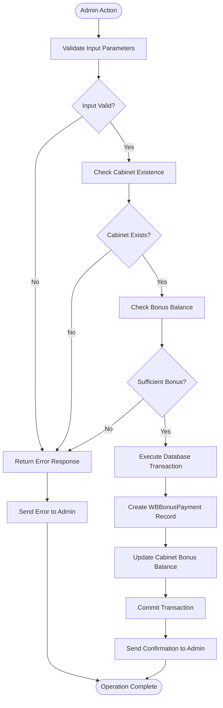
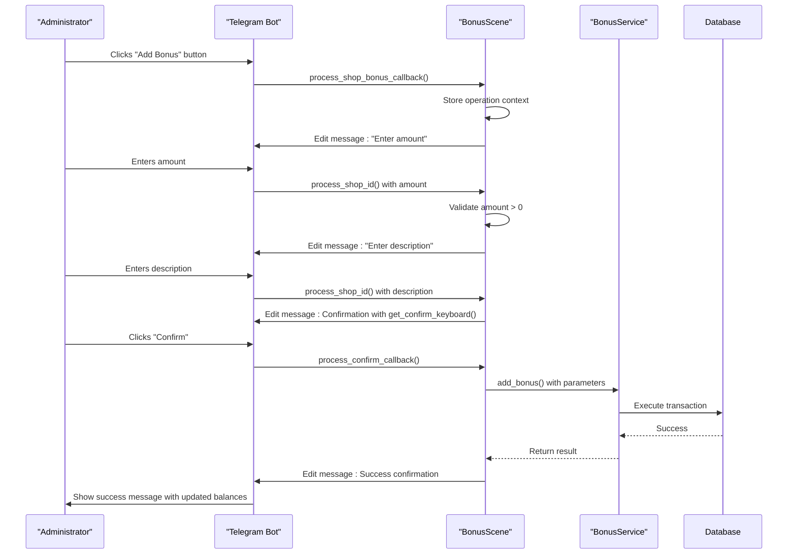
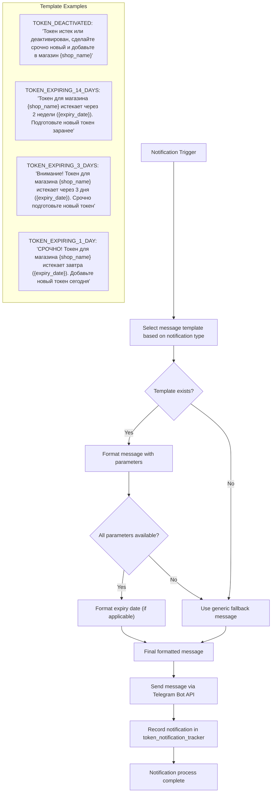
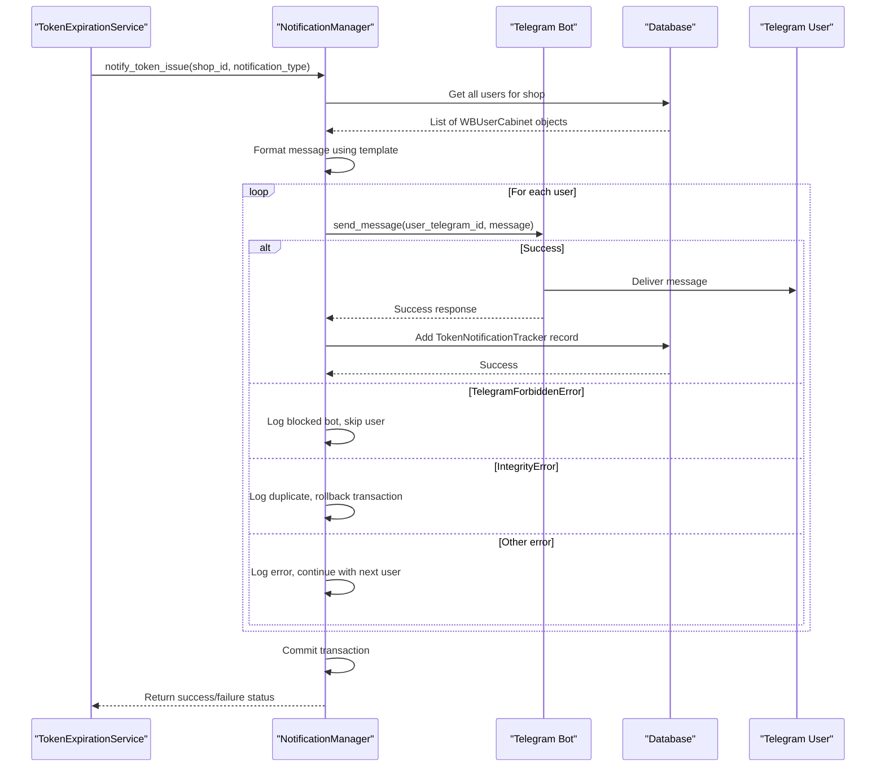

# Bonus Alert Notifications

<cite>
**Referenced Files in This Document**   
- [bonus_service.py](file://app/modules/cabinet_bonus_manager/bonus_service.py)
- [bonus_scene.py](file://app/modules/cabinet_bonus_manager/bonus_scene.py)
- [state_manager.py](file://app/modules/cabinet_bonus_manager/state_manager.py)
- [callbacks.py](file://app/modules/cabinet_bonus_manager/callbacks.py)
- [keyboards.py](file://app/modules/cabinet_bonus_manager/keyboards.py)
- [notification_manager.py](file://app/modules/token_monitoring/services/notification_manager.py)
- [token_expiration_service.py](file://app/modules/token_monitoring/services/token_expiration_service.py)
- [token_monitoring_service.py](file://app/modules/token_monitoring/services/token_monitoring_service.py)
- [scheduler.py](file://app/modules/token_monitoring/scheduler.py)
- [models.py](file://app/modules/token_monitoring/models.py)
</cite>

## Table of Contents
1. [Introduction](#introduction)
2. [Bonus Management System](#bonus-management-system)
3. [State Management in Bonus Redemption](#state-management-in-bonus-redemption)
4. [Callback Handling and User Interaction](#callback-handling-and-user-interaction)
5. [Token Expiration Monitoring and Alert System](#token-expiration-monitoring-and-alert-system)
6. [Notification Message Composition](#notification-message-composition)
7. [Integration with Telegram Event System](#integration-with-telegram-event-system)
8. [Error Handling and User Journey Continuity](#error-handling-and-user-journey-continuity)
9. [Real-World Bonus Scenarios and Notification Patterns](#real-world-bonus-scenarios-and-notification-patterns)
10. [Conclusion](#conclusion)

## Introduction

The bonus alert notification system in the advertising bot platform serves two primary functions: managing cabinet bonuses for administrative users and monitoring token expiration for proactive user alerts. While the cabinet bonus system focuses on financial operations within the platform, the token monitoring system provides critical alerts about API token status. This document details both systems, with emphasis on their notification mechanisms, state management, and integration with the Telegram messaging platform.

The system architecture separates concerns between bonus management operations and token expiration alerts, using distinct modules with specialized responsibilities. The cabinet bonus manager handles financial transactions for advertising cabinets, while the token monitoring service proactively alerts users about impending token expiration. Both systems leverage the Telegram bot framework for user interaction but serve different user needs and operational requirements.

**Section sources**
- [bonus_service.py](file://app/modules/cabinet_bonus_manager/bonus_service.py#L1-L176)
- [notification_manager.py](file://app/modules/token_monitoring/services/notification_manager.py#L1-L335)

## Bonus Management System

The cabinet bonus management system enables administrators to perform financial operations on advertising cabinets, including adding, subtracting, and resetting bonus balances. The system is implemented in the `cabinet_bonus_manager` module and provides a comprehensive interface for managing cabinet bonuses through the Telegram bot.

The core functionality is implemented in the `bonus_service.py` file, which contains asynchronous functions for all bonus operations. The `add_bonus` function allows administrators to increase a cabinet's bonus balance by a specified amount, creating a corresponding `WBBonusPayment` record in the database. Similarly, the `subtract_bonus` function reduces a cabinet's bonus balance, with validation to prevent overdrafts. The `reset_bonus` function completely clears a cabinet's bonus balance, useful for account reconciliation or promotional resets.

Each operation follows a transactional pattern with proper error handling and rollback capabilities. The service functions validate input parameters, check cabinet existence, and ensure sufficient funds before executing operations. The system maintains an audit trail by recording all bonus transactions in the database, including the administrator ID, operation type, amount, and description. This provides complete transparency and accountability for all financial operations within the platform.



**Diagram sources**
- [bonus_service.py](file://app/modules/cabinet_bonus_manager/bonus_service.py#L1-L176)

**Section sources**
- [bonus_service.py](file://app/modules/cabinet_bonus_manager/bonus_service.py#L1-L176)
- [bonus_scene.py](file://app/modules/cabinet_bonus_manager/bonus_scene.py#L1-L513)

## State Management in Bonus Redemption

The bonus management system implements a sophisticated state management mechanism to guide administrators through multi-step operations. The system uses the aiogram FSM (Finite State Machine) framework to maintain context across multiple user interactions, ensuring a smooth and error-resistant user experience.

The state management is defined in the `state_manager.py` file, which declares a `BonusManagerStateGroup` class containing four distinct states: `waiting_for_shop_id`, `waiting_for_amount`, `waiting_for_description`, and `waiting_for_confirm`. These states represent the sequential steps in the bonus management workflow, from selecting a cabinet to confirming the final operation.

The state transitions are carefully orchestrated in the `bonus_scene.py` file, which implements the scene-based interaction model. When an administrator initiates a bonus operation, the system enters the `waiting_for_shop_id` state and prompts for the target cabinet's shop ID. Upon receiving valid input, the system transitions to the next appropriate state based on the operation type. For example, after entering a shop ID, the system moves to `waiting_for_amount` for add or subtract operations, or directly to `waiting_for_description` for reset operations.

The system maintains state context throughout the operation, storing intermediate data such as the selected shop ID, operation type, amount, and description. This allows administrators to navigate back through the workflow or cancel operations at any point without losing context. The state manager also implements a custom `wizard_exit` method that selectively preserves important data when exiting the bonus management scene, ensuring continuity if the administrator needs to perform other tasks before completing the bonus operation.

```mermaid
stateDiagram-v2
[*] --> Idle
Idle --> WaitingForShopId : "bonus_menu command"
WaitingForShopId --> WaitingForAmount : "valid shop_id"
WaitingForAmount --> WaitingForDescription : "valid amount"
WaitingForDescription --> WaitingForConfirm : "description entered"
WaitingForConfirm --> OperationSuccess : "confirm"
WaitingForConfirm --> WaitingForShopId : "cancel"
OperationSuccess --> WaitingForShopId : "new operation"
WaitingForShopId --> Idle : "start command"
state "OperationSuccess" {
[*] --> ShowResults
ShowResults --> UpdateStateData : "update context"
UpdateStateData --> [*]
}
note right of WaitingForAmount
Validates amount > 0
Checks available bonus balance
end note
note right of WaitingForConfirm
Displays final confirmation
Shows operation summary
Requires explicit confirmation
end note
```

**Diagram sources**
- [state_manager.py](file://app/modules/cabinet_bonus_manager/state_manager.py#L1-L20)
- [bonus_scene.py](file://app/modules/cabinet_bonus_manager/bonus_scene.py#L1-L513)

**Section sources**
- [state_manager.py](file://app/modules/cabinet_bonus_manager/state_manager.py#L1-L20)
- [bonus_scene.py](file://app/modules/cabinet_bonus_manager/bonus_scene.py#L1-L513)

## Callback Handling and User Interaction

The bonus management system employs a comprehensive callback handling mechanism to facilitate user interaction through inline keyboard buttons. The system uses aiogram's callback data pattern to encode operation parameters directly in callback payloads, enabling rich, stateless interactions that are resilient to message edits and deletions.

The callback system is defined in the `callbacks.py` file, which declares the `AdminBonus` class inheriting from `CallbackData`. This class defines the callback structure with fields for `action`, `operation`, `wb_cabinet_original_id`, and `amount`. The `action` field specifies the primary operation (add, subtract, reset, confirm, cancel, menu), while the `operation` field provides additional context for confirmation callbacks. The `wb_cabinet_original_id` and `amount` fields carry the target cabinet ID and operation amount, respectively.

The `keyboards.py` file implements three primary keyboard layouts: `get_shop_bonus_keyboard` for selecting operations on a specific cabinet, `get_confirm_keyboard` for confirming operations with amount and operation type, and `get_back_to_menu_keyboard` for navigation. These keyboards are dynamically generated based on the current operation context, ensuring that users only see relevant options at each step of the workflow.

The callback handlers in `bonus_scene.py` process these interactions through dedicated methods such as `process_shop_bonus_callback`, `process_confirm_callback`, and `process_cancel_callback`. These handlers extract parameters from the callback data, validate the operation context, and execute the appropriate business logic. The system provides immediate visual feedback by editing the original message to reflect the current state, maintaining a clean and focused user interface throughout the interaction.



**Diagram sources**
- [callbacks.py](file://app/modules/cabinet_bonus_manager/callbacks.py#L1-L11)
- [keyboards.py](file://app/modules/cabinet_bonus_manager/keyboards.py#L1-L97)
- [bonus_scene.py](file://app/modules/cabinet_bonus_manager/bonus_scene.py#L1-L513)

**Section sources**
- [callbacks.py](file://app/modules/cabinet_bonus_manager/callbacks.py#L1-L11)
- [keyboards.py](file://app/modules/cabinet_bonus_manager/keyboards.py#L1-L97)
- [bonus_scene.py](file://app/modules/cabinet_bonus_manager/bonus_scene.py#L1-L513)

## Token Expiration Monitoring and Alert System

The token expiration monitoring system provides proactive alerts about API token status, ensuring users can maintain uninterrupted service. This system operates independently of the bonus management functionality but shares the same notification infrastructure through the Telegram bot.

The monitoring system is implemented in the `token_monitoring` module and consists of three core components: the `TokenExpirationService`, the `NotificationManager`, and the `TokenMonitoringScheduler`. The `TokenExpirationService` scans the database for tokens approaching expiration and determines which notifications should be sent based on predefined warning stages (14 days, 3 days, and 1 day before expiration).

The service checks all active tokens with expiration dates, calculating the days until expiry for each token. When a token reaches one of the warning stages, the system verifies whether a notification has already been sent for that specific stage to prevent duplicate alerts. This deduplication is enforced through a unique constraint in the `token_notification_tracker` database table, which prevents multiple notifications of the same type for the same shop and user combination.

The `TokenMonitoringScheduler` runs the expiration check on a daily basis at a configurable time (default 9:00 AM). The scheduler calculates the time until the next check and sleeps until that moment, ensuring consistent daily execution. The system also supports manual execution through the `run_manual_token_check` function, allowing administrators to trigger an immediate check when needed.

```mermaid
flowchart TD
Scheduler[TokenMonitoringScheduler] --> |Daily at 9:00| ExpirationService[TokenExpirationService]
ExpirationService --> |Check all tokens| Database[(Database)]
Database --> |Active tokens with expiry| ExpirationService
ExpirationService --> |For each token| CalculateDays["Calculate days until expiry"]
CalculateDays --> |Days in [1,3,14]| CheckNotification["Check if notification already sent"]
CheckNotification --> |Not sent| SendNotification["Send notification via NotificationManager"]
CheckNotification --> |Already sent| Skip["Skip (prevent duplicates)"]
SendNotification --> NotificationManager[NotificationManager]
NotificationManager --> |Send message| TelegramBot[(Telegram)]
NotificationManager --> |Record in DB| TokenNotificationTracker[(token_notification_tracker)]
ExpirationService --> |Collect stats| LogResults["Log check statistics"]
subgraph "Deduplication"
TokenNotificationTracker --> |Unique constraint| Constraint["shop_id + user_telegram_id + notification_type"]
Constraint --> |Prevents duplicates| NotificationManager
end
subgraph "Manual Operations"
Admin --> |Run manual check| run_manual_token_check[run_manual_token_check()]
run_manual_token_check --> ExpirationService
Admin --> |Get report| get_token_expiration_report[get_token_expiration_report()]
get_token_expiration_report --> ExpirationService
end
```

**Diagram sources**
- [token_expiration_service.py](file://app/modules/token_monitoring/services/token_expiration_service.py#L1-L313)
- [scheduler.py](file://app/modules/token_monitoring/scheduler.py#L1-L185)
- [models.py](file://app/modules/token_monitoring/models.py#L1-L80)

**Section sources**
- [token_expiration_service.py](file://app/modules/token_monitoring/services/token_expiration_service.py#L1-L313)
- [scheduler.py](file://app/modules/token_monitoring/scheduler.py#L1-L185)

## Notification Message Composition

The notification system employs a template-based approach to message composition, ensuring consistent and localized messaging across different notification types. The message templates are defined in the `NotificationManager` class within the `notification_manager.py` file, with separate templates for each notification type: token deactivation, 14-day expiration, 3-day expiration, and 1-day expiration.

The message templates use Python's string formatting to incorporate dynamic content such as the shop name and expiration date. For example, the 14-day expiration template includes placeholders for `{shop_name}` and `{expiry_date}`, which are replaced with actual values when the message is sent. This approach allows for easy localization and customization of notification messages without modifying the core notification logic.

The system handles formatting errors gracefully by providing fallback messages when template parameters are missing or incorrectly specified. This ensures that users always receive a meaningful notification even if there are issues with the template formatting. The message composition process also includes date formatting, converting datetime objects to human-readable strings in the format "DD.MM.YYYY" for consistency across all notifications.

For bonus operations, the system generates confirmation messages that include detailed information about the completed transaction, including the shop ID, operation type, amount, and updated balance information. These messages provide immediate feedback to administrators, confirming the success of their operations and showing the resulting state of the cabinet's financial balances.



**Diagram sources**
- [notification_manager.py](file://app/modules/token_monitoring/services/notification_manager.py#L1-L335)
- [models.py](file://app/modules/token_monitoring/models.py#L1-L80)

**Section sources**
- [notification_manager.py](file://app/modules/token_monitoring/services/notification_manager.py#L1-L335)

## Integration with Telegram Event System

The notification system is tightly integrated with the Telegram event system through the aiogram framework, enabling real-time message delivery and interaction. The integration is implemented in the `NotificationManager` class, which uses the Telegram Bot API to send messages to users and handles various edge cases that may occur during message delivery.

When sending notifications, the system uses the `send_message` method of the Telegram Bot API, targeting users by their Telegram user ID. The system handles the `TelegramForbiddenError` exception, which occurs when a user has blocked the bot, by logging the event and continuing with other notifications. This ensures that issues with individual users do not prevent notifications from being sent to other users of the same shop.

The integration also includes a database persistence layer that records each notification in the `token_notification_tracker` table. This provides an audit trail of all sent notifications and enables deduplication by preventing the same notification type from being sent multiple times to the same user for the same shop. The database record includes the shop ID, user Telegram ID, notification type, token expiry date (when applicable), and timestamps for when the notification was sent and resolved.

The system uses lazy loading for the bot instance, importing it only when needed to avoid circular import issues. This design pattern allows the notification manager to be imported and used throughout the application without requiring the bot instance to be available at import time.



**Diagram sources**
- [notification_manager.py](file://app/modules/token_monitoring/services/notification_manager.py#L1-L335)
- [models.py](file://app/modules/token_monitoring/models.py#L1-L80)

**Section sources**
- [notification_manager.py](file://app/modules/token_monitoring/services/notification_manager.py#L1-L335)
- [models.py](file://app/modules/token_monitoring/models.py#L1-L80)

## Error Handling and User Journey Continuity

The system implements comprehensive error handling to ensure reliability and maintain user journey continuity, even in the face of various failure scenarios. The error handling strategy differs between the bonus management system and the token notification system, reflecting their different operational requirements.

In the bonus management system, all database operations are wrapped in transactions with explicit rollback on error. This ensures that partial operations do not leave the database in an inconsistent state. For example, if an `add_bonus` operation fails after creating the `WBBonusPayment` record but before committing the transaction, the entire operation is rolled back, preventing phantom bonus additions. The system also validates input parameters and business rules (such as positive amounts and sufficient balances) before attempting database operations, providing clear error messages to administrators.

The token notification system employs a more resilient approach, designed to continue processing even when individual notifications fail. When sending notifications to multiple users of a shop, the system isolates each user notification in a try-except block, allowing it to skip problematic users while continuing with others. This ensures that if one user has blocked the bot or there is a temporary network issue, other users still receive their notifications.

The system also handles database constraint violations gracefully, particularly the unique constraint that prevents duplicate notifications. When an `IntegrityError` occurs due to a duplicate notification attempt, the system logs the event and continues processing, rather than failing the entire operation. This design ensures that the system remains operational even when edge cases occur.

For both systems, comprehensive logging is implemented to aid in debugging and monitoring. All significant operations, errors, and warnings are logged with appropriate severity levels, providing administrators with visibility into system behavior and facilitating troubleshooting when issues arise.

```mermaid
flowchart TD
subgraph "Bonus Management Error Handling"
Start1[Start Bonus Operation] --> Transaction["Begin database transaction"]
Transaction --> Execute["Execute operation"]
Execute --> Success1{"Success?"}
Success1 --> |Yes| Commit["Commit transaction"]
Success1 --> |No| Rollback["Rollback transaction"]
Rollback --> LogError["Log error details"]
Commit --> Complete1["Operation complete"]
LogError --> Complete1
end
subgraph "Notification System Error Handling"
Start2[Start Notification Process] --> ProcessUsers["Process each user"]
ProcessUsers --> SendMsg["Send message to user"]
SendMsg --> Success2{"Success?"}
Success2 --> |Yes| Record["Record in database"]
Success2 --> |TelegramForbiddenError| Skip["Skip user, log blocked bot"]
Success2 --> |IntegrityError| SkipDuplicate["Skip, log duplicate"]
Success2 --> |Other error| LogNotifyError["Log error, continue"]
Record --> Success3{"Database success?"}
Success3 --> |Yes| NextUser["Process next user"]
Success3 --> |No| LogDBError["Log database error, continue"]
Skip --> NextUser
SkipDuplicate --> NextUser
LogNotifyError --> NextUser
LogDBError --> NextUser
NextUser --> MoreUsers{"More users?"}
MoreUsers --> |Yes| ProcessUsers
MoreUsers --> |No| Complete2["Process complete"]
end
style Success1 fill:#9f9,stroke:#333
style Success2 fill:#9f9,stroke:#333
style Success3 fill:#9f9,stroke:#333
```



**Diagram sources**
- [bonus_service.py](file://app/modules/cabinet_bonus_manager/bonus_service.py#L1-L176)
- [notification_manager.py](file://app/modules/token_monitoring/services/notification_manager.py#L1-L335)

**Section sources**
- [bonus_service.py](file://app/modules/cabinet_bonus_manager/bonus_service.py#L1-L176)
- [notification_manager.py](file://app/modules/token_monitoring/services/notification_manager.py#L1-L335)

## Real-World Bonus Scenarios and Notification Patterns

The system supports several real-world scenarios for bonus management and token notifications, each with specific patterns and workflows. These scenarios demonstrate how the system functions in practical use cases and highlight the integration between different components.

For bonus management, a typical scenario involves an administrator adding a promotional bonus to a high-performing advertising cabinet. The administrator initiates the process with the `/bonus_menu` command, enters the shop ID, selects "Add Bonus," specifies the amount, adds a description (such as "Q3 Performance Bonus"), and confirms the operation. The system validates the input, executes the transaction, and displays a confirmation message with the updated balance. This entire workflow is stateful, guiding the administrator through each step with appropriate validation and feedback.

Another common scenario is the reset of bonus balances at the end of a billing cycle. Administrators can use the "Reset" function to clear all bonuses for a cabinet, which is useful for account reconciliation or when transitioning between promotional periods. The system requires explicit confirmation before executing this irreversible operation, preventing accidental data loss.

For token notifications, the system automatically alerts users at three critical points: 14 days, 3 days, and 1 day before token expiration. The 14-day notification serves as a gentle reminder to prepare a new token, the 3-day notification emphasizes urgency, and the 1-day notification is marked as "СРОЧНО!" (URGENT!) to convey critical importance. When a token is deactivated, an immediate notification is sent regardless of the expiration schedule.

The system also handles edge cases such as multiple users for the same shop. In such cases, notifications are sent to all users, ensuring that at least one team member receives the alert. The deduplication mechanism prevents the same user from receiving multiple identical notifications, while still allowing different users to receive alerts for the same token issue.

These scenarios demonstrate the system's robustness and user-centric design, balancing automation with administrative control and providing clear, timely communications to maintain service continuity.

**Section sources**
- [bonus_service.py](file://app/modules/cabinet_bonus_manager/bonus_service.py#L1-L176)
- [bonus_scene.py](file://app/modules/cabinet_bonus_manager/bonus_scene.py#L1-L513)
- [notification_manager.py](file://app/modules/token_monitoring/services/notification_manager.py#L1-L335)
- [token_expiration_service.py](file://app/modules/token_monitoring/services/token_expiration_service.py#L1-L313)

## Conclusion

The bonus alert notification system in the advertising bot platform provides comprehensive functionality for both financial operations and service monitoring. The cabinet bonus manager enables administrators to perform precise financial operations on advertising cabinets with a user-friendly interface and robust transactional integrity. Meanwhile, the token monitoring system proactively alerts users about impending token expiration, preventing service disruptions through timely notifications.

The system's architecture demonstrates a clear separation of concerns, with distinct modules handling bonus management and token notifications while sharing common infrastructure for database access and Telegram integration. The state management system ensures a smooth user experience for multi-step operations, while the callback handling mechanism provides rich, interactive interfaces within the Telegram environment.

The notification system's template-based message composition, deduplication mechanisms, and comprehensive error handling make it reliable and maintainable. By recording all notifications in the database, the system provides an audit trail and enables sophisticated features like notification history and resolution tracking.

Together, these components form a robust platform that supports both administrative operations and user communications, ensuring the advertising system remains functional and user-friendly. The design principles of transactional integrity, user guidance, and proactive monitoring provide a solid foundation for future enhancements and additional notification types.