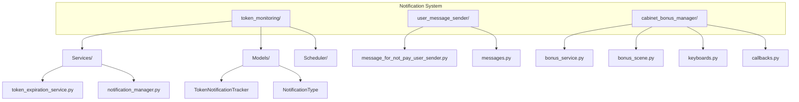
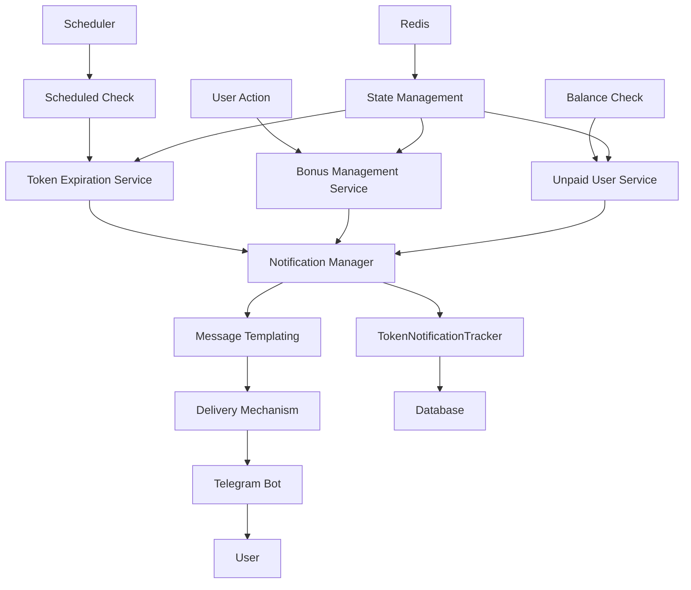
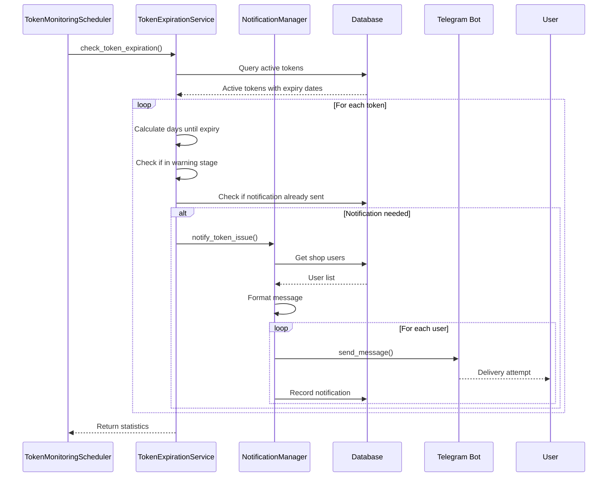
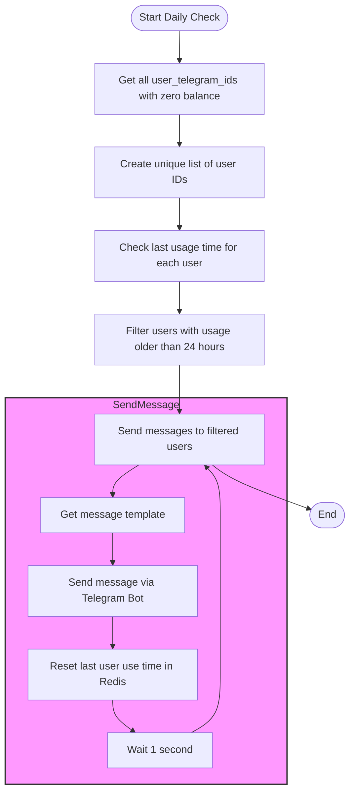
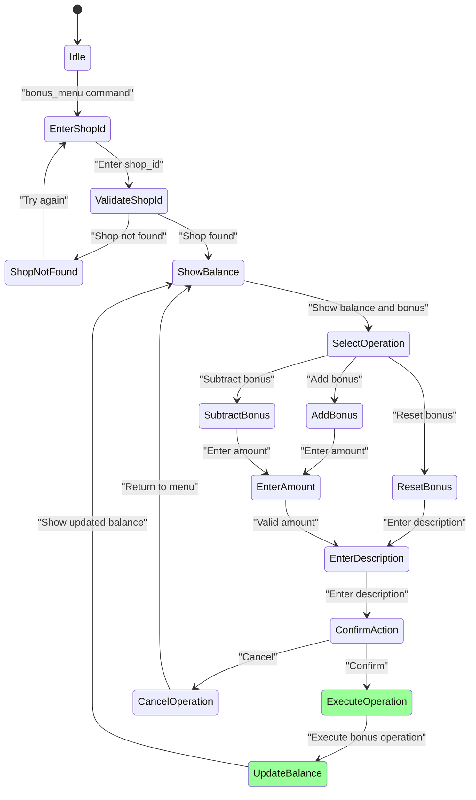
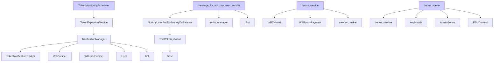

# Event-Driven Notifications

<cite>
**Referenced Files in This Document**   
- [token_expiration_service.py](file://app/modules/token_monitoring/services/token_expiration_service.py)
- [notification_manager.py](file://app/modules/token_monitoring/services/notification_manager.py)
- [models.py](file://app/modules/token_monitoring/models.py)
- [scheduler.py](file://app/modules/token_monitoring/scheduler.py)
- [message_for_not_pay_user_sender.py](file://app/modules/user_message_sender/message_for_not_pay_user_sender.py)
- [messages.py](file://app/modules/user_message_sender/messages.py)
- [bonus_service.py](file://app/modules/cabinet_bonus_manager/bonus_service.py)
- [bonus_scene.py](file://app/modules/cabinet_bonus_manager/bonus_scene.py)
- [templates.py](file://app/client_bot/user_interface/message_templates/templates.py)
- [base.py](file://app/client_bot/user_interface/message_templates/base.py)
</cite>

## Table of Contents
1. [Introduction](#introduction)
2. [Project Structure](#project-structure)
3. [Core Components](#core-components)
4. [Architecture Overview](#architecture-overview)
5. [Detailed Component Analysis](#detailed-component-analysis)
6. [Dependency Analysis](#dependency-analysis)
7. [Performance Considerations](#performance-considerations)
8. [Troubleshooting Guide](#troubleshooting-guide)
9. [Conclusion](#conclusion)

## Introduction
This document provides comprehensive documentation for the event-driven notification system in the adv-bot application. The system is designed to monitor token expiration, manage user notifications, and handle various messaging workflows including unpaid user alerts and bonus notifications. The architecture follows an event-driven pattern with scheduled tasks, notification managers, and state tracking mechanisms to ensure timely delivery of critical alerts to users.

## Project Structure
The notification system is organized within the app/modules directory with dedicated modules for token monitoring, user messaging, and bonus management. The core notification components are located in the token_monitoring module, while user-specific messaging is handled by the user_message_sender and cabinet_bonus_manager modules.

**Diagram sources**
- [token_expiration_service.py](file://app/modules/token_monitoring/services/token_expiration_service.py)
- [notification_manager.py](file://app/modules/token_monitoring/services/notification_manager.py)
- [models.py](file://app/modules/token_monitoring/models.py)
- [message_for_not_pay_user_sender.py](file://app/modules/user_message_sender/message_for_not_pay_user_sender.py)
- [bonus_service.py](file://app/modules/cabinet_bonus_manager/bonus_service.py)

**Section sources**
- [token_expiration_service.py](file://app/modules/token_monitoring/services/token_expiration_service.py)
- [notification_manager.py](file://app/modules/token_monitoring/services/notification_manager.py)
- [models.py](file://app/modules/token_monitoring/models.py)
- [scheduler.py](file://app/modules/token_monitoring/scheduler.py)

## Core Components
The event-driven notification system consists of several core components that work together to detect events, prepare messages, and deliver notifications to users. The main components include the TokenExpirationService for monitoring token expiration, the NotificationManager for handling message delivery, and the TokenMonitoringScheduler for managing the timing of notification checks.

The system also includes specialized components for handling unpaid user messaging and bonus notifications, each with their own service and message template implementations. The architecture is designed to be modular and extensible, allowing for additional notification types to be added with minimal changes to the core system.

**Section sources**
- [token_expiration_service.py](file://app/modules/token_monitoring/services/token_expiration_service.py#L1-L50)
- [notification_manager.py](file://app/modules/token_monitoring/services/notification_manager.py#L1-L50)
- [message_for_not_pay_user_sender.py](file://app/modules/user_message_sender/message_for_not_pay_user_sender.py#L1-L50)

## Architecture Overview
The event-driven notification system follows a layered architecture with clear separation of concerns between event detection, message preparation, and delivery mechanisms. The system is triggered by scheduled events and user actions, with notifications being delivered through the Telegram bot interface.

**Diagram sources**
- [token_expiration_service.py](file://app/modules/token_monitoring/services/token_expiration_service.py)
- [notification_manager.py](file://app/modules/token_monitoring/services/notification_manager.py)
- [scheduler.py](file://app/modules/token_monitoring/scheduler.py)
- [message_for_not_pay_user_sender.py](file://app/modules/user_message_sender/message_for_not_pay_user_sender.py)
- [bonus_service.py](file://app/modules/cabinet_bonus_manager/bonus_service.py)

## Detailed Component Analysis

### Token Monitoring Notification Workflow
The token monitoring system detects expiration events and sends alerts to users through a multi-stage process. The workflow begins with the TokenMonitoringScheduler initiating a daily check at a specified time, which triggers the TokenExpirationService to examine all active tokens.

**Diagram sources**
- [scheduler.py](file://app/modules/token_monitoring/scheduler.py#L1-L50)
- [token_expiration_service.py](file://app/modules/token_monitoring/services/token_expiration_service.py#L1-L50)
- [notification_manager.py](file://app/modules/token_monitoring/services/notification_manager.py#L1-L50)

**Section sources**
- [scheduler.py](file://app/modules/token_monitoring/scheduler.py#L1-L186)
- [token_expiration_service.py](file://app/modules/token_monitoring/services/token_expiration_service.py#L1-L314)
- [notification_manager.py](file://app/modules/token_monitoring/services/notification_manager.py#L1-L336)

### Unpaid User Messaging System
The unpaid user messaging system identifies users with zero balance and sends them promotional messages to encourage service renewal. This system operates on a daily schedule, checking user balances and sending messages to those who haven't used the service within a specified time period.

**Diagram sources**
- [message_for_not_pay_user_sender.py](file://app/modules/user_message_sender/message_for_not_pay_user_sender.py#L1-L96)
- [messages.py](file://app/modules/user_message_sender/messages.py#L1-L39)

**Section sources**
- [message_for_not_pay_user_sender.py](file://app/modules/user_message_sender/message_for_not_pay_user_sender.py#L1-L96)
- [messages.py](file://app/modules/user_message_sender/messages.py#L1-L39)

### Bonus Notification Flows
The bonus notification system allows administrators to manage cabinet bonuses and automatically notifies users of changes to their bonus balances. The system uses a scene-based approach for user interaction, with callback handlers managing the state of bonus operations.

**Diagram sources**
- [bonus_service.py](file://app/modules/cabinet_bonus_manager/bonus_service.py#L1-L177)
- [bonus_scene.py](file://app/modules/cabinet_bonus_manager/bonus_scene.py#L1-L514)

**Section sources**
- [bonus_service.py](file://app/modules/cabinet_bonus_manager/bonus_service.py#L1-L177)
- [bonus_scene.py](file://app/modules/cabinet_bonus_manager/bonus_scene.py#L1-L514)
- [keyboards.py](file://app/modules/cabinet_bonus_manager/keyboards.py#L1-L97)
- [callbacks.py](file://app/modules/cabinet_bonus_manager/callbacks.py#L1-L11)

## Dependency Analysis
The notification system has a well-defined dependency structure with clear boundaries between components. The core dependencies are managed through dependency injection, allowing for easy testing and maintenance.

**Diagram sources**
- [scheduler.py](file://app/modules/token_monitoring/scheduler.py)
- [token_expiration_service.py](file://app/modules/token_monitoring/services/token_expiration_service.py)
- [notification_manager.py](file://app/modules/token_monitoring/services/notification_manager.py)
- [models.py](file://app/modules/token_monitoring/models.py)
- [message_for_not_pay_user_sender.py](file://app/modules/user_message_sender/message_for_not_pay_user_sender.py)
- [messages.py](file://app/modules/user_message_sender/messages.py)
- [bonus_service.py](file://app/modules/cabinet_bonus_manager/bonus_service.py)
- [bonus_scene.py](file://app/modules/cabinet_bonus_manager/bonus_scene.py)

**Section sources**
- [scheduler.py](file://app/modules/token_monitoring/scheduler.py#L1-L186)
- [token_expiration_service.py](file://app/modules/token_monitoring/services/token_expiration_service.py#L1-L314)
- [notification_manager.py](file://app/modules/token_monitoring/services/notification_manager.py#L1-L336)
- [models.py](file://app/modules/token_monitoring/models.py#L1-L81)
- [message_for_not_pay_user_sender.py](file://app/modules/user_message_sender/message_for_not_pay_user_sender.py#L1-L96)
- [messages.py](file://app/modules/user_message_sender/messages.py#L1-L39)
- [bonus_service.py](file://app/modules/cabinet_bonus_manager/bonus_service.py#L1-L177)
- [bonus_scene.py](file://app/modules/cabinet_bonus_manager/bonus_scene.py#L1-L514)

## Performance Considerations
The notification system includes several performance optimization techniques to handle bulk messaging efficiently. The system uses database indexing on key fields such as shop_id and user_telegram_id to speed up queries. The TokenNotificationTracker table includes a unique constraint to prevent duplicate notifications, reducing unnecessary database writes.

For bulk messaging operations, the system implements sequential processing with a 1-second delay between messages to comply with Telegram's rate limiting. The use of Redis for caching user activity data reduces database load and improves response times for the unpaid user messaging system.

The ARQ task queue system provides additional performance benefits with configurable retry logic and job persistence. The system is configured to keep jobs for 24 hours and allow up to 10 retry attempts, ensuring reliable message delivery even during temporary failures.

**Section sources**
- [token_expiration_service.py](file://app/modules/token_monitoring/services/token_expiration_service.py#L1-L314)
- [message_for_not_pay_user_sender.py](file://app/modules/user_message_sender/message_for_not_pay_user_sender.py#L1-L96)
- [workers.py](file://app/arq_workers/workers.py#L1-L51)

## Troubleshooting Guide
The notification system includes comprehensive error handling and logging to facilitate troubleshooting. Common issues and their solutions include:

1. **Notifications not being sent**: Check the TokenNotificationTracker table for existing records that might prevent duplicate notifications due to the unique constraint.

2. **Telegram ForbiddenError**: This occurs when users have blocked the bot. The system handles this gracefully by logging the error and continuing with other users.

3. **Database IntegrityError**: This typically occurs when attempting to send duplicate notifications. The system catches this exception and logs a debug message.

4. **Scheduler not running**: Verify that the TokenMonitoringScheduler has been properly started and that the _running flag is set to True.

5. **Redis connection issues**: Check the Redis configuration and ensure that the redis_manager is properly initialized.

The system logs detailed information about each notification attempt, including success/failure status, user IDs, and error messages, which can be used for debugging and monitoring.

**Section sources**
- [notification_manager.py](file://app/modules/token_monitoring/services/notification_manager.py#L1-L336)
- [token_expiration_service.py](file://app/modules/token_monitoring/services/token_expiration_service.py#L1-L314)
- [scheduler.py](file://app/modules/token_monitoring/scheduler.py#L1-L186)

## Conclusion
The event-driven notification system in the adv-bot application provides a robust and scalable solution for delivering timely alerts to users. The architecture effectively separates concerns between event detection, message preparation, and delivery mechanisms, making the system maintainable and extensible.

Key strengths of the system include its comprehensive token expiration monitoring with multiple warning stages, efficient handling of bulk messaging operations, and robust error handling. The use of scheduled tasks, state tracking, and message templating ensures reliable delivery of critical notifications while maintaining a clean separation between business logic and delivery mechanisms.

The system could be further enhanced by implementing more sophisticated retry logic, adding support for multiple notification channels beyond Telegram, and incorporating user preference management for notification types and frequencies.