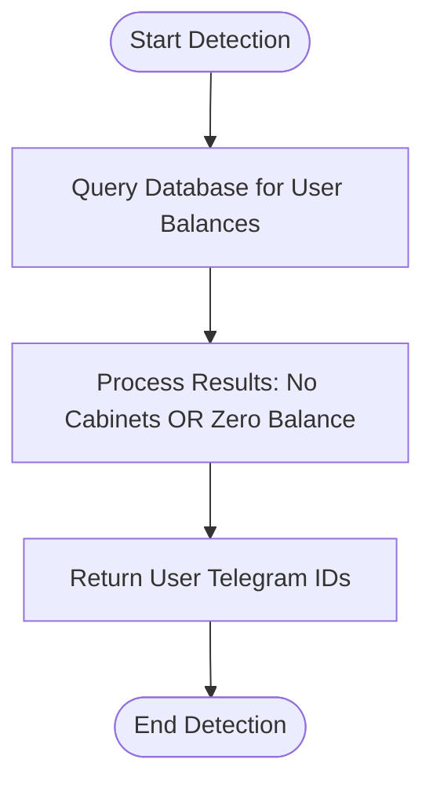
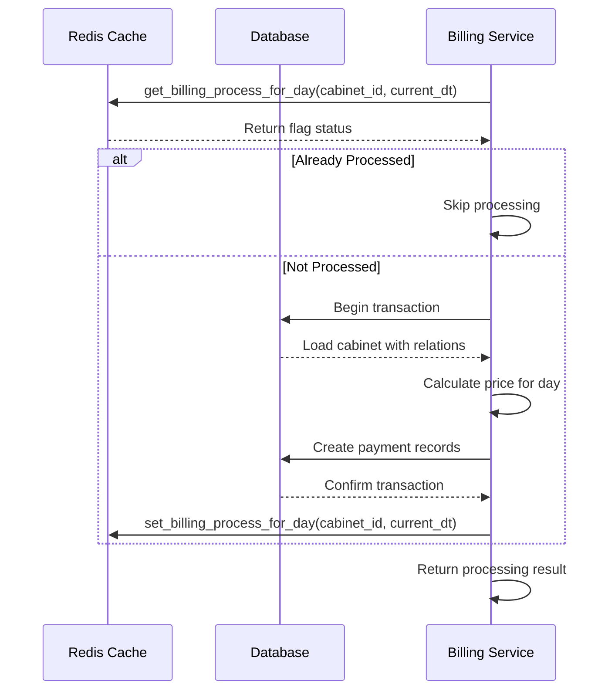
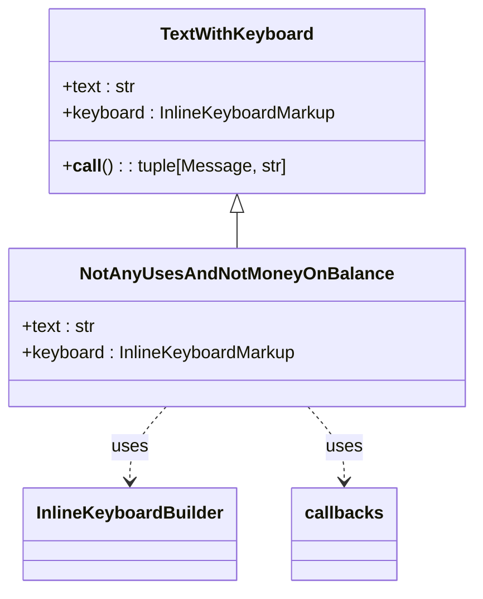
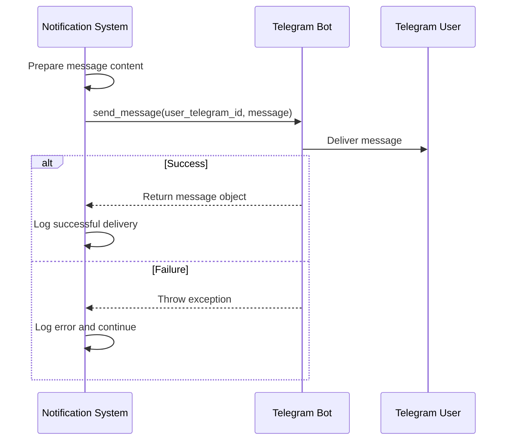
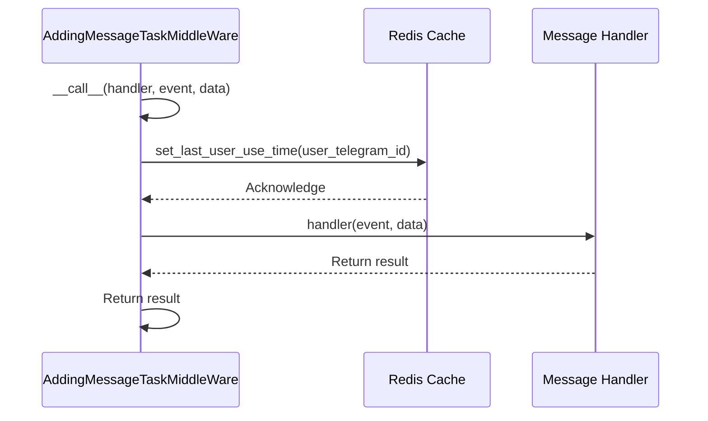
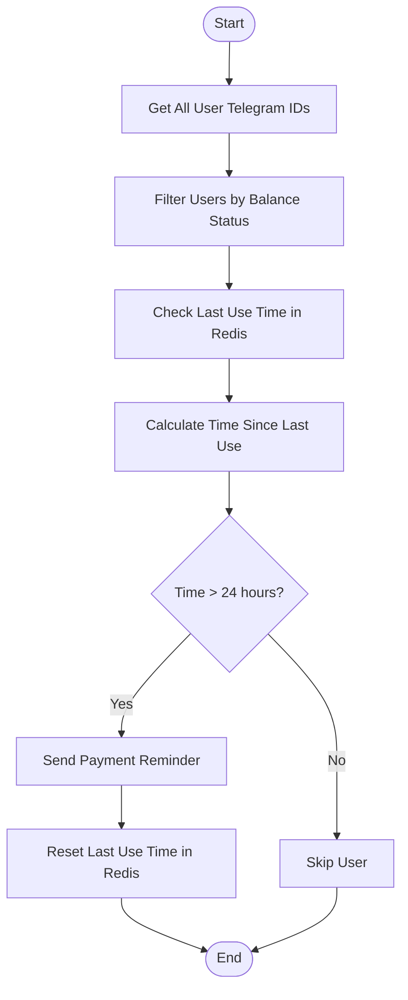
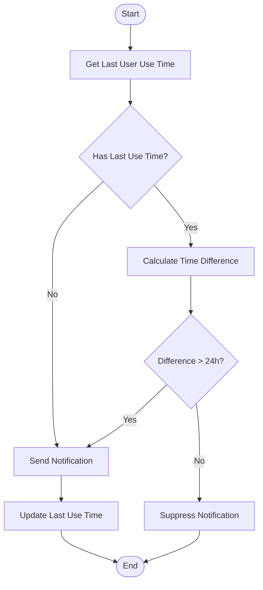
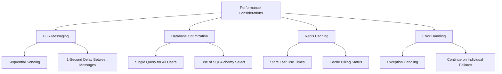
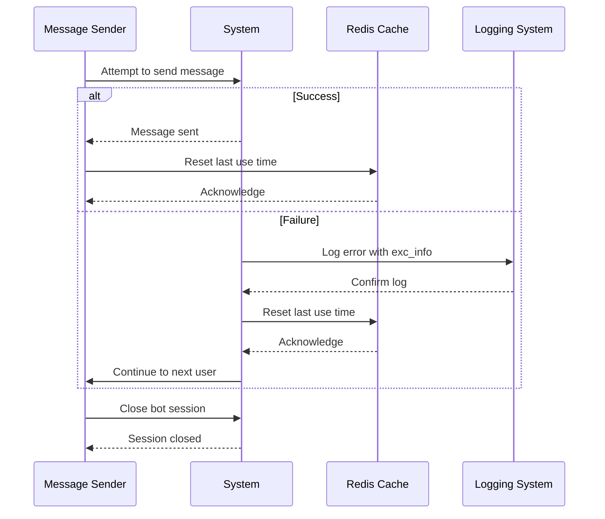

# Payment Reminder Notifications

<cite>
**Referenced Files in This Document**   
- [message_for_not_pay_user_sender.py](file://app/modules/user_message_sender/message_for_not_pay_user_sender.py)
- [messages.py](file://app/modules/user_message_sender/messages.py)
- [middleware_for_adding_task.py](file://app/modules/user_message_sender/middleware_for_adding_task.py)
- [billing.py](file://app/modules/billing/billing.py)
- [redis_manager.py](file://app/modules/billing/redis_manager.py)
- [billing_check.py](file://app/core/redis_manager_v2/mixins/billing_check.py)
- [templates.py](file://app/client_bot/user_interface/message_templates/templates.py)
- [base.py](file://app/client_bot/user_interface/message_templates/base.py)
- [notification_manager.py](file://app/modules/token_monitoring/services/notification_manager.py)
- [token_expiration_service.py](file://app/modules/token_monitoring/services/token_expiration_service.py)
- [scheduler.py](file://app/modules/token_monitoring/scheduler.py)
- [startup.py](file://app/modules/token_monitoring/startup.py)
</cite>

## Table of Contents
1. [Introduction](#introduction)
2. [Billing Status Detection](#billing-status-detection)
3. [Subscription Cycle Processing](#subscription-cycle-processing)
4. [Message Preparation and Localization](#message-preparation-and-localization)
5. [Telegram Event Integration](#telegram-event-integration)
6. [Middleware and Task Queuing](#middleware-and-task-queuing)
7. [Message Templates and Timing Strategies](#message-templates-and-timing-strategies)
8. [Suppression Logic](#suppression-logic)
9. [Performance Considerations](#performance-considerations)
10. [Failure Recovery Mechanisms](#failure-recovery-mechanisms)

## Introduction
The payment reminder notification system is designed to identify users with unpaid accounts and send timely reminders through Telegram. The system integrates with billing status checks, subscription cycle monitoring, and user activity tracking to determine when reminders should be triggered. This document details the architecture and implementation of this notification system, including message preparation, delivery mechanisms, and performance optimization strategies.

## Billing Status Detection
The system detects unpaid user accounts through comprehensive billing status checks that examine both database records and Redis cache. The detection process involves querying user accounts and their associated cabinets to determine balance status.

**Diagram sources**
- [message_for_not_pay_user_sender.py](file://app/modules/user_message_sender/message_for_not_pay_user_sender.py#L70-L95)

**Section sources**
- [message_for_not_pay_user_sender.py](file://app/modules/user_message_sender/message_for_not_pay_user_sender.py#L70-L95)
- [billing.py](file://app/modules/billing/billing.py#L96-L172)

## Subscription Cycle Processing
The system processes subscription cycles by checking billing status for each cabinet on a daily basis. A Redis-based flag system prevents duplicate processing within the same day, ensuring idempotency. The processing flow follows a specific sequence: Redis check → database transaction → commit → Redis flag update.

**Diagram sources**
- [billing.py](file://app/modules/billing/billing.py#L96-L291)
- [redis_manager.py](file://app/modules/billing/redis_manager.py#L1-L8)
- [billing_check.py](file://app/core/redis_manager_v2/mixins/billing_check.py#L1-L35)

**Section sources**
- [billing.py](file://app/modules/billing/billing.py#L96-L291)
- [redis_manager.py](file://app/modules/billing/redis_manager.py#L1-L8)
- [billing_check.py](file://app/core/redis_manager_v2/mixins/billing_check.py#L1-L35)

## Message Preparation and Localization
Message preparation involves creating dynamic content with user-specific information and localization support. The system uses template classes that separate message text from keyboard layouts, allowing for consistent formatting across different notification types.

**Diagram sources**
- [messages.py](file://app/modules/user_message_sender/messages.py#L1-L38)
- [templates.py](file://app/client_bot/user_interface/message_templates/templates.py#L1-L187)
- [base.py](file://app/client_bot/user_interface/message_templates/base.py#L1-L31)

**Section sources**
- [messages.py](file://app/modules/user_message_sender/messages.py#L1-L38)
- [templates.py](file://app/client_bot/user_interface/message_templates/templates.py#L1-L187)

## Telegram Event Integration
The notification system integrates with Telegram through the bot framework to deliver messages to users. The integration uses the Telegram event system to send messages asynchronously, with proper error handling for cases where users have blocked the bot or other delivery issues occur.

**Diagram sources**
- [message_for_not_pay_user_sender.py](file://app/modules/user_message_sender/message_for_not_pay_user_sender.py#L1-L95)
- [notification_manager.py](file://app/modules/token_monitoring/services/notification_manager.py#L1-L335)

**Section sources**
- [message_for_not_pay_user_sender.py](file://app/modules/user_message_sender/message_for_not_pay_user_sender.py#L1-L95)
- [notification_manager.py](file://app/modules/token_monitoring/services/notification_manager.py#L1-L335)

## Middleware and Task Queuing
The system employs middleware to track user interactions and queue notification tasks. When a user interacts with the bot, middleware updates their last use time in Redis, which is later used to determine eligibility for payment reminders.

**Diagram sources**
- [middleware_for_adding_task.py](file://app/modules/user_message_sender/middleware_for_adding_task.py#L1-L24)

**Section sources**
- [middleware_for_adding_task.py](file://app/modules/user_message_sender/middleware_for_adding_task.py#L1-L24)

## Message Templates and Timing Strategies
The system uses predefined message templates with specific timing strategies to ensure reminders are sent at appropriate intervals. For payment reminders, messages are sent after a 24-hour delay since the user's last interaction, preventing excessive notifications.

**Diagram sources**
- [message_for_not_pay_user_sender.py](file://app/modules/user_message_sender/message_for_not_pay_user_sender.py#L1-L95)

**Section sources**
- [message_for_not_pay_user_sender.py](file://app/modules/user_message_sender/message_for_not_pay_user_sender.py#L1-L95)

## Suppression Logic
The system implements suppression logic to prevent sending redundant notifications to users who have recently been contacted. This is achieved through Redis storage of last user interaction times, with a 24-hour threshold determining when a user becomes eligible for another reminder.

**Diagram sources**
- [message_for_not_pay_user_sender.py](file://app/modules/user_message_sender/message_for_not_pay_user_sender.py#L45-L65)

**Section sources**
- [message_for_not_pay_user_sender.py](file://app/modules/user_message_sender/message_for_not_pay_user_sender.py#L45-L65)

## Performance Considerations
The system is designed with performance considerations for bulk messaging operations. Messages are sent sequentially with a 1-second delay between transmissions to avoid overwhelming the Telegram API. Database queries are optimized to retrieve all necessary user data in single operations, and Redis is used extensively for caching frequently accessed information.

**Diagram sources**
- [message_for_not_pay_user_sender.py](file://app/modules/user_message_sender/message_for_not_pay_user_sender.py#L1-L95)
- [billing.py](file://app/modules/billing/billing.py#L96-L291)

**Section sources**
- [message_for_not_pay_user_sender.py](file://app/modules/user_message_sender/message_for_not_pay_user_sender.py#L1-L95)

## Failure Recovery Mechanisms
The system includes comprehensive failure recovery mechanisms to ensure reliable operation. Each message sending attempt is wrapped in exception handling, allowing the process to continue even if individual messages fail. Database transactions are properly managed with rollback capabilities, and Redis operations are treated as best-effort enhancements rather than critical path dependencies.

**Diagram sources**
- [message_for_not_pay_user_sender.py](file://app/modules/user_message_sender/message_for_not_pay_user_sender.py#L1-L95)
- [notification_manager.py](file://app/modules/token_monitoring/services/notification_manager.py#L1-L335)

**Section sources**
- [message_for_not_pay_user_sender.py](file://app/modules/user_message_sender/message_for_not_pay_user_sender.py#L1-L95)
- [notification_manager.py](file://app/modules/token_monitoring/services/notification_manager.py#L1-L335)