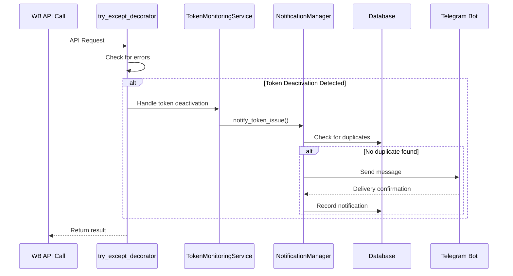
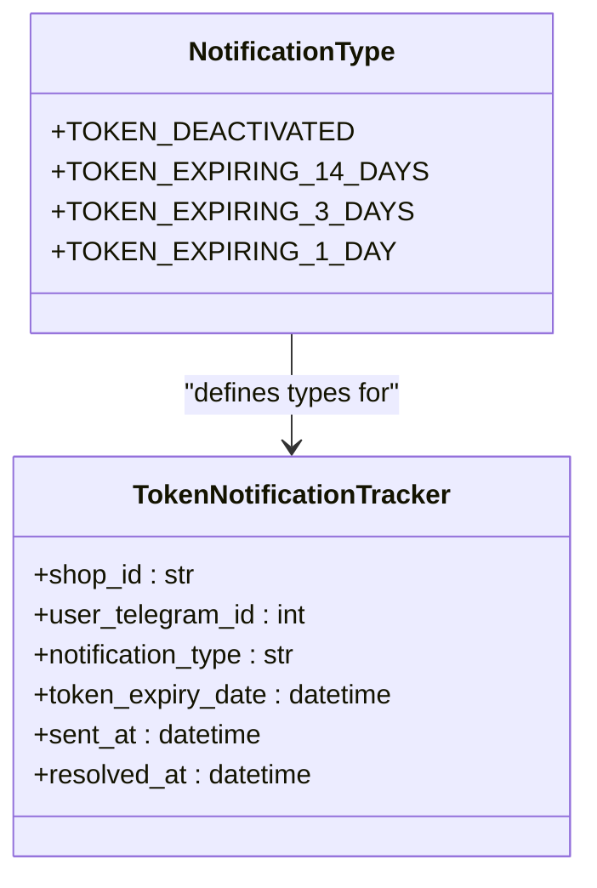
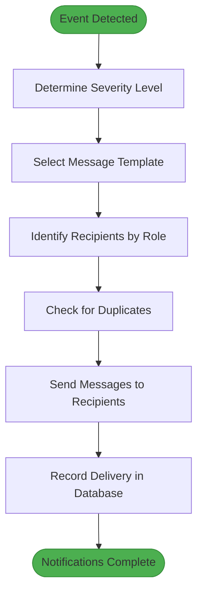
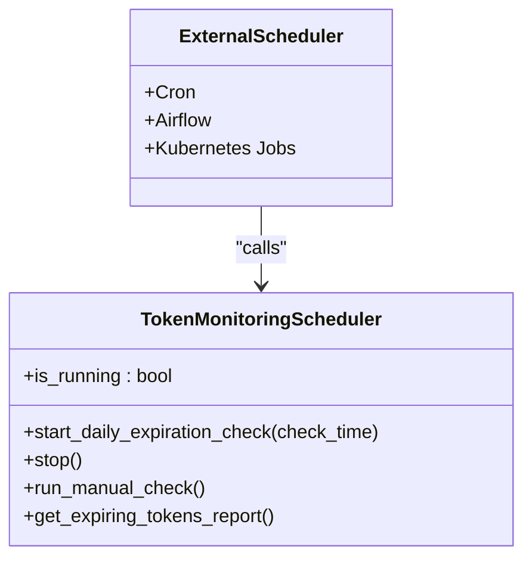
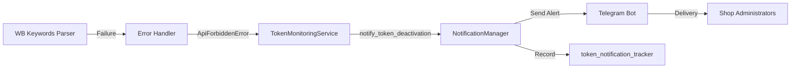
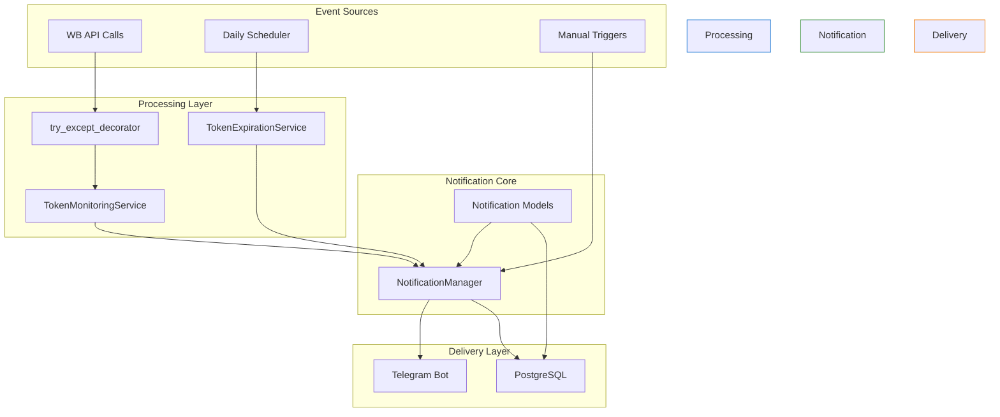
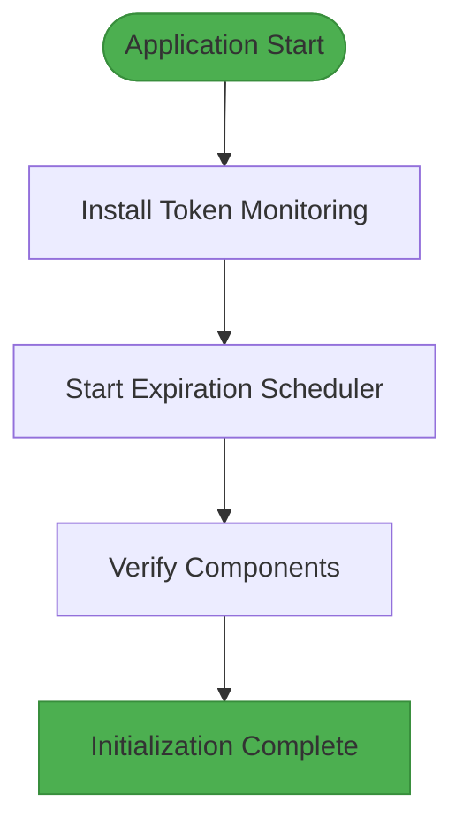

# System Status Notifications

<cite>
**Referenced Files in This Document**   
- [notification_manager.py](file://app/modules/token_monitoring/services/notification_manager.py)
- [token_monitoring_service.py](file://app/modules/token_monitoring/services/token_monitoring_service.py)
- [token_expiration_service.py](file://app/modules/token_monitoring/services/token_expiration_service.py)
- [scheduler.py](file://app/modules/token_monitoring/scheduler.py)
- [startup.py](file://app/modules/token_monitoring/startup.py)
- [integration.py](file://app/modules/token_monitoring/integration.py)
- [http_request.py](file://app/core/wb_api/http_request.py)
- [models.py](file://app/modules/token_monitoring/models.py)
- [events.py](file://app/core/telegram/event_send_message_manager/events.py)
</cite>

## Table of Contents
1. [Introduction](#introduction)
2. [Event Publishing Mechanism](#event-publishing-mechanism)
3. [Notification Types and Triggers](#notification-types-and-triggers)
4. [Message Routing and Severity Levels](#message-routing-and-severity-levels)
5. [Delivery Guarantees and Deduplication](#delivery-guarantees-and-deduplication)
6. [Integration with External Monitoring](#integration-with-external-monitoring)
7. [Operational Alert Examples](#operational-alert-examples)
8. [Architecture Overview](#architecture-overview)
9. [Startup and Initialization](#startup-and-initialization)

## Introduction
The system status notification framework provides comprehensive monitoring and alerting capabilities for critical system events. This document details the architecture and implementation of the notification system, focusing on event publishing, subscription patterns, message routing, and delivery guarantees. The system is designed to proactively notify users about service failures, update completions, and configuration changes through a robust event-driven architecture.

**Section sources**
- [notification_manager.py](file://app/modules/token_monitoring/services/notification_manager.py#L1-L336)
- [token_monitoring_service.py](file://app/modules/token_monitoring/services/token_monitoring_service.py#L1-L209)

## Event Publishing Mechanism
The notification system implements an event-driven architecture centered around the Events module. Critical system events are published through a centralized notification manager that coordinates message delivery across components.

The core event publishing mechanism works as follows:
1. System components detect critical events (service failures, configuration changes, etc.)
2. Events are routed to the NotificationManager which handles message formatting and delivery
3. The manager publishes events to subscribers through the Telegram bot interface
4. Delivery status is tracked in the database for audit and deduplication purposes

The system uses a decorator-based approach to intercept API calls and detect token-related issues. The `try_except_decorator` in the HTTP request module has been enhanced to monitor for token deactivation events and automatically publish notifications.



**Diagram sources**
- [http_request.py](file://app/core/wb_api/http_request.py#L80-L213)
- [token_monitoring_service.py](file://app/modules/token_monitoring/services/token_monitoring_service.py#L1-L209)
- [notification_manager.py](file://app/modules/token_monitoring/services/notification_manager.py#L1-L336)

**Section sources**
- [token_monitoring_service.py](file://app/modules/token_monitoring/services/token_monitoring_service.py#L1-L209)
- [http_request.py](file://app/core/wb_api/http_request.py#L80-L213)

## Notification Types and Triggers
The system supports multiple notification types, each triggered by specific system events. The NotificationType enum defines the available alert categories:



**Diagram sources**
- [models.py](file://app/modules/token_monitoring/models.py#L1-L81)

### Critical Event Triggers
**Service Failures**: Triggered when API calls fail due to token deactivation (ApiForbiddenError). The system automatically detects these failures through the enhanced try_except_decorator and publishes TOKEN_DEACTIVATED notifications.

**Update Completions**: The system monitors token expiration dates and proactively sends warnings at 14, 3, and 1 day intervals before expiration. These are implemented through scheduled jobs in the TokenExpirationService.

**Configuration Changes**: While not explicitly implemented in the current code, the architecture supports configuration change alerts through the same notification framework. Any system component can trigger notifications by calling the NotificationManager.

The event subscription pattern follows a publish-subscribe model where:
- Publishers: System components that detect events
- Broker: NotificationManager coordinates message delivery
- Subscribers: Users who receive alerts via Telegram

**Section sources**
- [models.py](file://app/modules/token_monitoring/models.py#L1-L81)
- [token_expiration_service.py](file://app/modules/token_monitoring/services/token_expiration_service.py#L1-L314)

## Message Routing and Severity Levels
The notification system implements sophisticated message routing based on severity levels and recipient roles. Messages are categorized by urgency, with different templates and delivery priorities for each severity level.

### Severity Levels
The system defines four severity levels based on the urgency of the situation:

| Severity Level | Notification Type | Response Time | Message Template |
|---------------|-------------------|---------------|------------------|
| Critical | TOKEN_DEACTIVATED | Immediate | "СРОЧНО! Токен для магазина {shop_name} истекает завтра ({expiry_date}). Добавьте новый токен сегодня" |
| High | TOKEN_EXPIRING_1_DAY | Within 24 hours | "Внимание! Токен для магазина {shop_name} истекает через 3 дня ({expiry_date}). Срочно подготовьте новый токен" |
| Medium | TOKEN_EXPIRING_3_DAYS | Within 3 days | "Токен для магазина {shop_name} истекает через 2 недели ({expiry_date}). Подготовьте новый токен заранее" |
| Low | TOKEN_EXPIRING_14_DAYS | Within 14 days | "Токен истек или деактивирован, сделайте срочно новый и добавьте в магазин {shop_name}" |

### Recipient Role-Based Routing
The system routes messages based on user roles and shop affiliations:
1. **Shop Administrators**: Receive all notifications for their shops
2. **System Administrators**: Receive critical system-wide alerts
3. **Regular Users**: Receive notifications only for shops they manage

The routing logic is implemented in the NotificationManager's _get_shop_users method, which queries the database to identify all users associated with a specific shop.



**Diagram sources**
- [notification_manager.py](file://app/modules/token_monitoring/services/notification_manager.py#L1-L336)
- [models.py](file://app/modules/token_monitoring/models.py#L1-L81)

**Section sources**
- [notification_manager.py](file://app/modules/token_monitoring/services/notification_manager.py#L1-L336)
- [models.py](file://app/modules/token_monitoring/models.py#L1-L81)

## Delivery Guarantees and Deduplication
The notification system implements robust delivery guarantees and deduplication strategies to ensure reliable message delivery while preventing spam.

### Delivery Guarantees
The system provides at-least-once delivery semantics through the following mechanisms:
- Database persistence of notification records before message sending
- Transactional updates to ensure consistency
- Error handling and retry logic for failed deliveries

When a notification is sent, the system:
1. Begins a database transaction
2. Sends the Telegram message
3. Records the notification in the token_notification_tracker table
4. Commits the transaction only after successful message delivery

### Deduplication Strategies
The system prevents duplicate notifications through multiple layers of protection:

1. **Database Constraints**: A unique constraint on (shop_id, user_telegram_id, notification_type) ensures that the same notification type cannot be sent multiple times to the same user for the same shop.

2. **Application-Level Checks**: The _notification_already_sent method queries the database to check if a notification has already been sent and not yet resolved.

3. **Resolved State Tracking**: Notifications can be marked as resolved, allowing the system to send follow-up alerts if the same issue persists.

```python
# Example of deduplication logic
async def _send_notification_to_user(self, ...):
    try:
        # Send Telegram message
        await self.bot.send_message(user_telegram_id, message)
        
        # Record notification in database
        notification = TokenNotificationTracker(
            shop_id=shop_id,
            user_telegram_id=user_telegram_id,
            notification_type=notification_type,
            token_expiry_date=expiry_date,
            sent_at=datetime.datetime.utcnow()
        )
        
        session.add(notification)
        await session.flush()  # This will fail if unique constraint violated
        
        return True
        
    except IntegrityError:
        # Duplicate notification - skip
        await session.rollback()
        return False
```

The deduplication strategy ensures that users receive timely alerts without being overwhelmed by repeated notifications for the same issue.

**Section sources**
- [notification_manager.py](file://app/modules/token_monitoring/services/notification_manager.py#L1-L336)
- [models.py](file://app/modules/token_monitoring/models.py#L1-L81)

## Integration with External Monitoring
The notification system provides several integration points for external monitoring tools and services.

### Scheduler Integration
The TokenMonitoringScheduler provides a clean interface for integration with external task schedulers:



External systems can trigger manual checks or retrieve reports through the scheduler's API, enabling integration with enterprise monitoring solutions.

### Health Check Endpoints
The system exposes several functions that can be used for health checks:
- `run_manual_token_check()` - Runs a complete token expiration check
- `get_token_expiration_report()` - Returns a summary of expiring tokens
- `is_token_monitoring_installed()` - Checks if monitoring is active

These functions can be wrapped in HTTP endpoints or CLI commands to integrate with monitoring tools like Prometheus, Nagios, or Datadog.

### Logging and Auditing
The system uses structured logging with the Python logging module, making it easy to integrate with log aggregation tools like ELK Stack or Splunk. All critical operations are logged with appropriate severity levels:

- INFO: Normal operation and successful notifications
- WARNING: Potential issues and skipped notifications
- ERROR: Failed operations and delivery errors

The token_notification_tracker table provides a complete audit trail of all notifications, including timestamps, recipient information, and resolution status.

**Diagram sources**
- [scheduler.py](file://app/modules/token_monitoring/scheduler.py#L1-L186)

**Section sources**
- [scheduler.py](file://app/modules/token_monitoring/scheduler.py#L1-L186)
- [startup.py](file://app/modules/token_monitoring/startup.py#L1-L120)

## Operational Alert Examples
The system handles several key operational alerts that demonstrate its capabilities in real-world scenarios.

### Shop Update Completion
When a shop's configuration is successfully updated, the system can notify administrators. Although not explicitly implemented in the current code, the framework supports this through the NotificationManager:

```python
async def notify_shop_update_completion(shop_id: str, update_details: dict):
    """Send notification about successful shop update."""
    manager = NotificationManager()
    await manager.notify_token_issue(
        shop_id=shop_id,
        notification_type="SHOP_UPDATE_COMPLETED",
        context=update_details
    )
```

### Model Refresh Status
For machine learning model updates, the system can provide status notifications:

```python
async def notify_model_refresh_status(shop_id: str, success: bool, metrics: dict):
    """Send notification about model refresh status."""
    notification_type = "MODEL_REFRESH_SUCCESSFUL" if success else "MODEL_REFRESH_FAILED"
    manager = NotificationManager()
    await manager.notify_token_issue(
        shop_id=shop_id,
        notification_type=notification_type,
        context=metrics
    )
```

### Parser Failures
The system monitors for parser failures and can alert administrators:



**Diagram sources**
- [token_monitoring_service.py](file://app/modules/token_monitoring/services/token_monitoring_service.py#L1-L209)
- [notification_manager.py](file://app/modules/token_monitoring/services/notification_manager.py#L1-L336)

**Section sources**
- [token_monitoring_service.py](file://app/modules/token_monitoring/services/token_monitoring_service.py#L1-L209)
- [notification_manager.py](file://app/modules/token_monitoring/services/notification_manager.py#L1-L336)

## Architecture Overview
The system status notification architecture follows a modular design with clear separation of concerns. The components work together to provide a reliable and scalable alerting system.



The architecture demonstrates several key design principles:
- **Separation of Concerns**: Each component has a single responsibility
- **Loose Coupling**: Components interact through well-defined interfaces
- **Extensibility**: New notification types and delivery channels can be added easily
- **Resilience**: Error handling and retry mechanisms ensure reliability

The system uses dependency injection to manage component dependencies, allowing for easy testing and configuration. The global instances (like _monitoring_service) provide convenient access points while maintaining the ability to inject custom implementations for testing.

**Diagram sources**
- [token_monitoring_service.py](file://app/modules/token_monitoring/services/token_monitoring_service.py#L1-L209)
- [token_expiration_service.py](file://app/modules/token_monitoring/services/token_expiration_service.py#L1-L314)
- [notification_manager.py](file://app/modules/token_monitoring/services/notification_manager.py#L1-L336)
- [scheduler.py](file://app/modules/token_monitoring/scheduler.py#L1-L186)

**Section sources**
- [token_monitoring_service.py](file://app/modules/token_monitoring/services/token_monitoring_service.py#L1-L209)
- [token_expiration_service.py](file://app/modules/token_monitoring/services/token_expiration_service.py#L1-L314)
- [notification_manager.py](file://app/modules/token_monitoring/services/notification_manager.py#L1-L336)
- [scheduler.py](file://app/modules/token_monitoring/scheduler.py#L1-L186)

## Startup and Initialization
The notification system is initialized through a well-defined startup process that ensures all components are properly configured and running.

### Initialization Sequence
The startup process follows these steps:



### Configuration Options
The system provides several configuration options through the initialize_token_monitoring function:

| Parameter | Default Value | Description |
|---------|---------------|-------------|
| enable_decorator_monitoring | True | Whether to install HTTP decorator monitoring |
| enable_expiration_scheduler | True | Whether to start the expiration scheduler |
| daily_check_time | 09:00 | Time of day to run daily expiration checks |

### Startup Code
The initialization is handled by the startup module:

```python
async def initialize_token_monitoring(
    enable_decorator_monitoring: bool = True,
    enable_expiration_scheduler: bool = True,
    daily_check_time: time = time(9, 0)
) -> None:
    """
    Initialize the complete token monitoring system.
    """
    logger.info("Initializing token monitoring system...")
    
    # Install decorator monitoring for token deactivation detection
    if enable_decorator_monitoring:
        install_token_monitoring()
        logger.info("✓ Token deactivation monitoring installed")
    
    # Start expiration scheduler for proactive monitoring
    if enable_expiration_scheduler:
        await start_token_monitoring_scheduler(daily_check_time)
        logger.info(f"✓ Token expiration scheduler started (daily at {daily_check_time})")
```

The system also provides a simple integration function for backward compatibility:

```python
def install_all_token_monitoring() -> None:
    """Install all token monitoring features with default settings."""
    setup_token_monitoring_for_app(
        enable_decorator_monitoring=True,
        enable_expiration_scheduler=True,
        daily_check_time=time(9, 0)  # 9:00 AM
    )
```

This startup sequence ensures that the notification system is fully operational before the application begins handling user requests.

**Section sources**
- [startup.py](file://app/modules/token_monitoring/startup.py#L1-L120)
- [integration.py](file://app/modules/token_monitoring/integration.py#L1-L112)
- [scheduler.py](file://app/modules/token_monitoring/scheduler.py#L1-L186)