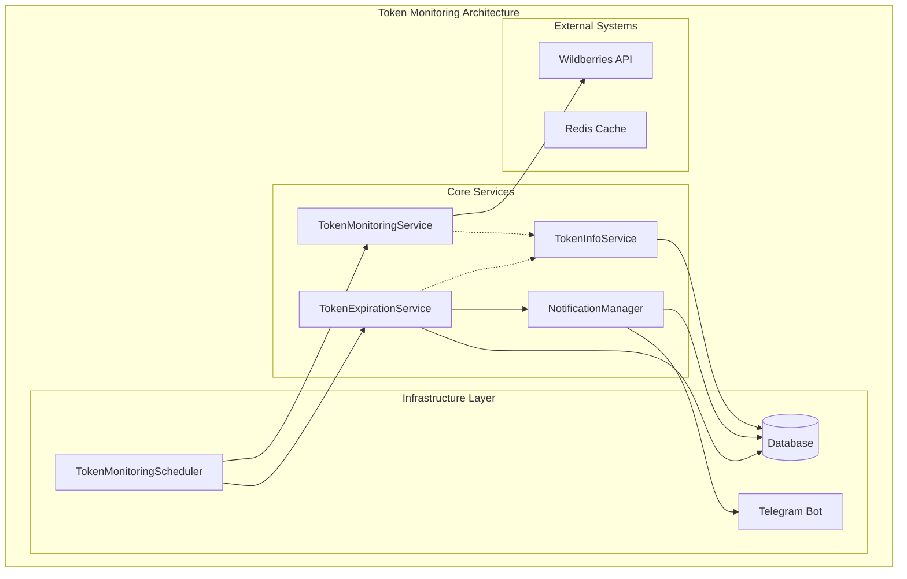
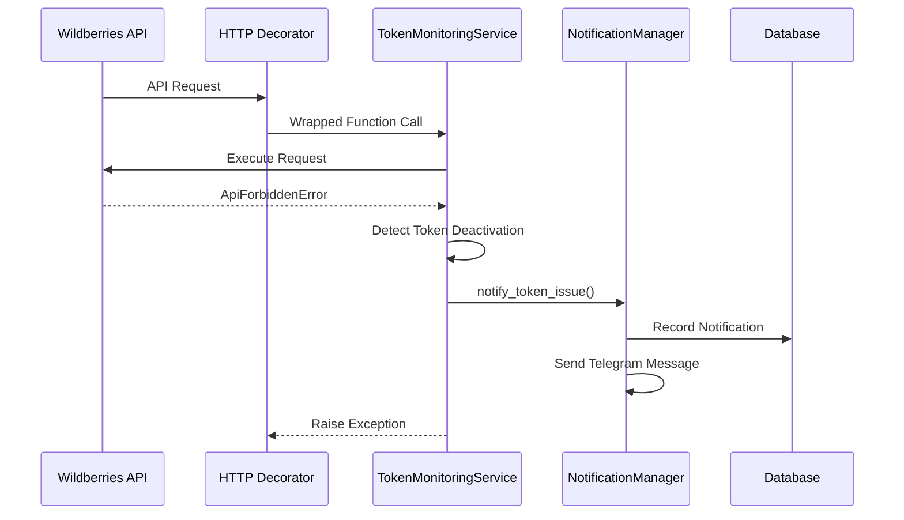
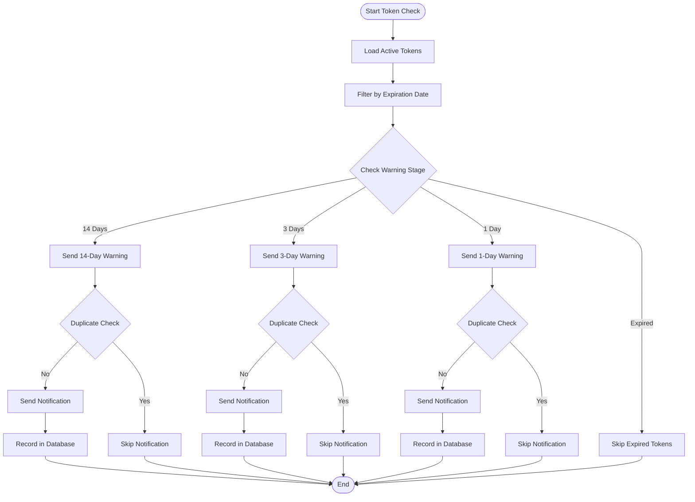
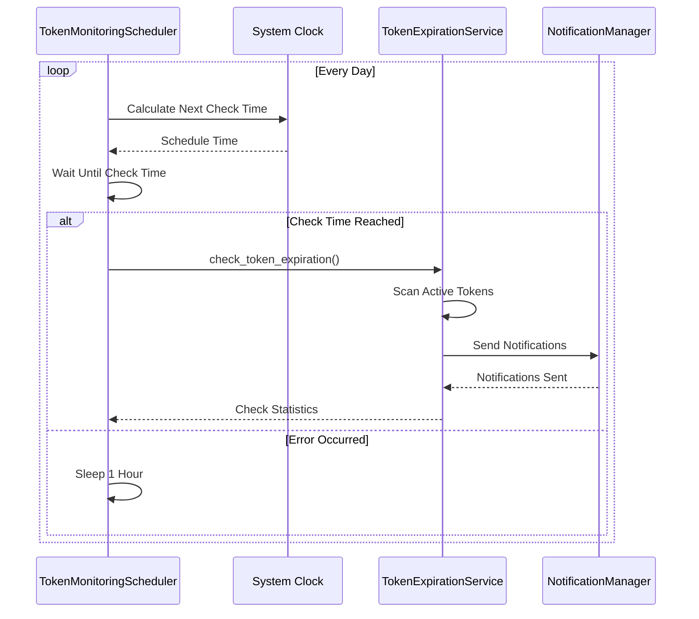
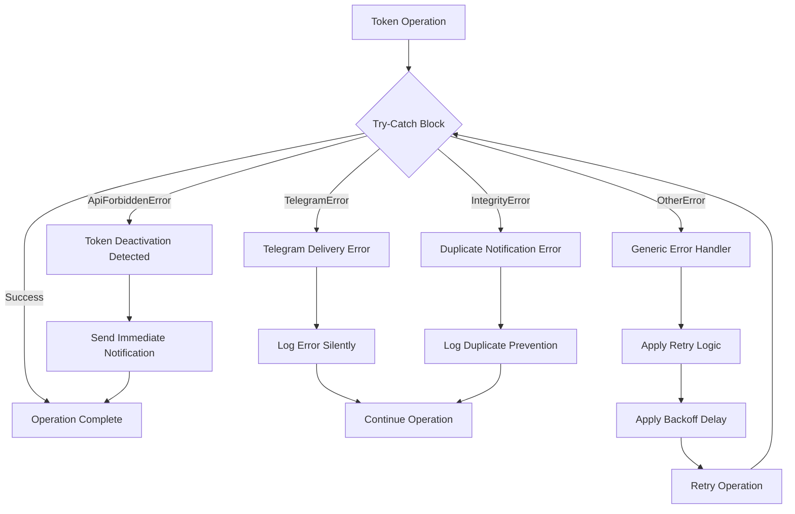

# Token Expiration Notifications

<cite>
**Referenced Files in This Document**
- [models.py](file://app/modules/token_monitoring/models.py)
- [scheduler.py](file://app/modules/token_monitoring/scheduler.py)
- [token_monitoring_service.py](file://app/modules/token_monitoring/services/token_monitoring_service.py)
- [notification_manager.py](file://app/modules/token_monitoring/services/notification_manager.py)
- [token_expiration_service.py](file://app/modules/token_monitoring/services/token_expiration_service.py)
- [startup.py](file://app/modules/token_monitoring/startup.py)
- [integration.py](file://app/modules/token_monitoring/integration.py)
- [README.md](file://app/modules/token_monitoring/README.md)
- [f8e1d9c2a3b4_add_token_notification_tracker_table.py](file://alembic/versions/f8e1d9c2a3b4_add_token_notification_tracker_table.py)
- [token_monitoring_demo.py](file://examples/token_monitoring_demo.py)
- [events.py](file://app/core/telegram/event_send_message_manager/events.py)
</cite>

## Table of Contents
1. [Introduction](#introduction)
2. [System Architecture](#system-architecture)
3. [Core Components](#core-components)
4. [Workflow Analysis](#workflow-analysis)
5. [Notification Templates](#notification-templates)
6. [Scheduling Mechanism](#scheduling-mechanism)
7. [Error Handling and Retry Strategies](#error-handling-and-retry-strategies)
8. [Configuration Options](#configuration-options)
9. [Integration Examples](#integration-examples)
10. [Troubleshooting Guide](#troubleshooting-guide)
11. [Performance Considerations](#performance-considerations)
12. [Conclusion](#conclusion)

## Introduction

The Token Expiration Notification System is a comprehensive monitoring solution designed to proactively manage Wildberries API token lifecycle. This system provides real-time token status monitoring, automatic deactivation detection, and intelligent notification delivery to prevent service disruptions caused by expired tokens.

The system operates on a multi-layered architecture that combines proactive expiration monitoring with reactive deactivation detection, ensuring that users receive timely alerts about token status changes and expiration dates. Built with asynchronous operations and robust error handling, the system maintains high availability and reliability even under adverse conditions.

## System Architecture

The token monitoring system follows a modular architecture with clear separation of concerns across four primary service layers:



**Diagram sources**
- [token_monitoring_service.py](file://app/modules/token_monitoring/services/token_monitoring_service.py#L1-L50)
- [notification_manager.py](file://app/modules/token_monitoring/services/notification_manager.py#L1-L50)
- [token_expiration_service.py](file://app/modules/token_monitoring/services/token_expiration_service.py#L1-L50)
- [scheduler.py](file://app/modules/token_monitoring/scheduler.py#L1-L50)

**Section sources**
- [README.md](file://app/modules/token_monitoring/README.md#L26-L47)

## Core Components

### TokenNotificationTracker Model

The foundation of the notification system is the `TokenNotificationTracker` model, which provides persistent storage for all token-related notifications:

```python
class TokenNotificationTracker(BaseTable):
    """
    Table for tracking token-related notifications sent to users.
    
    Prevents duplicate notifications and provides audit trail for token issues.
    The unique constraint ensures only one notification per (shop_id, user_telegram_id, notification_type).
    """
    
    shop_id: Mapped[str] = mapped_column(String, nullable=False, index=True)
    user_telegram_id: Mapped[int] = mapped_column(BIGINT, nullable=False, index=True)
    notification_type: Mapped[str] = mapped_column(String, nullable=False)
    token_expiry_date: Mapped[datetime.datetime] = mapped_column(DateTime, nullable=True)
    sent_at: Mapped[datetime.datetime] = mapped_column(
        DateTime, 
        nullable=False, 
        server_default=text("now()"),
        index=True
    )
    resolved_at: Mapped[datetime.datetime] = mapped_column(DateTime, nullable=True)
```

The model implements several key features:
- **Unique Constraints**: Prevents duplicate notifications for the same shop, user, and notification type
- **Audit Trail**: Maintains complete history of all notifications sent
- **Resolution Tracking**: Allows marking notifications as resolved when issues are fixed
- **Index Optimization**: Strategic indexing for efficient queries

### Notification Types Enumeration

The system defines four distinct notification types for different token scenarios:

```python
class NotificationType(Enum):
    TOKEN_DEACTIVATED = "TOKEN_DEACTIVATED"
    TOKEN_EXPIRING_14_DAYS = "TOKEN_EXPIRING_14_DAYS"
    TOKEN_EXPIRING_3_DAYS = "TOKEN_EXPIRING_3_DAYS"
    TOKEN_EXPIRING_1_DAY = "TOKEN_EXPIRING_1_DAY"
```

Each notification type corresponds to specific warning stages and user actions required, ensuring appropriate urgency levels for different expiration timelines.

**Section sources**
- [models.py](file://app/modules/token_monitoring/models.py#L1-L81)

### TokenMonitoringService

The `TokenMonitoringService` acts as the central hub for detecting token deactivation events during API calls:



**Diagram sources**
- [token_monitoring_service.py](file://app/modules/token_monitoring/services/token_monitoring_service.py#L40-L120)

The service implements a sophisticated wrapper around the existing HTTP decorator system, preserving all original functionality while adding token monitoring capabilities. It automatically detects token deactivation events and triggers immediate notifications.

**Section sources**
- [token_monitoring_service.py](file://app/modules/token_monitoring/services/token_monitoring_service.py#L1-L209)

## Workflow Analysis

### Token Validity Checking Workflow

The system performs comprehensive token validity checks through a multi-stage process:



**Diagram sources**
- [token_expiration_service.py](file://app/modules/token_monitoring/services/token_expiration_service.py#L40-L120)

### State Transitions in Token Status Detection

The system tracks token status through several distinct states:

1. **Active State**: Token is valid and has sufficient permissions
2. **Warning State**: Token is approaching expiration (14/3/1 day stages)
3. **Expired State**: Token has passed expiration date
4. **Deactivated State**: Token is permanently invalid or blocked

Each state transition triggers appropriate notifications and updates the notification tracker accordingly.

**Section sources**
- [token_expiration_service.py](file://app/modules/token_monitoring/services/token_expiration_service.py#L1-L314)

## Notification Templates

The system provides localized Russian-language notification templates tailored to different warning stages:

### Deactivation Notification Template
```
Токен истек или деактивирован, сделайте срочно новый и добавьте в магазин {shop_name}
```

### 14-Day Expiration Template
```
Токен для магазина {shop_name} истекает через 2 недели ({expiry_date}). 
Подготовьте новый токен заранее
```

### 3-Day Expiration Template
```
Внимание! Токен для магазина {shop_name} истекает через 3 дня ({expiry_date}). 
Срочно подготовьте новый токен
```

### 1-Day Expiration Template
```
СРОЧНО! Токен для магазина {shop_name} истекает завтра ({expiry_date}). 
Добавьте новый токен сегодня
```

Each template includes:
- **Contextual Information**: Shop name and expiration date
- **Action Guidance**: Clear instructions for users
- **Urgency Indicators**: Different emphasis levels for different stages
- **Support Information**: Links to support resources

**Section sources**
- [notification_manager.py](file://app/modules/token_monitoring/services/notification_manager.py#L20-L40)

## Scheduling Mechanism

### TokenMonitoringScheduler Implementation

The `TokenMonitoringScheduler` provides robust scheduling capabilities for automated token monitoring:

```python
class TokenMonitoringScheduler:
    """Scheduler for running token monitoring tasks at regular intervals."""
    
    def __init__(
        self, 
        expiration_service: Optional[TokenExpirationService] = None,
        notification_manager: Optional[NotificationManager] = None
    ):
        self.expiration_service = expiration_service or TokenExpirationService()
        self.notification_manager = notification_manager or NotificationManager()
        self._running = False
        self._task = None
```

### Daily Check Loop

The scheduler implements a sophisticated daily check loop with intelligent timing calculations:



**Diagram sources**
- [scheduler.py](file://app/modules/token_monitoring/scheduler.py#L60-L120)

### Weekly Cleanup Operations

The scheduler includes weekly cleanup operations performed on Mondays:

```python
# Optional: Clean up old resolved notifications (weekly)
if datetime.now().weekday() == 0:  # Monday
    try:
        cleaned = await self.expiration_service.cleanup_resolved_notifications(30)
        logger.info(f"Cleaned up {cleaned} old resolved notifications")
    except Exception as e:
        logger.error(f"Failed to clean up old notifications: {e}", exc_info=True)
```

This ensures database performance remains optimal by removing old resolved notifications while maintaining historical data for audit purposes.

**Section sources**
- [scheduler.py](file://app/modules/token_monitoring/scheduler.py#L1-L186)

## Error Handling and Retry Strategies

### Comprehensive Error Handling

The system implements multi-layered error handling across all components:



**Diagram sources**
- [notification_manager.py](file://app/modules/token_monitoring/services/notification_manager.py#L80-L150)
- [token_monitoring_service.py](file://app/modules/token_monitoring/services/token_monitoring_service.py#L100-L150)

### Retry Strategies

The system implements exponential backoff for error recovery:

1. **Immediate Retry**: For transient network issues
2. **Delayed Retry**: After 1-hour delays for persistent errors
3. **Graceful Degradation**: Continue operation even if individual notifications fail

### Error Categories and Handling

| Error Type | Handling Strategy | Recovery Action |
|------------|-------------------|-----------------|
| **TelegramForbiddenError** | Silent Skip | Log and continue |
| **IntegrityError** | Constraint Bypass | Log duplicate prevention |
| **Database Connection** | Retry with Backoff | Wait and retry |
| **API Rate Limits** | Queue Management | Respect rate limits |

**Section sources**
- [notification_manager.py](file://app/modules/token_monitoring/services/notification_manager.py#L80-L180)
- [token_monitoring_service.py](file://app/modules/token_monitoring/services/token_monitoring_service.py#L100-L200)

## Configuration Options

### Required Permissions

The system validates tokens against essential Wildberries API permissions:

- **"Контент"** (Content): Required for product management operations
- **"Статистика"** (Statistics): Essential for performance data access
- **"Аналитика"** (Analytics): Important for detailed analytics
- **"Продвижение"** (Promotion): Necessary for advertising campaign management

### Warning Stage Configuration

Expiration warnings are configured for strategic notification timing:

```python
WARNING_STAGES = [14, 3, 1]  # Days before expiry
DAYS_TO_NOTIFICATION_TYPE = {
    14: NotificationType.TOKEN_EXPIRING_14_DAYS.value,
    3: NotificationType.TOKEN_EXPIRING_3_DAYS.value,
    1: NotificationType.TOKEN_EXPIRING_1_DAY.value,
}
```

### Notification Thresholds

The system provides configurable notification thresholds:

- **Early Warning**: 14 days before expiration
- **Urgent Warning**: 3 days before expiration  
- **Critical Warning**: 1 day before expiration
- **Cleanup Interval**: Weekly (Monday) for resolved notifications

### User-Specific Preferences

While the current implementation focuses on system-wide notifications, the architecture supports future enhancement for user-specific notification preferences:

```python
# Future enhancement possibility
class UserNotificationPreferences:
    preferred_language: str = "ru"
    notification_frequency: str = "immediate"  # immediate/daily/weekly
    preferred_channels: set[str] = {"telegram", "email"}
```

**Section sources**
- [token_expiration_service.py](file://app/modules/token_monitoring/services/token_expiration_service.py#L20-L40)

## Integration Examples

### Basic System Initialization

```python
from app.modules.token_monitoring import install_all_token_monitoring

# Recommended for most applications
install_all_token_monitoring()
```

### Custom Configuration

```python
from app.modules.token_monitoring import initialize_token_monitoring
from datetime import time

await initialize_token_monitoring(
    enable_decorator_monitoring=True,    # Enable deactivation detection
    enable_expiration_scheduler=True,    # Enable proactive monitoring
    daily_check_time=time(10, 30)       # Run checks at 10:30 AM
)
```

### Manual Token Check

```python
from app.modules.token_monitoring import run_token_expiration_check

stats = await run_token_expiration_check()
print(f"Notifications sent: {stats['notifications_sent']}")
print(f"Errors encountered: {stats['errors']}")
```

### Scheduled Monitoring Setup

```python
from app.modules.token_monitoring.scheduler import TokenMonitoringScheduler

scheduler = TokenMonitoringScheduler()

# Start daily checks at 9:00 AM
await scheduler.start_daily_expiration_check(time(9, 0))

# Run manual check
stats = await scheduler.run_manual_check()

# Get expiring tokens report
report = await scheduler.get_expiring_tokens_report(30)  # Next 30 days
```

### Integration with Existing Systems

```python
# Use existing bot instance
from app.client_bot.bot import get_bot

notification_manager = NotificationManager(bot=get_bot())

# Custom notification delivery
await notification_manager.notify_token_issue(
    shop_id="shop_123",
    notification_type=NotificationType.TOKEN_DEACTIVATED.value
)
```

**Section sources**
- [startup.py](file://app/modules/token_monitoring/startup.py#L15-L60)
- [token_monitoring_demo.py](file://examples/token_monitoring_demo.py#L200-L300)

## Troubleshooting Guide

### Common Issues and Solutions

#### No Notifications Sent
**Symptoms**: Tokens expire but no notifications are delivered
**Causes**:
- Shop has no associated users in `WBUserCabinet`
- Telegram bot credentials are invalid
- Users have blocked the bot

**Solutions**:
```python
# Verify shop-user associations
from app.utils.db.session_maker import get_async_session_maker

async with get_async_session_maker()() as session:
    # Check for users associated with shop
    users = await session.execute(
        select(User).join(WBUserCabinet)
        .where(WBUserCabinet.shop_id == "your_shop_id")
    )
    print(f"Users found: {users.scalars().all()}")
```

#### Duplicate Notifications
**Symptoms**: Same notification sent multiple times
**Causes**: Database unique constraint violation
**Solutions**: The system automatically prevents duplicates through database constraints

#### Missing Token Data
**Symptoms**: Token expiration checks fail or return no results
**Causes**:
- `WBToken` records lack `shop_id` values
- Token expiration dates are not properly set
- Database connection issues

**Solutions**:
```python
# Verify token data completeness
from app.modules.common_slaves.wildberries.models import WBToken

async with get_async_session_maker()() as session:
    tokens = await session.execute(
        select(WBToken)
        .where(WBToken.shop_id.is_not(None))
        .where(WBToken.expires > datetime.now())
    )
    print(f"Valid tokens with shop_id: {tokens.scalars().all()}")
```

### Debug Mode Configuration

Enable detailed logging for troubleshooting:

```python
import logging

logging.getLogger('app.modules.token_monitoring').setLevel(logging.DEBUG)
```

### Health Check Implementation

```python
async def check_token_monitoring_health():
    """Perform comprehensive health check"""
    
    # Check if monitoring is installed
    from app.modules.token_monitoring.integration import is_token_monitoring_installed
    monitoring_installed = is_token_monitoring_installed()
    
    # Run manual check
    stats = await run_token_expiration_check()
    
    # Verify database connectivity
    try:
        async with get_async_session_maker()() as session:
            await session.execute("SELECT 1")
            db_connected = True
    except Exception as e:
        db_connected = False
    
    return {
        "monitoring_installed": monitoring_installed,
        "last_check_stats": stats,
        "database_connected": db_connected
    }
```

**Section sources**
- [README.md](file://app/modules/token_monitoring/README.md#L350-L400)

## Performance Considerations

### Database Optimization

The system implements several database optimization strategies:

```sql
-- Indexes for optimal query performance
CREATE INDEX ix_token_notification_tracker_shop_id ON token_notification_tracker (shop_id);
CREATE INDEX ix_token_notification_tracker_user_telegram_id ON token_notification_tracker (user_telegram_id);
CREATE INDEX ix_token_notification_tracker_sent_at ON token_notification_tracker (sent_at);
CREATE INDEX ix_token_notification_tracker_resolved_at ON token_notification_tracker (resolved_at);

-- Unique constraint prevents duplicates efficiently
CREATE UNIQUE INDEX uq_token_notification_shop_user_type 
ON token_notification_tracker (shop_id, user_telegram_id, notification_type);
```

### Memory Usage Optimization

- **Lazy Loading**: Components are loaded only when needed
- **Async Operations**: Non-blocking notification sending
- **Batch Processing**: Efficient handling of multiple tokens
- **Connection Pooling**: Database connections reused efficiently

### Rate Limiting Implementation

```python
# Telegram API rate limiting protection
async def send_notification_with_rate_limit(self, user_id: int, message: str):
    """Send notification with built-in rate limiting"""
    try:
        await self.bot.send_message(user_id, message)
        # Rate limiting handled internally by aiogram
    except TelegramForbiddenError:
        # User blocked - silent failure
        pass
```

### Background Task Management

The scheduler runs non-blocking background tasks:

```python
# Non-blocking notification delivery
asyncio.create_task(
    self._handle_token_deactivation(shop_id, func.__name__, str(e))
)
```

**Section sources**
- [f8e1d9c2a3b4_add_token_notification_tracker_table.py](file://alembic/versions/f8e1d9c2a3b4_add_token_notification_tracker_table.py#L20-L40)

## Conclusion

The Token Expiration Notification System provides a robust, scalable solution for managing Wildberries API token lifecycle. Through its multi-layered architecture combining proactive expiration monitoring with reactive deactivation detection, the system ensures minimal service disruption while maintaining high user engagement through timely notifications.

Key strengths of the system include:

- **Proactive Monitoring**: Multi-stage warning system prevents last-minute surprises
- **Robust Error Handling**: Comprehensive error recovery and graceful degradation
- **Scalable Architecture**: Modular design supports easy extension and maintenance
- **User-Friendly Notifications**: Localized, actionable messages in Russian language
- **Performance Optimization**: Efficient database design and async operations

The system's design philosophy emphasizes reliability and maintainability, with extensive logging, comprehensive error handling, and clear separation of concerns across service layers. This approach ensures that the system can handle production workloads while remaining easy to debug and extend.

Future enhancements could include user-specific notification preferences, integration with additional communication channels, and advanced analytics for monitoring system effectiveness. The current implementation provides a solid foundation for these improvements while delivering immediate value through reliable token lifecycle management.