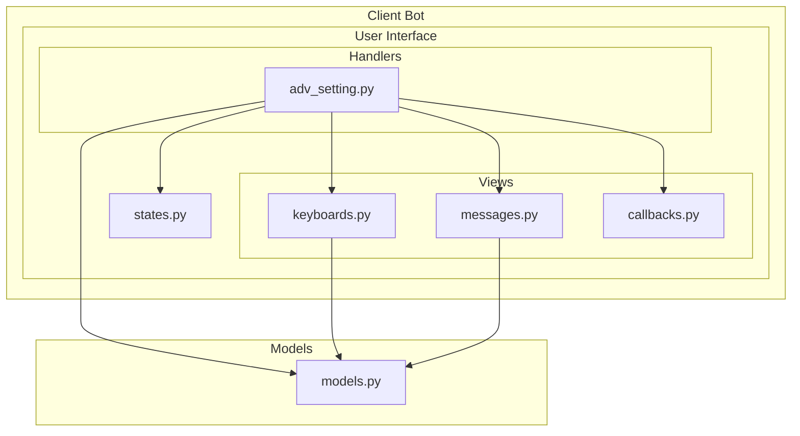
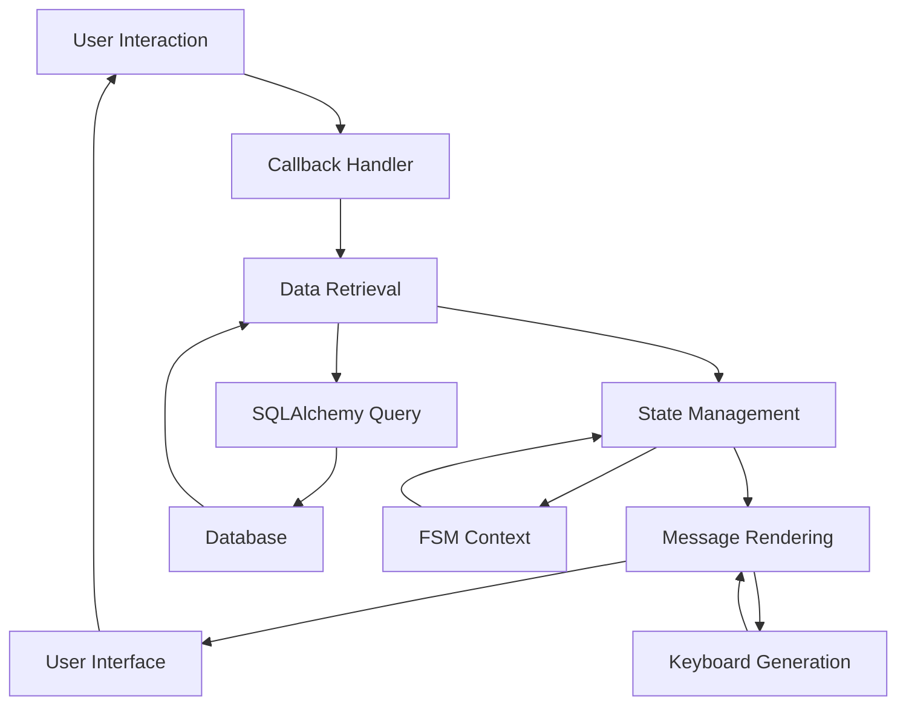
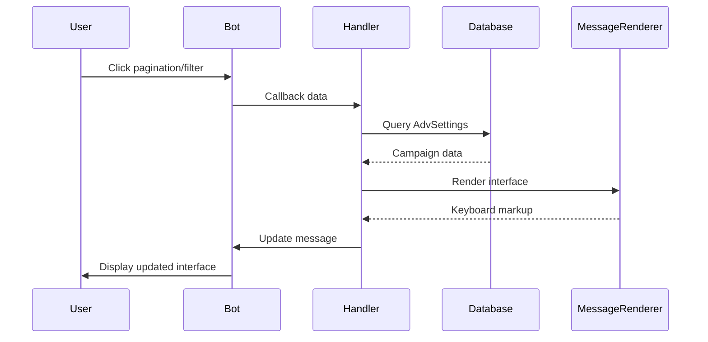
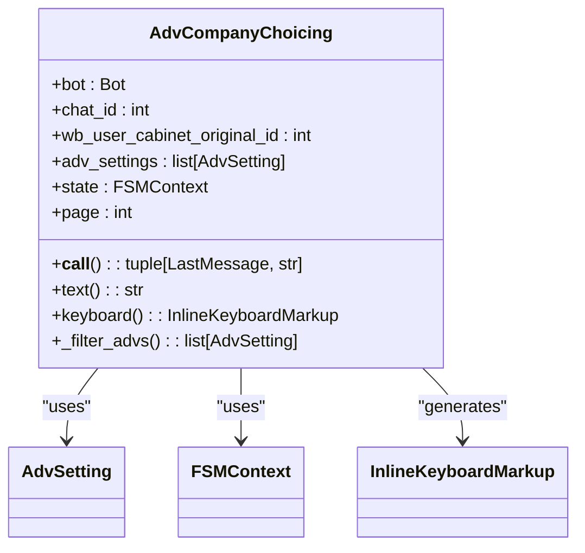
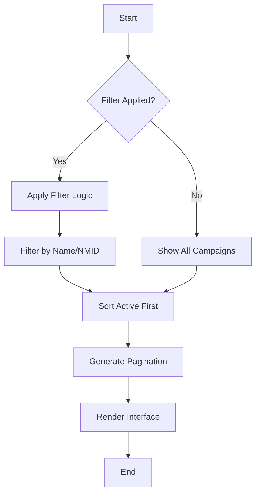
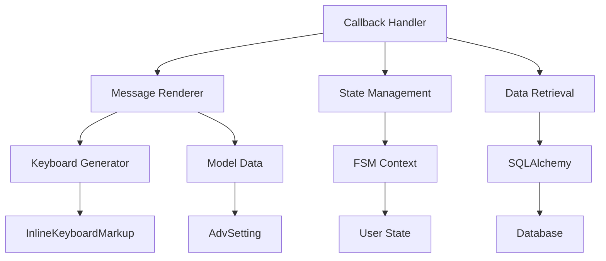

# Ad Campaign Selection Flow

<cite>
**Referenced Files in This Document**   
- [adv_setting.py](file://app/client_bot/user_interface/handlers/adv_setting.py)
- [keyboards.py](file://app/client_bot/user_interface/views/keyboards.py)
- [messages.py](file://app/client_bot/user_interface/views/messages/messages.py)
- [callbacks.py](file://app/client_bot/user_interface/views/callbacks.py)
- [models.py](file://app/modules/common_slaves/wildberries/models/models.py)
- [start.py](file://app/client_bot/user_interface/handlers/start/start.py)
</cite>

## Table of Contents
1. [Introduction](#introduction)
2. [Project Structure](#project-structure)
3. [Core Components](#core-components)
4. [Architecture Overview](#architecture-overview)
5. [Detailed Component Analysis](#detailed-component-analysis)
6. [Dependency Analysis](#dependency-analysis)
7. [Performance Considerations](#performance-considerations)
8. [Troubleshooting Guide](#troubleshooting-guide)
9. [Conclusion](#conclusion)

## Introduction
This document provides a comprehensive analysis of the ad campaign selection and navigation flow in the adv-bot system. The system enables users to browse and select advertising campaigns through paginated interfaces, with robust state management and dynamic message rendering. The core functionality revolves around the ChoiceAdvPaginator callbacks, which manage pagination and filtering of advertising campaigns associated with a user's cabinet. The flow begins with shop selection and progresses through campaign listing, filtering, and detailed campaign configuration. The system uses SQLAlchemy joined queries to efficiently retrieve AdvSetting entities linked to WBUserCabinet, ensuring optimal data access patterns. Filter states are maintained across user interactions using FSM (Finite State Machine) context, providing a seamless user experience during navigation. The document details the callback flow from initial shop selection to campaign menu display, including error handling for missing campaigns and recovery paths when navigation context is lost.

## Project Structure
The ad campaign selection functionality is organized within the client_bot module of the adv-bot system. The core components are located in the user_interface directory, which contains handlers, views, and state management modules. The handlers directory contains the business logic for processing user interactions, with the adv_setting.py file being central to campaign selection. The views directory contains the presentation layer components, including keyboards.py for UI elements and messages.py for message templates. The callbacks.py file defines the callback data structures used for navigation, while models.py contains the SQLAlchemy models that define the data structure. The state management is handled by states.py, which defines the FSM states for the campaign selection process. The overall structure follows a clean separation of concerns, with handlers managing logic, views handling presentation, and models defining data structures.

**Diagram sources**
- [adv_setting.py](file://app/client_bot/user_interface/handlers/adv_setting.py)
- [keyboards.py](file://app/client_bot/user_interface/views/keyboards.py)
- [messages.py](file://app/client_bot/user_interface/views/messages/messages.py)
- [callbacks.py](file://app/client_bot/user_interface/views/callbacks.py)
- [states.py](file://app/client_bot/user_interface/states.py)
- [models.py](file://app/modules/common_slaves/wildberries/models/models.py)

**Section sources**
- [adv_setting.py](file://app/client_bot/user_interface/handlers/adv_setting.py)
- [keyboards.py](file://app/client_bot/user_interface/views/keyboards.py)
- [messages.py](file://app/client_bot/user_interface/views/messages/messages.py)
- [callbacks.py](file://app/client_bot/user_interface/views/callbacks.py)
- [states.py](file://app/client_bot/user_interface/states.py)
- [models.py](file://app/modules/common_slaves/wildberries/models/models.py)

## Core Components
The core components of the ad campaign selection flow include the ChoiceAdvPaginator callback handler, the AdvCompanyChoicing message renderer, and the state management system. The ChoiceAdvPaginator callback handler manages pagination and filtering of advertising campaigns, retrieving data from the database and updating the user interface accordingly. The AdvCompanyChoicing class dynamically renders the campaign selection interface, including pagination controls and campaign details. The state management system maintains the user's navigation context, including the selected cabinet and filter state, across interactions. The data retrieval pattern uses joined SQLAlchemy queries to fetch AdvSetting entities linked to WBUserCabinet, ensuring efficient database access. The filter state is maintained in the FSM context, allowing users to apply and reset filters during navigation. The system also handles error conditions, such as missing campaigns, by providing appropriate user feedback and recovery paths.

**Section sources**
- [adv_setting.py](file://app/client_bot/user_interface/handlers/adv_setting.py#L44-L187)
- [keyboards.py](file://app/client_bot/user_interface/views/keyboards.py#L307-L420)
- [messages.py](file://app/client_bot/user_interface/views/messages/messages.py#L69-L105)
- [callbacks.py](file://app/client_bot/user_interface/views/callbacks.py#L0-L227)

## Architecture Overview
The ad campaign selection flow follows a clear architectural pattern that separates concerns between data access, business logic, and presentation. The flow begins with user interaction through Telegram callbacks, which are processed by the router in adv_setting.py. The handler retrieves campaign data using SQLAlchemy queries that join AdvSetting with WBUserCabinet, ensuring efficient data access. The retrieved data is then passed to the AdvCompanyChoicing message renderer, which generates the appropriate interface with pagination controls. The state management system maintains context across interactions, allowing for seamless navigation and filtering. The architecture supports both forward navigation (from shop to campaigns) and backward navigation (return to shop menu), with proper state preservation. Error handling is integrated throughout the flow, providing recovery paths when issues occur.

**Diagram sources**
- [adv_setting.py](file://app/client_bot/user_interface/handlers/adv_setting.py#L44-L187)
- [messages.py](file://app/client_bot/user_interface/views/messages/messages.py#L69-L105)
- [keyboards.py](file://app/client_bot/user_interface/views/keyboards.py#L307-L420)
- [states.py](file://app/client_bot/user_interface/states.py#L0-L78)

## Detailed Component Analysis
### ChoiceAdvPaginator Callback Analysis
The ChoiceAdvPaginator callback handler is responsible for managing pagination and filtering of advertising campaigns. When a user interacts with pagination controls or applies filters, this handler processes the request, retrieves the appropriate data subset, and updates the interface.

**Diagram sources**
- [adv_setting.py](file://app/client_bot/user_interface/handlers/adv_setting.py#L83-L120)
- [messages.py](file://app/client_bot/user_interface/views/messages/messages.py#L69-L105)
- [keyboards.py](file://app/client_bot/user_interface/views/keyboards.py#L307-L420)

**Section sources**
- [adv_setting.py](file://app/client_bot/user_interface/handlers/adv_setting.py#L83-L120)
- [keyboards.py](file://app/client_bot/user_interface/views/keyboards.py#L307-L420)
- [messages.py](file://app/client_bot/user_interface/views/messages/messages.py#L69-L105)

### AdvCompanyChoicing Message Renderer
The AdvCompanyChoicing class is responsible for dynamically rendering the campaign selection interface. It receives campaign data and state information, then generates the appropriate message with pagination controls and campaign details.

**Diagram sources**
- [messages.py](file://app/client_bot/user_interface/views/messages/messages.py#L69-L105)
- [models.py](file://app/modules/common_slaves/wildberries/models/models.py#L0-L718)

**Section sources**
- [messages.py](file://app/client_bot/user_interface/views/messages/messages.py#L69-L105)
- [models.py](file://app/modules/common_slaves/wildberries/models/models.py#L0-L718)

### Data Retrieval and Filtering
The system uses efficient data retrieval patterns with SQLAlchemy joined queries to fetch AdvSetting entities linked to WBUserCabinet. Filter states are maintained in the FSM context, allowing for dynamic filtering based on user input.

**Diagram sources**
- [adv_setting.py](file://app/client_bot/user_interface/handlers/adv_setting.py#L44-L86)
- [messages.py](file://app/client_bot/user_interface/views/messages/messages.py#L69-L105)

**Section sources**
- [adv_setting.py](file://app/client_bot/user_interface/handlers/adv_setting.py#L44-L86)
- [messages.py](file://app/client_bot/user_interface/views/messages/messages.py#L69-L105)

## Dependency Analysis
The ad campaign selection flow has a well-defined dependency structure that ensures separation of concerns while maintaining necessary connections between components. The handlers depend on views for message rendering, views depend on models for data structure, and both depend on the state management system for context preservation. The callback system provides a clean interface between user interactions and business logic. The dependency graph shows a clear flow from user interaction through processing to presentation, with database access isolated in the data retrieval layer.

**Diagram sources**
- [adv_setting.py](file://app/client_bot/user_interface/handlers/adv_setting.py)
- [messages.py](file://app/client_bot/user_interface/views/messages/messages.py)
- [keyboards.py](file://app/client_bot/user_interface/views/keyboards.py)
- [states.py](file://app/client_bot/user_interface/states.py)
- [models.py](file://app/modules/common_slaves/wildberries/models/models.py)

**Section sources**
- [adv_setting.py](file://app/client_bot/user_interface/handlers/adv_setting.py)
- [messages.py](file://app/client_bot/user_interface/views/messages/messages.py)
- [keyboards.py](file://app/client_bot/user_interface/views/keyboards.py)
- [states.py](file://app/client_bot/user_interface/states.py)
- [models.py](file://app/modules/common_slaves/wildberries/models/models.py)

## Performance Considerations
The ad campaign selection flow is designed with performance in mind. The data retrieval uses joined SQLAlchemy queries to minimize database round trips, fetching all necessary data in a single query. Pagination limits the amount of data transferred and rendered at once, improving response times. The use of efficient filtering algorithms ensures that campaign lists can be quickly filtered based on user input. The state management system minimizes redundant data retrieval by preserving context across interactions. The interface is optimized for Telegram's messaging system, with incremental updates rather than complete refreshes when possible. These performance considerations ensure a responsive user experience even with large numbers of advertising campaigns.

## Troubleshooting Guide
The system includes several error handling mechanisms to address common issues. When a campaign is not found, the system provides a clear error message and attempts to recover by showing the campaign list. If navigation context is lost, the system can reconstruct it from the user's cabinet information. Database errors are caught and logged, with appropriate user feedback provided. The state management system includes validation to prevent invalid state transitions. For debugging purposes, the system logs key operations, making it easier to trace issues. Recovery paths are built into the flow, allowing users to return to previous states or restart the selection process if needed.

**Section sources**
- [adv_setting.py](file://app/client_bot/user_interface/handlers/adv_setting.py#L153-L187)
- [start.py](file://app/client_bot/user_interface/handlers/start/start.py#L308-L347)

## Conclusion
The ad campaign selection flow in the adv-bot system provides a robust and user-friendly interface for managing advertising campaigns. The system effectively combines pagination, filtering, and state management to create a seamless navigation experience. The architecture follows clean separation of concerns, with well-defined components for handling callbacks, rendering messages, and managing state. The data retrieval pattern using joined SQLAlchemy queries ensures efficient database access, while the FSM-based state management preserves context across interactions. The system includes comprehensive error handling and recovery paths, making it resilient to various failure scenarios. Overall, the design provides a solid foundation for campaign management with room for future enhancements and optimizations.