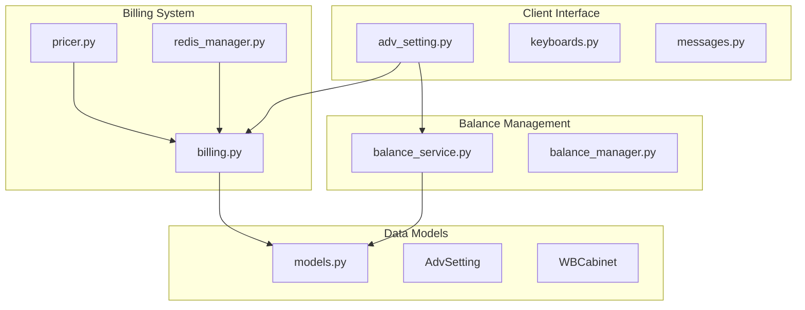
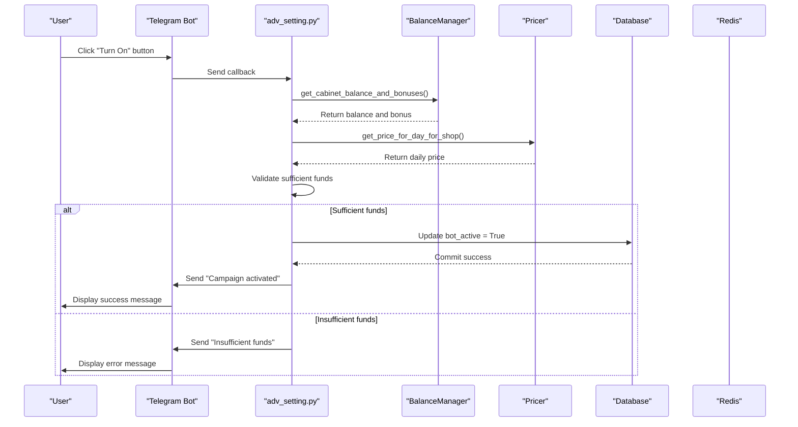
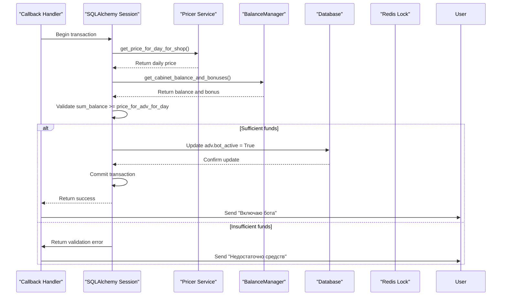
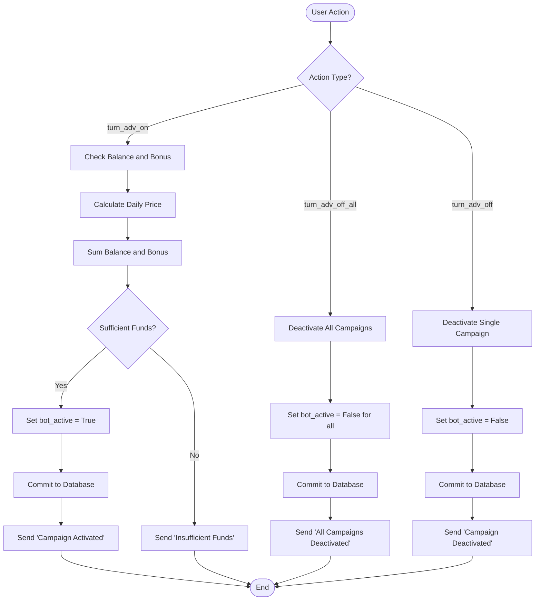
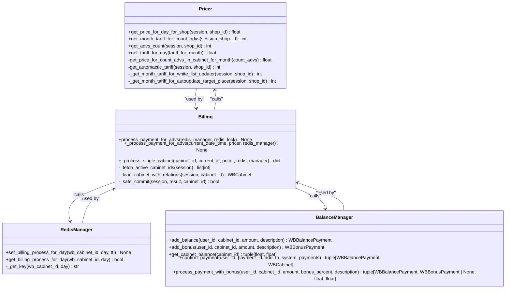
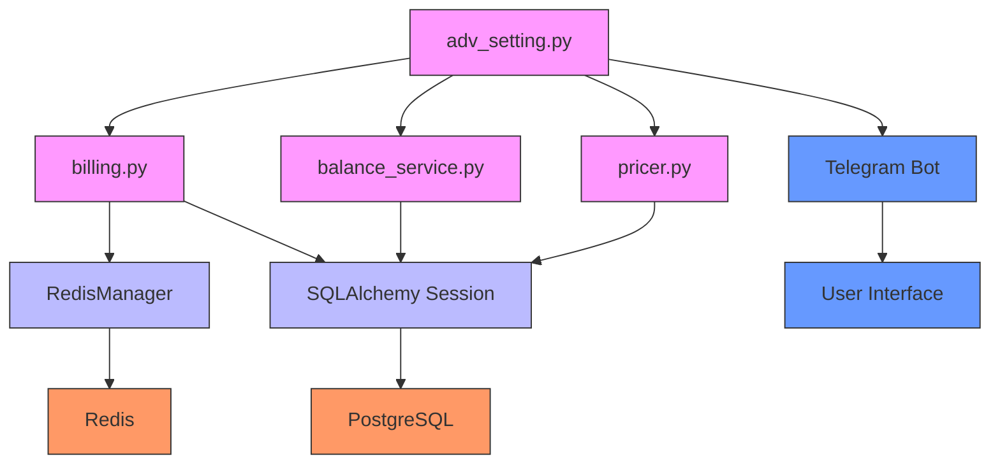

# Campaign Activation and Deactivation Flow

<cite>
**Referenced Files in This Document**   
- [adv_setting.py](file://app/client_bot/user_interface/handlers/adv_setting.py)
- [billing.py](file://app/modules/billing/billing.py)
- [pricer.py](file://app/modules/billing/pricer/pricer.py)
- [balance_service.py](file://app/modules/balance_manager/balance_service.py)
- [redis_manager.py](file://app/modules/billing/redis_manager.py)
- [billing_check.py](file://app/core/redis_manager_v2/mixins/billing_check.py)
- [models.py](file://app/modules/common_slaves/wildberries/models/models.py)
- [models.py](file://app/modules/billing/models.py)
</cite>

## Table of Contents
1. [Introduction](#introduction)
2. [Project Structure](#project-structure)
3. [Core Components](#core-components)
4. [Architecture Overview](#architecture-overview)
5. [Detailed Component Analysis](#detailed-component-analysis)
6. [Dependency Analysis](#dependency-analysis)
7. [Performance Considerations](#performance-considerations)
8. [Troubleshooting Guide](#troubleshooting-guide)
9. [Conclusion](#conclusion)

## Introduction
This document provides a comprehensive analysis of the campaign activation and deactivation flow in the adv-bot system. The system manages advertising campaigns with three distinct modes: single campaign activation, bulk deactivation, and individual deactivation. Each operation involves financial validation through the Pricer and BalanceManager services, transaction safety with SQLAlchemy sessions, and user feedback via status messages. The documentation details the complete process of turning advertising campaigns on and off, emphasizing the financial checks that prevent activation without sufficient funds.

## Project Structure
The adv-bot system is organized into several key modules that handle different aspects of campaign management, billing, and user interaction. The core functionality for campaign activation and deactivation resides in the client_bot module, specifically within the user_interface/handlers directory. The billing system is implemented in the modules/billing directory, while balance management is handled by the modules/balance_manager module. The system uses SQLAlchemy for database operations and Redis for caching and locking mechanisms.

**Diagram sources**
- [adv_setting.py](file://app/client_bot/user_interface/handlers/adv_setting.py)
- [billing.py](file://app/modules/billing/billing.py)
- [balance_service.py](file://app/modules/balance_manager/balance_service.py)
- [models.py](file://app/modules/common_slaves/wildberries/models/models.py)

**Section sources**
- [adv_setting.py](file://app/client_bot/user_interface/handlers/adv_setting.py)
- [billing.py](file://app/modules/billing/billing.py)
- [balance_service.py](file://app/modules/balance_manager/balance_service.py)

## Core Components
The campaign activation and deactivation system consists of several core components that work together to manage advertising campaigns. The primary components include the campaign state management in adv_setting.py, the billing system in billing.py, the balance validation in balance_service.py, and the financial calculation in pricer.py. These components interact through well-defined interfaces and use SQLAlchemy for database transactions and Redis for caching and locking.

**Section sources**
- [adv_setting.py](file://app/client_bot/user_interface/handlers/adv_setting.py)
- [billing.py](file://app/modules/billing/billing.py)
- [pricer.py](file://app/modules/billing/pricer/pricer.py)
- [balance_service.py](file://app/modules/balance_manager/balance_service.py)

## Architecture Overview
The campaign activation and deactivation flow follows a well-defined architecture that ensures transaction safety, financial validation, and proper user feedback. The system uses a callback-driven approach where user actions trigger specific handlers that validate financial conditions, update campaign states, and provide appropriate feedback.

**Diagram sources**
- [adv_setting.py](file://app/client_bot/user_interface/handlers/adv_setting.py)
- [balance_service.py](file://app/modules/balance_manager/balance_service.py)
- [pricer.py](file://app/modules/billing/pricer/pricer.py)

## Detailed Component Analysis

### Campaign Activation and Deactivation Analysis
The campaign activation and deactivation system implements three distinct modes: single campaign activation (turn_adv_on), bulk deactivation (turn_adv_off_all), and individual deactivation (turn_adv_off). Each mode follows a specific flow with appropriate financial validation and user feedback.

#### For API/Service Components:

**Diagram sources**
- [adv_setting.py](file://app/client_bot/user_interface/handlers/adv_setting.py)
- [pricer.py](file://app/modules/billing/pricer/pricer.py)
- [balance_service.py](file://app/modules/balance_manager/balance_service.py)

#### For Complex Logic Components:

**Diagram sources**
- [adv_setting.py](file://app/client_bot/user_interface/handlers/adv_setting.py)
- [balance_service.py](file://app/modules/balance_manager/balance_service.py)
- [pricer.py](file://app/modules/billing/pricer/pricer.py)

**Section sources**
- [adv_setting.py](file://app/client_bot/user_interface/handlers/adv_setting.py)
- [balance_service.py](file://app/modules/balance_manager/balance_service.py)
- [pricer.py](file://app/modules/billing/pricer/pricer.py)

### Billing System Analysis
The billing system in the adv-bot handles daily charges for advertising campaigns with Redis/DB deduplication and Redis locks to ensure transaction safety. The system processes payments for all active cabinets, validates financial conditions, and updates campaign states accordingly.

#### For Object-Oriented Components:

**Diagram sources**
- [billing.py](file://app/modules/billing/billing.py)
- [pricer.py](file://app/modules/billing/pricer/pricer.py)
- [redis_manager.py](file://app/modules/billing/redis_manager.py)
- [balance_service.py](file://app/modules/balance_manager/balance_service.py)

**Section sources**
- [billing.py](file://app/modules/billing/billing.py)
- [pricer.py](file://app/modules/billing/pricer/pricer.py)
- [redis_manager.py](file://app/modules/billing/redis_manager.py)
- [balance_service.py](file://app/modules/balance_manager/balance_service.py)

## Dependency Analysis
The campaign activation and deactivation system has a well-defined dependency chain that ensures proper operation and transaction safety. The system relies on several key components that work together to manage campaign states and financial transactions.

**Diagram sources**
- [adv_setting.py](file://app/client_bot/user_interface/handlers/adv_setting.py)
- [billing.py](file://app/modules/billing/billing.py)
- [balance_service.py](file://app/modules/balance_manager/balance_service.py)
- [pricer.py](file://app/modules/billing/pricer/pricer.py)
- [redis_manager.py](file://app/modules/billing/redis_manager.py)

**Section sources**
- [adv_setting.py](file://app/client_bot/user_interface/handlers/adv_setting.py)
- [billing.py](file://app/modules/billing/billing.py)
- [balance_service.py](file://app/modules/balance_manager/balance_service.py)

## Performance Considerations
The campaign activation and deactivation system is designed with performance in mind, using Redis for caching and locking to prevent duplicate processing. The billing system processes all active cabinets in parallel, ensuring efficient operation even with a large number of campaigns. The use of SQLAlchemy sessions with proper transaction management ensures data consistency while maintaining good performance.

The system implements several optimization techniques:
- Redis caching of billing status to prevent duplicate processing
- Parallel processing of cabinet payments
- Efficient database queries with proper indexing
- Connection pooling for database operations
- Asynchronous operations to maximize throughput

These optimizations ensure that the system can handle a large number of campaigns efficiently while maintaining data consistency and transaction safety.

## Troubleshooting Guide
When troubleshooting issues with campaign activation and deactivation, consider the following common scenarios:

1. **Campaign fails to activate despite sufficient funds**: Check if the Pricer service is returning the correct daily price and verify that the balance calculation includes both balance and bonus amounts.

2. **Duplicate billing charges**: Verify that the RedisManager is properly setting and checking the billing process flag for each cabinet and day.

3. **Database transaction failures**: Check the SQLAlchemy session management and ensure that all transactions are properly committed or rolled back.

4. **Incorrect pricing calculations**: Verify that the tariff configuration in the Pricer service is correct and that the get_price_for_count_advs_in_cabinet_for_month method is returning the expected values.

5. **Redis connection issues**: Ensure that the Redis server is running and accessible, and verify the connection configuration in the RedisManager.

**Section sources**
- [billing.py](file://app/modules/billing/billing.py)
- [pricer.py](file://app/modules/billing/pricer/pricer.py)
- [redis_manager.py](file://app/modules/billing/redis_manager.py)
- [balance_service.py](file://app/modules/balance_manager/balance_service.py)

## Conclusion
The campaign activation and deactivation system in the adv-bot provides a robust and reliable mechanism for managing advertising campaigns. The system implements three distinct modes of operation with proper financial validation, transaction safety, and user feedback. The architecture leverages Redis for caching and locking, SQLAlchemy for database transactions, and a well-defined component structure to ensure maintainability and scalability.

The key strengths of the system include:
- Comprehensive financial validation before campaign activation
- Transaction safety with proper error handling and rollback
- Efficient processing with Redis caching and parallel operations
- Clear user feedback for all operations
- Well-documented code structure with clear separation of concerns

This documentation provides a comprehensive overview of the system's architecture and operation, enabling developers and administrators to understand, maintain, and extend the functionality as needed.