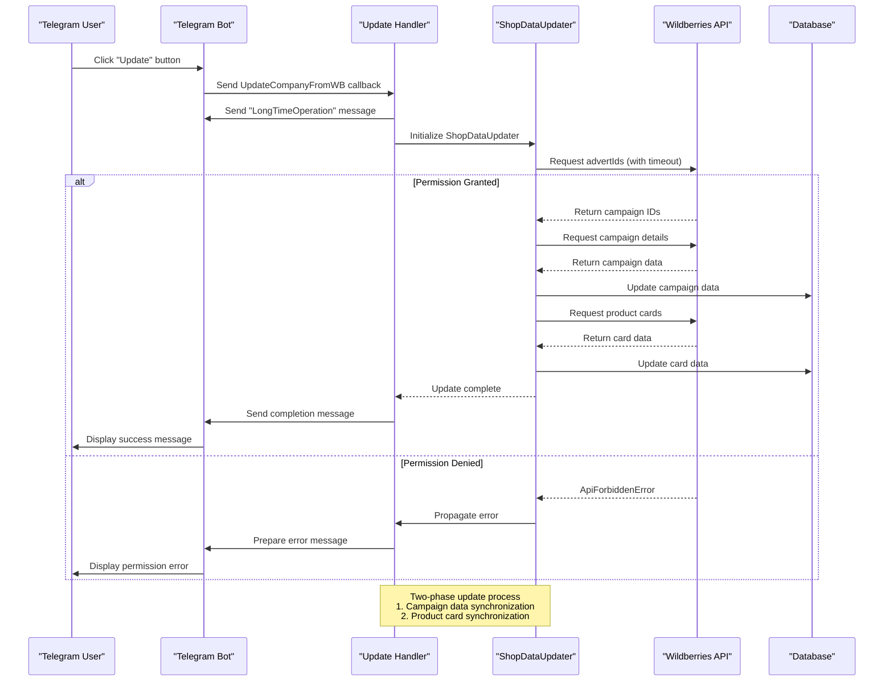
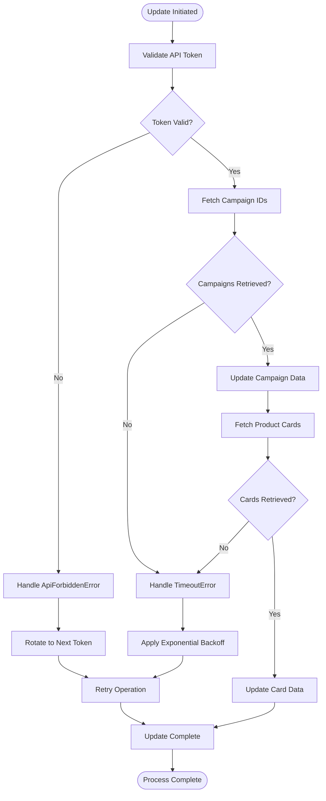
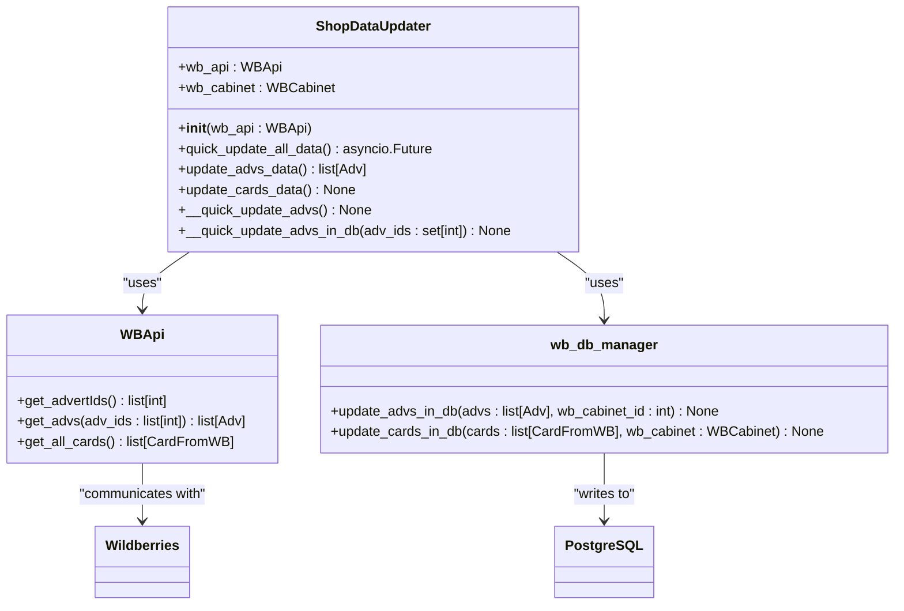
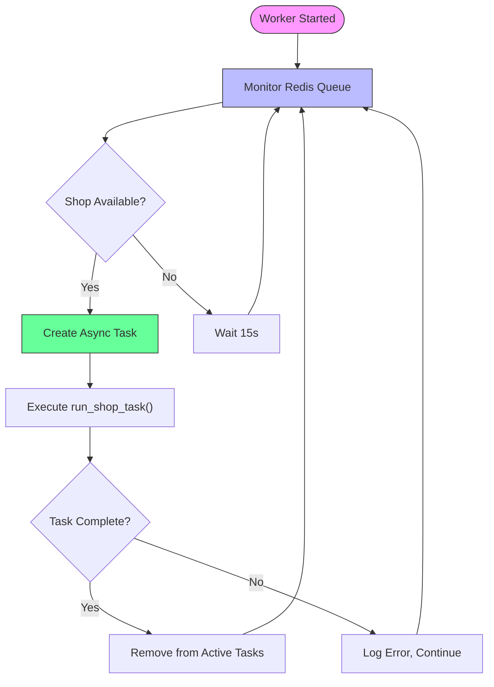

# Shop Data Update Flow

<cite>
**Referenced Files in This Document**   
- [shops_data_updater.py](file://app/modules/common_slaves/wildberries/shops_data_updater.py)
- [start.py](file://app/client_bot/user_interface/handlers/start/start.py)
- [messages.py](file://app/client_bot/user_interface/views/messages/messages.py)
- [worker.py](file://app/modules/shop_runner/shop_run_worker/worker/worker.py)
- [run_process_func.py](file://app/modules/shop_runner/run_process_func.py)
- [wb_shop.py](file://app/modules/shop_runner/wb_shop.py)
- [manager.py](file://app/modules/shop_runner/service_manager/manager.py)
- [http_request.py](file://app/core/wb_api/http_request.py)
- [base.py](file://app/core/wb_api/base.py)
</cite>

## Table of Contents
1. [Introduction](#introduction)
2. [Shop Data Update Process Overview](#shop-data-update-process-overview)
3. [Core Components](#core-components)
4. [Update Flow Sequence](#update-flow-sequence)
5. [Error Handling and Recovery](#error-handling-and-recovery)
6. [User Feedback Mechanisms](#user-feedback-mechanisms)
7. [Architecture Overview](#architecture-overview)
8. [Detailed Component Analysis](#detailed-component-analysis)
9. [Conclusion](#conclusion)

## Introduction
The adv-bot system implements a comprehensive shop data update flow that synchronizes advertising data from the Wildberries API. This documentation details the complete process of updating shop data, including campaign synchronization, product card updates, permission checks, and timeout handling. The system is designed to handle long-running operations efficiently while providing appropriate user feedback through the Telegram bot interface.

**Section sources**
- [shops_data_updater.py](file://app/modules/common_slaves/wildberries/shops_data_updater.py#L1-L103)

## Shop Data Update Process Overview
The shop data update process in the adv-bot system follows a two-phase approach for synchronizing advertising data from Wildberries. The process begins with a user-initiated request through the Telegram bot interface and proceeds through a series of coordinated operations to update both campaign data and product card information.

The update flow is designed to handle the asynchronous nature of Wildberries API operations while maintaining data consistency across the system. The process involves permission validation, data retrieval with timeout constraints, and sequential updates of advertising campaigns followed by product card information.

**Section sources**
- [shops_data_updater.py](file://app/modules/common_slaves/wildberries/shops_data_updater.py#L1-L103)
- [start.py](file://app/client_bot/user_interface/handlers/start/start.py#L344-L377)

## Core Components
The shop data update functionality is implemented through several key components that work together to ensure reliable data synchronization:

- **ShopDataUpdater**: The primary class responsible for coordinating the update of advertising campaigns and product cards from Wildberries API.
- **WBShop**: Manages the lifecycle of shop update operations, including the execution of multiple concurrent update coroutines.
- **CoroutinesManager**: Orchestrates various update operations such as keyword parsing, ad data updates, and statistical information synchronization.
- **RedisShopManager**: Handles the queuing and management of shops awaiting update, ensuring efficient resource utilization.

These components work in concert to provide a robust update mechanism that can handle the complexities of Wildberries API integration.

**Section sources**
- [shops_data_updater.py](file://app/modules/common_slaves/wildberries/shops_data_updater.py#L1-L103)
- [wb_shop.py](file://app/modules/shop_runner/wb_shop.py#L1-L41)
- [manager.py](file://app/modules/shop_runner/service_manager/manager.py#L1-L132)

## Update Flow Sequence
The shop data update process follows a well-defined sequence of operations that ensures data consistency and provides appropriate user feedback:



**Diagram sources**
- [start.py](file://app/client_bot/user_interface/handlers/start/start.py#L344-L377)
- [shops_data_updater.py](file://app/modules/common_slaves/wildberries/shops_data_updater.py#L1-L103)

## Error Handling and Recovery
The system implements comprehensive error handling strategies to manage various failure scenarios during the shop data update process:

### Timeout Handling
The system uses `asyncio.wait_for` to enforce operation timeouts when communicating with the Wildberries API. This prevents individual operations from blocking the update process indefinitely. The timeout mechanism is integrated at multiple levels:

- Individual API requests have built-in timeout handling through the `http_request` decorator
- The `ShopDataUpdater` enforces overall operation timeouts for complete update cycles
- The worker process monitors task completion and handles stalled operations

### Permission Checks
Permission validation occurs at multiple stages of the update process:

- Initial token validation when creating the `WBApi` instance
- Shop access verification through the `WBCabinetAccess` object
- Token rotation via `set_next_token` when encountering `ApiForbiddenError`

When a permission error occurs, the system attempts to use alternative tokens before propagating the error to the user interface.

### Error Recovery Strategies
The system implements several recovery mechanisms:

- **Token Rotation**: When an `ApiForbiddenError` occurs, the system automatically attempts to use the next available token in the rotation.
- **Retry Logic**: Transient errors trigger exponential backoff retry mechanisms with increasing delays between attempts.
- **Graceful Degradation**: If certain data cannot be updated, the system continues with available data rather than failing the entire operation.



**Diagram sources**
- [base.py](file://app/core/wb_api/base.py#L32-L70)
- [http_request.py](file://app/core/wb_api/http_request.py#L85-L147)
- [shops_data_updater.py](file://app/modules/common_slaves/wildberries/shops_data_updater.py#L1-L103)

**Section sources**
- [http_request.py](file://app/core/wb_api/http_request.py#L85-L147)
- [base.py](file://app/core/wb_api/base.py#L65-L101)

## User Feedback Mechanisms
The system provides comprehensive user feedback throughout the update process to maintain transparency and manage user expectations:

### Initial Feedback
When a user initiates a shop data update, the system immediately provides feedback that the operation may take some time:

```python
await messages.LongTimeOperation(bot, callback_query.message.chat.id)()
```

This message informs users that the operation is long-running and sets appropriate expectations for response time.

### Progress Indication
The system uses Redis to track the status of ongoing update operations. The `RedisShopManager` maintains a queue of shops being processed and their current status. This allows the system to provide real-time updates on the progress of data synchronization.

### Completion and Error Messages
Upon completion of the update process, the system sends appropriate messages to inform the user of the outcome:

- Success messages when the update completes without errors
- Detailed error messages when specific issues occur (e.g., permission denied, timeout)
- Actionable guidance on how to resolve common issues

The feedback mechanism is integrated with the Telegram bot interface to ensure users receive timely notifications regardless of their current location within the application.

**Section sources**
- [messages.py](file://app/client_bot/user_interface/views/messages/messages.py#L629-L631)
- [start.py](file://app/client_bot/user_interface/handlers/start/start.py#L344-L377)

## Architecture Overview
The shop data update system follows a distributed architecture with clear separation of concerns between components:

```mermaid
graph TB
subgraph "User Interface"
UI[Telegram Bot]
UI --> Handler[Update Handler]
end
subgraph "Processing Layer"
Handler --> Updater[ShopDataUpdater]
Updater --> API[Wildberries API Client]
Updater --> DB[Database Manager]
end
subgraph "Data Layer"
API --> WB[Wildberries API]
DB --> PostgreSQL[(PostgreSQL)]
DB --> Redis[(Redis)]
end
subgraph "Orchestration"
Worker[Shop Worker]
Worker --> Queue[Redis Queue]
Worker --> Updater
Queue --> Worker
end
style UI fill:#f9f,stroke:#333
style WB fill:#bbf,stroke:#333
style PostgreSQL fill:#f96,stroke:#333
style Redis fill:#6f9,stroke:#333
Note over Worker,Queue: Worker process continuously monitors<br/>Redis queue for shops requiring updates
```

**Diagram sources**
- [worker.py](file://app/modules/shop_runner/shop_run_worker/worker/worker.py#L1-L80)
- [run_process_func.py](file://app/modules/shop_runner/run_process_func.py#L1-L67)

## Detailed Component Analysis

### ShopDataUpdater Analysis
The `ShopDataUpdater` class is the central component responsible for synchronizing data between Wildberries and the application database. It implements a two-phase update process:

#### Two-Phase Update Process
The update process consists of two distinct phases executed sequentially:

1. **Campaign Data Update**: Synchronizes advertising campaign information including campaign IDs, names, statuses, and bidding parameters.
2. **Product Card Update**: Retrieves and updates product card information including names, categories, and associated metadata.

The phased approach ensures data consistency and allows for independent error handling in each phase.

#### Data Synchronization Logic
The updater implements intelligent synchronization logic that minimizes unnecessary API calls:

- It first retrieves the list of campaign IDs from Wildberries
- Compares this list with existing campaigns in the database
- Updates only the campaigns that have changed or are new
- Uses a coroutine queue to parallelize updates while maintaining resource constraints



**Diagram sources**
- [shops_data_updater.py](file://app/modules/common_slaves/wildberries/shops_data_updater.py#L1-L103)

**Section sources**
- [shops_data_updater.py](file://app/modules/common_slaves/wildberries/shops_data_updater.py#L1-L103)

### Worker Process Analysis
The background worker process manages the execution of shop update operations across multiple shops:

#### Task Management
The worker implements a dynamic task management system that:

- Monitors a Redis queue for shops requiring updates
- Creates asynchronous tasks for each shop in the queue
- Tracks task completion and handles cleanup operations
- Implements exponential backoff for failed operations

#### Resource Management
The system efficiently manages resources by:

- Limiting the number of concurrent update operations
- Using Redis TTL (Time To Live) to prevent stale tasks from accumulating
- Implementing proper cleanup procedures when tasks complete



**Diagram sources**
- [worker.py](file://app/modules/shop_runner/shop_run_worker/worker/worker.py#L37-L80)
- [run_process_func.py](file://app/modules/shop_runner/run_process_func.py#L33-L67)

**Section sources**
- [worker.py](file://app/modules/shop_runner/shop_run_worker/worker/worker.py#L1-L80)
- [run_process_func.py](file://app/modules/shop_runner/run_process_func.py#L1-L67)

## Conclusion
The shop data update flow in the adv-bot system provides a robust mechanism for synchronizing advertising data from Wildberries. The system implements a comprehensive approach to handling long-running operations, with appropriate user feedback, error recovery, and resource management.

Key features of the implementation include:

- A two-phase update process that ensures data consistency
- Comprehensive error handling for both timeout and permission issues
- Efficient resource utilization through asynchronous processing
- Clear user feedback mechanisms that manage expectations
- Resilient recovery strategies for common failure scenarios

The architecture effectively separates concerns between user interface, business logic, and data access layers, resulting in a maintainable and scalable solution for shop data synchronization.