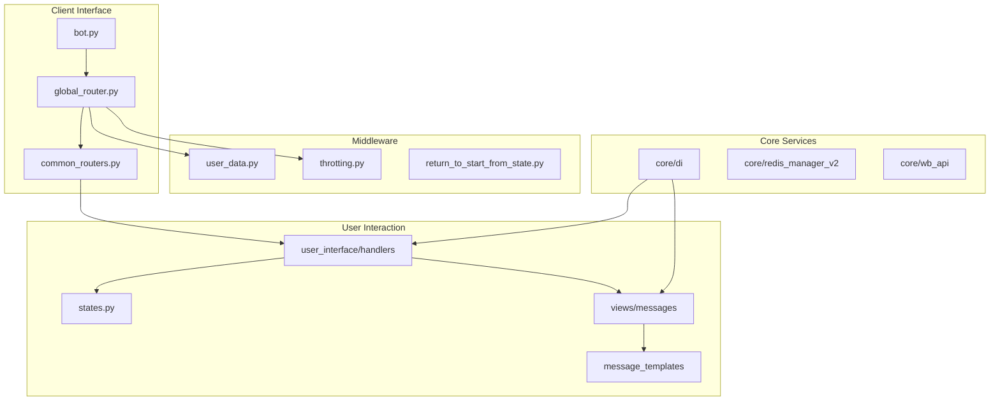
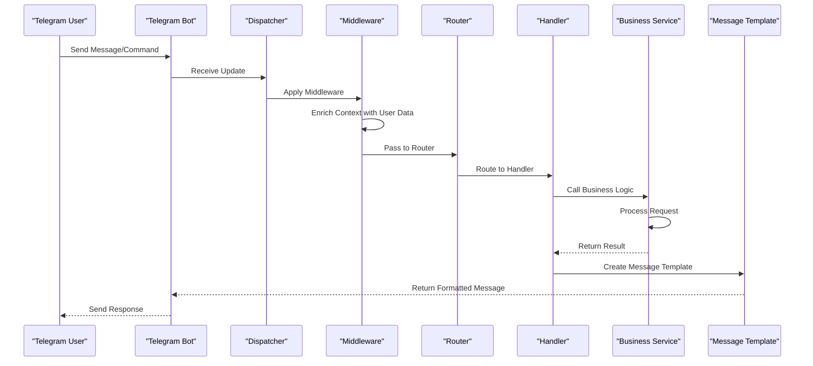
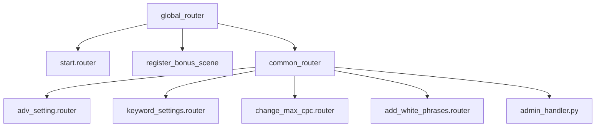
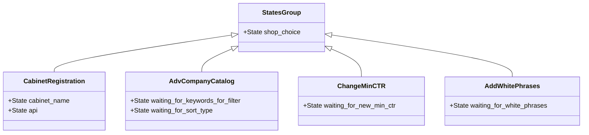
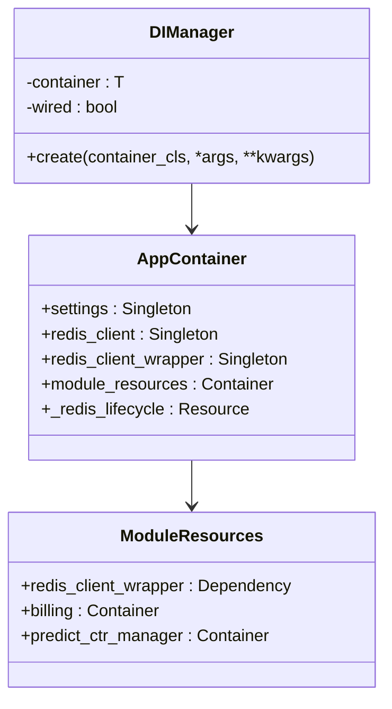
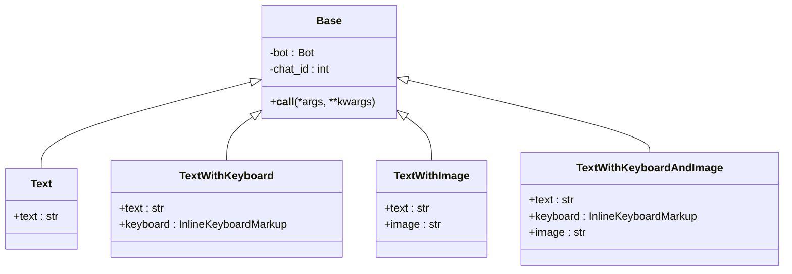
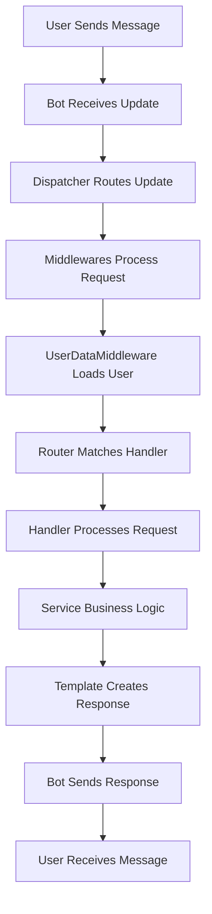
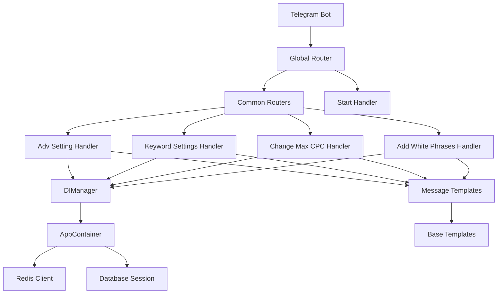

# Synchronous User Flows

<cite>
**Referenced Files in This Document**   
- [start.py](file://app/client_bot/user_interface/handlers/start/start.py)
- [adv_setting.py](file://app/client_bot/user_interface/handlers/adv_setting.py)
- [states.py](file://app/client_bot/user_interface/states.py)
- [bot.py](file://app/client_bot/bot.py)
- [global_router.py](file://app/client_bot/global_router.py)
- [common_routers.py](file://app/client_bot/common_routers.py)
- [user_data.py](file://app/client_bot/middlewars/user_data.py)
- [templates.py](file://app/client_bot/user_interface/message_templates/templates.py)
- [messages.py](file://app/client_bot/user_interface/views/messages/messages.py)
- [di_manager.py](file://app/core/di/di_manager.py)
- [app_container.py](file://app/core/di/app_container.py)
</cite>

## Table of Contents
1. [Introduction](#introduction)
2. [Project Structure](#project-structure)
3. [Core Components](#core-components)
4. [Architecture Overview](#architecture-overview)
5. [Detailed Component Analysis](#detailed-component-analysis)
6. [Dependency Analysis](#dependency-analysis)
7. [Performance Considerations](#performance-considerations)
8. [Troubleshooting Guide](#troubleshooting-guide)
9. [Conclusion](#conclusion)

## Introduction
This document provides comprehensive documentation for synchronous user interaction flows in the adv-bot system. It details the complete request-response lifecycle from Telegram user input to bot response, focusing on handler routing, state management, and service orchestration. The document explains how DIManager injects dependencies into handlers and how user states are maintained through aiogram's state machine. Sequence diagrams illustrate data flow from message reception to response generation, with examples from start.py and adv_setting.py. Error handling patterns and validation workflows are detailed, along with code examples demonstrating handler registration, middleware integration, and response templating using message templates.

## Project Structure
The adv-bot system follows a modular architecture with clear separation of concerns. The client_bot module handles Telegram interactions, while core modules manage business logic and infrastructure services. The structure organizes handlers by functionality, with dedicated modules for state management, message templating, and dependency injection.

**Diagram sources**
- [bot.py](file://app/client_bot/bot.py)
- [global_router.py](file://app/client_bot/global_router.py)
- [common_routers.py](file://app/client_bot/common_routers.py)

**Section sources**
- [bot.py](file://app/client_bot/bot.py#L1-L15)
- [global_router.py](file://app/client_bot/global_router.py#L1-L29)

## Core Components
The core components of the synchronous user interaction flow include the Telegram bot instance, router system, state machine, dependency injection container, and message templating system. These components work together to process user input, maintain conversation state, inject required services, and generate appropriate responses.

**Section sources**
- [bot.py](file://app/client_bot/bot.py#L1-L15)
- [states.py](file://app/client_bot/user_interface/states.py#L1-L79)
- [di_manager.py](file://app/core/di/di_manager.py#L1-L32)

## Architecture Overview
The adv-bot system implements a layered architecture for handling synchronous user interactions. The request-response flow begins with message reception by the Telegram bot, followed by routing through aiogram's dispatcher system. Middleware components enrich the request context with user data and apply throttling. The router directs requests to appropriate handlers based on commands, callbacks, or message content. Handlers process the request, interact with business services, and generate responses using templated messages.

**Diagram sources**
- [bot.py](file://app/client_bot/bot.py#L1-L15)
- [global_router.py](file://app/client_bot/global_router.py#L1-L29)
- [user_data.py](file://app/client_bot/middlewars/user_data.py#L1-L51)

## Detailed Component Analysis

### Handler Routing System
The handler routing system uses aiogram's Router class to organize and dispatch incoming updates. Routers are hierarchically structured with global_router serving as the entry point, which includes common_routers containing most application handlers. The routing system prioritizes handler registration order, particularly for the /start command which requires specific sequencing.

**Diagram sources**
- [global_router.py](file://app/client_bot/global_router.py#L1-L29)
- [common_routers.py](file://app/client_bot/common_routers.py#L1-L112)

**Section sources**
- [global_router.py](file://app/client_bot/global_router.py#L1-L29)
- [common_routers.py](file://app/client_bot/common_routers.py#L1-L112)

### State Management
The state management system uses aiogram's FSM (Finite State Machine) to maintain user conversation context. States are organized into logical groups based on functionality, such as CabinetRegistration for onboarding new users or AdvCompanyCatalog for filtering advertising campaigns. The system preserves state across interactions, allowing multi-step workflows.

**Diagram sources**
- [states.py](file://app/client_bot/user_interface/states.py#L1-L79)

**Section sources**
- [states.py](file://app/client_bot/user_interface/states.py#L1-L79)
- [start.py](file://app/client_bot/user_interface/handlers/start/start.py#L1-L199)

### Dependency Injection System
The dependency injection system uses the dependency_injector library to manage service instantiation and injection. The AppContainer serves as the main DI container, configuring providers for core services like Redis and database connections. The DIManager acts as a context manager for the container, handling bootstrap and shutdown operations.

**Diagram sources**
- [di_manager.py](file://app/core/di/di_manager.py#L1-L32)
- [app_container.py](file://app/core/di/app_container.py#L1-L49)
- [module_resources.py](file://app/core/di/module_resources.py#L1-L34)

**Section sources**
- [di_manager.py](file://app/core/di/di_manager.py#L1-L32)
- [app_container.py](file://app/core/di/app_container.py#L1-L49)

### Message Templating System
The message templating system provides a structured approach to generating bot responses. Base templates inherit from aiogram types and implement the callable interface, allowing them to be executed directly. Different template types support various message formats including text-only, text with keyboard, text with image, and combinations thereof.

**Diagram sources**
- [base.py](file://app/client_bot/user_interface/message_templates/base.py#L1-L31)
- [templates.py](file://app/client_bot/user_interface/message_templates/templates.py#L1-L187)

**Section sources**
- [base.py](file://app/client_bot/user_interface/message_templates/base.py#L1-L31)
- [templates.py](file://app/client_bot/user_interface/message_templates/templates.py#L1-L187)

### Request-Response Lifecycle
The complete request-response lifecycle begins with user input and progresses through multiple processing stages before generating a response. This flowchart illustrates the synchronous processing path from message reception to response delivery.

**Diagram sources**
- [bot.py](file://app/client_bot/bot.py#L1-L15)
- [user_data.py](file://app/client_bot/middlewars/user_data.py#L1-L51)
- [global_router.py](file://app/client_bot/global_router.py#L1-L29)

**Section sources**
- [bot.py](file://app/client_bot/bot.py#L1-L15)
- [user_data.py](file://app/client_bot/middlewars/user_data.py#L1-L51)

## Dependency Analysis
The adv-bot system demonstrates a well-structured dependency graph with clear separation between interface, business logic, and infrastructure layers. The dependency injection system enables loose coupling between components, while the router hierarchy establishes clear ownership of request handling responsibilities.

**Diagram sources**
- [bot.py](file://app/client_bot/bot.py#L1-L15)
- [global_router.py](file://app/client_bot/global_router.py#L1-L29)
- [common_routers.py](file://app/client_bot/common_routers.py#L1-L112)
- [di_manager.py](file://app/core/di/di_manager.py#L1-L32)

**Section sources**
- [bot.py](file://app/client_bot/bot.py#L1-L15)
- [global_router.py](file://app/client_bot/global_router.py#L1-L29)
- [common_routers.py](file://app/client_bot/common_routers.py#L1-L112)

## Performance Considerations
The synchronous user flows are designed with performance in mind, minimizing database queries through strategic use of Redis caching and SQLAlchemy's joined loading. The middleware system avoids blocking operations, and the dependency injection container optimizes service instantiation through singleton providers. Message templates are designed to be lightweight and reusable, reducing response generation time.

## Troubleshooting Guide
Common issues in the synchronous user flow typically involve state management, dependency injection, or message templating. When handlers fail to trigger, verify the router inclusion order, particularly for the /start command. For state-related issues, ensure proper state clearing and data updating in handlers. Dependency injection problems often stem from missing wiring configurations or provider misconfigurations. Message template errors usually involve incorrect property definitions or missing abstract method implementations.

**Section sources**
- [start.py](file://app/client_bot/user_interface/handlers/start/start.py#L1-L199)
- [adv_setting.py](file://app/client_bot/user_interface/handlers/adv_setting.py#L1-L363)
- [templates.py](file://app/client_bot/user_interface/message_templates/templates.py#L1-L187)

## Conclusion
The adv-bot system implements a robust synchronous user interaction flow using aiogram's framework components. The architecture combines effective handler routing, state management, dependency injection, and message templating to create a responsive and maintainable Telegram bot. The system's modular design allows for easy extension and maintenance, while the dependency injection system promotes loose coupling and testability. By following the patterns documented here, developers can effectively understand, extend, and troubleshoot the synchronous user flows in the adv-bot system.