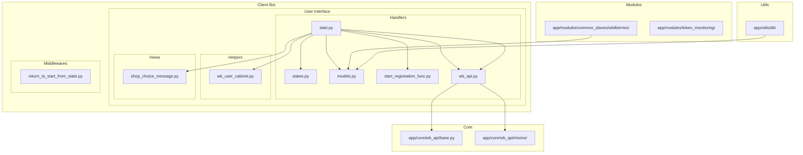
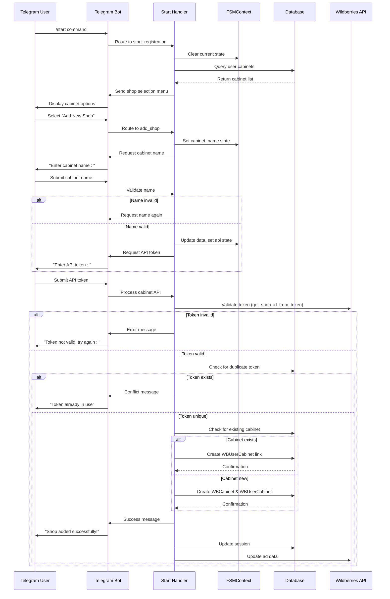
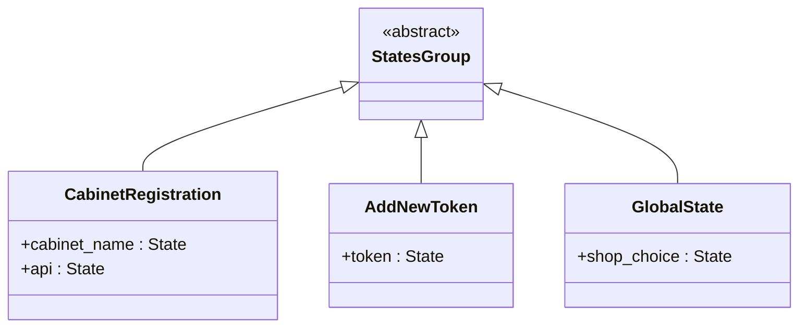
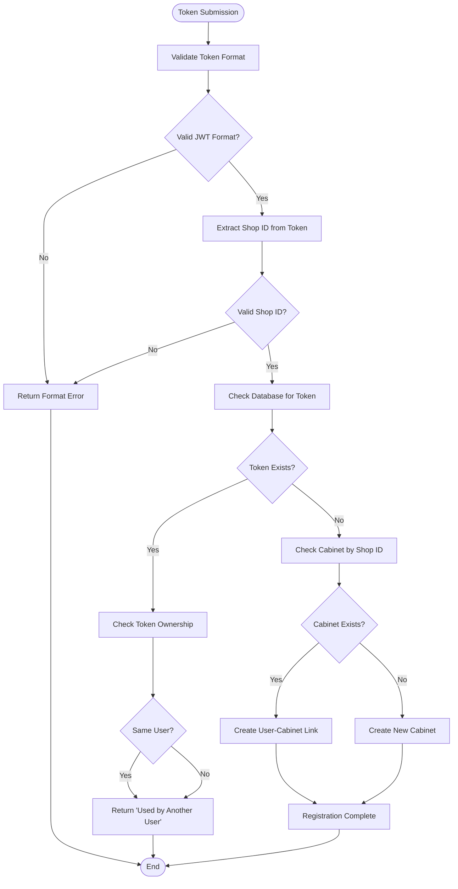
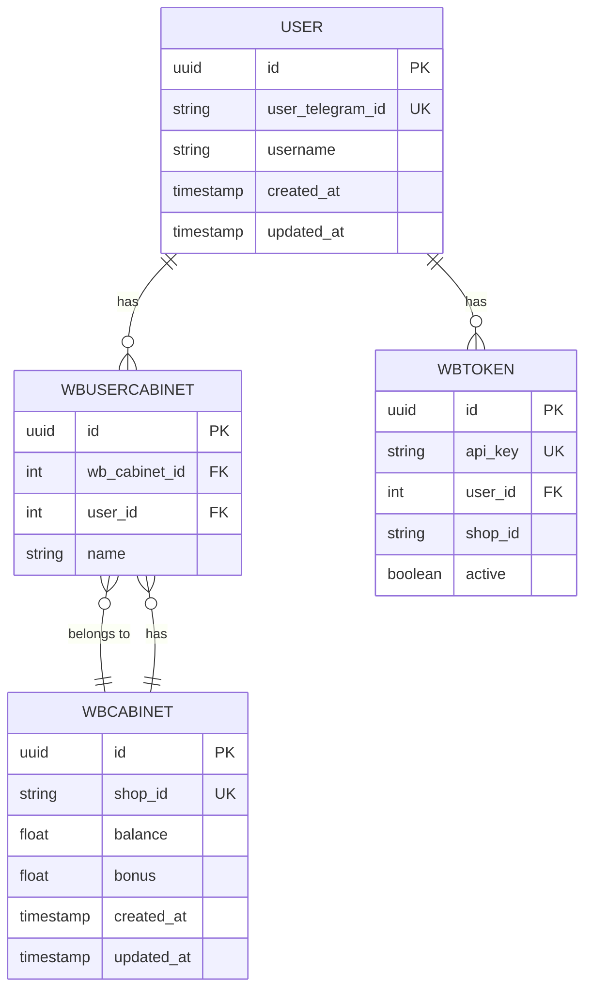
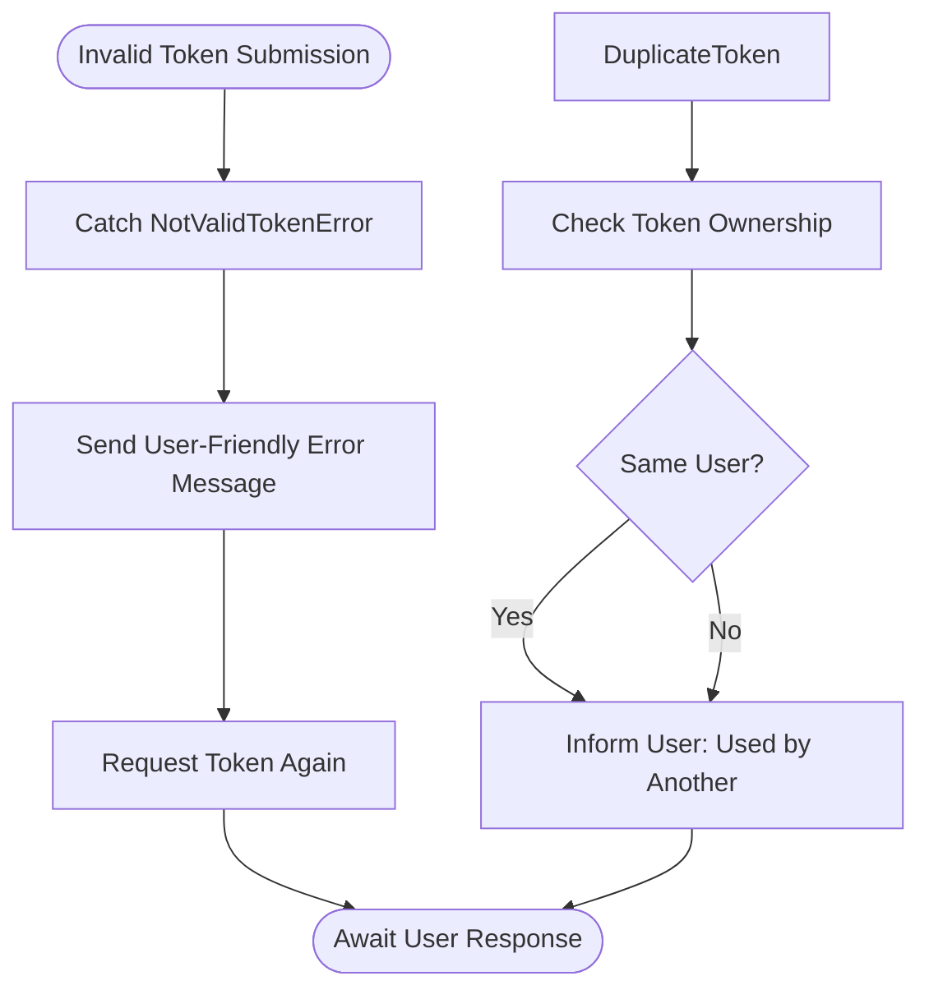
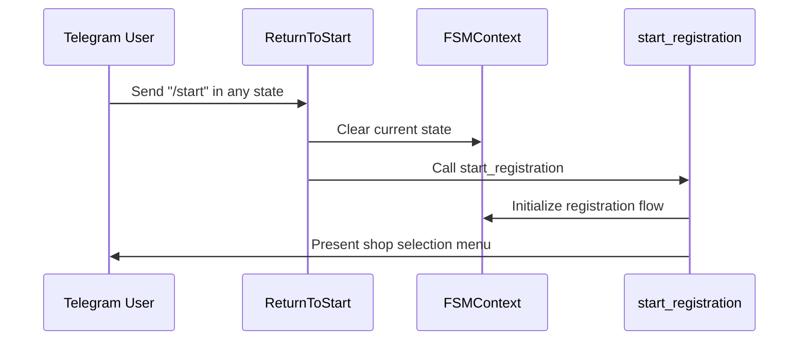
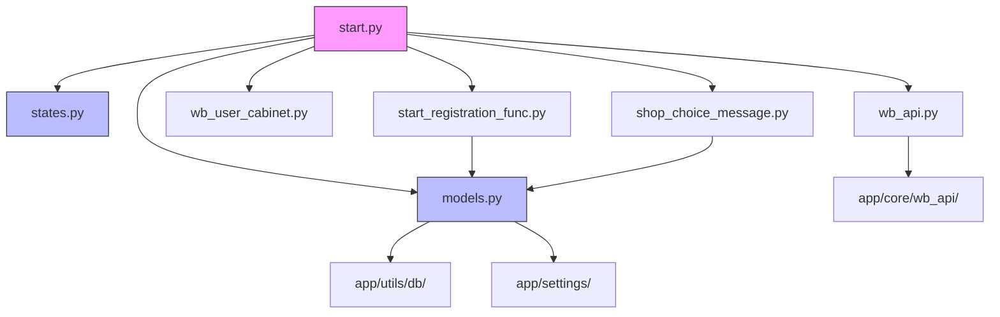

# User Authentication Flow

<cite>
**Referenced Files in This Document**   
- [start.py](file://app/client_bot/user_interface/handlers/start/start.py)
- [start_registration_func.py](file://app/client_bot/user_interface/handlers/start_registration_func.py)
- [states.py](file://app/client_bot/user_interface/states.py)
- [models.py](file://app/modules/common_slaves/wildberries/models/models.py)
- [wb_user_cabinet.py](file://app/client_bot/user_interface/helpers/wb_user_cabinet.py)
- [shop_choice_message.py](file://app/client_bot/user_interface/handlers/shop_choice_message.py)
- [wb_api.py](file://app/client_bot/user_interface/handlers/start/wb_api.py)
- [exceptions.py](file://app/core/wb_api/exceptions.py)
</cite>

## Table of Contents
1. [Introduction](#introduction)
2. [Project Structure](#project-structure)
3. [Core Components](#core-components)
4. [Architecture Overview](#architecture-overview)
5. [Detailed Component Analysis](#detailed-component-analysis)
6. [Dependency Analysis](#dependency-analysis)
7. [Performance Considerations](#performance-considerations)
8. [Troubleshooting Guide](#troubleshooting-guide)
9. [Conclusion](#conclusion)

## Introduction
This document provides comprehensive documentation for the user authentication and registration flow in the adv-bot system. The process begins with the user sending the /start command and proceeds through cabinet registration, token validation against the Wildberries API, and database persistence of user and cabinet relationships. The system uses Finite State Machine (FSM) context for state management throughout the registration process. This documentation details the complete sequence of handler interactions, error handling mechanisms for invalid tokens or duplicate entries, and the role of key models such as WBToken and WBUserCabinet.

## Project Structure

**Diagram sources**
- [start.py](file://app/client_bot/user_interface/handlers/start/start.py)
- [states.py](file://app/client_bot/user_interface/states.py)
- [models.py](file://app/modules/common_slaves/wildberries/models/models.py)

**Section sources**
- [start.py](file://app/client_bot/user_interface/handlers/start/start.py)
- [start_registration_func.py](file://app/client_bot/user_interface/handlers/start_registration_func.py)

## Core Components

The user authentication and registration flow in the adv-bot system consists of several core components that work together to manage user onboarding, token validation, and cabinet registration. The primary components include the state management system using FSMContext, the token validation mechanism against Wildberries API, and the database persistence layer for user and cabinet relationships.

The process begins with the `/start` command handler which initializes the registration process. When a user sends the `/start` command, the `start_registration` function is called, which clears any existing state and presents the user with shop selection options. If the user has no existing cabinets, they are prompted to add a new one.

For cabinet registration, the system uses a multi-step process managed by FSM states defined in `CabinetRegistration`. The user first provides a cabinet name, which is validated for uniqueness and length constraints. Then, they enter an API token which undergoes validation to verify its authenticity and permissions.

The WBToken model plays a crucial role in this process, providing methods to extract the shop ID from the token payload and validate token permissions. The system checks for duplicate tokens both within the same user's account and across different users to prevent conflicts.

Database persistence is handled through SQLAlchemy models with proper relationships between User, WBUserCabinet, WBCabinet, and WBToken entities. The system ensures data integrity through unique constraints and proper foreign key relationships.

**Section sources**
- [start.py](file://app/client_bot/user_interface/handlers/start/start.py#L1-L463)
- [models.py](file://app/modules/common_slaves/wildberries/models/models.py#L1-L719)
- [states.py](file://app/client_bot/user_interface/states.py#L1-L79)

## Architecture Overview

**Diagram sources**
- [start.py](file://app/client_bot/user_interface/handlers/start/start.py#L1-L463)
- [models.py](file://app/modules/common_slaves/wildberries/models/models.py#L1-L719)

## Detailed Component Analysis

### Authentication Flow Analysis

#### State Management with FSMContext
The system implements a robust state management system using aiogram's FSMContext to guide users through the registration process. The states are defined in the `states.py` file with specific state groups for different workflows.

**Diagram sources**
- [states.py](file://app/client_bot/user_interface/states.py#L1-L79)

The `CabinetRegistration` state group manages the two-step process of cabinet creation: first collecting the cabinet name, then the API token. When a user begins registration, the system clears any existing state to prevent conflicts from previous sessions. The state transitions are carefully managed to ensure users progress through the registration process in the correct order.

#### Token Validation Process
The token validation process is a critical component of the authentication flow. When a user submits an API token, the system performs several validation steps to ensure its authenticity and proper permissions.

**Diagram sources**
- [start.py](file://app/client_bot/user_interface/handlers/start/start.py#L1-L463)
- [models.py](file://app/modules/common_slaves/wildberries/models/models.py#L1-L719)

The validation process begins by checking if the token is a valid JWT format. The system uses the `WBToken` model's `get_shop_id_from_token()` method which decodes the JWT payload and extracts the "sid" claim containing the shop ID. If the token cannot be decoded or doesn't contain a valid shop ID, it's rejected as invalid.

After format validation, the system checks the database for existing tokens with the same API key and shop ID combination. This prevents duplicate token usage both within the same user account and across different users. The system also checks if a WBCabinet already exists for the shop ID. If it does, a new WBUserCabinet relationship is created to link the user to the existing cabinet. If no cabinet exists, a new WBCabinet is created along with the WBUserCabinet relationship.

#### Database Models and Relationships
The authentication system relies on several key database models that define the relationships between users, cabinets, and tokens.

**Diagram sources**
- [models.py](file://app/modules/common_slaves/wildberries/models/models.py#L1-L719)

The `User` model represents the Telegram user with their unique telegram ID and username. The `WBCabinet` model represents a Wildberries shop with its shop ID, balance, and bonus information. The `WBUserCabinet` model serves as a junction table that creates a many-to-many relationship between users and cabinets, allowing multiple users to access the same cabinet or a single user to manage multiple cabinets. The `WBToken` model stores the API token information including the token itself, the associated user, and the shop ID extracted from the token.

These models are connected through foreign key relationships that maintain data integrity. The WBUserCabinet table has unique constraints to prevent duplicate user-cabinet relationships. The WBToken table has a unique constraint on the combination of api_key and user_id to prevent a user from adding the same token multiple times.

### Error Handling and Recovery

#### Error Handling Patterns
The system implements comprehensive error handling to manage various failure scenarios during the authentication process. When a user submits an invalid token, the system catches the `NotValidTokenError` exception and provides appropriate feedback.

**Diagram sources**
- [start.py](file://app/client_bot/user_interface/handlers/start/start.py#L1-L463)
- [exceptions.py](file://app/core/wb_api/exceptions.py#L1-L100)

The error handling strategy focuses on providing clear, actionable feedback to users while maintaining system security. When a token validation fails, the system doesn't reveal specific details about why the token was invalid (such as whether it was malformed or had insufficient permissions) to prevent potential security information disclosure.

For duplicate token scenarios, the system differentiates between a token already being used by the same user versus being used by another user. This allows for appropriate messaging: "This token is already in use by you" versus "This token is already in use by another user."

#### State Recovery Mechanisms
The system includes mechanisms to recover from interrupted registration processes. The `ReturnToStart` middleware monitors for "/start" commands during any state and resets the user's state to begin the registration process anew.

**Diagram sources**
- [return_to_start_from_state.py](file://app/client_bot/middlewars/return_to_start_from_state.py#L1-L28)
- [start_registration_func.py](file://app/client_bot/user_interface/handlers/start_registration_func.py#L1-L60)

This recovery mechanism ensures that users can always return to the beginning of the registration process by simply typing "/start", regardless of their current state. This is particularly useful if a user gets stuck or wants to start over with a different cabinet.

## Dependency Analysis

**Diagram sources**
- [start.py](file://app/client_bot/user_interface/handlers/start/start.py)
- [states.py](file://app/client_bot/user_interface/states.py)
- [models.py](file://app/modules/common_slaves/wildberries/models/models.py)

The authentication flow has a well-defined dependency structure. The main entry point is the `start.py` handler which depends on several components: the state definitions, data models, registration logic, helper functions, UI components, and API clients. The `start_registration_func.py` module handles the initial user registration and depends on the same data models. The `shop_choice_message.py` module provides the UI for shop selection and also depends on the data models.

All components ultimately depend on the core data models defined in `models.py`, which in turn depend on the database utilities and application settings. The API integration through `wb_api.py` depends on the core Wildberries API implementation in the app/core/wb_api package.

**Section sources**
- [start.py](file://app/client_bot/user_interface/handlers/start/start.py)
- [states.py](file://app/client_bot/user_interface/states.py)
- [models.py](file://app/modules/common_slaves/wildberries/models/models.py)

## Performance Considerations
The authentication and registration flow has been designed with performance considerations in mind. Database queries are optimized using SQLAlchemy's joined loading and selectin loading to minimize the number of database round trips. The system uses appropriate indexes on frequently queried fields such as user_telegram_id, shop_id, and api_key to ensure fast lookups.

The token validation process is designed to be efficient by leveraging the JWT token structure, which allows extracting the shop ID without making an API call to Wildberries. Only after local validation passes does the system proceed with database operations.

For high-traffic scenarios, the system could benefit from additional caching mechanisms, particularly for frequently accessed cabinet information. The current implementation makes direct database queries for each request, which could be optimized with Redis caching for improved performance.

The state management system uses aiogram's built-in FSMContext which can be configured to use different storage backends (memory, Redis, database) depending on the deployment requirements. For production environments with multiple bot instances, using Redis as the state storage backend would ensure consistent state management across instances.

## Troubleshooting Guide

Common issues in the authentication flow and their solutions:

1. **Invalid Token Errors**: When users receive "Token not valid" messages, verify that they are using a valid Wildberries API token with the correct permissions. The token must have at least "Продвижение" (Promotion) permissions.

2. **Duplicate Token Conflicts**: If users receive "Token already in use" messages, check whether they are attempting to add a token they've already added or one that belongs to another user. Each token can only be used by one user account.

3. **Shop ID Extraction Failures**: If the system cannot extract the shop ID from a seemingly valid token, the token may be malformed or use an unexpected format. Verify the token structure and ensure it's a valid JWT.

4. **Database Constraint Violations**: Unique constraint violations may occur if there are race conditions during cabinet creation. The system should use database transactions with appropriate isolation levels to prevent these issues.

5. **State Management Issues**: If users experience unexpected behavior with state transitions, verify that the FSMContext is properly configured and that middleware is correctly handling state resets.

**Section sources**
- [start.py](file://app/client_bot/user_interface/handlers/start/start.py#L1-L463)
- [exceptions.py](file://app/core/wb_api/exceptions.py#L1-L100)
- [models.py](file://app/modules/common_slaves/wildberries/models/models.py#L1-L719)

## Conclusion
The user authentication and registration flow in the adv-bot system provides a robust mechanism for users to connect their Wildberries shops to the bot. The process is carefully orchestrated through a series of state-managed steps that guide users from initial contact through successful cabinet registration.

Key strengths of the system include its comprehensive validation of API tokens, proper handling of edge cases such as duplicate tokens, and clear error messaging. The use of FSMContext ensures a smooth user experience by maintaining state throughout the multi-step registration process.

The architecture effectively separates concerns between state management, business logic, and data persistence, making the system maintainable and extensible. The database schema is well-designed with appropriate relationships and constraints to maintain data integrity.

For future improvements, consider implementing additional security measures such as rate limiting for token validation attempts, enhanced logging for troubleshooting, and improved error categorization to provide more specific feedback to users while maintaining security.