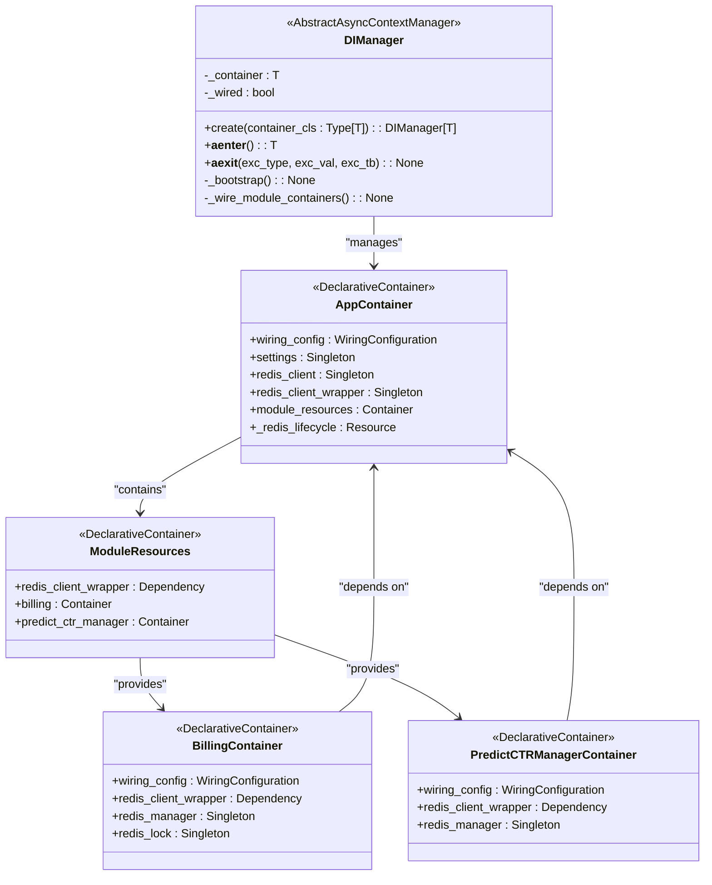

# Dependency Injection

<cite>
**Referenced Files in This Document**   
- [app_container.py](file://app/core/di/app_container.py)
- [di_manager.py](file://app/core/di/di_manager.py)
- [module_resources.py](file://app/core/di/module_resources.py)
- [redis.py](file://app/core/di/databases/redis.py)
- [app_config.py](file://app/configs/app_config.py)
- [billing/di.py](file://app/modules/billing/di.py)
- [predict_ctr_update_manager/di.py](file://app/modules/shop_runner/service_manager/services/predict_ctr_update_manager/di.py)
</cite>

## Table of Contents
1. [Introduction](#introduction)
2. [AppContainer: Central DI Container](#appcontainer-central-di-container)
3. [DIManager: Container Lifecycle Manager](#dimanager-container-lifecycle-manager)
4. [Module Resources and Container Hierarchy](#module-resources-and-container-hierarchy)
5. [Service Provisioning and Injection](#service-provisioning-and-injection)
6. [Architecture Diagram](#architecture-diagram)
7. [Benefits for Testability and Maintainability](#benefits-for-testability-and-maintainability)
8. [Common Issues and Troubleshooting](#common-issues-and-troubleshooting)
9. [Conclusion](#conclusion)

## Introduction
The adv-bot application implements a comprehensive Dependency Injection (DI) system using the Dependency Injector library to manage component dependencies, configuration, and lifecycle. This documentation details the DI architecture, focusing on the AppContainer as the central dependency container, the DIManager for container lifecycle management, and the hierarchical structure of module containers. The system enables clean separation of concerns, promotes testability, and simplifies configuration management across the application's complex module structure.

## AppContainer: Central DI Container
The AppContainer class serves as the root dependency injection container for the adv-bot application. It defines and manages the primary services and configurations that are shared across the application. The container uses the Dependency Injector library's declarative container pattern to define providers for various services.

The AppContainer is configured with a wiring configuration that specifies the packages where dependency injection should be automatically applied. This allows components in specified modules to automatically receive their dependencies without explicit container references.

Key providers in the AppContainer include:
- **settings**: A singleton provider that creates and manages the application configuration through AppConfig
- **redis_client**: A singleton provider that creates a Redis client instance using configuration parameters
- **redis_client_wrapper**: A singleton provider that wraps the raw Redis client with a RedisClient abstraction for consistent API usage
- **module_resources**: A container provider that aggregates module-specific DI containers
- **_redis_lifecycle**: A resource provider that manages the lifecycle of the Redis connection, handling initialization and shutdown

The container also defines a lifecycle resource for Redis that ensures proper connection validation during initialization and graceful closure during shutdown.

**Section sources**
- [app_container.py](file://app/core/di/app_container.py#L1-L96)
- [redis.py](file://app/core/di/databases/redis.py#L1-L36)
- [app_config.py](file://app/configs/app_config.py#L1-L22)

## DIManager: Container Lifecycle Manager
The DIManager class is an async context manager that handles the complete lifecycle of the DI container. It encapsulates the bootstrap process, wiring of dependencies, and proper shutdown procedures. The manager follows the async context manager protocol, allowing for clean resource management using async with statements.

Key features of DIManager include:
- **Prevented direct initialization**: The constructor raises a RuntimeError to enforce the use of the create class method, ensuring proper async initialization
- **Async creation**: The create class method is a coroutine that properly initializes the container and performs bootstrap operations
- **Bootstrap process**: The _bootstrap method initializes container resources, wires the root container (if wiring configuration exists), and invokes module container wiring
- **Module container wiring**: The _wire_module_containers method automatically wires all module containers that have wiring configurations
- **Graceful shutdown**: The __aexit__ method ensures proper shutdown of container resources when the context is exited

The DIManager provides a clean interface for managing the container lifecycle, ensuring that all resources are properly initialized and cleaned up, which is particularly important for async applications with database and cache connections.

**Section sources**
- [di_manager.py](file://app/core/di/di_manager.py#L1-L96)

## Module Resources and Container Hierarchy
The DI system implements a hierarchical container structure through the ModuleResources class, which acts as an aggregator for module-specific DI containers. This design enables modular dependency management while maintaining access to shared resources.

The ModuleResources container defines dependencies that can be shared across modules, primarily the redis_client_wrapper. Individual modules are then defined as container providers within ModuleResources, each receiving the shared dependencies they require.

Currently implemented module containers include:
- **BillingContainer**: Manages dependencies for the billing module, including RedisManager and RedisLock components
- **PredictCTRManagerContainer**: Manages dependencies for the CTR prediction update module, including PredictCTRRedisManager

Each module container follows the same pattern:
- Defines a wiring configuration that specifies the modules where injection should occur
- Declares dependencies from the parent container (typically redis_client_wrapper)
- Provides module-specific services as singleton providers
- Maintains isolation from other modules while accessing shared infrastructure

This hierarchical approach allows for independent development and testing of modules while ensuring consistent access to shared resources.

**Section sources**
- [module_resources.py](file://app/core/di/module_resources.py#L1-L34)
- [billing/di.py](file://app/modules/billing/di.py#L1-L42)
- [predict_ctr_update_manager/di.py](file://app/modules/shop_runner/service_manager/services/predict_ctr_update_manager/di.py#L1-L41)

## Service Provisioning and Injection
The DI system enables service provisioning and injection through the Dependency Injector library's wiring capabilities. Services are provisioned through providers defined in the various containers, and injected into components using the @inject decorator and Provide pattern.

The wiring configuration in AppContainer specifies the packages where injection should be automatically applied:
- app.core.redis_manager_v2
- app.modules.wb_adv_updater.get_text_to_predict_ctr_dict
- app.modules.common_slaves.wildberries.super_cabinet_manager

Module containers extend this wiring to their specific modules:
- BillingContainer wires app.modules.billing.billing
- PredictCTRManagerContainer wires multiple modules including predict_ctr_update_manager and related components

Components that require dependencies use the @inject decorator and request specific dependencies using Provide[Container.provider_name]. This allows the DI framework to automatically resolve and inject the required services at runtime.

The system supports both singleton and dependency providers, ensuring that expensive resources like database connections are shared appropriately while allowing for flexible dependency injection patterns.

**Section sources**
- [app_container.py](file://app/core/di/app_container.py#L1-L96)
- [di_manager.py](file://app/core/di/di_manager.py#L1-L96)
- [module_resources.py](file://app/core/di/module_resources.py#L1-L34)

## Architecture Diagram
The following UML diagram illustrates the relationship between the AppContainer, DIManager, and module containers in the adv-bot application's DI system.

**Diagram sources**
- [app_container.py](file://app/core/di/app_container.py#L1-L96)
- [di_manager.py](file://app/core/di/di_manager.py#L1-L96)
- [module_resources.py](file://app/core/di/module_resources.py#L1-L34)
- [billing/di.py](file://app/modules/billing/di.py#L1-L42)
- [predict_ctr_update_manager/di.py](file://app/modules/shop_runner/service_manager/services/predict_ctr_update_manager/di.py#L1-L41)

## Benefits for Testability and Maintainability
The DI system in adv-bot provides significant benefits for both testability and maintainability:

**Testability Benefits:**
- **Dependency isolation**: Module containers can be easily replaced or mocked in tests, allowing for isolated unit testing
- **Configuration flexibility**: Test configurations can be injected without modifying production code
- **Resource mocking**: External dependencies like Redis can be replaced with mock implementations
- **Container replacement**: The entire DI container can be substituted with a test-specific container

**Maintainability Benefits:**
- **Modular design**: Clear separation between core infrastructure and module-specific dependencies
- **Consistent patterns**: Standardized approach to dependency management across the application
- **Configuration centralization**: Application settings are managed in a single location
- **Lifecycle management**: Automated resource initialization and cleanup reduces resource management errors
- **Extensibility**: New modules can be added by creating new container classes without modifying the core container

The hierarchical container structure allows teams to work on different modules independently while ensuring consistent access to shared resources and services.

**Section sources**
- [app_container.py](file://app/core/di/app_container.py#L1-L96)
- [di_manager.py](file://app/core/di/di_manager.py#L1-L96)
- [module_resources.py](file://app/core/di/module_resources.py#L1-L34)

## Common Issues and Troubleshooting
While the DI system provides many benefits, certain issues may arise during development and deployment. This section addresses common problems and their solutions.

**Wiring Failures:**
- **Symptom**: Module dependencies are not injected, resulting in injection errors
- **Cause**: Missing or incorrect wiring configuration in AppContainer or module containers
- **Solution**: Verify that the required modules are included in the wiring_config packages or modules list. Check for typos in module paths.

**Resource Initialization Errors:**
- **Symptom**: Application fails to start with Redis connection errors
- **Cause**: Invalid Redis configuration or unreachable Redis server
- **Solution**: Verify Redis configuration in environment variables. Check network connectivity to the Redis server. The RedisLifecycle resource will validate the connection during initialization.

**Missing Dependencies:**
- **Symptom**: Dependency injection fails with provider not found errors
- **Cause**: Required providers are not defined in the container hierarchy
- **Solution**: Ensure all required dependencies are declared in the appropriate container. Verify that module containers receive all necessary dependencies from the parent container.

**Circular Dependencies:**
- **Symptom**: Application hangs or fails during container initialization
- **Cause**: Two or more components depend on each other directly or indirectly
- **Solution**: Restructure the dependency graph to eliminate circular references. Consider introducing interfaces or event-based communication.

**Debugging Tips:**
- Enable debug logging to see wiring progress and container initialization
- Use the DIManager's logging to identify which containers are being wired
- Verify container structure by inspecting the providers dictionary
- Test container initialization in isolation before integrating with the full application

**Section sources**
- [app_container.py](file://app/core/di/app_container.py#L1-L96)
- [di_manager.py](file://app/core/di/di_manager.py#L1-L96)
- [redis.py](file://app/core/di/databases/redis.py#L1-L36)

## Conclusion
The Dependency Injection system in the adv-bot application provides a robust foundation for managing component dependencies, configuration, and lifecycle. The AppContainer serves as the central registry for shared services, while the DIManager ensures proper initialization and cleanup of resources. The hierarchical container structure with ModuleResources enables modular development and testing.

This architecture promotes clean separation of concerns, improves testability through dependency injection, and enhances maintainability by centralizing configuration and resource management. The system effectively addresses the complexity of a multi-module application while providing a consistent pattern for dependency management across the codebase.

By following the patterns established in this DI system, developers can extend the application with new modules while maintaining consistency and ensuring proper resource management.