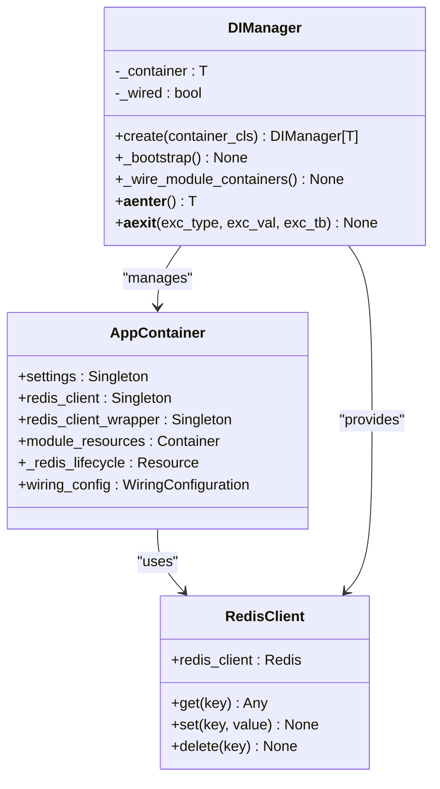
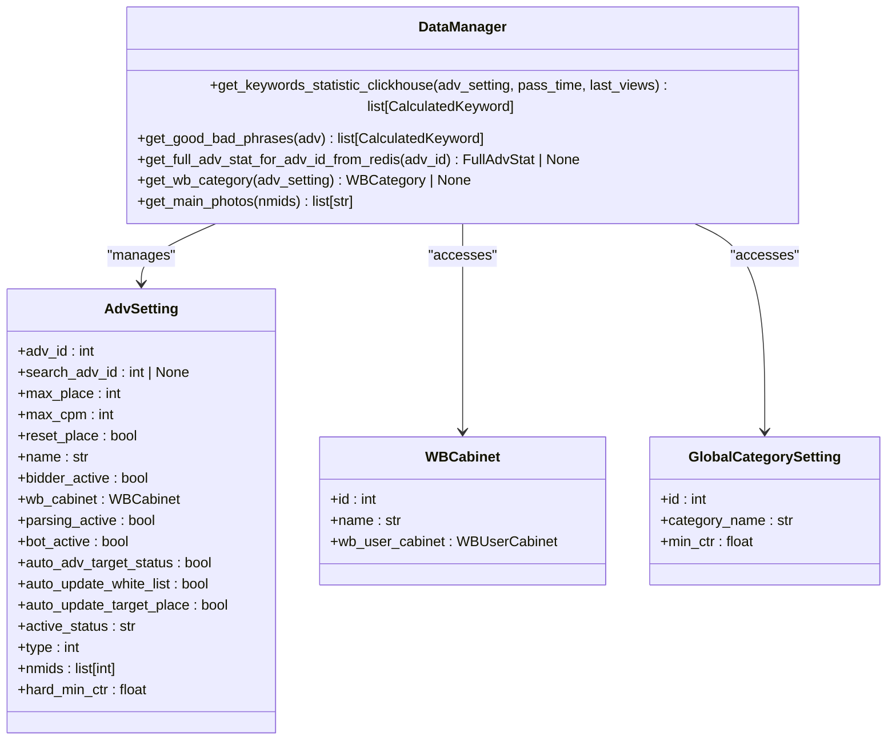
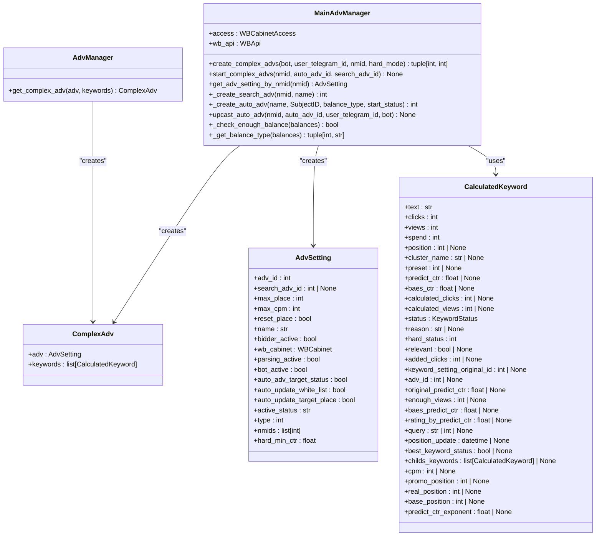
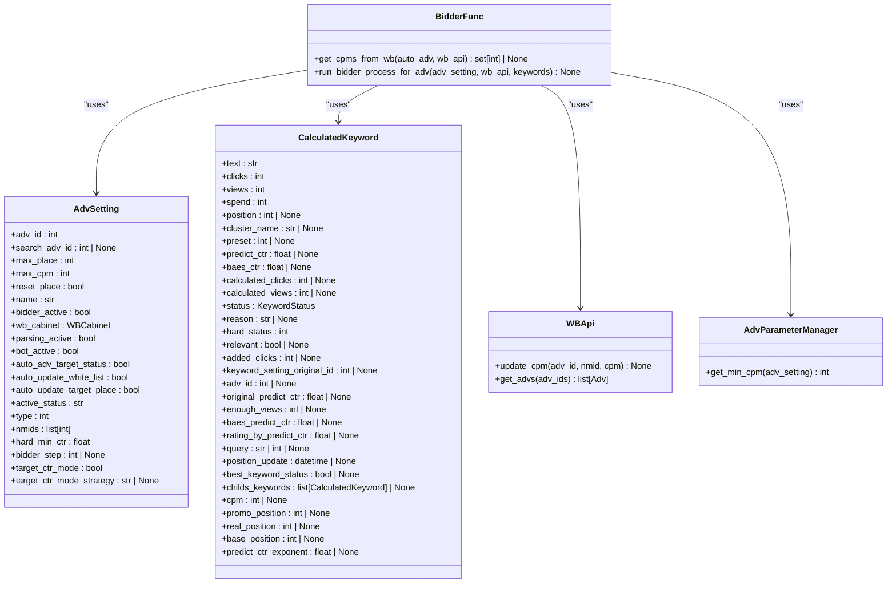

# Design Patterns

<cite>
**Referenced Files in This Document**   
- [app_container.py](file://app/core/di/app_container.py)
- [di_manager.py](file://app/core/di/di_manager.py)
- [data_manager.py](file://app/modules/wb_adv_updater/data_manager.py)
- [models.py](file://app/modules/wb_adv_updater/models.py)
- [adv_manager.py](file://app/modules/shop_runner/service_manager/modules/adv_manager/adv_manager.py)
- [main_manager.py](file://app/modules/adv_creator/backend/main_manager.py)
- [bidder_func.py](file://app/modules/shop_runner/bidder/bidder_func.py)
- [base_adv.py](file://app/core/wb_api/data_classes/advs/base_adv.py)
- [auction_adv.py](file://app/core/wb_api/data_classes/advs/auction_adv.py)
- [adv_fabric.py](file://app/core/wb_api/data_classes/advs/adv_fabric.py)
</cite>

## Table of Contents
1. [Introduction](#introduction)
2. [Dependency Injection Pattern](#dependency-injection-pattern)
3. [Repository Pattern](#repository-pattern)
4. [Factory Pattern](#factory-pattern)
5. [Strategy Pattern](#strategy-pattern)
6. [Pattern Usage Guidance](#pattern-usage-guidance)
7. [Conclusion](#conclusion)

## Introduction
The adv-bot system implements several key design patterns to ensure maintainability, testability, and extensibility. This document details the implementation of Dependency Injection, Repository, Factory, and Strategy patterns within the system. Each pattern addresses specific architectural concerns and enables clean separation of concerns, making the codebase more modular and easier to extend. The patterns work together to create a robust foundation for the advertising automation system.

## Dependency Injection Pattern

The Dependency Injection (DI) pattern is implemented in the adv-bot system through the AppContainer and DIManager classes, providing a centralized mechanism for managing dependencies and promoting loose coupling between components. This implementation follows the Inversion of Control principle, where objects receive their dependencies rather than creating them directly.

The AppContainer serves as the main DI container, defining and configuring all application services and their dependencies. It uses the dependency_injector library to manage the lifecycle of services and ensure proper initialization order. The DIManager acts as a context manager that handles the bootstrap process, wiring of dependencies, and proper shutdown of resources.

This pattern enables several key benefits in the adv-bot system:
- **Testability**: Dependencies can be easily mocked or replaced during testing
- **Configuration management**: Application settings are centralized and injected where needed
- **Resource management**: Database connections and other resources are properly initialized and cleaned up
- **Modularity**: Components are loosely coupled, making the system more maintainable

**Diagram sources**
- [app_container.py](file://app/core/di/app_container.py#L1-L96)
- [di_manager.py](file://app/core/di/di_manager.py#L1-L96)

**Section sources**
- [app_container.py](file://app/core/di/app_container.py#L1-L96)
- [di_manager.py](file://app/core/di/di_manager.py#L1-L96)

## Repository Pattern

The Repository Pattern is implemented across the data access layers of the adv-bot system, providing an abstraction between the domain logic and data storage mechanisms. This pattern is particularly evident in the handling of WBToken and WBCabinet models, where repository-like functionality is encapsulated in data manager classes.

The implementation separates data access logic from business logic, allowing the system to interact with data sources through a collection-like interface. This abstraction enables easier testing, as repositories can be mocked or replaced with in-memory implementations during unit tests. It also provides a single point of control for data access operations, making it easier to implement caching, logging, and error handling.

Key components of the Repository Pattern implementation include:
- Data manager classes that encapsulate data access logic
- Use of SQLAlchemy for database operations with proper session management
- Integration with Redis for caching frequently accessed data
- Type-safe data transfer objects for domain entities

The pattern enables the system to work with different data sources transparently, as the business logic only interacts with the repository interface rather than the underlying data storage mechanism.

**Diagram sources**
- [data_manager.py](file://app/modules/wb_adv_updater/data_manager.py#L1-L799)
- [models.py](file://app/modules/wb_adv_updater/models.py#L1-L52)

**Section sources**
- [data_manager.py](file://app/modules/wb_adv_updater/data_manager.py#L1-L799)
- [models.py](file://app/modules/wb_adv_updater/models.py#L1-L52)

## Factory Pattern

The Factory Pattern is implemented in the adv-bot system through the AdvManager and MainAdvManager classes, which handle the creation of different types of advertising campaigns. This pattern provides a flexible way to create complex objects without exposing the instantiation logic to the client.

The implementation allows for the creation of various ad types, including auto-ads and search-ads, through a unified interface. The factory methods encapsulate the complexity of ad creation, including validation, configuration, and integration with external APIs. This abstraction enables the system to easily extend support for new ad types without modifying existing client code.

Key aspects of the Factory Pattern implementation include:
- Centralized creation logic in the MainAdvManager class
- Support for complex ad creation workflows involving multiple steps
- Integration with external APIs for ad creation and configuration
- Error handling and validation during the creation process

The pattern promotes code reuse and reduces duplication by centralizing the ad creation logic, making it easier to maintain and extend as new requirements emerge.

**Diagram sources**
- [adv_manager.py](file://app/modules/shop_runner/service_manager/modules/adv_manager/adv_manager.py#L1-L11)
- [main_manager.py](file://app/modules/adv_creator/backend/main_manager.py#L1-L326)

**Section sources**
- [adv_manager.py](file://app/modules/shop_runner/service_manager/modules/adv_manager/adv_manager.py#L1-L11)
- [main_manager.py](file://app/modules/adv_creator/backend/main_manager.py#L1-L326)

## Strategy Pattern

The Strategy Pattern is implemented in the adv-bot system through the bidding strategy functionality, allowing different bidding algorithms to be used interchangeably. This pattern is particularly evident in the bidder_func module, which contains the core bidding logic that can be configured based on different strategies.

The implementation enables the system to dynamically select and apply different bidding strategies based on campaign settings and performance metrics. This flexibility allows for optimization of advertising spend and improved campaign performance. The pattern separates the bidding algorithm from the context in which it is used, making it easy to add new strategies without modifying existing code.

Key components of the Strategy Pattern implementation include:
- The run_bidder_process_for_adv function that implements the core bidding logic
- Configuration-driven strategy selection through campaign settings
- Integration with external data sources for decision making
- Extensible design that allows for new strategies to be added

The pattern promotes code maintainability by isolating the bidding logic and making it easier to test and optimize individual strategies independently.

**Diagram sources**
- [bidder_func.py](file://app/modules/shop_runner/bidder/bidder_func.py#L1-L162)

**Section sources**
- [bidder_func.py](file://app/modules/shop_runner/bidder/bidder_func.py#L1-L162)

## Pattern Usage Guidance

When extending the adv-bot codebase, consider the following guidance for using each design pattern:

**Dependency Injection Pattern**: Use this pattern when adding new services or components that have dependencies on other services. Always define dependencies in the AppContainer and inject them through constructor parameters rather than creating them directly. This ensures proper lifecycle management and makes components easier to test.

**Repository Pattern**: Implement this pattern when adding new data access functionality. Create data manager classes that encapsulate data access logic and provide a clean interface to the rest of the system. Use the existing DataManager as a reference for proper session management and error handling.

**Factory Pattern**: Apply this pattern when creating complex objects with multiple configuration options or when the creation process involves multiple steps. Centralize creation logic in factory classes and provide clear interfaces for creating different variants of objects.

**Strategy Pattern**: Use this pattern when implementing algorithms that may have multiple variations or when the algorithm needs to be selected at runtime based on configuration or conditions. Define clear interfaces for strategies and ensure they can be easily swapped without affecting the rest of the system.

These patterns work together to create a maintainable and extensible codebase. When adding new features, consider how these patterns can be leveraged to ensure consistency with the existing architecture.

## Conclusion

The adv-bot system effectively implements several key design patterns to create a maintainable, testable, and extensible codebase. The Dependency Injection pattern provides a robust mechanism for managing dependencies and promoting loose coupling. The Repository Pattern abstracts data access logic, making it easier to work with different data sources and improving testability. The Factory Pattern centralizes object creation logic, reducing duplication and making it easier to extend support for new ad types. Finally, the Strategy Pattern enables flexible bidding algorithms that can be configured and optimized based on campaign requirements.

These patterns work together to create a solid architectural foundation that supports the complex requirements of advertising automation. By following the established patterns when extending the codebase, developers can ensure consistency and maintainability across the system.