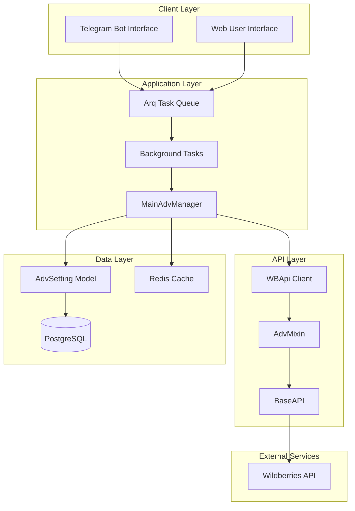
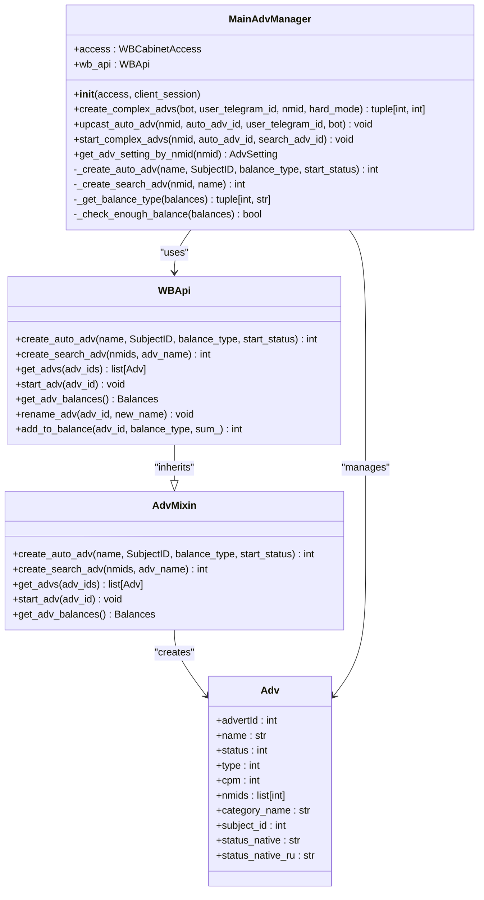
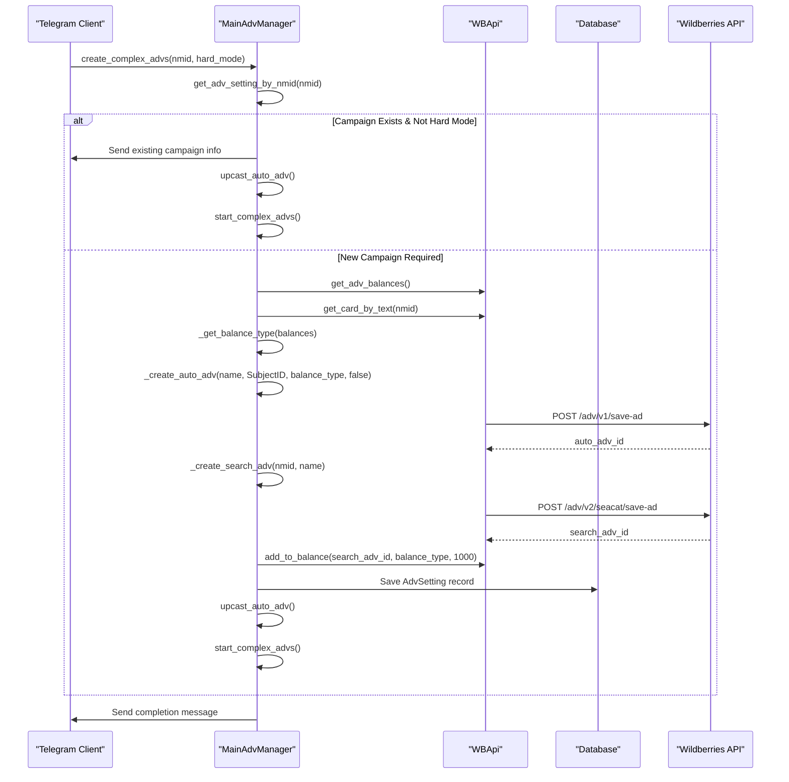

# Factory Pattern Implementation in Advertising Creation System

<cite>
**Referenced Files in This Document**
- [main_manager.py](file://app/modules/adv_creator/backend/main_manager.py)
- [wb_api.py](file://app/modules/adv_creator/backend/wb_api.py)
- [adv.py](file://app/core/wb_api/mixins/adv.py)
- [base_adv.py](file://app/core/wb_api/data_classes/advs/base_adv.py)
- [auction_adv.py](file://app/core/wb_api/data_classes/advs/auction_adv.py)
- [adv_fabric.py](file://app/core/wb_api/data_classes/advs/adv_fabric.py)
- [models.py](file://app/modules/common_slaves/wildberries/models/models.py)
- [tasks.py](file://app/modules/adv_creator/backend/tasks.py)
- [test_create_complex_advs.py](file://app/modules/adv_creator/backend/test_create_complex_advs.py)
</cite>

## Table of Contents
1. [Introduction](#introduction)
2. [System Architecture](#system-architecture)
3. [MainAdvManager Factory Pattern](#mainadvmanager-factory-pattern)
4. [Advertisement Creation Workflow](#advertisement-creation-workflow)
5. [Factory Methods Analysis](#factory-methods-analysis)
6. [Error Handling and Retry Logic](#error-handling-and-retry-logic)
7. [Dependency Injection](#dependency-injection)
8. [Extension Points](#extension-points)
9. [Testing and Validation](#testing-and-validation)
10. [Performance Considerations](#performance-considerations)
11. [Troubleshooting Guide](#troubleshooting-guide)
12. [Conclusion](#conclusion)

## Introduction

The advertising creation system in the Wildberries automation platform implements a sophisticated Factory Pattern through the `MainAdvManager` class. This pattern encapsulates the complexity of creating and configuring complex advertising campaigns, specifically targeting both Auto Ads and Search Ads through dedicated factory methods `_create_auto_adv` and `_create_search_adv`.

The system demonstrates advanced factory pattern implementation with automatic balance management, retry mechanisms, and comprehensive error handling. It serves as a central orchestrator for creating complex advertising campaigns that combine multiple ad types into cohesive marketing strategies.

## System Architecture

The advertising creation system follows a layered architecture with clear separation of concerns:



**Diagram sources**
- [main_manager.py](file://app/modules/adv_creator/backend/main_manager.py#L32-L35)
- [wb_api.py](file://app/modules/adv_creator/backend/wb_api.py#L1-L12)
- [tasks.py](file://app/modules/adv_creator/backend/tasks.py#L1-L20)

## MainAdvManager Factory Pattern

The `MainAdvManager` class serves as the primary factory for creating complex advertising campaigns. It implements the factory pattern by encapsulating the creation logic for different types of advertisements while maintaining consistent configuration and error handling.



**Diagram sources**
- [main_manager.py](file://app/modules/adv_creator/backend/main_manager.py#L32-L325)
- [wb_api.py](file://app/modules/adv_creator/backend/wb_api.py#L1-L12)
- [adv.py](file://app/core/wb_api/mixins/adv.py#L1-L50)

**Section sources**
- [main_manager.py](file://app/modules/adv_creator/backend/main_manager.py#L32-L35)
- [wb_api.py](file://app/modules/adv_creator/backend/wb_api.py#L1-L12)

## Advertisement Creation Workflow

The factory pattern implementation follows a comprehensive workflow for creating complex advertising campaigns:



**Diagram sources**
- [main_manager.py](file://app/modules/adv_creator/backend/main_manager.py#L118-L233)
- [tasks.py](file://app/modules/adv_creator/backend/tasks.py#L25-L60)

**Section sources**
- [main_manager.py](file://app/modules/adv_creator/backend/main_manager.py#L118-L233)
- [tasks.py](file://app/modules/adv_creator/backend/tasks.py#L25-L60)

## Factory Methods Analysis

### Auto Advertisement Factory Method

The `_create_auto_adv` method serves as the factory for creating automated advertising campaigns:

```python
async def _create_auto_adv(
    self, name: str, SubjectID: int, balance_type: int, start_status: bool
) -> int:
    return await self.wb_api.create_auto_adv(
        name, SubjectID, balance_type, start_status
    )
```

This method encapsulates the complexity of creating auto ads by:
- Accepting standardized parameters (name, SubjectID, balance_type, start_status)
- Delegating to the underlying WBApi.create_auto_adv method
- Returning the auto_adv_id for further configuration

### Search Advertisement Factory Method

The `_create_search_adv` method creates search-based advertising campaigns:

```python
async def _create_search_adv(self, nmid: int, name: str) -> int:
    adv_name = name
    adv_adv = await self.wb_api.create_search_adv([nmid], adv_name)
    await self.wb_api.rename_adv(adv_adv, new_name=adv_name)
    return adv_adv
```

Key features:
- Creates search ads with specific product identifiers
- Automatically renames the ad for consistency
- Returns the search_adv_id for subsequent operations

### Balance Management Factory

The factory implements intelligent balance management through the `_get_balance_type` method:

```python
def _get_balance_type(self, balances: Balances) -> (int, str):
    is_balance_enough: bool = self._check_enough_balance(balances)
    
    if not is_balance_enough:
        raise NotEnoughBalanceOnShopError()
    
    balance_rows = [
        (balances.balance, "balance"),
        (balances.net, "net"),
        (balances.bonus, "bonus"),
    ]
    
    min_balance_property_name = min(
        list(filter(lambda row: row[0] > 1000, balance_rows))
    )[1]
    
    if min_balance_property_name == "balance":
        balance_type = 0
    elif min_balance_property_name == "net":
        balance_type = 1
    elif min_balance_property_name == "bonus":
        balance_type = 3
    else:
        raise Exception("Неизвестный тип баланса")
    return balance_type, min_balance_property_name
```

**Section sources**
- [main_manager.py](file://app/modules/adv_creator/backend/main_manager.py#L37-L49)
- [main_manager.py](file://app/modules/adv_creator/backend/main_manager.py#L288-L325)

## Error Handling and Retry Logic

The factory pattern implementation includes comprehensive error handling and retry mechanisms:

### Retry Logic for Auto Advertisement Setup

```python
async def upcast_auto_adv(
    self, nmid: int, auto_adv_id: int, user_telegram_id: int, bot: Bot
):
    await bot.send_message(
        user_telegram_id, f"Пытаюсь найти и настроить Авто-РК для артикула {nmid}"
    )
    start_delay = 10 * 60
    global_max_attempts = 10
    for attempt in range(global_max_attempts):
        max_attempts = 3
        for _ in range(max_attempts):
            try:
                advs = await self.wb_api.get_advs([auto_adv_id])
                break
            except AdvNotFoundInWBError:
                logger.info(
                    f"Кампания {auto_adv_id} не найдена после создания,"
                    f" следующая попытка через {start_delay} секунд"
                )
                await asyncio.sleep(start_delay)
                start_delay *= 2
        else:
            raise AdvNotFoundInWBError(
                f"Кампания {auto_adv_id} не найдена после создания в API,"
                f" проверьте ее наличие в рекламном кабинете WB"
            )
```

### Balance Validation

```python
@staticmethod
def _check_enough_balance(balances: Balances) -> bool:
    balance = balances.balance
    net = balances.net
    bonus = balances.bonus
    full_balance: list[int] = [balance, net, bonus]
    logger.debug(f"Балансы: {full_balance}")
    if (
        sum(full_balance) >= 2000
        or len(list(filter(lambda x: x >= 1000, full_balance))) >= 2
    ):
        return True
    return False
```

**Section sources**
- [main_manager.py](file://app/modules/adv_creator/backend/main_manager.py#L51-L116)
- [main_manager.py](file://app/modules/adv_creator/backend/main_manager.py#L288-L299)

## Dependency Injection

The factory pattern implementation uses dependency injection for loose coupling:

```python
class MainAdvManager:
    def __init__(self, access: "WBCabinetAccess", client_session: ClientSession):
        self.access = access
        self.wb_api = WBApi(access, client_session)
```

Dependencies injected:
- **WBCabinetAccess**: Provides access to Wildberries cabinet credentials
- **ClientSession**: HTTP client session for API communication
- **WBApi**: Underlying API client with mixin capabilities

This design enables:
- **Testability**: Easy mocking of dependencies in unit tests
- **Flexibility**: Different implementations can be injected
- **Maintainability**: Clear separation of concerns

**Section sources**
- [main_manager.py](file://app/modules/adv_creator/backend/main_manager.py#L32-L35)

## Extension Points

The factory pattern implementation provides several extension points for future enhancements:

### Advertisement Type Extensions

The current implementation supports:
- **Auto Ads**: Automated bidding campaigns
- **Search Ads**: Keyword-based search campaigns

Future extensions could include:
- **Display Ads**: Banner and display advertising
- **Video Ads**: Video campaign types
- **Native Ads**: Integrated content advertising

### Balance Type Extensions

The balance management system can be extended to support:
- **Multiple Currency Types**: Different currency balances
- **Custom Balance Priorities**: Configurable balance selection logic
- **Advanced Budget Allocation**: Sophisticated budget distribution algorithms

### Factory Method Extensions

Additional factory methods could be added:
- `create_display_adv()`: For banner advertising
- `create_video_adv()`: For video campaign creation
- `create_native_adv()`: For native content advertising

**Section sources**
- [main_manager.py](file://app/modules/adv_creator/backend/main_manager.py#L37-L49)
- [adv.py](file://app/core/wb_api/mixins/adv.py#L100-L120)

## Testing and Validation

The system includes comprehensive testing for the factory pattern implementation:

### Unit Tests

```python
@pytest.mark.asyncio
async def test_create_complex_advs(
    access_mock, adv_setting_mock, bot_mock, client_session_mock
):
    user_telegram_id = 122334
    nmid = 112333

    with (
        patch("app.modules.adv_creator.backend.main_manager.WBApi") as WBAPI_mock,
    ):
        MainAdvManager.get_adv_setting_by_nmid = AsyncMock(
            return_value=adv_setting_mock
        )
        MainAdvManager.start_complex_advs = AsyncMock()
        manager = MainAdvManager(access_mock, client_session_mock)

        manager.upcast_auto_adv = AsyncMock(return_value=None)

        WBAPI_mock.get_adv_balances = AsyncMock(return_value=1000)
        adv_from_wb_mock_1 = MagicMock(spec=Adv)
        adv_from_wb_mock_2 = MagicMock(spec=Adv)

        WBAPI_mock.get_advs = AsyncMock(
            return_value=[adv_from_wb_mock_1, adv_from_wb_mock_2]
        )
        manager.get_adv_setting_by_nmid = AsyncMock(return_value=adv_setting_mock)
        await manager.create_complex_advs(bot_mock, user_telegram_id, nmid, None)
```

### Background Task Testing

```python
async def create_complex_advs(
    ctx: dict[str, Any], nmid: int, shop_id: str, hard_mode: bool, user_telegram_id: int
) -> None:
    try:
        await _create_complex_advs(ctx, nmid, shop_id, hard_mode, user_telegram_id)
    except ApiForbiddenError:
        bot = get_bot()
        await bot.send_message(
            user_telegram_id,
            f"Нет токенов с нужными правами. Обратитесь в поддержку {const.SUPPORT_LINK}",
        )
        return
    except Exception:
        delay = 1
        logger.error(
            f"Ошибка задачи create_complex_advs, повтор через {delay} сек",
            exc_info=True,
        )
        raise Retry(defer=delay)
```

**Section sources**
- [test_create_complex_advs.py](file://app/modules/adv_creator/backend/test_create_complex_advs.py#L1-L49)
- [tasks.py](file://app/modules/adv_creator/backend/tasks.py#L15-L25)

## Performance Considerations

The factory pattern implementation includes several performance optimizations:

### Batch Operations

```python
@try_except_decorator(1, 2)
async def get_advs(self, adv_ids: list[int] | None = None) -> list[Adv]:
    if not adv_ids:
        adv_ids = await self.get_advertIds()
    all_advs = []
    part = 50
    for i in range(0, len(adv_ids), part):
        part_of_advs = adv_ids[i : i + part]
        advs = await self._get_advs(part_of_advs)
        if advs:
            all_advs.extend(advs)
    return all_advs
```

### Asynchronous Processing

- **Non-blocking Operations**: All API calls are asynchronous
- **Concurrent Requests**: Multiple advertisements processed concurrently
- **Connection Pooling**: Reuse of HTTP connections for efficiency

### Memory Management

- **Lazy Loading**: Database records loaded on demand
- **Resource Cleanup**: Proper cleanup of resources and sessions
- **Efficient Data Structures**: Optimized data handling for large datasets

## Troubleshooting Guide

Common issues and solutions when working with the factory pattern implementation:

### Balance Issues

**Problem**: `NotEnoughBalanceOnShopError`
**Solution**: 
- Verify account balance through Wildberries interface
- Check balance type availability (balance, net, bonus)
- Ensure sufficient funds across multiple balance types

### Advertisement Creation Failures

**Problem**: `AdvNotFoundInWBError`
**Solution**:
- Verify API permissions and tokens
- Check network connectivity
- Review Wildberries API status
- Implement retry logic with exponential backoff

### Database Connection Issues

**Problem**: Database connection failures
**Solution**:
- Verify database configuration
- Check connection pool settings
- Implement connection retry mechanisms
- Monitor database performance metrics

### API Rate Limiting

**Problem**: API rate limiting errors
**Solution**:
- Implement request throttling
- Use exponential backoff for retries
- Monitor API usage statistics
- Consider API key rotation

**Section sources**
- [main_manager.py](file://app/modules/adv_creator/backend/main_manager.py#L51-L116)
- [tasks.py](file://app/modules/adv_creator/backend/tasks.py#L60-L108)

## Conclusion

The Factory Pattern implementation in the `MainAdvManager` class provides a robust and scalable solution for creating complex advertising campaigns. The implementation demonstrates several key benefits:

**Encapsulation**: The factory encapsulates the complexity of advertisement creation, configuration, and management, providing a clean interface for clients.

**Consistency**: All advertisement creation follows standardized procedures, ensuring consistent configuration across different ad types.

**Extensibility**: The modular design allows for easy addition of new advertisement types and configuration options.

**Reliability**: Comprehensive error handling, retry logic, and validation ensure reliable operation under various conditions.

**Maintainability**: Clear separation of concerns and dependency injection make the system easy to maintain and test.

The factory pattern implementation serves as an excellent example of how to apply design patterns to solve real-world problems in complex systems, providing both immediate functionality and long-term flexibility for future enhancements.