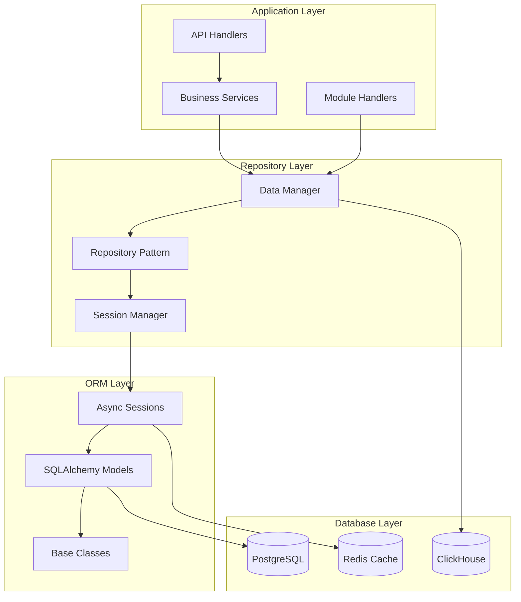
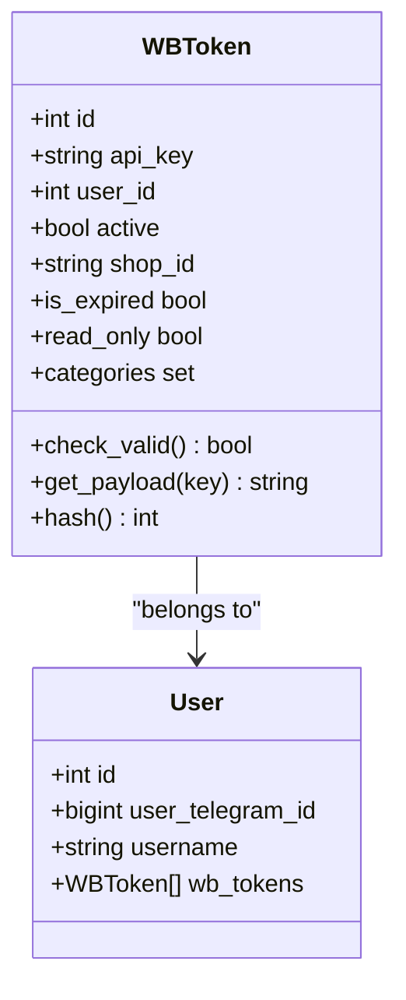
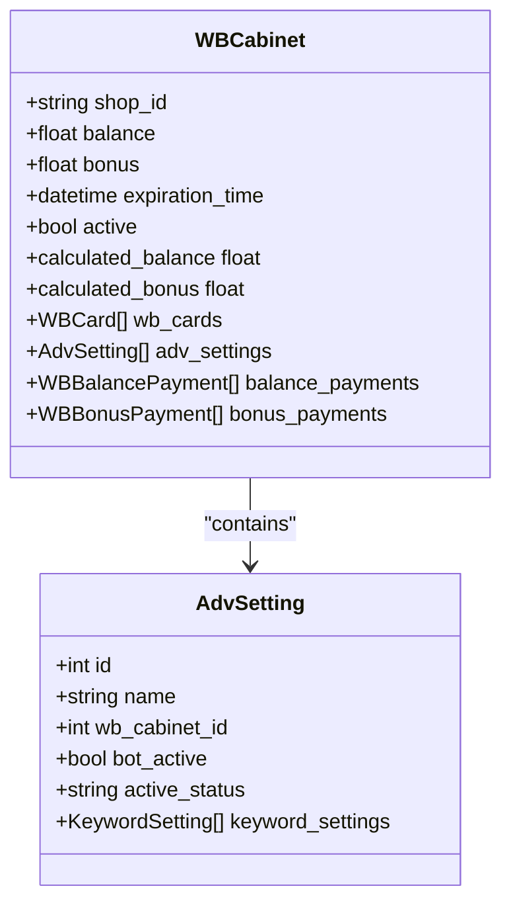
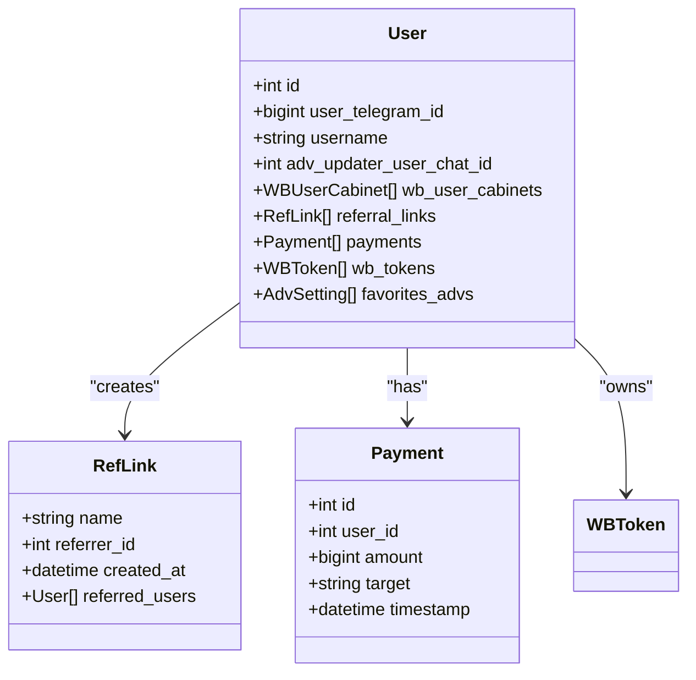
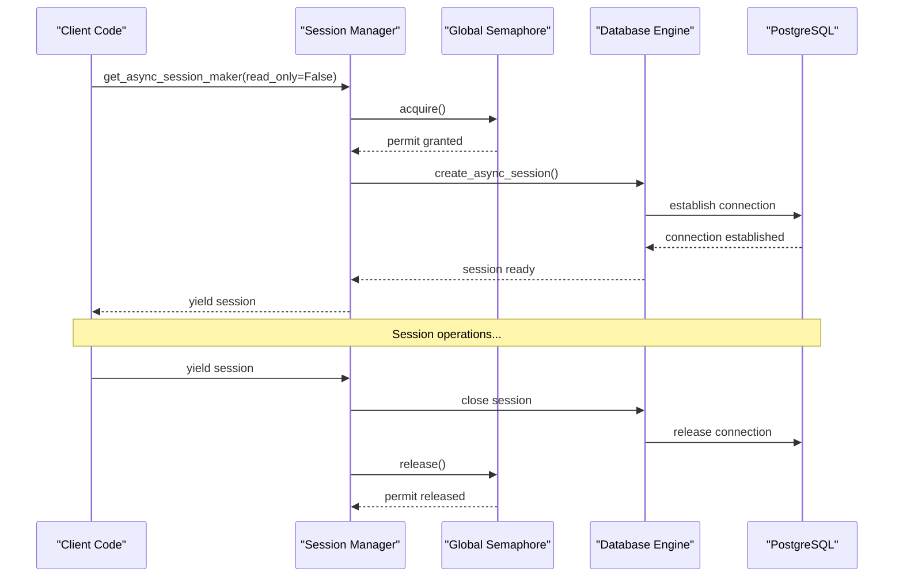
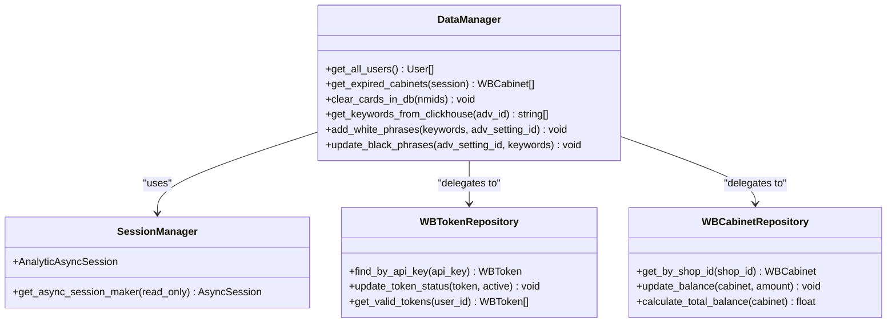
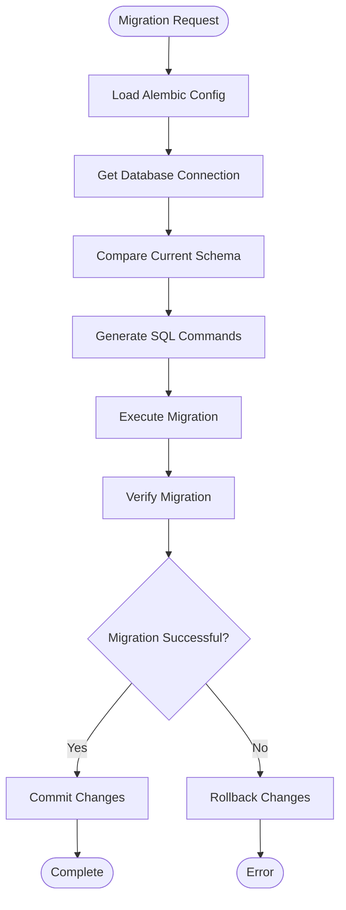
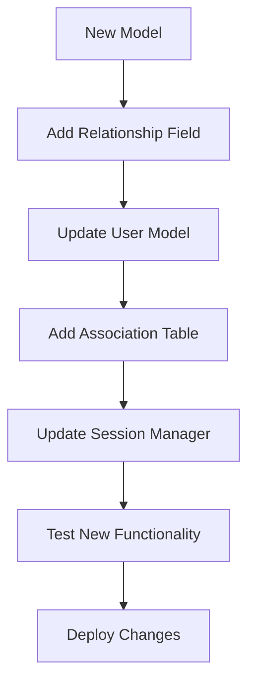

# Repository Pattern Implementation in adv-bot System

<cite>
**Referenced Files in This Document**
- [app/utils/db/models.py](file://app/utils/db/models.py)
- [app/utils/db/session_maker.py](file://app/utils/db/session_maker.py)
- [app/utils/db/base.py](file://app/utils/db/base.py)
- [app/utils/db/assoc_tables.py](file://app/utils/db/assoc_tables.py)
- [app/modules/common_slaves/wildberries/models/models.py](file://app/modules/common_slaves/wildberries/models/models.py)
- [app/modules/common_slaves/wildberries/models/wb_cabinet.py](file://app/modules/common_slaves/wildberries/models/wb_cabinet.py)
- [app/modules/token_monitoring/models.py](file://app/modules/token_monitoring/models.py)
- [app/payments/db/models.py](file://app/payments/db/models.py)
- [app/modules/wb_adv_updater/data_manager.py](file://app/modules/wb_adv_updater/data_manager.py)
- [alembic/env.py](file://alembic/env.py)
</cite>

## Table of Contents
1. [Introduction](#introduction)
2. [System Architecture Overview](#system-architecture-overview)
3. [Core Data Models](#core-data-models)
4. [SQLAlchemy ORM Configuration](#sqlalchemy-orm-configuration)
5. [Session Management and Connection Pooling](#session-management-and-connection-pooling)
6. [Repository Pattern Implementation](#repository-pattern-implementation)
7. [Database Migrations with Alembic](#database-migrations-with-alembic)
8. [CRUD Operations and Queries](#crud-operations-and-queries)
9. [Performance Optimization](#performance-optimization)
10. [Extending the Data Model](#extending-the-data-model)
11. [Error Handling and Monitoring](#error-handling-and-monitoring)
12. [Best Practices](#best-practices)

## Introduction

The adv-bot system implements a sophisticated Repository Pattern using SQLAlchemy ORM with asynchronous session management. This pattern provides a clean abstraction layer between business logic and data persistence, enabling efficient data access operations while maintaining code separation and scalability.

The system focuses on managing Wildberries advertising campaigns, user tokens, payment systems, and various business entities through a well-structured ORM model. The implementation emphasizes async operations, connection pooling, and comprehensive monitoring to handle high-throughput scenarios typical of advertising platforms.

## System Architecture Overview

The Repository Pattern in adv-bot follows a layered architecture that separates concerns and provides clear boundaries between different system components.



**Diagram sources**
- [app/modules/wb_adv_updater/data_manager.py](file://app/modules/wb_adv_updater/data_manager.py#L1100-L1200)
- [app/utils/db/session_maker.py](file://app/utils/db/session_maker.py#L1-L178)

## Core Data Models

The system defines several key entities that form the foundation of the Repository Pattern implementation. These models represent the core business objects and their relationships.

### Base Model Architecture

All models inherit from a common base class that provides essential functionality:

```python
class BaseTable(Base):
    __abstract__ = True
    id: Mapped[int] = mapped_column(Integer, primary_key=True, autoincrement=True)

    @declared_attr
    def __tablename__(self):
        return self.__name__.lower()

    def __repr__(self) -> str:
        return f"<{self.__class__.__name__} {self.id}>"
```

### Primary Entity Models

#### WBToken Model
The `WBToken` model represents Wildberries API tokens with comprehensive validation and metadata:



**Diagram sources**
- [app/modules/common_slaves/wildberries/models/models.py](file://app/modules/common_slaves/wildberries/models/models.py#L159-L257)

#### WBCabinet Model
The `WBCabinet` model manages Wildberries user cabinets with financial tracking:



**Diagram sources**
- [app/modules/common_slaves/wildberries/models/wb_cabinet.py](file://app/modules/common_slaves/wildberries/models/wb_cabinet.py#L22-L82)
- [app/modules/common_slaves/wildberries/models/models.py](file://app/modules/common_slaves/wildberries/models/models.py#L351-L562)

#### User Model
The central `User` model serves as the root entity with comprehensive relationships:



**Diagram sources**
- [app/utils/db/models.py](file://app/utils/db/models.py#L15-L51)

**Section sources**
- [app/utils/db/models.py](file://app/utils/db/models.py#L1-L51)
- [app/modules/common_slaves/wildberries/models/models.py](file://app/modules/common_slaves/wildberries/models/models.py#L159-L257)
- [app/modules/common_slaves/wildberries/models/wb_cabinet.py](file://app/modules/common_slaves/wildberries/models/wb_cabinet.py#L22-L82)

## SQLAlchemy ORM Configuration

The system uses SQLAlchemy with async support and advanced configuration options to optimize performance and reliability.

### Async Engine Configuration

The session maker creates separate engines for read/write and read-only operations:

```python
# Read-write engine for write operations
read_write_engine = create_async_engine(
    read_write_db_connector,
    echo=False,
    pool_size=pool_size,
    max_overflow=max_overflow,
    pool_pre_ping=True,
)

# Read-only engine for read operations
read_only_engine = create_async_engine(
    read_only_db_connector,
    echo=False,
    pool_size=pool_size,
    max_overflow=max_overflow,
    pool_pre_ping=True,
)
```

### Advanced Session Features

The system implements custom session classes with built-in monitoring capabilities:

```python
class AnalyticAsyncSession(AsyncSession):
    async def execute(self, statement: Any, *args, **kwargs) -> Result[Any]:
        query_start = time()
        try:
            # Operation type detection
            operation_type = type(statement).__name__
            
            # Stack trace analysis for debugging
            stack = traceback.extract_stack()
            caller = next(
                (frame for frame in reversed(stack[:-1]) 
                 if "sqlalchemy" not in frame.filename),
                None,
            )
            
            result: Result[Any] = await super().execute(statement, *args, **kwargs)
            duration = time() - query_start
            
            if duration > 1.0:
                logger.warning(
                    f"Slow query ({duration:.2f}s), Type: {operation_type} "
                    f"Location: {caller.filename}:{caller.lineno} "
                    f"Statement: {statement}"
                )
            return result
        except Exception as e:
            logger.exception("Query error during execution:")
            raise e
```

**Section sources**
- [app/utils/db/session_maker.py](file://app/utils/db/session_maker.py#L1-L178)

## Session Management and Connection Pooling

The system implements sophisticated session management with connection pooling, semaphore-based concurrency control, and automatic resource cleanup.

### Session Factory Architecture



**Diagram sources**
- [app/utils/db/session_maker.py](file://app/utils/db/session_maker.py#L120-L178)

### Connection Pool Configuration

The system uses configurable connection pools with monitoring:

```python
# Global semaphore for controlling concurrent connections
global_semaphore = asyncio.Semaphore(count_sem)

# Connection pool settings
pool_size = settings.PG_POOL_SIZE      # Default: 10
max_overflow = settings.PG_MAX_OVERFLOW # Default: 20
```

### Automatic Resource Management

The session manager automatically handles resource cleanup and provides detailed logging:

```python
@asynccontextmanager
async def get_async_session_maker(read_only=False) -> AsyncGenerator[AsyncSession, None]:
    session_start = time()
    current_task = asyncio.current_task()
    
    try:
        async with semaphore:
            async with session_maker() as session:
                try:
                    yield session
                finally:
                    hold_time = time() - session_start
                    if hold_time > 1.0:
                        task_name = current_task.get_name()
                        if not task_name:
                            task_name = "unknown"
                        logger.warning(
                            f"Session held for too long: {hold_time:.2f}s "
                            f"by task {task_name}"
                        )
    except Exception as e:
        logger.error(
            f"Session error after {time() - session_start:.3f}s:\n"
            f"Task: {current_task.get_name()}\n"
            f"Error: {str(e)}",
            exc_info=True,
        )
        raise
```

**Section sources**
- [app/utils/db/session_maker.py](file://app/utils/db/session_maker.py#L120-L178)

## Repository Pattern Implementation

The Repository Pattern in adv-bot is implemented through data managers that encapsulate database operations while maintaining clean interfaces.

### Data Manager Architecture



**Diagram sources**
- [app/modules/wb_adv_updater/data_manager.py](file://app/modules/wb_adv_updater/data_manager.py#L1100-L1200)

### Example Repository Operations

#### Basic CRUD Operations

```python
async def get_expired_cabinets(session: AsyncSession) -> list[WBCabinet]:
    delete_expired_time = datetime.now() - timedelta(days=30)
    stmt = (
        select(WBCabinet)
        .options(selectinload(WBCabinet.adv_settings))
        .where(WBCabinet.expiration_time < delete_expired_time)
    )
    result = await session.execute(stmt)
    wb_cabinets: list[WBCabinet] = list(result.unique().scalars().all())
    return wb_cabinets

async def clear_cards_in_db(nmids: list[int]) -> None:
    async with _sm(read_only=False) as session:
        stmt = select(WBCard).where(WBCard.nmid.notin_(nmids))
        result = await session.execute(stmt)
        wb_cards: list[WBCard] = list(result.unique().scalars().all())
        for card in wb_cards:
            await session.delete(card)
            await session.commit()
```

#### Complex Query Operations

```python
async def add_white_phrases(keywords: list[str], adv_setting_id: int) -> None:
    async with _sm(read_only=False) as session:
        for text in keywords:
            stmt = (
                select(KeywordSetting)
                .join(KeywordSetting.adv_setting)
                .where(
                    and_(KeywordSetting.text == text, 
                         AdvSetting.id == adv_setting_id)
                )
            )
            result = await session.execute(stmt)
            keyword_setting = result.scalar()
            if not keyword_setting:
                adv_keyword = AdvKeyword(
                    text=text,
                    adv_setting_id=adv_setting_id,
                    views=0,
                    clicks=0,
                    spend=0,
                    date=datetime.now().date(),
                )

                keyword_setting = KeywordSetting(
                    text=text,
                    adv_setting_id=adv_setting_id,
                )
                keyword_setting.adv_keywords.append(adv_keyword)
                session.add(keyword_setting)
            keyword_setting.hard_status = 2
        await session.commit()
```

**Section sources**
- [app/modules/wb_adv_updater/data_manager.py](file://app/modules/wb_adv_updater/data_manager.py#L1100-L1299)

## Database Migrations with Alembic

The system uses Alembic for database schema migrations, providing version control for database changes and ensuring consistent deployments.

### Migration Configuration

```python
# Alembic configuration for migration operations
def run_migrations_online() -> None:
    connectable = engine_from_config(
        config.get_section(config.config_ini_section, {}),
        prefix="sqlalchemy.",
        poolclass=pool.NullPool,
    )

    with connectable.connect() as connection:
        context.configure(connection=connection, target_metadata=target_metadata)

        with context.begin_transaction():
            context.run_migrations()
```

### Migration Workflow



**Diagram sources**
- [alembic/env.py](file://alembic/env.py#L50-L89)

### Migration Examples

The system includes numerous migration files that demonstrate different types of schema changes:

- **Add New Columns**: Adding shop_id to WBToken model
- **Create Indexes**: Optimizing queries with composite indexes
- **Add Constraints**: Enforcing data integrity with unique constraints
- **Modify Types**: Changing column types for better performance

**Section sources**
- [alembic/env.py](file://alembic/env.py#L1-L89)

## CRUD Operations and Queries

The system provides comprehensive CRUD operations through the Repository Pattern, with optimized queries and efficient data access patterns.

### Query Optimization Strategies

#### Lazy Loading vs Eager Loading

```python
# Eager loading for related data
stmt = (
    select(WBCabinet)
    .options(
        selectinload(WBCabinet.adv_settings),
        selectinload(WBCabinet.wb_cards),
        selectinload(WBCabinet.balance_payments)
    )
    .where(WBCabinet.shop_id == shop_id)
)

# Lazy loading for optional relationships
user = await session.get(User, user_id)
# wb_tokens loaded on-demand when accessed
tokens = user.wb_tokens
```

#### Batch Operations

```python
async def batch_update_tokens(tokens: list[WBToken]) -> None:
    async with _sm(read_only=False) as session:
        for token in tokens:
            session.add(token)
        await session.commit()
```

### Advanced Query Patterns

#### Aggregation Queries

```python
async def get_sum_bot_balance_from_wb_wb_user_cabinet_original_id(
        shop_id: str,
) -> float | None:
    stmt = select(
        func.sum(coalesce(WBCabinet.balance, 0) + coalesce(WBCabinet.bonus, 0))
    ).where(WBCabinet.shop_id == shop_id)
    async with _sm() as session:
        result = await session.execute(stmt)
        return result.scalar_one_or_none()
```

#### Complex Filtering

```python
async def get_need_nmids_for_parsing(
        text: str, adv_id: int, adv_ids: set[int]
) -> set[int]:
    adv_ids_with_text: set[int] = await get_nmids_for_keyword_text(text)
    nmids_need = set()
    not_found_adv_id = set()
    
    for adv_id_with_text in adv_ids_with_text:
        if adv_id_with_text not in adv_ids:
            continue
        nmid = await redis_manager.get_nmid(adv_id_with_text)
        if not nmid:
            not_found_adv_id.add(adv_id_with_text)
        else:
            nmids_need.add(nmid)
    
    return nmids_need
```

**Section sources**
- [app/modules/wb_adv_updater/data_manager.py](file://app/modules/wb_adv_updater/data_manager.py#L1100-L1299)

## Performance Optimization

The system implements multiple performance optimization strategies to handle high-throughput scenarios efficiently.

### Indexing Strategy

```python
# Composite indexes for frequently queried columns
__table_args__ = (
    Index("ix_adv_settings_cabinet_type_update", "wb_cabinet_id", "type", "last_update"),
    Index("ix_adv_settings_cabinet_id", "wb_cabinet_id"),
    Index("ix_advsetting_adv_id", "adv_id"),
    Index("ix_advsetting_active_status", "active_status"),
    Index("ix_advsetting_bot_active", "bot_active"),
    Index("ix_advsetting_name_pattern", "name", postgresql_using="gin", postgresql_ops={"name": "gin_trgm_ops"}),
)
```

### Connection Pool Optimization

```python
# Configurable pool settings
pool_size = settings.PG_POOL_SIZE          # Connection pool size
max_overflow = settings.PG_MAX_OVERFLOW    # Maximum overflow connections
global_semaphore = asyncio.Semaphore(count_sem)  # Concurrency control
```

### Query Performance Monitoring

```python
class AnalyticAsyncSession(AsyncSession):
    async def execute(self, statement: Any, *args, **kwargs) -> Result[Any]:
        query_start = time()
        
        # Monitor slow queries (>1 second)
        if duration > 1.0:
            logger.warning(
                f"Slow query ({duration:.2f}s), Type: {operation_type} "
                f"Location: {caller.filename}:{caller.lineno} "
                f"Statement: {statement}"
            )
```

### Caching Integration

The system integrates with Redis for caching frequently accessed data:

```python
async def get_keywords_positions_dict_by_text(
        adv_setting: AdvSetting, texts: list[str]
) -> dict[str, WBItemPosition]:
    positions = await redis_manager.get_keywords_positions(adv_setting, texts)
    positions = [position for position in positions if position]
    positions = {position.keyword_text: position for position in positions}
    return positions
```

**Section sources**
- [app/utils/db/session_maker.py](file://app/utils/db/session_maker.py#L25-L50)
- [app/modules/common_slaves/wildberries/models/models.py](file://app/modules/common_slaves/wildberries/models/models.py#L500-L562)

## Extending the Data Model

The system provides clear patterns for extending the data model with new entities and relationships while maintaining backward compatibility.

### Adding New Models

To add a new model, follow these steps:

1. **Create the Model Class**:
```python
class NewEntity(BaseTable):
    name = mapped_column(String, nullable=False)
    description = mapped_column(String, nullable=True)
    created_at = mapped_column(DateTime, server_default=func.now())
    
    # Add relationships as needed
    user_id = mapped_column(Integer, ForeignKey("user.id"))
    user: Mapped[User] = relationship("User", back_populates="new_entities")
```

2. **Add to Association Tables** (if needed):
```python
new_entity_association = Table(
    "new_entity_association",
    Base.metadata,
    Column("user_id", BIGINT, ForeignKey("user.id")),
    Column("entity_id", BIGINT, ForeignKey("newentity.id")),
)
```

3. **Update User Model**:
```python
class User(BaseTable):
    # Existing fields...
    new_entities: Mapped[list["NewEntity"]] = relationship(
        "NewEntity", back_populates="user"
    )
```

### Adding New Relationships



### Best Practices for Extensions

1. **Use Foreign Keys**: Always define proper foreign key relationships
2. **Add Indexes**: Create appropriate indexes for query optimization
3. **Back-populate Relationships**: Use back_populates for bidirectional relationships
4. **Cascade Operations**: Define appropriate cascade behaviors
5. **Test Thoroughly**: Ensure new models integrate properly with existing code

## Error Handling and Monitoring

The system implements comprehensive error handling and monitoring to ensure reliable operation under various conditions.

### Session Error Handling

```python
try:
    async with session_maker() as session:
        # Database operations
        result = await session.execute(stmt)
        return result.scalars().all()
except Exception as e:
    logger.error(
        f"Session error after {time() - session_start:.3f}s:\n"
        f"Task: {current_task.get_name()}\n"
        f"Error: {str(e)}",
        exc_info=True,
    )
    raise
```

### Query Performance Monitoring

```python
class AnalyticAsyncSession(AsyncSession):
    async def execute(self, statement: Any, *args, **kwargs) -> Result[Any]:
        query_start = time()
        
        try:
            result: Result[Any] = await super().execute(statement, *args, **kwargs)
            duration = time() - query_start
            
            if duration > 1.0:
                # Log slow queries with context
                logger.warning(
                    f"Slow query ({duration:.2f}s), Type: {operation_type} "
                    f"Location: {caller.filename}:{caller.lineno} "
                    f"Statement: {statement}"
                )
            return result
        except Exception as e:
            logger.exception("Query error during execution:")
            raise e
```

### Connection Pool Monitoring

```python
# Track connection usage
conn_counter = 0
lock_counter = threading.Lock()

def log_checkout(dbapi_con, con_record, con_proxy):
    logger.debug("Соединение взято из пула")
    global conn_counter
    with lock_counter:
        conn_counter += 1
    logger.debug(f"Количество соединений: {conn_counter}")

def log_checkin(dbapi_con, con_record):
    logger.debug("Соединение возвращено в пул")
    global conn_counter
    with lock_counter:
        conn_counter -= 1
    logger.debug(f"Количество соединений: {conn_counter}")
```

**Section sources**
- [app/utils/db/session_maker.py](file://app/utils/db/session_maker.py#L25-L50)
- [app/utils/db/session_maker.py](file://app/utils/db/session_maker.py#L120-L178)

## Best Practices

Based on the analysis of the adv-bot system, here are key best practices for implementing the Repository Pattern effectively:

### 1. Session Management
- Use async context managers for automatic resource cleanup
- Implement connection pooling with appropriate limits
- Monitor query performance and log slow operations
- Use separate engines for read-only and read-write operations

### 2. Model Design
- Inherit from a common base class for consistency
- Use SQLAlchemy's declarative base for type safety
- Implement proper relationships with cascade options
- Add appropriate indexes for query optimization

### 3. Query Optimization
- Use eager loading for related data when appropriate
- Implement batch operations for bulk updates
- Leverage database indexes for frequent queries
- Consider using external databases (ClickHouse) for analytics

### 4. Error Handling
- Implement comprehensive exception handling
- Log detailed error information with context
- Monitor connection pool usage and query performance
- Use semaphores to prevent resource exhaustion

### 5. Extension Strategy
- Follow established patterns for adding new models
- Maintain backward compatibility
- Test thoroughly with existing functionality
- Document new models and relationships

### 6. Performance Considerations
- Use connection pooling to manage database resources
- Implement caching for frequently accessed data
- Optimize queries with appropriate indexes
- Monitor and log performance metrics

The Repository Pattern implementation in adv-bot demonstrates a mature approach to database abstraction that balances performance, maintainability, and reliability. The system's architecture provides a solid foundation for scaling and extending functionality while maintaining clean separation of concerns.