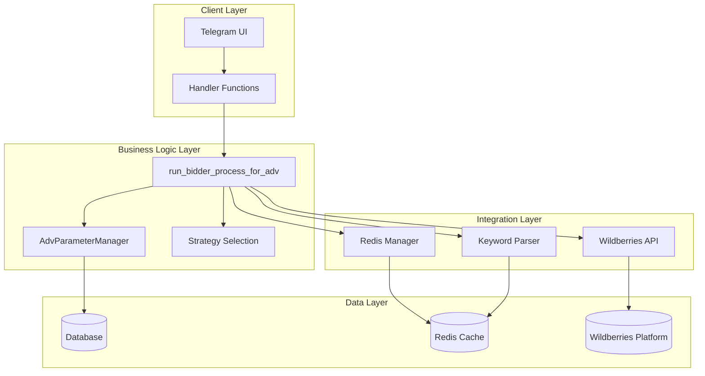
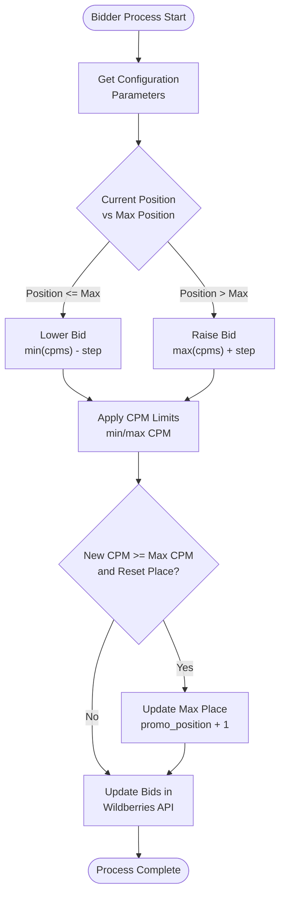
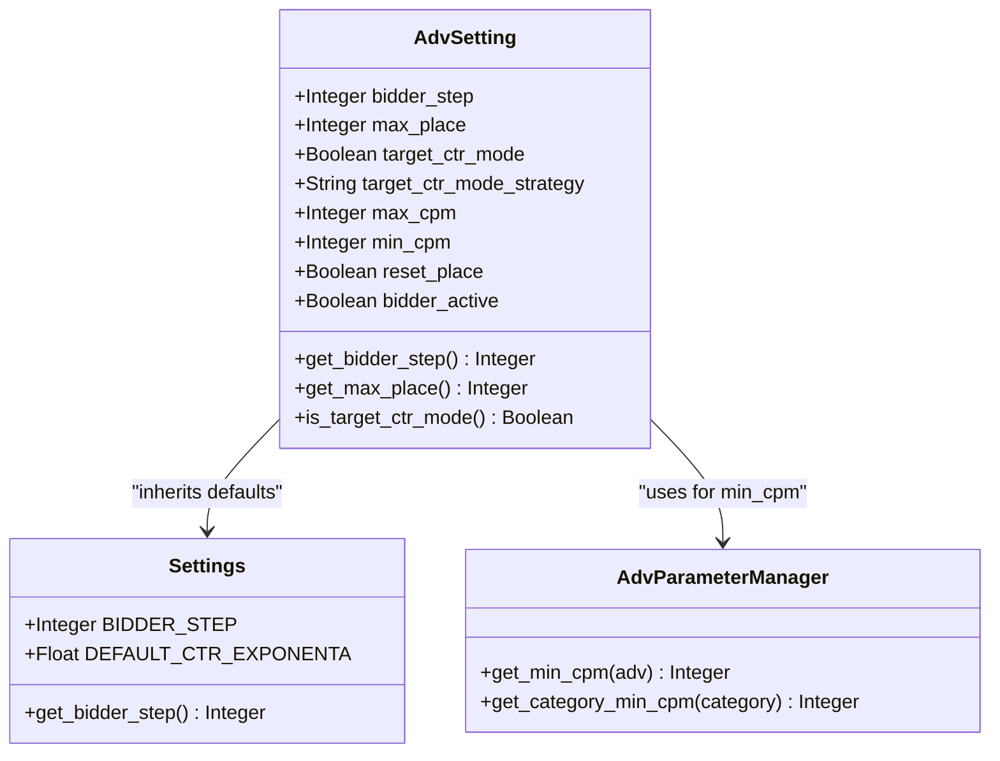
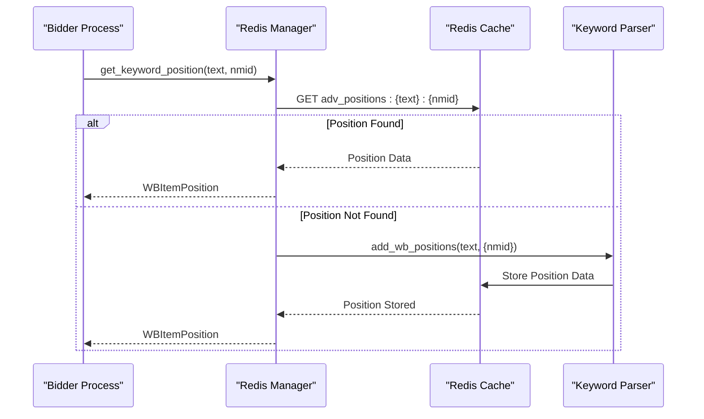

# Strategy Pattern Implementation in Bidding System

<cite>
**Referenced Files in This Document**
- [bidder_func.py](file://app/modules/shop_runner/bidder/bidder_func.py)
- [adv_parameter_manager.py](file://app/modules/shop_runner/service_manager/old_modules/adv_common_parameters_manager/adv_parameter_manager.py)
- [strategy_setting.py](file://app/client_bot/user_interface/handlers/strategy_setting.py)
- [models.py](file://app/modules/common_slaves/wildberries/models/models.py)
- [settings_master.py](file://app/settings/settings_master.py)
- [wb_positions.py](file://app/core/redis_manager_v2/mixins/wb_positions.py)
- [redis_manager.py](file://app/utils/redis_manager/__init__.py)
- [change_cpm.py](file://app/client_bot/user_interface/handlers/change_cpm.py)
- [bidder_step_setting.py](file://app/modules/bidder_step_setting/telegram_handler.py)
</cite>

## Table of Contents
1. [Introduction](#introduction)
2. [Architecture Overview](#architecture-overview)
3. [Core Components](#core-components)
4. [Strategy Pattern Implementation](#strategy-pattern-implementation)
5. [Configuration Parameters](#configuration-parameters)
6. [Bid Adjustment Logic](#bid-adjustment-logic)
7. [External System Integration](#external-system-integration)
8. [Performance Considerations](#performance-considerations)
9. [Implementation Guidelines](#implementation-guidelines)
10. [Troubleshooting](#troubleshooting)

## Introduction

The bidding system in the adv-bot application implements a sophisticated Strategy Pattern to manage dynamic bid adjustments based on keyword performance and position. This pattern enables flexible bidding logic that can be modified without changing core application code, allowing for different bidding strategies to be applied based on configuration parameters like `bidder_step` and `max_place`.

The system orchestrates bid adjustments through the `run_bidder_process_for_adv` function, which coordinates with external systems including the Wildberries API and Redis position cache to calculate optimal bid amounts based on current market conditions and campaign goals.

## Architecture Overview

The bidding system follows a layered architecture with clear separation of concerns:



**Diagram sources**
- [bidder_func.py](file://app/modules/shop_runner/bidder/bidder_func.py#L45-L163)
- [adv_parameter_manager.py](file://app/modules/shop_runner/service_manager/old_modules/adv_common_parameters_manager/adv_parameter_manager.py#L7-L23)

## Core Components

### run_bidder_process_for_adv Function

The central orchestrator of the bidding process, responsible for coordinating all aspects of bid adjustment:

```python
async def run_bidder_process_for_adv(
    adv_setting: AdvSetting, wb_api: WBApi, keywords: list[CalculatedKeyword]
) -> None:
```

This function serves as the main entry point for the bidding strategy execution, taking advantage of the Strategy Pattern to adapt behavior based on configuration parameters.

**Section sources**
- [bidder_func.py](file://app/modules/shop_runner/bidder/bidder_func.py#L45-L163)

### AdvParameterManager

Manages campaign-specific parameters and provides minimum CPM calculations:

```python
class AdvParameterManager:
    async def get_min_cpm(self, adv: AdvSetting) -> int:
        # Calculates minimum CPM based on product category
        # Uses Redis cache for category-specific minimums
```

**Section sources**
- [adv_parameter_manager.py](file://app/modules/shop_runner/service_manager/old_modules/adv_common_parameters_manager/adv_parameter_manager.py#L7-L23)

## Strategy Pattern Implementation

The bidding system implements the Strategy Pattern through configurable parameters that determine the bidding approach:

### Strategy Selection Mechanism



**Diagram sources**
- [bidder_func.py](file://app/modules/shop_runner/bidder/bidder_func.py#L96-L161)

### Target CTR Mode Strategies

The system supports two primary bidding strategies through the `target_ctr_mode_strategy` parameter:

1. **Forward Mode (`"forward"`)**: Aggressive bidding strategy that focuses on maintaining or improving position
2. **Keep Mode (`"keep"`)**: Conservative strategy that prioritizes stability over aggressive positioning

```python
# Strategy mode configuration
adv.target_ctr_mode_strategy = "forward"  # or "keep"
```

**Section sources**
- [strategy_setting.py](file://app/client_bot/user_interface/handlers/strategy_setting.py#L55-L81)

## Configuration Parameters

### Core Bidding Parameters

The system uses several key configuration parameters to control bidding behavior:



**Diagram sources**
- [models.py](file://app/modules/common_slaves/wildberries/models/models.py#L436-L469)
- [settings_master.py](file://app/settings/settings_master.py#L130-L135)

### Parameter Details

| Parameter | Type | Description | Default |
|-----------|------|-------------|---------|
| `bidder_step` | Integer | Bid adjustment increment | `BIDDER_STEP` setting |
| `max_place` | Integer | Maximum desired position | Configurable per campaign |
| `target_ctr_mode` | Boolean | Enable CTR-based targeting | False |
| `target_ctr_mode_strategy` | String | `"forward"` or `"keep"` | `"forward"` |
| `reset_place` | Boolean | Auto-increase max place on cap | True |

**Section sources**
- [models.py](file://app/modules/common_slaves/wildberries/models/models.py#L410-L437)
- [settings_master.py](file://app/settings/settings_master.py#L130-L135)

## Bid Adjustment Logic

### Position-Based Bid Calculation

The core bid adjustment logic determines whether to raise or lower bids based on current position:

```python
# Calculate new CPM based on position
if promo_position <= max_position or promo_position == 1:
    new_cpm: int = min(cpms) - step  # Lower bid
else:
    new_cpm = max(cpms) + step  # Raise bid
```

### Bid Limit Application

After initial calculation, the system applies minimum and maximum limits:

```python
# Apply CPM limits
adv_param_manager = AdvParameterManager()
min_cpm = await adv_param_manager.get_min_cpm(adv_setting)
new_cpm = max(min(new_cpm, max_cpm), min_cpm)
```

### Automatic Position Reset

When bids reach the maximum limit, the system can automatically increase the target position:

```python
if new_cpm >= max_cpm and adv_setting.reset_place:
    # Update max_place to allow for future position improvements
    adv_setting_for_update.max_place = promo_position + 1
```

**Section sources**
- [bidder_func.py](file://app/modules/shop_runner/bidder/bidder_func.py#L115-L135)

## External System Integration

### Redis Position Cache Integration

The system integrates with Redis to retrieve real-time keyword position data:



**Diagram sources**
- [redis_manager.py](file://app/utils/redis_manager/__init__.py#L172-L206)
- [wb_positions.py](file://app/core/redis_manager_v2/mixins/wb_positions.py#L35-L71)

### Wildberries API Integration

The system updates bids through the Wildberries API:

```python
# Update auto-ads bid
if adv_setting.bidder_for_auto:
    await wb_api.update_cpm(auto_adv_id, nmid, new_cpm)

# Update search ads bid  
if adv_setting.search_adv_id:
    await wb_api.update_cpm(adv_setting.search_adv_id, nmid, new_cpm)
```

**Section sources**
- [bidder_func.py](file://app/modules/shop_runner/bidder/bidder_func.py#L145-L161)

## Performance Considerations

### Rate Limiting and Throttling

The system implements several mechanisms to handle API rate limits:

1. **Delay Management**: Keyword parsing includes configurable delays
2. **Connection Pooling**: Redis connections are managed efficiently
3. **Batch Operations**: Multiple keyword positions can be retrieved simultaneously

### Redis Performance Optimization

```python
# Efficient batch retrieval of keyword positions
keys = [
    "adv_positions:" + text + ":" + str(adv_setting.nmids[0]) for text in texts
]
results = await self._client.mget(keys)
```

### Memory Management

The system uses streaming and pagination for large datasets to minimize memory usage during position calculations.

**Section sources**
- [wb_positions.py](file://app/core/redis_manager_v2/mixins/wb_positions.py#L45-L71)

## Implementation Guidelines

### Adding New Bidding Strategies

To implement a new bidding strategy:

1. **Extend Configuration**: Add new strategy parameters to `AdvSetting`
2. **Implement Strategy Logic**: Create strategy-specific calculation functions
3. **Update Strategy Selection**: Modify the strategy selection logic in `run_bidder_process_for_adv`
4. **Add UI Controls**: Implement Telegram interface for strategy configuration

Example new strategy implementation:

```python
async def calculate_aggressive_bid(current_position: int, max_position: int, cpms: set[int], step: int) -> int:
    """Aggressive strategy: prioritize position improvement"""
    if current_position <= max_position:
        return min(cpms) - step * 2  # More aggressive reduction
    else:
        return max(cpms) + step * 1.5  # Moderate increase
```

### Configuration Best Practices

1. **Step Size**: Configure `bidder_step` based on campaign budget and competition
2. **Position Targets**: Set realistic `max_place` values based on historical performance
3. **CTR Mode**: Enable `target_ctr_mode` for campaigns focused on conversion metrics
4. **Strategy Selection**: Choose appropriate strategy mode based on campaign goals

**Section sources**
- [bidder_step_setting.py](file://app/modules/bidder_step_setting/telegram_handler.py#L34-L57)

## Troubleshooting

### Common Issues and Solutions

#### Bid Updates Fail
**Symptoms**: Bids not updating despite successful API calls
**Causes**: 
- API rate limiting
- Invalid advertisement IDs
- Insufficient permissions

**Solutions**:
- Implement exponential backoff retry logic
- Validate advertisement IDs before updates
- Check user permissions in Wildberries account

#### Position Data Missing
**Symptoms**: Keywords not found in Redis cache
**Causes**:
- Parsing queue congestion
- Redis cache expiration
- Network connectivity issues

**Solutions**:
- Monitor parsing queue status
- Adjust cache TTL settings
- Implement fallback position retrieval

#### Strategy Execution Errors
**Symptoms**: Unexpected bid adjustments
**Causes**:
- Incorrect configuration parameters
- Logic errors in strategy calculation
- Data inconsistencies

**Solutions**:
- Verify configuration parameter values
- Review strategy calculation logic
- Implement data validation checks

### Debugging Tools

1. **Logging**: Comprehensive logging throughout the bidding process
2. **Metrics Collection**: Track bid adjustment frequency and effectiveness
3. **Health Checks**: Monitor Redis and API connectivity
4. **Configuration Validation**: Validate parameter combinations

**Section sources**
- [bidder_func.py](file://app/modules/shop_runner/bidder/bidder_func.py#L50-L65)