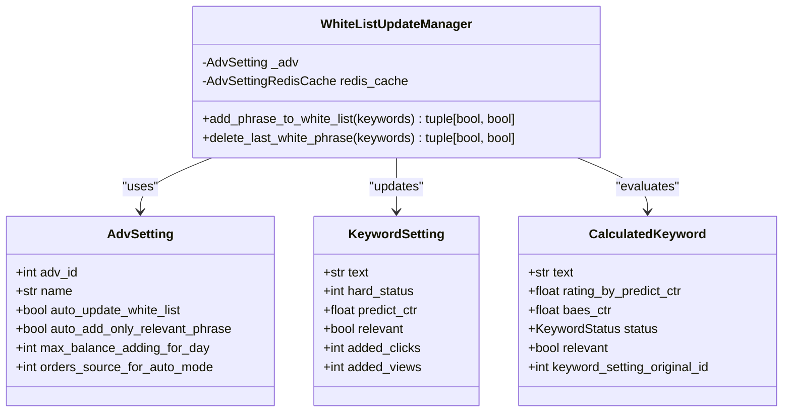
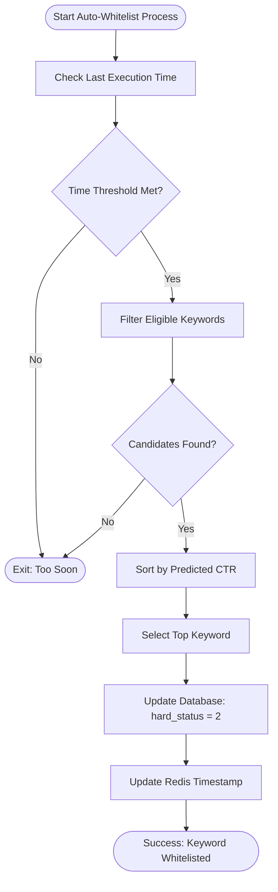
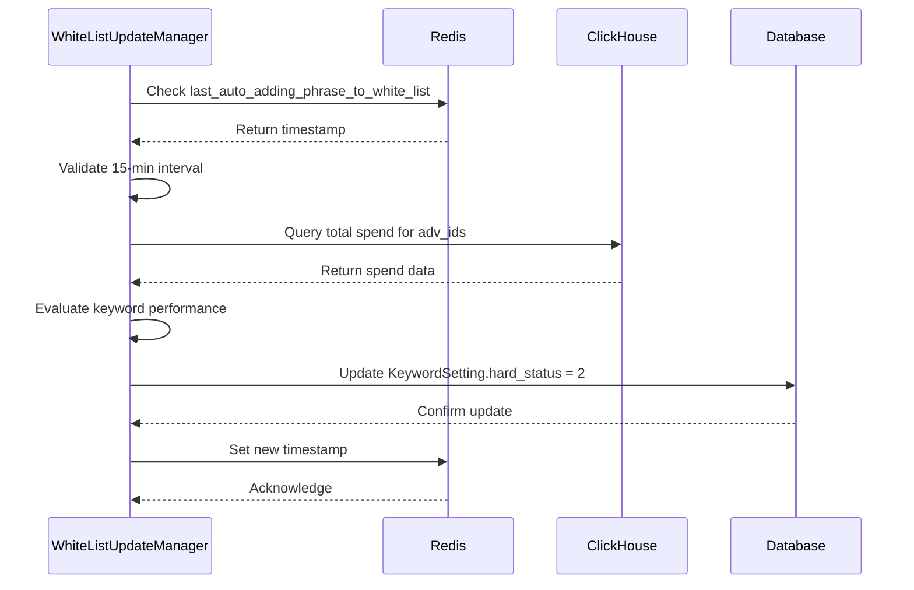
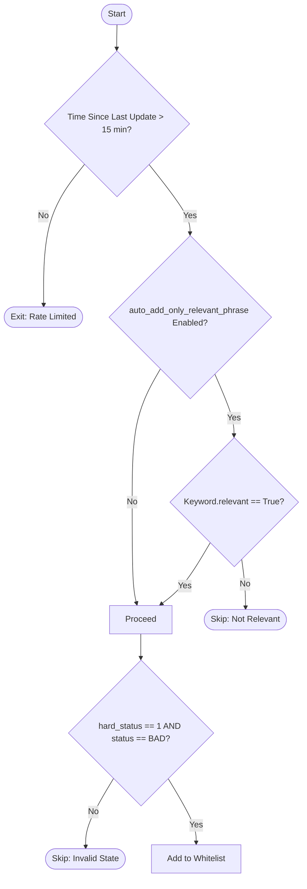

# Auto White List Updater

<cite>
**Referenced Files in This Document**   
- [auto_white_list_updater.py](file://app/modules/shop_runner/service_manager/old_modules/setting_auto_updater/modules/white_list_updater/auto_white_list_updater/auto_white_list_updater.py)
- [click_house_manager.py](file://app/modules/shop_runner/service_manager/old_modules/setting_auto_updater/modules/white_list_updater/auto_white_list_updater/click_house_manager.py)
- [redis_cache.py](file://app/modules/shop_runner/service_manager/old_modules/setting_auto_updater/modules/white_list_updater/auto_white_list_updater/redis_cache/redis_cache.py)
- [last_auto_update_phrases_to_white_list.py](file://app/modules/shop_runner/service_manager/old_modules/setting_auto_updater/modules/white_list_updater/auto_white_list_updater/redis_cache/last_auto_update_phrases_to_white_list.py)
- [models.py](file://app/modules/common_slaves/wildberries/models/models.py)
- [adv_setting.py](file://app/client_bot/user_interface/handlers/adv_setting.py)
- [keyword_settings.py](file://app/client_bot/user_interface/handlers/keyword_settings.py)
- [563a95f2f3bb_add_auto_update_white_list_to_advsetting.py](file://alembic/versions/563a95f2f3bb_add_auto_update_white_list_to_advsetting.py)
- [3a55768aa832_add_relevant_to_keywordsetting.py](file://alembic/versions/3a55768aa832_add_relevant_to_keywordsetting.py)
</cite>

## Table of Contents
1. [Introduction](#introduction)
2. [Core Components](#core-components)
3. [Decision Logic for Auto-Whitelisting](#decision-logic-for-auto-whitelisting)
4. [Integration with ClickHouse and Redis](#integration-with-clickhouse-and-redis)
5. [Safety Checks and Thresholds](#safety-checks-and-thresholds)
6. [Configuration Options](#configuration-options)
7. [User Interface and Controls](#user-interface-and-controls)
8. [Common Issues and Troubleshooting](#common-issues-and-troubleshooting)
9. [Conclusion](#conclusion)

## Introduction
The Auto White List Updater is a system designed to automatically identify high-performing keywords and add them to the white list based on performance metrics such as conversion rate, click-through rate (CTR), and return on advertising spend (ROAS). This automation reduces manual intervention and improves campaign efficiency by promoting keywords that demonstrate strong performance. The system integrates with ClickHouse for analytics data retrieval and uses Redis for state management to ensure consistency and prevent redundant operations.

**Section sources**
- [auto_white_list_updater.py](file://app/modules/shop_runner/service_manager/old_modules/setting_auto_updater/modules/white_list_updater/auto_white_list_updater/auto_white_list_updater.py#L1-L140)

## Core Components

The Auto White List Updater consists of several key components that work together to evaluate keyword performance and manage their status in advertising campaigns. The primary class responsible for this functionality is `WhiteListUpdateManager`, which orchestrates the logic for adding or removing phrases from the white list.

The system evaluates keywords using calculated performance metrics derived from real-time analytics. It leverages database models such as `AdvSetting` and `KeywordSetting` to store configuration and status information. Keywords are evaluated based on their `hard_status` field, where:
- `0` = Blacklisted
- `1` = In testing
- `2` = Whitelisted

Keywords transition between these states based on performance thresholds and business rules defined in the system.



**Diagram sources**
- [auto_white_list_updater.py](file://app/modules/shop_runner/service_manager/old_modules/setting_auto_updater/modules/white_list_updater/auto_white_list_updater/auto_white_list_updater.py#L1-L140)
- [models.py](file://app/modules/common_slaves/wildberries/models/models.py#L300-L659)

**Section sources**
- [auto_white_list_updater.py](file://app/modules/shop_runner/service_manager/old_modules/setting_auto_updater/modules/white_list_updater/auto_white_list_updater/auto_white_list_updater.py#L1-L140)
- [models.py](file://app/modules/common_slaves/wildberries/models/models.py#L300-L659)

## Decision Logic for Auto-Whitelisting

The decision logic within the Auto White List Updater evaluates keywords based on multiple performance indicators including CTR, predicted CTR, and relevance. The core method `add_phrase_to_white_list` implements the selection process:

1. **Filtering Candidates**: Keywords are filtered based on their current status (`hard_status == 1`) and performance classification (`status == BAD`). If the setting `auto_add_only_relevant_phrase` is enabled, only relevant keywords are considered.
2. **Sorting by Performance**: Eligible keywords are sorted by `rating_by_predict_ctr` in descending order to prioritize higher-performing terms.
3. **Selection and Update**: The top-performing keyword is selected and its `hard_status` is updated to `2` (whitelisted) via a database transaction.

The system also includes a mechanism to remove underperforming whitelisted keywords through the `delete_last_white_phrase` method, which removes the lowest-performing keyword (excluding the best performer) when budget thresholds are exceeded.



**Diagram sources**
- [auto_white_list_updater.py](file://app/modules/shop_runner/service_manager/old_modules/setting_auto_updater/modules/white_list_updater/auto_white_list_updater/auto_white_list_updater.py#L1-L140)

**Section sources**
- [auto_white_list_updater.py](file://app/modules/shop_runner/service_manager/old_modules/setting_auto_updater/modules/white_list_updater/auto_white_list_updater/auto_white_list_updater.py#L1-L140)

## Integration with ClickHouse and Redis

The Auto White List Updater integrates with ClickHouse for retrieving aggregated advertising spend data and with Redis for managing execution state and preventing race conditions.

### ClickHouse Integration
The `get_sum_spend_for_complex_adv` function queries ClickHouse to retrieve total spending across both automatic and auction-based advertising campaigns. This data is used to enforce daily spending limits and evaluate cost efficiency.

```python
async def get_sum_spend_for_complex_adv(auto_adv_id: int, auction_adv_id: int) -> float:
    async with get_clickhouse_client() as client:
        result = await client.query(query, parameters={"adv_ids": [auto_adv_id, auction_adv_id]})
        sum_spend: float = result.first_item["spend"]
        return sum_spend
```

This integration ensures that decisions about keyword promotion consider overall campaign spend efficiency.

### Redis Integration
Redis is used to manage execution frequency and prevent overlapping updates. The system uses two Redis-based state trackers:
- `LastAutoAddPhraseToWhiteList`: Tracks the last time a keyword was added to the white list
- `LastAutoDeleteFromWhiteList`: Tracks the last time a keyword was removed from the white list

Each operation enforces a minimum 15-minute interval between executions using the `check_pass_time(60 * 15)` method.



**Diagram sources**
- [click_house_manager.py](file://app/modules/shop_runner/service_manager/old_modules/setting_auto_updater/modules/white_list_updater/auto_white_list_updater/click_house_manager.py#L1-L30)
- [redis_cache.py](file://app/modules/shop_runner/service_manager/old_modules/setting_auto_updater/modules/white_list_updater/auto_white_list_updater/redis_cache/redis_cache.py#L1-L13)
- [last_auto_update_phrases_to_white_list.py](file://app/modules/shop_runner/service_manager/old_modules/setting_auto_updater/modules/white_list_updater/auto_white_list_updater/redis_cache/last_auto_update_phrases_to_white_list.py#L1-L25)

**Section sources**
- [click_house_manager.py](file://app/modules/shop_runner/service_manager/old_modules/setting_auto_updater/modules/white_list_updater/auto_white_list_updater/click_house_manager.py#L1-L30)
- [redis_cache.py](file://app/modules/shop_runner/service_manager/old_modules/setting_auto_updater/modules/white_list_updater/auto_white_list_updater/redis_cache/redis_cache.py#L1-L13)

## Safety Checks and Thresholds

The Auto White List Updater implements several safety checks to prevent premature or inappropriate keyword additions:

### Time-Based Throttling
The system enforces a minimum 15-minute interval between auto-whitelist operations using Redis-based time tracking:
```python
pass_time = 60 * 15
if not await redis_cache.last_auto_adding_phrase_to_white_list.check_pass_time(pass_time):
    return False, False
```

### Relevance Filtering
When `auto_add_only_relevant_phrase` is enabled in `AdvSetting`, only keywords marked as relevant (`relevant == True`) are eligible for auto-whitelisting.

### Spend Limit Protection
The `max_balance_adding_for_day` parameter in `AdvSetting` defines the maximum daily budget allocation for auto-added phrases, preventing excessive spending.

### Impression Thresholds
Although not explicitly coded in the core updater, the system relies on sufficient impression data before making decisions, ensuring statistical significance in performance metrics.

### State Validation
The system validates that keywords are in the correct state (`hard_status == 1` and `status == BAD`) before considering them for promotion, preventing already-optimized keywords from being reprocessed unnecessarily.



**Diagram sources**
- [auto_white_list_updater.py](file://app/modules/shop_runner/service_manager/old_modules/setting_auto_updater/modules/white_list_updater/auto_white_list_updater/auto_white_list_updater.py#L1-L140)
- [models.py](file://app/modules/common_slaves/wildberries/models/models.py#L300-L659)

**Section sources**
- [auto_white_list_updater.py](file://app/modules/shop_runner/service_manager/old_modules/setting_auto_updater/modules/white_list_updater/auto_white_list_updater/auto_white_list_updater.py#L1-L140)

## Configuration Options

The Auto White List Updater supports several configurable parameters that control its behavior:

### AdvSetting Configuration Fields
| Field Name | Type | Default | Description |
|-----------|------|---------|-------------|
| `auto_update_white_list` | Boolean | false | Enables/disables the auto-whitelist feature |
| `auto_add_only_relevant_phrase` | Boolean | true | Only adds keywords marked as relevant |
| `max_balance_adding_for_day` | Integer | 0 | Maximum daily budget for auto-added phrases |
| `orders_source_for_auto_mode` | Enum | COMMON_STATISTIC | Data source for performance evaluation |

### Update Frequency
The system operates with a minimum 15-minute interval between executions, enforced through Redis state management. This cannot be configured dynamically but is hardcoded in the `check_pass_time(60 * 15)` calls.

### Manual Override Capabilities
Users can manually override the auto-whitelist system through the Telegram interface by:
- Disabling `auto_update_white_list` in campaign settings
- Manually changing keyword `hard_status` values
- Setting individual keywords as relevant or irrelevant

These manual changes take precedence over automated decisions.

**Section sources**
- [models.py](file://app/modules/common_slaves/wildberries/models/models.py#L300-L659)
- [563a95f2f3bb_add_auto_update_white_list_to_advsetting.py](file://alembic/versions/563a95f2f3bb_add_auto_update_white_list_to_advsetting.py#L1-L35)
- [3a55768aa832_add_relevant_to_keywordsetting.py](file://alembic/versions/3a55768aa832_add_relevant_to_keywordsetting.py#L1-L31)

## User Interface and Controls

The Auto White List Updater provides user-facing controls through the Telegram interface, allowing users to review and manage auto-added phrases.

### Telegram Interface Features
Users can access controls through the campaign settings menu, where they can:
- Toggle `auto_update_white_list` on/off
- View recently auto-added phrases
- Manually revert auto-whitelisted keywords
- Adjust relevance settings for individual keywords

### Review and Reversion
The system maintains a history of auto-updates through Redis caches, enabling users to:
- See when the last auto-update occurred
- Identify which keywords were added or removed
- Manually reverse any auto-decision through the keyword settings interface

### Notification System
While not explicitly shown in the code, the architecture supports integration with notification systems to alert users when keywords are auto-whitelisted, providing transparency and control.

**Section sources**
- [adv_setting.py](file://app/client_bot/user_interface/handlers/adv_setting.py)
- [keyword_settings.py](file://app/client_bot/user_interface/handlers/keyword_settings.py)

## Common Issues and Troubleshooting

### False Positives
**Issue**: Low-quality keywords being incorrectly whitelisted  
**Cause**: Insufficient data or overly aggressive thresholds  
**Solution**: Ensure adequate impression volume and verify `auto_add_only_relevant_phrase` is enabled

### Delayed Updates
**Issue**: Auto-whitelist operations not occurring as frequently as expected  
**Cause**: The 15-minute minimum interval enforced by Redis  
**Solution**: This is intentional; consider manual additions for urgent cases

### Data Synchronization Problems
**Issue**: Discrepancies between ClickHouse analytics and database records  
**Cause**: Asynchronous data pipelines or caching layers  
**Solution**: Verify data freshness in ClickHouse and check ETL pipeline status

### Budget Overruns
**Issue**: Exceeding `max_balance_adding_for_day` limits  
**Cause**: Multiple campaigns sharing budget or inaccurate spend tracking  
**Solution**: Monitor aggregate spend across all campaigns and adjust limits accordingly

### Stale State in Redis
**Issue**: Auto-updater not triggering despite meeting criteria  
**Cause**: Corrupted or expired Redis keys  
**Solution**: Clear the relevant Redis keys (`LastAutoAddPhraseToWhiteList`, `LastAutoDeleteFromWhiteList`) for the affected campaign

**Section sources**
- [auto_white_list_updater.py](file://app/modules/shop_runner/service_manager/old_modules/setting_auto_updater/modules/white_list_updater/auto_white_list_updater/auto_white_list_updater.py#L1-L140)
- [click_house_manager.py](file://app/modules/shop_runner/service_manager/old_modules/setting_auto_updater/modules/white_list_updater/auto_white_list_updater/click_house_manager.py#L1-L30)
- [redis_cache.py](file://app/modules/shop_runner/service_manager/old_modules/setting_auto_updater/modules/white_list_updater/auto_white_list_updater/redis_cache/redis_cache.py#L1-L13)

## Conclusion
The Auto White List Updater is a sophisticated system that automates keyword optimization based on performance metrics and business rules. By integrating with ClickHouse for analytics and Redis for state management, it ensures reliable and efficient operation. The system includes robust safety checks to prevent premature additions and provides users with controls to review and override automated decisions. Proper configuration and monitoring are essential to maximize its effectiveness while avoiding common issues like false positives and budget overruns.