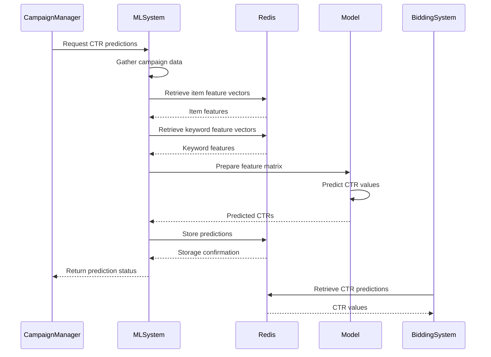
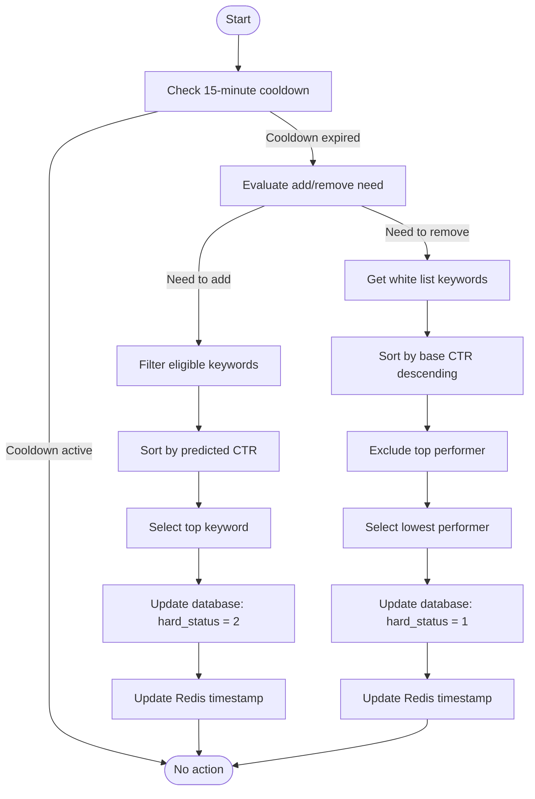
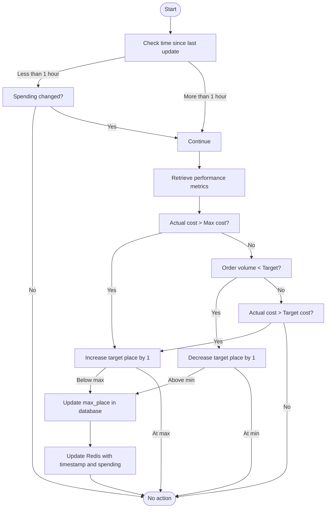
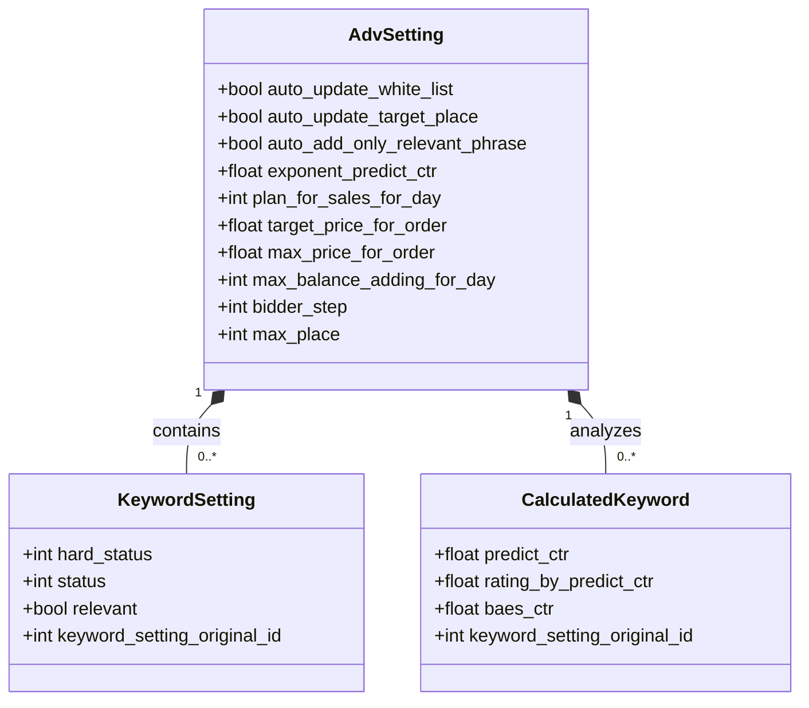

# Automation and Machine Learning Features

<cite>
**Referenced Files in This Document**   
- [ML.py](file://app/modules/wb_adv_updater/ML.py)
- [fitter.py](file://app/modules/wb_adv_updater/fitter.py)
- [run_update_model.py](file://run_update_model.py)
- [auto_white_list_updater.py](file://app/modules/shop_runner/service_manager/old_modules/setting_auto_updater/modules/white_list_updater/auto_white_list_updater/auto_white_list_updater.py)
- [adv_setting.py](file://app/modules/shop_runner/service_manager/old_modules/setting_auto_updater/update_adv_setting.py)
- [target_place_updater.py](file://app/modules/shop_runner/service_manager/old_modules/setting_auto_updater/modules/target_place_updater/target_place_updater.py)
- [auto_updater_target_place.py](file://app/modules/shop_runner/service_manager/old_modules/auto_updater_target_place/auto_updater_target_place.py)
- [predict_ctr_exponent_settings/handlers.py](file://app/modules/predict_ctr_exponent_settings/telegram/handlers.py)
- [models.py](file://app/modules/common_slaves/wildberries/models/models.py)
- [predic_ctr.py](file://app/core/redis_manager_v2/mixins/predic_ctr.py)
</cite>

## Table of Contents
1. [Introduction](#introduction)
2. [Predictive CTR System](#predictive-ctr-system)
3. [Auto White List Updater](#auto-white-list-updater)
4. [Target Place Optimization System](#target-place-optimization-system)
5. [Configuration Options](#configuration-options)
6. [Integration Points](#integration-points)
7. [Performance Metrics and Model Training](#performance-metrics-and-model-training)
8. [Troubleshooting Guide](#troubleshooting-guide)
9. [Conclusion](#conclusion)

## Introduction
The automation and machine learning features in the advertising bot system provide intelligent campaign management through predictive analytics and automated optimization. These features reduce manual intervention by automatically adjusting bidding strategies, managing keyword inclusion, and maintaining optimal ad positions based on performance data. The system leverages machine learning models to predict click-through rates (CTR), dynamically updates white lists of high-performing keywords, and optimizes bid amounts to achieve target advertising positions. This documentation details the implementation, configuration, and operation of these automation features, providing guidance for effective use and troubleshooting.

## Predictive CTR System

The predictive CTR system uses machine learning models to forecast the click-through rate for keyword-ad combinations, enabling data-driven bidding decisions. The system is implemented in ML.py and relies on a trained XGBoost model that analyzes historical performance data, item features, and keyword characteristics to generate CTR predictions.

The prediction process begins by gathering relevant data from active advertising campaigns, including campaign settings, keyword statistics, and product information. For each active campaign, the system retrieves the associated NMIDs (product identifiers) and obtains item feature vectors from Redis. These vectors contain embedded representations of product characteristics that influence performance. Similarly, keyword feature vectors are retrieved for all keywords in the campaign.

The data is then structured into a feature matrix where each row represents a keyword-campaign combination with features including:
- Average item features across all NMIDs in the campaign
- Keyword embedding features
- Campaign type and configuration parameters

This feature matrix is passed to the trained XGBoost model which outputs predicted CTR values. The predictions are stored in Redis using a structured key format that allows efficient retrieval during bidding operations. The system supports both legacy and new key formats, with the new format incorporating NMID information for more precise targeting.

Model predictions are updated regularly to reflect changing market conditions and campaign performance. The system implements a semaphore to limit concurrent prediction processes, ensuring stable resource utilization. Predicted CTR values are used by the bidding system to determine optimal bid amounts, with higher predicted CTRs generally resulting in more aggressive bidding to secure better ad positions.



**Diagram sources**
- [ML.py](file://app/modules/wb_adv_updater/ML.py)
- [predic_ctr.py](file://app/core/redis_manager_v2/mixins/predic_ctr.py)

**Section sources**
- [ML.py](file://app/modules/wb_adv_updater/ML.py#L71-L102)
- [models.py](file://app/modules/common_slaves/wildberries/models/models.py)

## Auto White List Updater

The Auto White List Updater dynamically manages keyword inclusion in advertising campaigns based on performance metrics. This system automatically adds high-potential keywords to the white list while removing underperforming ones, optimizing the campaign's keyword portfolio without manual intervention.

The updater operates through two primary functions: adding phrases to the white list and removing phrases from the white list. When adding phrases, the system evaluates keywords that are currently not in the white list but have favorable performance characteristics. Keywords are filtered based on their hard status and performance status, with preference given to relevant phrases when the campaign is configured for relevance-based selection.

The selection process prioritizes keywords with the highest rating by predicted CTR. The top-performing keyword is promoted to the white list by updating its hard status in the database from 1 (not in white list) to 2 (in white list). This change triggers the bidding system to allocate more budget to this keyword, increasing its visibility.

Conversely, the system can remove keywords from the white list when campaign spending exceeds targets. In this case, the system identifies white list keywords sorted by their base CTR in descending order, excluding the top performer. The lowest-performing keyword from this filtered set is demoted by updating its hard status back to 1, effectively removing it from the white list.

To prevent excessive changes, the system implements rate limiting through Redis-based time tracking. Both addition and removal operations are constrained by a 15-minute cooldown period, ensuring that changes are made judiciously and allowing time to assess the impact of previous adjustments.



**Diagram sources**
- [auto_white_list_updater.py](file://app/modules/shop_runner/service_manager/old_modules/setting_auto_updater/modules/white_list_updater/auto_white_list_updater/auto_white_list_updater.py)

**Section sources**
- [auto_white_list_updater.py](file://app/modules/shop_runner/service_manager/old_modules/setting_auto_updater/modules/white_list_updater/auto_white_list_updater/auto_white_list_updater.py#L42-L107)
- [adv_setting.py](file://app/modules/shop_runner/service_manager/old_modules/setting_auto_updater/update_adv_setting.py#L57-L66)

## Target Place Optimization System

The Target Place Optimization System automatically adjusts bid amounts to maintain desired ad positions based on campaign performance against sales targets. This system monitors key performance indicators and modifies the maximum placement position to optimize campaign efficiency.

The optimization logic follows a hierarchical decision process based on the relationship between actual performance and campaign targets. When the actual cost per order exceeds the maximum allowed cost, the system increases the target place number (moving to a less prominent position) to reduce bidding aggression and lower costs.

Conversely, when order volume falls below the daily sales target and the cost per order remains below the maximum threshold, the system decreases the target place number (moving to a more prominent position) to increase visibility and drive more orders. If order volume meets or exceeds the target but the cost per order exceeds the target cost, the system again increases the target place to reduce spending.

The system implements safeguards to prevent excessive changes. A time-based lock prevents updates within one hour of the previous adjustment unless spending has changed, avoiding rapid oscillations in bid strategy. The target place is constrained within reasonable bounds, with a minimum of 1 (most prominent position) and appropriate upper limits to prevent excessively low visibility.

Position adjustments are implemented through database updates to the campaign's max_place parameter, which directly influences the bidding algorithm's behavior. The system records each change in Redis with a timestamp and spending context, enabling performance tracking and preventing redundant adjustments.



**Diagram sources**
- [auto_updater_target_place.py](file://app/modules/shop_runner/service_manager/old_modules/auto_updater_target_place/auto_updater_target_place.py)
- [target_place_updater.py](file://app/modules/shop_runner/service_manager/old_modules/setting_auto_updater/modules/target_place_updater/target_place_updater.py)

**Section sources**
- [auto_updater_target_place.py](file://app/modules/shop_runner/service_manager/old_modules/auto_updater_target_place/auto_updater_target_place.py#L38-L71)
- [target_place_updater.py](file://app/modules/shop_runner/service_manager/old_modules/setting_auto_updater/modules/target_place_updater/target_place_updater.py#L0-L70)

## Configuration Options

The automation features provide several configuration options that allow users to customize system behavior according to their campaign strategies and business requirements. These settings are stored in the AdvSetting model and can be modified through the user interface.

The predict_ctr_exponent_settings module enables users to adjust the exponent applied to predicted CTR values. This parameter influences how aggressively the bidding system responds to CTR predictions, with higher values amplifying the difference between high-CTR and low-CTR keywords. Users can modify this setting through a dedicated interface that validates input format and updates the database record.

Campaigns can be configured to automatically update the white list by setting the auto_update_white_list flag. When enabled, the system will periodically evaluate keywords for inclusion or exclusion based on performance. The auto_add_only_relevant_phrase setting further refines this behavior by restricting automatic additions to only relevant phrases, as determined by the relevance scoring system.

For target place optimization, campaigns can enable auto_update_target_place to allow automatic position adjustments. Additional parameters include plan_for_sales_for_day (daily sales target), target_price_for_order (desired cost per order), and max_price_for_order (maximum acceptable cost per order). These values form the basis for the optimization algorithm's decision-making process.

Safety limits are implemented through configuration options such as max_balance_adding_for_day, which caps daily budget increases, and bidder_step, which controls the granularity of bid adjustments. These limits prevent runaway spending and ensure gradual, controlled optimization.



**Diagram sources**
- [models.py](file://app/modules/common_slaves/wildberries/models/models.py#L380-L424)
- [handlers.py](file://app/modules/predict_ctr_exponent_settings/telegram/handlers.py#L34-L61)

**Section sources**
- [models.py](file://app/modules/common_slaves/wildberries/models/models.py#L380-L424)
- [handlers.py](file://app/modules/predict_ctr_exponent_settings/telegram/handlers.py#L34-L61)

## Integration Points

The automation and machine learning features integrate with various system components through well-defined interfaces and data flow patterns. The primary integration points include the bidding system, campaign settings management, and data storage layers.

The ML prediction system integrates with the bidding engine through Redis, where predicted CTR values are stored and retrieved using standardized key formats. The bidding system queries Redis for CTR predictions when determining bid amounts, creating a decoupled architecture that allows independent scaling of prediction and bidding components.

Campaign settings are managed through the AdvSetting model in the database, which serves as the central configuration repository. The automation systems periodically query this model to retrieve current settings for active campaigns. Changes to settings through the user interface trigger database updates that are subsequently detected by the automation processes during their regular execution cycles.

Data flow between components follows a producer-consumer pattern, with data collection processes populating Redis and ClickHouse with performance metrics, while automation processes consume this data to make optimization decisions. The system uses Redis for low-latency access to frequently used data such as feature vectors and recent performance metrics, while ClickHouse stores comprehensive historical data for model training and reporting.

The task scheduling system coordinates the execution of various automation processes, ensuring that resource-intensive operations like model training and prediction generation do not overlap excessively. This coordination is achieved through asynchronous event handling and semaphore-based concurrency control, maintaining system stability during peak loads.

```mermaid
graph TB
subgraph "User Interface"
UI[Web Interface]
end
subgraph "Application Layer"
Bidding[Bidding System]
Automation[Automation Engine]
MLSystem[ML Prediction System]
end
subgraph "Data Layer"
Redis[(Redis)]
ClickHouse[(ClickHouse)]
PostgreSQL[(PostgreSQL)]
end
UI --> PostgreSQL: Update settings
PostgreSQL --> Automation: Read campaign settings
PostgreSQL --> MLSystem: Read campaign data
MLSystem --> Redis: Store CTR predictions
Bidding --> Redis: Retrieve CTR predictions
Bidding --> ClickHouse: Write performance data
Automation --> ClickHouse: Read performance metrics
Automation --> Redis: Read feature vectors
MLSystem --> ClickHouse: Read historical data
MLSystem --> Redis: Read current feature vectors
```

**Diagram sources**
- [ML.py](file://app/modules/wb_adv_updater/ML.py)
- [fitter.py](file://app/modules/wb_adv_updater/fitter.py)
- [data_getter.py](file://app/modules/wb_adv_updater/data_getter.py)

**Section sources**
- [ML.py](file://app/modules/wb_adv_updater/ML.py#L71-L102)
- [fitter.py](file://app/modules/wb_adv_updater/fitter.py#L46-L70)
- [data_getter.py](file://app/modules/wb_adv_updater/data_getter.py#L0-L53)

## Performance Metrics and Model Training

The machine learning models are trained on historical campaign performance data to accurately predict CTR for keyword-ad combinations. The training process follows a regular schedule, with model updates occurring when sufficient new data has been collected to justify retraining.

Training data is sourced from multiple systems, including ClickHouse for keyword performance statistics (views, clicks, spend), PostgreSQL for campaign configurations, and Redis for item and keyword feature vectors. The data collection process filters active campaigns and extracts relevant features, creating a comprehensive dataset that captures the relationship between various factors and actual CTR performance.

The training pipeline applies Bayesian inference to handle keywords with low view counts, incorporating prior knowledge about minimum acceptable CTR values. This approach prevents overfitting to sparse data and provides more stable predictions for new or infrequently seen keywords. The feature engineering process creates a rich representation that includes both item-level features (derived from product characteristics) and keyword-level features (derived from search behavior patterns).

Model performance is evaluated using cross-validation with KFold splitting, calculating mean squared error as the primary metric. The system logs detailed performance metrics including mean CV MSE, standard deviation of CV MSE, and maximum difference between CV MSE scores, enabling monitoring of model stability over time.

Model updates are triggered by a dedicated process that checks for new features and sufficient data volume. The training process is resource-intensive and runs with concurrency limits to prevent system overload. Trained models are serialized and stored for use by the prediction system, with versioning to support rollback if needed.

**Section sources**
- [fitter.py](file://app/modules/wb_adv_updater/fitter.py#L46-L70)
- [run_update_model.py](file://run_update_model.py#L0-L24)
- [ML.py](file://app/modules/wb_adv_updater/ML.py#L71-L102)

## Troubleshooting Guide

When experiencing unexpected automation behavior, follow this systematic troubleshooting approach to identify and resolve issues:

1. **Verify Configuration Settings**: Check that automation features are properly enabled in the campaign settings. Confirm that auto_update_white_list and auto_update_target_place flags are set correctly, and that all required parameters (target prices, sales plans) have valid values.

2. **Check Data Availability**: Ensure sufficient performance data is available for the system to make informed decisions. Campaigns with very low impression volumes may not trigger automation due to insufficient statistical significance. Verify that ClickHouse is receiving performance data and that Redis contains up-to-date feature vectors.

3. **Review Rate Limiting**: The system implements cooldown periods to prevent excessive changes. If automation appears unresponsive, check whether recent changes have triggered the 15-minute cooldown for white list updates or the 1-hour cooldown for target place adjustments.

4. **Examine Model Status**: Verify that the ML model has been successfully trained and predictions are being generated. Check system logs for errors during the model training or prediction processes. Ensure that the prediction pipeline is running and has access to required data sources.

5. **Validate Data Flow**: Confirm that data is flowing correctly between components. Verify that campaign performance data is being written to ClickHouse, feature vectors are available in Redis, and the automation processes can access the database for configuration settings.

6. **Monitor Resource Constraints**: Check for system resource limitations that might affect automation performance. The prediction process uses a semaphore to limit concurrency, which could delay processing if multiple campaigns require updates simultaneously.

7. **Inspect Error Logs**: Review application logs for specific error messages related to automation components. Common issues include database connection problems, Redis connectivity issues, and data format errors during feature extraction.

8. **Test with Override Mechanisms**: Temporarily disable automation and make manual adjustments to verify that the underlying bidding system is functioning correctly. This helps isolate whether issues are related to the automation logic or fundamental system functionality.

**Section sources**
- [auto_white_list_updater.py](file://app/modules/shop_runner/service_manager/old_modules/setting_auto_updater/modules/white_list_updater/auto_white_list_updater/auto_white_list_updater.py)
- [auto_updater_target_place.py](file://app/modules/shop_runner/service_manager/old_modules/auto_updater_target_place/auto_updater_target_place.py)
- [ML.py](file://app/modules/wb_adv_updater/ML.py)

## Conclusion

The automation and machine learning features provide sophisticated campaign optimization capabilities that significantly reduce manual management requirements while improving advertising efficiency. By leveraging predictive analytics for CTR estimation, dynamically managing keyword portfolios, and automatically adjusting bid strategies to maintain optimal ad positions, the system enables more effective allocation of advertising budgets.

The modular architecture separates concerns between data collection, model prediction, and optimization logic, allowing independent development and scaling of each component. Configuration options provide flexibility to adapt the automation behavior to different business requirements and risk tolerances.

Regular model retraining ensures that predictions remain accurate as market conditions evolve, while safety limits and rate limiting prevent excessive spending and rapid strategy oscillations. The integration with existing bidding systems through Redis provides a decoupled architecture that maintains system stability while enabling advanced optimization capabilities.

These features represent a significant advancement in advertising campaign management, transforming what was previously a manual, reactive process into an automated, proactive optimization system that continuously improves campaign performance based on data-driven insights.