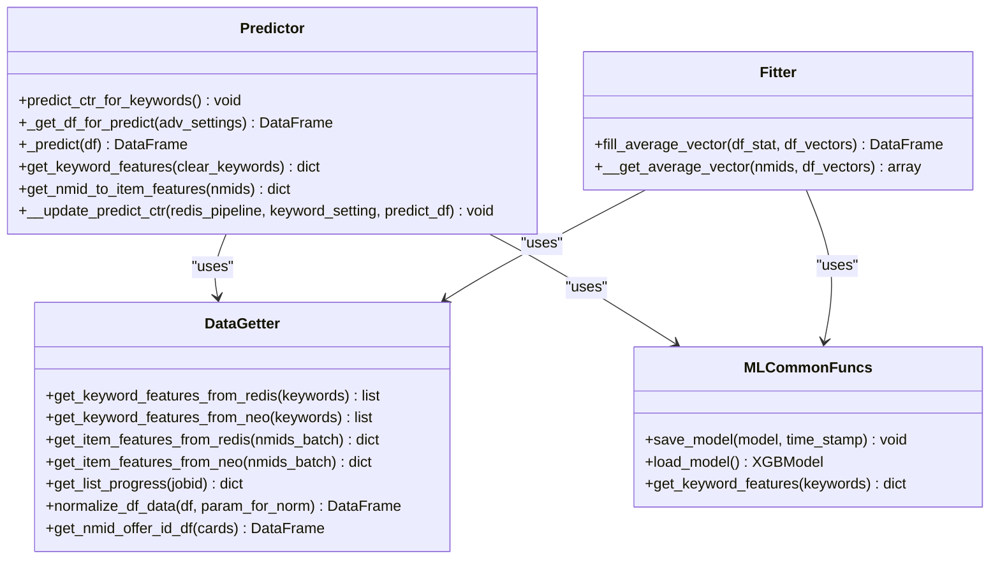
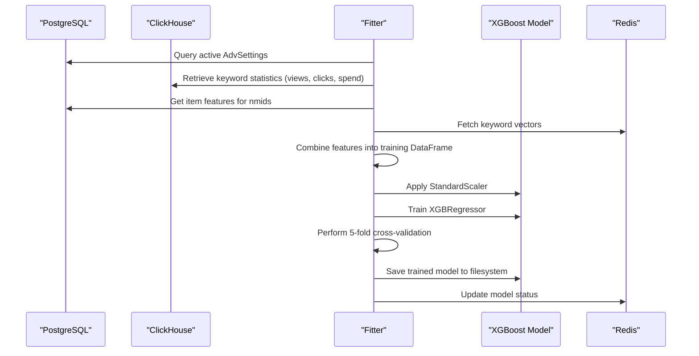
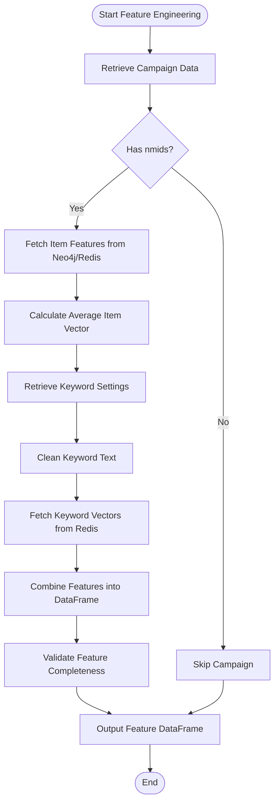
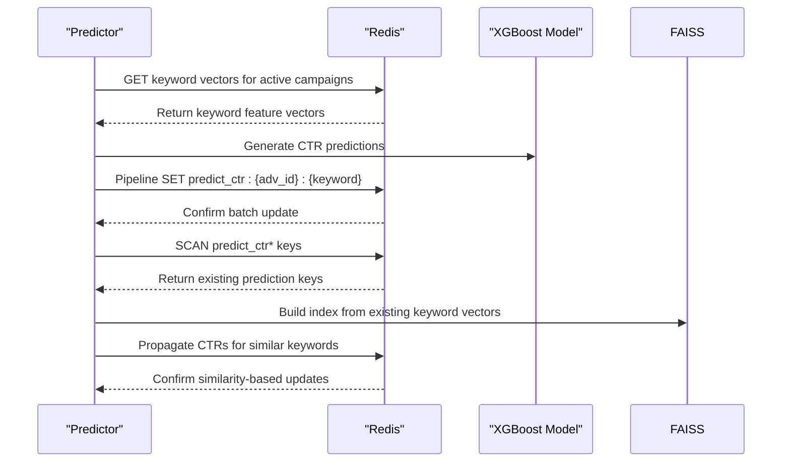
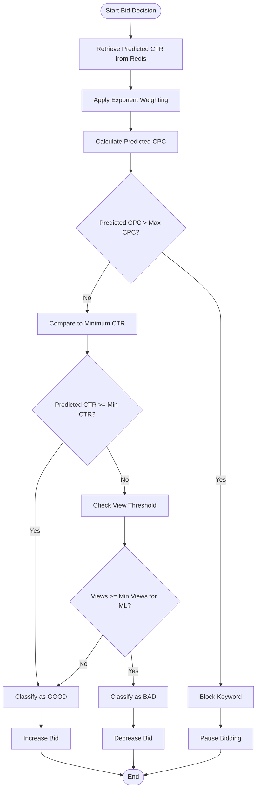
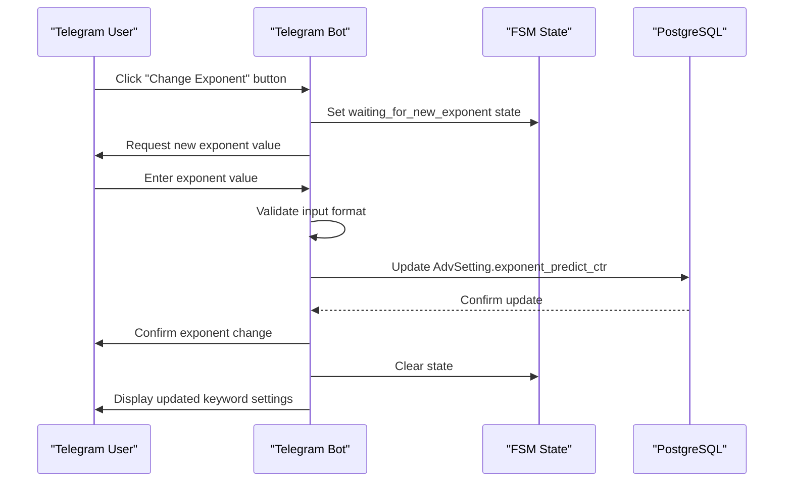
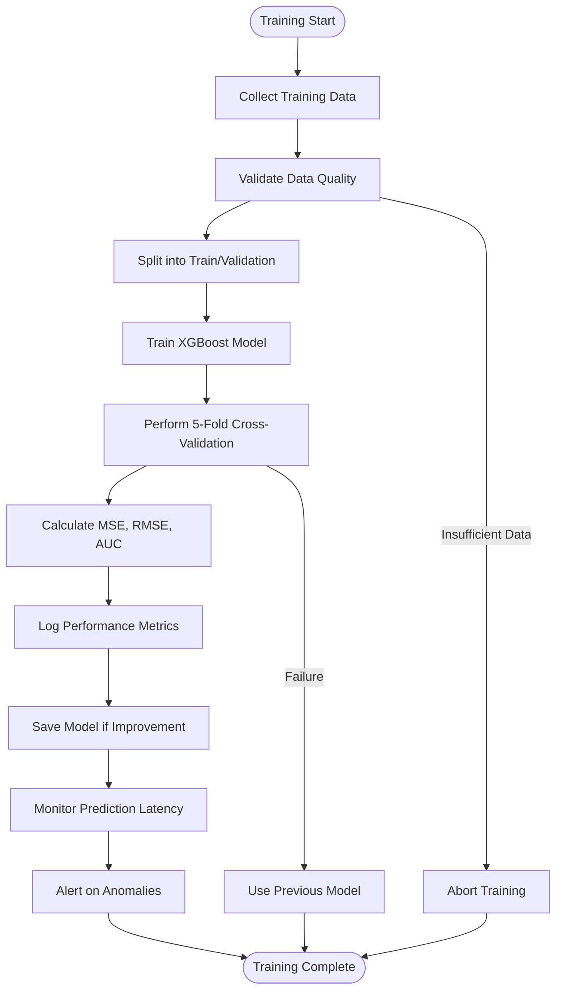
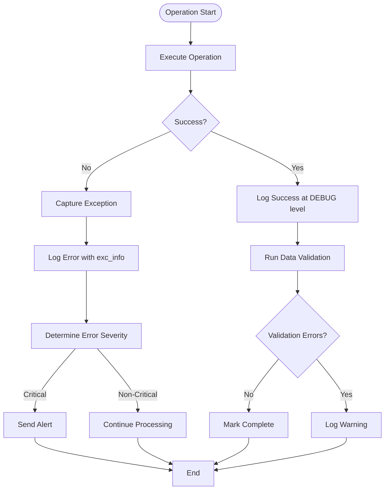
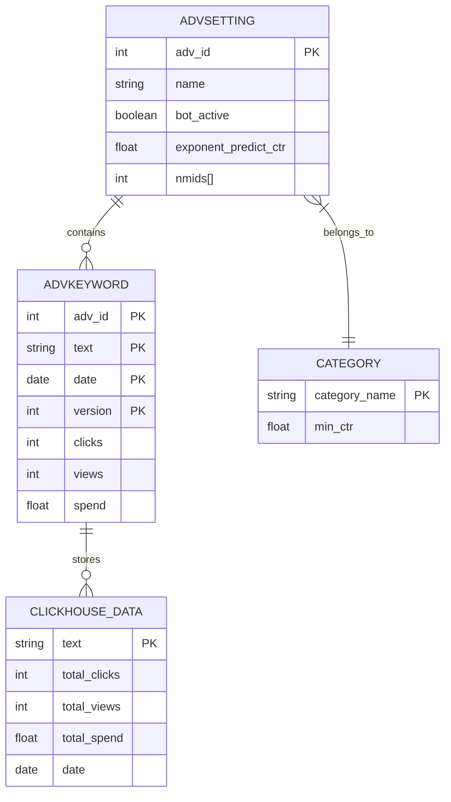
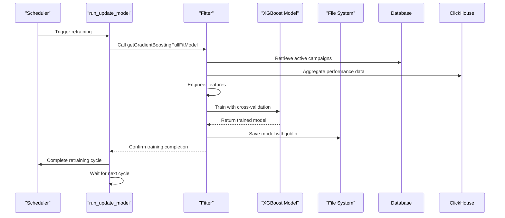

# Predictive CTR System

<cite>
**Referenced Files in This Document**   
- [ML.py](file://app/modules/wb_adv_updater/ML.py)
- [fitter.py](file://app/modules/wb_adv_updater/fitter.py)
- [data_getter.py](file://app/modules/wb_adv_updater/data_getter.py)
- [data_manager.py](file://app/modules/wb_adv_updater/data_manager.py)
- [ml_common_funcs.py](file://app/modules/wb_adv_updater/ml_common_funcs.py)
- [predict_ctr_exponent_settings/telegram/handlers.py](file://app/modules/predict_ctr_exponent_settings/telegram/handlers.py)
- [min_ctr_manager.py](file://app/modules/wb_adv_updater/min_ctr_manager/min_ctr_manager.py)
- [ml_data_manager.py](file://app/modules/wb_adv_updater/ml_data_manager.py)
- [runner.py](file://app/modules/wb_adv_updater/runner.py)
</cite>

## Table of Contents
1. [Introduction](#introduction)
2. [Model Architecture](#model-architecture)
3. [Training Pipeline](#training-pipeline)
4. [Feature Engineering](#feature-engineering)
5. [Real-time Inference with Redis](#real-time-inference-with-redis)
6. [Integration with Bidding Engine](#integration-with-bidding-engine)
7. [Configuration via predict_ctr_exponent_settings](#configuration-via-predict_ctr_exponent_settings)
8. [Performance Metrics and Monitoring](#performance-metrics-and-monitoring)
9. [Error Handling and Debugging](#error-handling-and-debugging)
10. [Data Aggregation with ClickHouse](#data-aggregation-with-clickhouse)
11. [Retraining Strategy](#retraining-strategy)
12. [Conclusion](#conclusion)

## Introduction
The Predictive CTR System is a machine learning-powered component designed to forecast click-through rates for advertising campaigns. The system leverages historical ad performance data, keyword relevance, and contextual features to generate accurate CTR predictions that inform bidding decisions. Built around an XGBoost regression model, the system integrates with Redis for real-time inference and ClickHouse for training data aggregation. The model is retrained periodically using fresh performance data and supports configurable sensitivity controls through the predict_ctr_exponent_settings interface.

## Model Architecture
The Predictive CTR System employs an XGBoost regression model to predict click-through rates based on multiple input features. The architecture consists of a gradient boosting framework that combines multiple weak prediction trees into a strong ensemble model. The system uses a pipeline that includes StandardScaler for feature normalization followed by XGBRegressor for prediction. Model persistence is handled through joblib serialization, with the trained model stored in JSON format for efficient loading during inference. The architecture supports both training and prediction workflows within an asynchronous Python environment, enabling non-blocking operations for database access and Redis interactions.

**Diagram sources**
- [ML.py](file://app/modules/wb_adv_updater/ML.py#L1-L241)
- [fitter.py](file://app/modules/wb_adv_updater/fitter.py#L1-L199)
- [data_getter.py](file://app/modules/wb_adv_updater/data_getter.py#L1-L54)
- [ml_common_funcs.py](file://app/modules/wb_adv_updater/ml_common_funcs.py#L1-L51)

**Section sources**
- [ML.py](file://app/modules/wb_adv_updater/ML.py#L1-L241)
- [fitter.py](file://app/modules/wb_adv_updater/fitter.py#L1-L199)

## Training Pipeline
The training pipeline for the Predictive CTR System follows a structured workflow that begins with data collection from active advertising campaigns. The system queries the database for all active AdvSetting records and retrieves historical performance data from ClickHouse for keyword-level statistics including views, clicks, and spend. Feature engineering is applied to create input vectors from item attributes and keyword characteristics. The pipeline implements Bayesian optimization for hyperparameter tuning and performs 5-fold cross-validation to evaluate model performance using MSE scoring. Training occurs asynchronously with progress logging, and the final model is saved with timestamp metadata. The pipeline is designed to handle cases with insufficient data by gracefully exiting without model updates.

**Diagram sources**
- [fitter.py](file://app/modules/wb_adv_updater/fitter.py#L1-L199)
- [data_manager.py](file://app/modules/wb_adv_updater/data_manager.py#L1-L799)
- [data_getter.py](file://app/modules/wb_adv_updater/data_getter.py#L1-L54)

**Section sources**
- [fitter.py](file://app/modules/wb_adv_updater/fitter.py#L1-L199)
- [data_manager.py](file://app/modules/wb_adv_updater/data_manager.py#L1-L799)

## Feature Engineering
The feature engineering process combines item-level and keyword-level attributes to create a comprehensive feature set for CTR prediction. For items, the system extracts vector representations from product characteristics, descriptions, and images, then computes average feature vectors when multiple items are associated with a campaign. Keyword features are derived from word embeddings generated by a Word2Vec model, capturing semantic relationships between search terms. The system handles campaigns with multiple nmids by calculating mean vectors across all associated items. Text preprocessing includes cleaning operations to normalize keyword text before feature extraction. Features are combined into a unified DataFrame with standardized column naming conventions (item_feature_X, keyword_feature_X) to ensure consistency in model input.

**Diagram sources**
- [ML.py](file://app/modules/wb_adv_updater/ML.py#L1-L241)
- [fitter.py](file://app/modules/wb_adv_updater/fitter.py#L1-L199)
- [data_getter.py](file://app/modules/wb_adv_updater/data_getter.py#L1-L54)
- [ml_data_manager.py](file://app/modules/wb_adv_updater/ml_data_manager.py#L1-L287)

**Section sources**
- [ML.py](file://app/modules/wb_adv_updater/ML.py#L1-L241)
- [fitter.py](file://app/modules/wb_adv_updater/fitter.py#L1-L199)
- [data_getter.py](file://app/modules/wb_adv_updater/data_getter.py#L1-L54)

## Real-time Inference with Redis
The Predictive CTR System leverages Redis as a high-performance cache for real-time inference operations. During prediction, the system retrieves pre-computed keyword vectors from Redis using the get_keyword_features_from_redis method, avoiding expensive on-the-fly computation. Predicted CTR values are stored in Redis with keys following the pattern "predict_ctr:{adv_id}:{keyword}" to enable fast lookup by campaign and keyword. The system uses Redis pipelines to batch multiple CTR updates, reducing network overhead and improving throughput. A similarity-based CTR propagation mechanism uses FAISS indexing to identify similar keywords and propagate CTR predictions when direct predictions are unavailable, enhancing coverage for long-tail search terms.

**Diagram sources**
- [ML.py](file://app/modules/wb_adv_updater/ML.py#L1-L241)
- [data_getter.py](file://app/modules/wb_adv_updater/data_getter.py#L1-L54)
- [ml_data_manager.py](file://app/modules/wb_adv_updater/ml_data_manager.py#L1-L287)
- [redis_manager.py](file://app/utils/redis_manager.py#L1-L50)

**Section sources**
- [ML.py](file://app/modules/wb_adv_updater/ML.py#L1-L241)
- [data_getter.py](file://app/modules/wb_adv_updater/data_getter.py#L1-L54)
- [ml_data_manager.py](file://app/modules/wb_adv_updater/ml_data_manager.py#L1-L287)

## Integration with Bidding Engine
The Predictive CTR System integrates with the bidding engine through the good_bad_phrases workflow, which determines keyword status based on predicted performance. The system calculates a Bayesian-adjusted CTR that combines historical performance with model predictions, applying exponential weighting controlled by the exponent_predict_ctr parameter. Keywords are classified as GOOD or BAD based on whether their predicted CTR exceeds campaign-specific minimum thresholds. The bidding engine uses these classifications to adjust bids, with GOOD keywords receiving higher bids and BAD keywords being throttled or paused. The integration also considers maximum CPC constraints, blocking keywords when predicted CPC exceeds campaign limits, thus preventing inefficient spending.

**Diagram sources**
- [data_manager.py](file://app/modules/wb_adv_updater/data_manager.py#L1-L799)
- [min_ctr_manager.py](file://app/modules/wb_adv_updater/min_ctr_manager/min_ctr_manager.py#L1-L123)
- [ML.py](file://app/modules/wb_adv_updater/ML.py#L1-L241)

**Section sources**
- [data_manager.py](file://app/modules/wb_adv_updater/data_manager.py#L1-L799)
- [min_ctr_manager.py](file://app/modules/wb_adv_updater/min_ctr_manager/min_ctr_manager.py#L1-L123)

## Configuration via predict_ctr_exponent_settings
The predict_ctr_exponent_settings module provides a user interface for configuring the sensitivity of CTR predictions through exponential weighting. Users can adjust the exponent_predict_ctr parameter via a Telegram bot interface, which directly modifies the AdvSetting record in the database. This parameter controls how aggressively the system weights model predictions versus historical performance in the Bayesian CTR calculation. Higher values amplify the influence of model predictions, making the system more responsive to new patterns but potentially more volatile. Lower values prioritize historical data, resulting in more conservative bid adjustments. The configuration system includes input validation to ensure only valid numeric values are accepted and provides immediate feedback upon successful updates.

**Diagram sources**
- [predict_ctr_exponent_settings/telegram/handlers.py](file://app/modules/predict_ctr_exponent_settings/telegram/handlers.py#L1-L81)
- [data_manager.py](file://app/modules/wb_adv_updater/data_manager.py#L1-L799)

**Section sources**
- [predict_ctr_exponent_settings/telegram/handlers.py](file://app/modules/predict_ctr_exponent_settings/telegram/handlers.py#L1-L81)

## Performance Metrics and Monitoring
The Predictive CTR System employs comprehensive performance metrics and monitoring to ensure model reliability and effectiveness. During training, the system performs 5-fold cross-validation using negative mean squared error as the scoring metric, logging mean MSE, standard deviation, and maximum difference between folds. The model's predictive accuracy is continuously monitored through AUC and RMSE calculations on holdout datasets. Operational monitoring includes logging of training duration, data volume statistics, and prediction latency. The system implements fallback mechanisms that maintain previous model versions and continue serving predictions even during training failures. Error handling is robust, with detailed exception logging and graceful degradation when individual components fail.

**Diagram sources**
- [fitter.py](file://app/modules/wb_adv_updater/fitter.py#L1-L199)
- [ML.py](file://app/modules/wb_adv_updater/ML.py#L1-L241)
- [runner.py](file://app/modules/wb_adv_updater/runner.py#L1-L110)

**Section sources**
- [fitter.py](file://app/modules/wb_adv_updater/fitter.py#L1-L199)

## Error Handling and Debugging
The Predictive CTR System implements comprehensive error handling and debugging capabilities to ensure reliability and facilitate troubleshooting. The system uses structured logging with the Python logging module, capturing debug, info, warning, and error messages with appropriate context. Critical operations are wrapped in try-except blocks with detailed exception logging, including stack traces when necessary. The system includes assertion checks to validate data integrity throughout the prediction pipeline. Debugging tools include CSV output of prediction datasets for offline analysis, profiling functions to identify performance bottlenecks, and comprehensive state validation to ensure all required fields are populated. The system gracefully handles missing data by skipping affected campaigns or keywords rather than failing entirely.

**Diagram sources**
- [ML.py](file://app/modules/wb_adv_updater/ML.py#L1-L241)
- [fitter.py](file://app/modules/wb_adv_updater/fitter.py#L1-L199)
- [data_manager.py](file://app/modules/wb_adv_updater/data_manager.py#L1-L799)

**Section sources**
- [ML.py](file://app/modules/wb_adv_updater/ML.py#L1-L241)
- [fitter.py](file://app/modules/wb_adv_updater/fitter.py#L1-L199)

## Data Aggregation with ClickHouse
The Predictive CTR System utilizes ClickHouse as a high-performance analytics database for aggregating historical ad performance data. The system queries ClickHouse to retrieve keyword-level statistics including total clicks, views, and spend over configurable time windows. The data retrieval process uses optimized SQL queries with proper indexing and filtering to minimize latency. For campaigns with both automatic and search advertising, the system aggregates data across multiple adv_id values. The queries employ versioning logic to ensure only the latest data records are used, preventing duplication from data updates. The aggregated data is used both for model training and real-time decision making, with caching mechanisms to reduce database load.

**Diagram sources**
- [data_manager.py](file://app/modules/wb_adv_updater/data_manager.py#L1-L799)
- [fitter.py](file://app/modules/wb_adv_updater/fitter.py#L1-L199)

**Section sources**
- [data_manager.py](file://app/modules/wb_adv_updater/data_manager.py#L1-L799)

## Retraining Strategy
The Predictive CTR System follows a periodic retraining strategy to maintain model accuracy as market conditions and user behavior evolve. The retraining process is orchestrated by the run_update_model function in the runner module, which executes in a continuous loop with error handling to ensure resilience. Training is triggered on a regular schedule, with the exact frequency determined by system configuration. The process begins with data collection from active campaigns, followed by feature engineering and model training with cross-validation. Only models that demonstrate improved performance are deployed, with the system maintaining the previous version as a fallback. The retraining pipeline includes comprehensive logging to track model performance over time and detect potential degradation.

**Diagram sources**
- [runner.py](file://app/modules/wb_adv_updater/runner.py#L1-L110)
- [fitter.py](file://app/modules/wb_adv_updater/fitter.py#L1-L199)
- [ml_data_manager.py](file://app/modules/wb_adv_updater/ml_data_manager.py#L1-L287)

**Section sources**
- [runner.py](file://app/modules/wb_adv_updater/runner.py#L1-L110)
- [fitter.py](file://app/modules/wb_adv_updater/fitter.py#L1-L199)

## Conclusion
The Predictive CTR System represents a sophisticated machine learning solution for optimizing advertising campaign performance through accurate click-through rate predictions. By combining historical performance data with advanced feature engineering and XGBoost modeling, the system enables data-driven bidding decisions that improve campaign efficiency. The architecture demonstrates careful consideration of production requirements, with robust error handling, comprehensive monitoring, and fallback mechanisms to ensure reliability. Integration with Redis enables real-time inference at scale, while ClickHouse provides efficient aggregation of large volumes of historical data. The configurable exponent settings allow fine-tuning of prediction sensitivity to match different business objectives. Overall, the system provides a solid foundation for automated advertising optimization that can adapt to changing market conditions through regular model retraining.