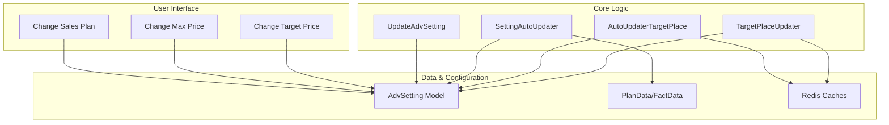
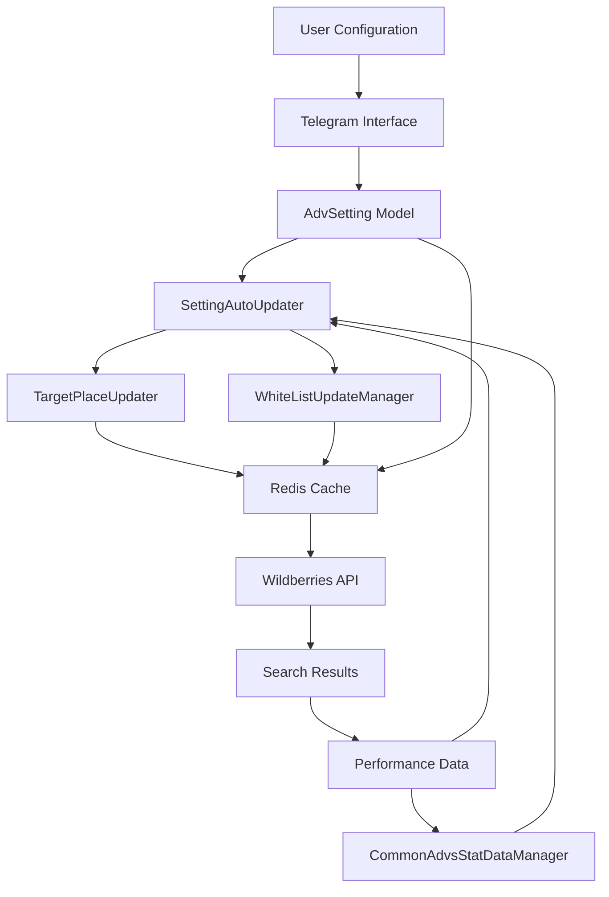
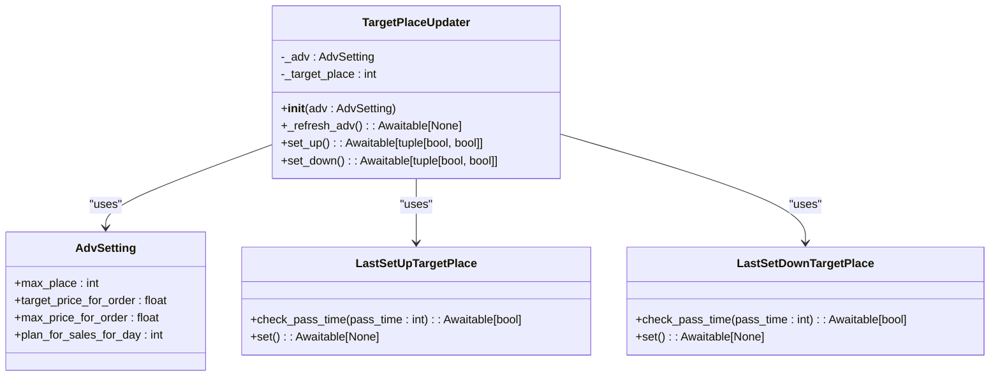
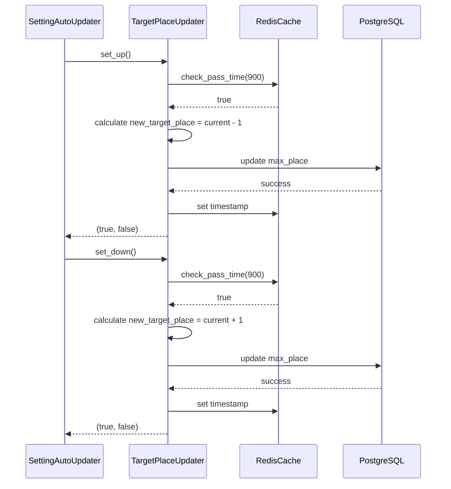
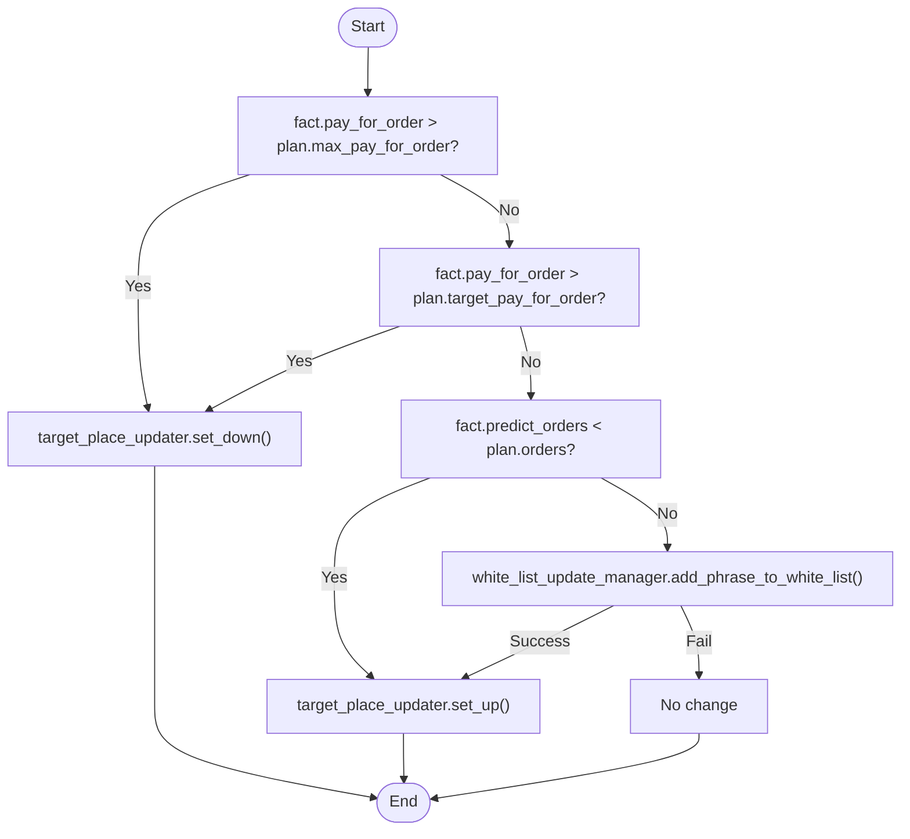
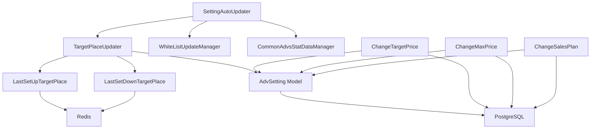

# Target Place Optimization

<cite>
**Referenced Files in This Document**   
- [auto_updater_target_place.py](file://app/modules/shop_runner/service_manager/old_modules/auto_updater_target_place/auto_updater_target_place.py)
- [target_place_updater.py](file://app/modules/shop_runner/service_manager/old_modules/setting_auto_updater/modules/target_place_updater/target_place_updater.py)
- [redis_cache.py](file://app/modules/shop_runner/service_manager/old_modules/setting_auto_updater/modules/target_place_updater/redis_cache.py)
- [last_target_place_update_redis_manager.py](file://app/modules/shop_runner/service_manager/old_modules/auto_updater_target_place/last_target_place_update_redis_manager.py)
- [models.py](file://app/modules/common_slaves/wildberries/models/models.py)
- [setting_auto_updater.py](file://app/modules/shop_runner/service_manager/old_modules/setting_auto_updater/setting_auto_updater.py)
- [update_adv_setting.py](file://app/modules/shop_runner/service_manager/old_modules/setting_auto_updater/update_adv_setting.py)
- [data_classes.py](file://app/modules/shop_runner/service_manager/old_modules/setting_auto_updater/data_classes.py)
- [change_target_price_for_order.py](file://app/modules/sales_plan_settings/telegram/setting_handlers/change_target_price_for_order.py)
- [change_max_price_for_order.py](file://app/modules/sales_plan_settings/telegram/setting_handlers/change_max_price_for_order.py)
- [change_plan_for_sales_for_day.py](file://app/modules/sales_plan_settings/telegram/setting_handlers/change_plan_for_sales_for_day.py)
</cite>

## Table of Contents
1. [Introduction](#introduction)
2. [Project Structure](#project-structure)
3. [Core Components](#core-components)
4. [Architecture Overview](#architecture-overview)
5. [Detailed Component Analysis](#detailed-component-analysis)
6. [Dependency Analysis](#dependency-analysis)
7. [Performance Considerations](#performance-considerations)
8. [Troubleshooting Guide](#troubleshooting-guide)
9. [Conclusion](#conclusion)

## Introduction
The Target Place Optimization system is designed to dynamically adjust advertising bids on Wildberries to maintain desired product positions in search results. The system uses a feedback-driven algorithm that analyzes performance metrics such as order volume, cost per order, and keyword effectiveness to make intelligent bid adjustments. It integrates with Redis for caching position data and PostgreSQL for persistent configuration storage, enabling responsive and reliable bid management. Users can configure target positions, acceptable deviation ranges, and daily budget constraints through a Telegram-based interface. The system implements safety mechanisms including maximum CPC caps and cooldown periods to prevent aggressive bidding. This document details the bid adjustment algorithm, integration points, user configuration options, response to market dynamics, safety controls, and operational monitoring.

## Project Structure
The Target Place Optimization functionality is primarily located within the `app/modules/shop_runner/service_manager/old_modules/` directory, with key components organized in a modular structure. The core logic is split between auto-updating mechanisms for target places and comprehensive setting auto-updaters that coordinate multiple optimization strategies. Configuration models are defined in the common slaves module, while user interface components for setting adjustments are implemented in the sales plan settings module. The system follows a layered architecture with clear separation between data models, business logic, and integration components.

**Diagram sources**
- [target_place_updater.py](file://app/modules/shop_runner/service_manager/old_modules/setting_auto_updater/modules/target_place_updater/target_place_updater.py)
- [models.py](file://app/modules/common_slaves/wildberries/models/models.py)
- [data_classes.py](file://app/modules/shop_runner/service_manager/old_modules/setting_auto_updater/data_classes.py)

**Section sources**
- [app/modules/shop_runner/service_manager/old_modules/](file://app/modules/shop_runner/service_manager/old_modules/)
- [app/modules/common_slaves/wildberries/models/](file://app/modules/common_slaves/wildberries/models/)
- [app/modules/sales_plan_settings/](file://app/modules/sales_plan_settings/)

## Core Components
The Target Place Optimization system consists of several interconnected components that work together to maintain optimal ad positioning. The core functionality revolves around the TargetPlaceUpdater class, which adjusts the max_place parameter in advertising campaigns based on performance metrics. This component works in conjunction with the SettingAutoUpdater, which coordinates multiple optimization strategies including white list management and bid adjustments. The system uses Redis to cache recent state changes and prevent excessive updates, while PostgreSQL stores persistent configuration data. User-configurable parameters such as target cost per order, maximum cost per order, and daily sales plans are stored in the AdvSetting model and can be modified through the Telegram interface.

**Section sources**
- [target_place_updater.py](file://app/modules/shop_runner/service_manager/old_modules/setting_auto_updater/modules/target_place_updater/target_place_updater.py)
- [setting_auto_updater.py](file://app/modules/shop_runner/service_manager/old_modules/setting_auto_updater/setting_auto_updater.py)
- [models.py](file://app/modules/common_slaves/wildberries/models/models.py)

## Architecture Overview
The Target Place Optimization system follows a modular architecture with clear separation of concerns. At the core is the TargetPlaceUpdater component, which makes bid adjustment decisions based on performance feedback. This component receives input from the SettingAutoUpdater, which aggregates performance data and compares actual results against user-defined targets. The system uses a feedback loop where recent performance metrics (FactData) are compared against planned targets (PlanData) to determine appropriate actions. Redis is used to implement cooldown periods and prevent excessive updates, while PostgreSQL provides persistent storage for campaign configurations and user settings. The user interface layer allows merchants to configure their optimization goals through a Telegram bot, with changes persisted to the database.

**Diagram sources**
- [setting_auto_updater.py](file://app/modules/shop_runner/service_manager/old_modules/setting_auto_updater/setting_auto_updater.py)
- [target_place_updater.py](file://app/modules/shop_runner/service_manager/old_modules/setting_auto_updater/modules/target_place_updater/target_place_updater.py)
- [models.py](file://app/modules/common_slaves/wildberries/models/models.py)

## Detailed Component Analysis

### Target Place Updater Analysis
The TargetPlaceUpdater component is responsible for adjusting the target position of advertising campaigns on Wildberries. It implements a bid adjustment algorithm that responds to performance metrics by either increasing or decreasing the desired ad position. The component uses a cooldown mechanism implemented through Redis to prevent excessive updates, requiring a minimum time interval between adjustments. When performance metrics indicate overspending, the updater increases the target place (moving to a less prominent position), while underperformance triggers a decrease in target place (moving to a more prominent position).

#### For Object-Oriented Components:

**Diagram sources**
- [target_place_updater.py](file://app/modules/shop_runner/service_manager/old_modules/setting_auto_updater/modules/target_place_updater/target_place_updater.py)
- [redis_cache.py](file://app/modules/shop_runner/service_manager/old_modules/setting_auto_updater/modules/target_place_updater/redis_cache.py)
- [models.py](file://app/modules/common_slaves/wildberries/models/models.py)

#### For API/Service Components:

**Diagram sources**
- [target_place_updater.py](file://app/modules/shop_runner/service_manager/old_modules/setting_auto_updater/modules/target_place_updater/target_place_updater.py)
- [redis_cache.py](file://app/modules/shop_runner/service_manager/old_modules/setting_auto_updater/modules/target_place_updater/redis_cache.py)

**Section sources**
- [target_place_updater.py](file://app/modules/shop_runner/service_manager/old_modules/setting_auto_updater/modules/target_place_updater/target_place_updater.py)
- [redis_cache.py](file://app/modules/shop_runner/service_manager/old_modules/setting_auto_updater/modules/target_place_updater/redis_cache.py)

### Bid Adjustment Algorithm Analysis
The bid adjustment algorithm in the Target Place Optimization system uses a multi-factor decision process to determine appropriate bid changes. The algorithm evaluates three primary metrics: actual orders versus planned orders, actual cost per order versus target cost, and actual cost per order versus maximum allowed cost. Based on these comparisons, the system decides whether to move the ad to a more prominent position (by decreasing the max_place value), a less prominent position (by increasing the max_place value), or maintain the current position. The algorithm implements safety mechanisms to prevent extreme bid changes, including minimum and maximum bounds for the target place.

#### For Complex Logic Components:

**Diagram sources**
- [update_adv_setting.py](file://app/modules/shop_runner/service_manager/old_modules/setting_auto_updater/update_adv_setting.py)
- [setting_auto_updater.py](file://app/modules/shop_runner/service_manager/old_modules/setting_auto_updater/setting_auto_updater.py)

**Section sources**
- [update_adv_setting.py](file://app/modules/shop_runner/service_manager/old_modules/setting_auto_updater/update_adv_setting.py)
- [setting_auto_updater.py](file://app/modules/shop_runner/service_manager/old_modules/setting_auto_updater/setting_auto_updater.py)

## Dependency Analysis
The Target Place Optimization system has a well-defined dependency structure that enables modular operation while maintaining data consistency. The core components depend on the AdvSetting model for campaign configuration data, which is stored in PostgreSQL. The TargetPlaceUpdater and related components depend on Redis for implementing cooldown periods and caching recent state changes. The SettingAutoUpdater component has dependencies on both the TargetPlaceUpdater and WhiteListUpdateManager, coordinating their actions based on performance analysis. The user interface components for configuration have direct dependencies on the database models to persist user settings. All components use the shared database session manager for data access, ensuring consistent transaction handling.

**Diagram sources**
- [target_place_updater.py](file://app/modules/shop_runner/service_manager/old_modules/setting_auto_updater/modules/target_place_updater/target_place_updater.py)
- [setting_auto_updater.py](file://app/modules/shop_runner/service_manager/old_modules/setting_auto_updater/setting_auto_updater.py)
- [models.py](file://app/modules/common_slaves/wildberries/models/models.py)
- [change_target_price_for_order.py](file://app/modules/sales_plan_settings/telegram/setting_handlers/change_target_price_for_order.py)

**Section sources**
- [target_place_updater.py](file://app/modules/shop_runner/service_manager/old_modules/setting_auto_updater/modules/target_place_updater/target_place_updater.py)
- [setting_auto_updater.py](file://app/modules/shop_runner/service_manager/old_modules/setting_auto_updater/setting_auto_updater.py)
- [models.py](file://app/modules/common_slaves/wildberries/models/models.py)

## Performance Considerations
The Target Place Optimization system is designed with performance and efficiency in mind. The use of Redis for caching recent state changes reduces the need for frequent database queries and prevents excessive updates to advertising campaigns. The cooldown mechanism implemented through Redis caches ensures that bid adjustments are spaced appropriately, preventing API rate limiting from Wildberries. The system processes performance data in batches and uses efficient database queries with appropriate indexing to minimize latency. The modular design allows components to be optimized independently, and the use of asynchronous operations ensures that the system can handle multiple campaigns concurrently without blocking.

## Troubleshooting Guide
Common issues in the Target Place Optimization system include position drift, budget exhaustion, and API rate limiting. Position drift can occur when the feedback loop is not responsive enough to market changes; this can be addressed by adjusting the cooldown periods in the Redis caches. Budget exhaustion typically results from aggressive bidding behavior and can be mitigated by setting appropriate maximum cost per order limits. API rate limiting from Wildberries can occur if update frequency is too high; this is prevented by the Redis-based cooldown mechanism but may require adjustment of the pass_time values if limits are still exceeded. Monitoring logs for update frequency and success rates can help identify and resolve these issues.

**Section sources**
- [target_place_updater.py](file://app/modules/shop_runner/service_manager/old_modules/setting_auto_updater/modules/target_place_updater/target_place_updater.py)
- [redis_cache.py](file://app/modules/shop_runner/service_manager/old_modules/setting_auto_updater/modules/target_place_updater/redis_cache.py)
- [setting_auto_updater.py](file://app/modules/shop_runner/service_manager/old_modules/setting_auto_updater/setting_auto_updater.py)

## Conclusion
The Target Place Optimization system provides a comprehensive solution for maintaining desired ad positions on Wildberries search results. By combining performance feedback analysis with intelligent bid adjustment algorithms, the system helps merchants achieve their marketing goals while managing costs effectively. The modular architecture with clear separation of concerns enables reliable operation and facilitates future enhancements. Integration with Redis for state caching and PostgreSQL for persistent storage ensures data consistency and system responsiveness. The user-friendly Telegram interface allows easy configuration of optimization parameters, making the system accessible to merchants with varying levels of technical expertise. With appropriate monitoring and tuning, the system can deliver consistent results in dynamic marketplace conditions.