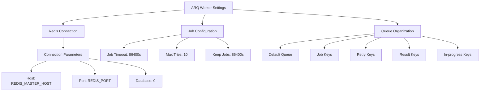
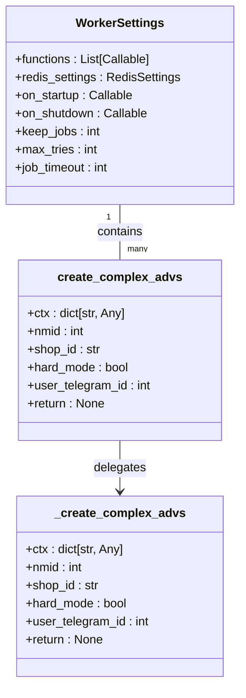
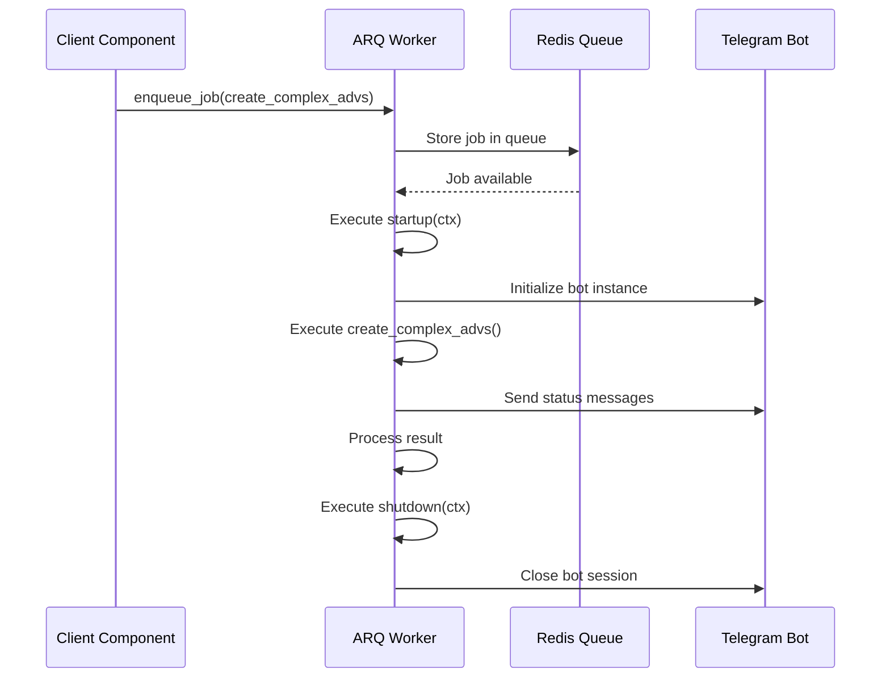
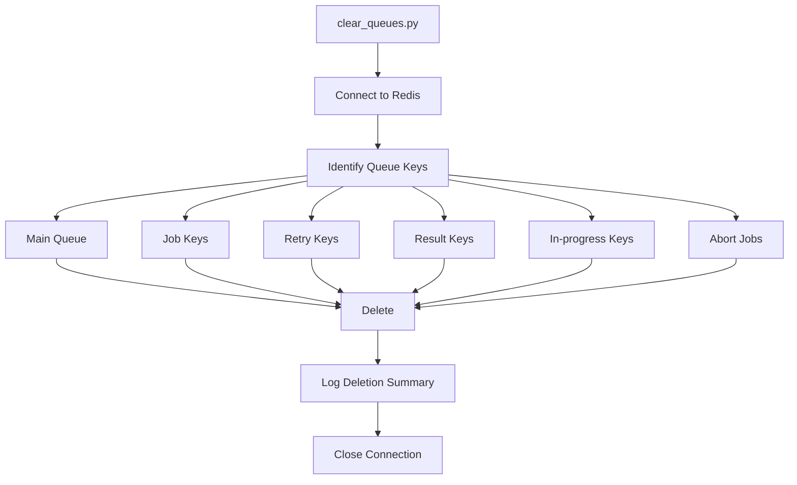
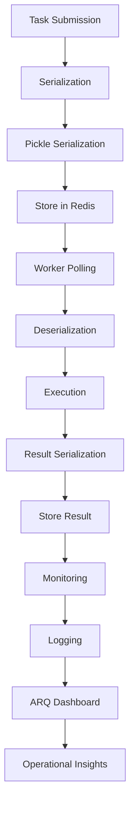
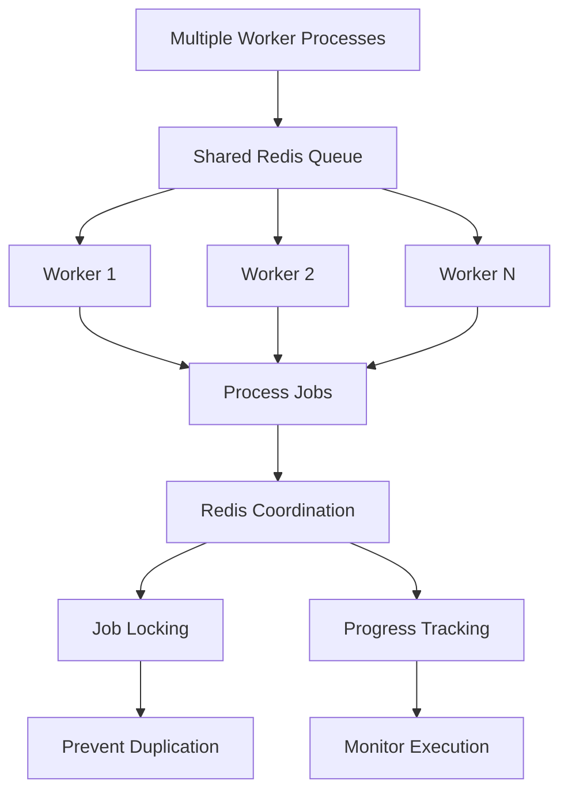
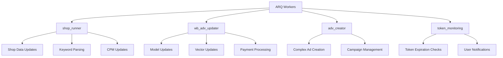
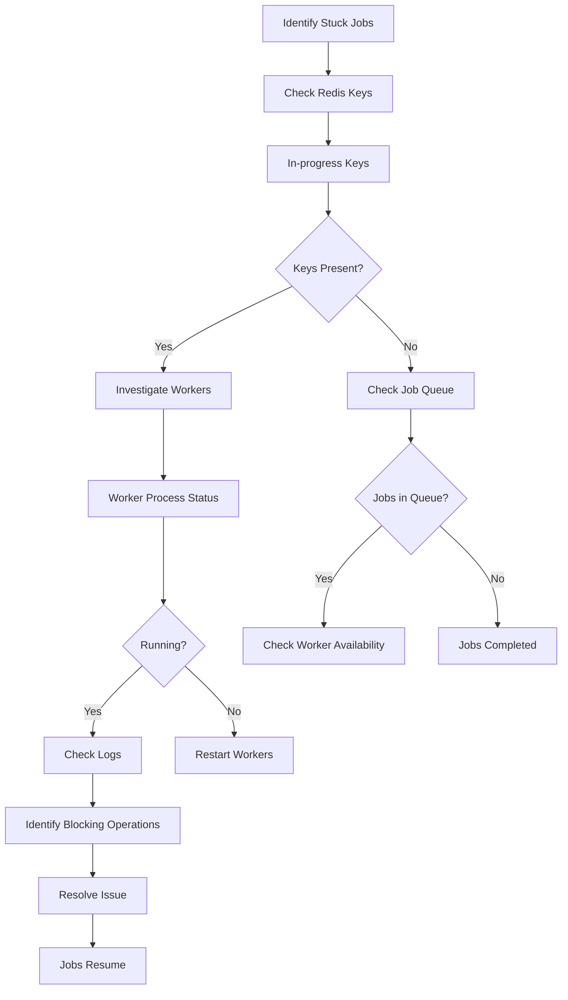

# ARQ Workers

<cite>
**Referenced Files in This Document**   
- [arq_redis_settings.py](file://app/arq_workers/arq_redis_settings.py)
- [workers.py](file://app/arq_workers/workers.py)
- [clear_queues.py](file://app/arq_workers/clear_queues.py)
- [tasks.py](file://app/modules/adv_creator/backend/tasks.py)
- [runner.py](file://app/modules/wb_adv_updater/runner.py)
- [settings_master.py](file://app/settings/settings_master.py)
- [redis_config.py](file://app/configs/infrastructure_config/redis_config.py)
- [shop_run_worker.py](file://app/modules/shop_runner/shop_run_worker/worker/worker.py)
</cite>

## Table of Contents
1. [Introduction](#introduction)
2. [ARQ Configuration with Redis](#arq-configuration-with-redis)
3. [Worker Functions Implementation](#worker-functions-implementation)
4. [Job Enqueueing and Client Integration](#job-enqueueing-and-client-integration)
5. [Error Handling and Retry Policies](#error-handling-and-retry-policies)
6. [Queue Management and Maintenance](#queue-management-and-maintenance)
7. [Task Serialization and Monitoring](#task-serialization-and-monitoring)
8. [Scaling and Concurrency Management](#scaling-and-concurrency-management)
9. [Integration with Core Modules](#integration-with-core-modules)
10. [Troubleshooting Stuck Jobs](#troubleshooting-stuck-jobs)

## Introduction
The ARQ-based background worker system in adv-bot provides asynchronous task processing for various operations including shop updates, keyword parsing, and model updates. This system leverages Redis as a message broker to manage task queues, ensure reliable execution, and provide fault tolerance. The architecture is designed to handle long-running tasks, periodic operations, and critical business processes that require guaranteed delivery and execution.

**Section sources**
- [workers.py](file://app/arq_workers/workers.py#L1-L50)
- [arq_redis_settings.py](file://app/arq_workers/arq_redis_settings.py#L1-L5)

## ARQ Configuration with Redis



**Diagram sources**
- [arq_redis_settings.py](file://app/arq_workers/arq_redis_settings.py#L1-L5)
- [workers.py](file://app/arq_workers/workers.py#L30-L50)
- [settings_master.py](file://app/settings/settings_master.py#L200-L400)

### Connection Parameters
The ARQ system is configured to connect to Redis using environment variables for flexibility and security. The connection settings are defined in `arq_redis_settings.py` which imports the Redis host from the application settings. The Redis configuration follows the standard pattern with host, port, database, and optional password parameters.

The system uses the master Redis instance for all operations, with the host specified by the `REDIS_MASTER_HOST` environment variable and the port by `REDIS_PORT` (defaulting to 6379 if not specified). This configuration ensures that all worker processes connect to the same Redis instance for consistent task management.

### Job Timeout Settings
The worker configuration includes comprehensive job timeout settings to prevent tasks from running indefinitely. The primary job timeout is set to 86,400 seconds (24 hours) through the `job_timeout` parameter in `WorkerSettings`. This generous timeout accommodates long-running operations such as complex ad creation or bulk data processing.

Additionally, the system implements retry logic with a maximum of 10 attempts (`max_tries = 10`). When a task fails, it can be retried with a configurable defer period, allowing for transient errors to resolve before retrying. This combination of long timeouts and multiple retry attempts ensures robust handling of operations that may encounter temporary issues.

### Redis Queue Organization
ARQ organizes its data in Redis using a structured key naming convention that separates different types of information:

- **Default queue**: Stores pending jobs using the default queue name
- **Job keys**: Prefixed with `arq:job:` for individual job data
- **Retry keys**: Prefixed with `arq:retry:` for jobs awaiting retry
- **Result keys**: Prefixed with `arq:result:` for job execution results
- **In-progress keys**: Prefixed with `arq:in-progress:` for currently executing jobs
- **Abort jobs sorted set**: Tracks aborted jobs

This organization allows for efficient querying and management of tasks while preventing key collisions with other Redis data used by the application.

**Section sources**
- [arq_redis_settings.py](file://app/arq_workers/arq_redis_settings.py#L1-L5)
- [workers.py](file://app/arq_workers/workers.py#L30-L50)
- [settings_master.py](file://app/settings/settings_master.py#L200-L400)
- [redis_config.py](file://app/configs/infrastructure_config/redis_config.py#L1-L15)

## Worker Functions Implementation



**Diagram sources**
- [workers.py](file://app/arq_workers/workers.py#L30-L50)
- [tasks.py](file://app/modules/adv_creator/backend/tasks.py#L1-L108)

### Task Types
The ARQ worker system implements several types of background tasks, with the primary function being `create_complex_advs` which handles the creation of complex advertising campaigns. This function is registered in the `WorkerSettings.functions` list and is available for execution by worker processes.

The system also supports other task types through integration with various modules:
- **Shop updates**: Periodic updates of shop data and statistics
- **Keyword parsing**: Processing and updating keyword positions
- **Model updates**: Updating machine learning models and prediction systems
- **Vector updates**: Synchronizing embedding vectors in Redis and Neo4j

### Function Implementation
The `create_complex_advs` function is implemented as an async function that takes a context dictionary and several parameters including the nmid (product identifier), shop ID, hard mode flag, and user Telegram ID. The function follows a wrapper pattern with the public function handling exceptions and retries, while the private `_create_complex_advs` function contains the core business logic.

The implementation includes comprehensive error handling for various scenarios:
- `ApiForbiddenError`: When API tokens lack required permissions
- `CardsNotFoundForShopError`: When product cards are not found on Wildberries
- `NotEnoughBalanceOnShopError`: When insufficient funds are available
- `AdvNotFoundInWBError`: When advertising campaigns cannot be found
- `StartComplexAdvError`: When campaign startup fails

Each error type triggers appropriate user notifications through the Telegram bot interface, ensuring users are informed of issues with their requests.

**Section sources**
- [workers.py](file://app/arq_workers/workers.py#L30-L50)
- [tasks.py](file://app/modules/adv_creator/backend/tasks.py#L1-L108)

## Job Enqueueing and Client Integration



**Diagram sources**
- [workers.py](file://app/arq_workers/workers.py#L10-L50)
- [tasks.py](file://app/modules/adv_creator/backend/tasks.py#L1-L108)
- [create_adv.py](file://create_adv.py#L1-L28)

### Client-Side Enqueueing
Client-facing components enqueue jobs using the ARQ framework's job queuing mechanism. The `create_adv.py` script demonstrates how jobs are enqueued from external components. The process involves:

1. Creating a client session for HTTP operations
2. Obtaining the bot instance for user notifications
3. Setting up the context dictionary with required dependencies
4. Calling the task function through the ARQ interface

The context dictionary pattern allows worker functions to access shared resources like the bot instance and HTTP client without having to initialize them for each task, improving efficiency and resource management.

### Integration Points
The worker system integrates with several core modules:
- **shop_runner**: For periodic shop updates and data synchronization
- **wb_adv_updater**: For advertising campaign updates and model refreshes
- **adv_creator**: For creating new advertising campaigns
- **token_monitoring**: For monitoring token expiration and sending notifications

These integrations enable the system to coordinate complex workflows across different parts of the application, ensuring data consistency and timely execution of critical operations.

**Section sources**
- [create_adv.py](file://create_adv.py#L1-L28)
- [workers.py](file://app/arq_workers/workers.py#L10-L50)
- [runner.py](file://app/modules/wb_adv_updater/runner.py#L1-L144)

## Error Handling and Retry Policies

```mermaid
flowchart TD
A[Task Execution] --> B{Success?}
B --> |Yes| C[Complete Job]
B --> |No| D{Error Type}
D --> E[ApiForbiddenError]
D --> F[Transient Error]
D --> G[Other Errors]
E --> H[Send Permission Message]
F --> I[Raise Retry(defer=delay)]
G --> J[Log Error]
I --> K[Retry After Delay]
K --> A
H --> L[Complete Job]
J --> M[Retry According to Policy]
M --> A
```

**Diagram sources**
- [tasks.py](file://app/modules/adv_creator/backend/tasks.py#L1-L108)
- [workers.py](file://app/arq_workers/workers.py#L30-L50)

### Error Handling Strategy
The worker system implements a comprehensive error handling strategy that distinguishes between different types of errors and responds appropriately:

- **Permission errors** (`ApiForbiddenError`): These are handled by sending a specific message to the user with instructions to contact support, then completing the job without retry since the condition is unlikely to resolve automatically.

- **Business logic errors** (e.g., `CardsNotFoundForShopError`, `NotEnoughBalanceOnShopError`): These errors trigger user notifications explaining the specific issue, then complete the job as retrying would not resolve the underlying problem.

- **Transient errors**: All other exceptions are treated as transient and trigger the retry mechanism, allowing the system to recover from temporary issues like network problems or service outages.

### Retry Policies
The system implements a sophisticated retry policy through ARQ's built-in retry mechanism:

- **Maximum attempts**: Configured globally as `max_tries = 10` in `WorkerSettings`
- **Retry delay**: Configured per task with a default of 1 second for the `create_complex_advs` function
- **Retry mechanism**: Uses ARQ's `Retry` exception with a `defer` parameter specifying the delay before retry

The retry system ensures that transient failures do not result in permanent job failure, while preventing infinite retry loops through the maximum attempts limit. This balance between reliability and resource efficiency is crucial for maintaining system stability under varying conditions.

**Section sources**
- [tasks.py](file://app/modules/adv_creator/backend/tasks.py#L1-L108)
- [workers.py](file://app/arq_workers/workers.py#L30-L50)

## Queue Management and Maintenance



**Diagram sources**
- [clear_queues.py](file://app/arq_workers/clear_queues.py#L1-L74)

### clear_queues.py Utility
The `clear_queues.py` script provides administrative functionality for maintaining task queues. This utility is essential for troubleshooting and system maintenance, allowing administrators to reset the worker system when needed.

The script performs the following operations:
1. Connects to Redis using the same settings as the worker processes
2. Identifies all ARQ-related keys using the framework's predefined prefixes
3. Deletes all queue-related data including pending jobs, retry queues, results, and in-progress tasks
4. Logs the operation results for audit and verification

This comprehensive cleanup ensures that no residual task data remains in Redis, providing a clean state for the worker system. The utility is particularly useful when redeploying the system, troubleshooting stuck jobs, or resetting the environment for testing.

### Queue Organization
The utility leverages ARQ's consistent key naming convention to identify and remove all relevant data:
- `default_queue_name`: The main job queue
- `job_key_prefix`: Prefix for individual job data
- `retry_key_prefix`: Prefix for retry queue entries
- `result_key_prefix`: Prefix for job results
- `in_progress_key_prefix`: Prefix for currently executing jobs
- `abort_jobs_ss`: Sorted set for aborted jobs

This systematic approach ensures that all task-related data is removed while preserving other Redis data used by the application.

**Section sources**
- [clear_queues.py](file://app/arq_workers/clear_queues.py#L1-L74)

## Task Serialization and Monitoring



**Diagram sources**
- [workers.py](file://app/arq_workers/workers.py#L1-L50)
- [runner.py](file://app/modules/wb_adv_updater/runner.py#L1-L144)

### Task Serialization
ARQ handles task serialization automatically using Python's pickle protocol. When a job is enqueued, ARQ serializes the function name and arguments, storing them in Redis. When a worker processes the job, it deserializes the data and executes the function with the original parameters.

The system stores job results for 86,400 seconds (24 hours) as configured by the `keep_jobs` setting. This retention period allows for result retrieval and debugging while preventing indefinite storage that could consume excessive Redis memory.

### Monitoring and Logging
The worker system implements comprehensive monitoring through:
- **Structured logging**: Using Python's logging module with consistent formatting
- **Error tracking**: Logging exceptions with full stack traces using `exc_info=True`
- **Progress tracking**: Logging key milestones in task execution
- **Performance monitoring**: Tracking task duration and resource usage

The logging configuration is initialized through `setup_logging()` which ensures consistent log formatting across all worker processes. Logs include timestamps, log levels, module names, and detailed messages that facilitate troubleshooting and performance analysis.

While the codebase doesn't explicitly implement an ARQ dashboard, the logging and result retention features provide the foundation for monitoring worker performance and task execution. External monitoring tools can consume the logs to provide visual dashboards and alerts.

**Section sources**
- [workers.py](file://app/arq_workers/workers.py#L1-L50)
- [runner.py](file://app/modules/wb_adv_updater/runner.py#L1-L144)
- [clear_queues.py](file://app/arq_workers/clear_queues.py#L1-L74)

## Scaling and Concurrency Management



**Diagram sources**
- [workers.py](file://app/arq_workers/workers.py#L30-L50)
- [shop_run_worker.py](file://app/modules/shop_runner/shop_run_worker/worker/worker.py#L1-L64)

### Worker Process Scaling
The ARQ system supports scaling through multiple worker processes that share the same Redis queue. Each worker process can be run independently, allowing the system to handle increased load by adding more workers.

The Redis-based coordination ensures that jobs are distributed among available workers without duplication. When a worker picks up a job, ARQ marks it as in-progress, preventing other workers from processing the same task simultaneously.

### Concurrency Management
The system manages concurrency through several mechanisms:
- **Job locking**: ARQ automatically locks jobs when they are being processed
- **Connection pooling**: Redis connections are managed efficiently
- **Resource sharing**: The context dictionary allows sharing expensive resources like HTTP sessions
- **Task isolation**: Each job runs in its own coroutine, preventing interference

For specific modules like `shop_runner`, additional concurrency controls are implemented. The `update_active_shop_update_tasks_run` function manages a pool of active shop update tasks, ensuring that resources are used efficiently while maintaining responsiveness.

The system can be scaled horizontally by running multiple worker instances, with Redis serving as the central coordination point. This architecture allows for flexible scaling based on workload requirements, from a single worker for development to multiple workers for production environments with high task volumes.

**Section sources**
- [workers.py](file://app/arq_workers/workers.py#L30-L50)
- [shop_run_worker.py](file://app/modules/shop_runner/shop_run_worker/worker/worker.py#L1-L64)

## Integration with Core Modules



**Diagram sources**
- [workers.py](file://app/arq_workers/workers.py#L30-L50)
- [runner.py](file://app/modules/wb_adv_updater/runner.py#L1-L144)
- [shop_run_worker.py](file://app/modules/shop_runner/shop_run_worker/worker/worker.py#L1-L64)

### shop_runner Integration
The ARQ worker system integrates closely with the `shop_runner` module to manage periodic shop updates. The `shop_run_worker` component uses a similar pattern of managing active tasks and coordinating updates across multiple shops.

The integration enables:
- Regular synchronization of shop data from Wildberries
- Updating advertising statistics and performance metrics
- Processing keyword positions and rankings
- Managing bidding strategies and CPM updates
- Maintaining cache consistency across the system

### wb_adv_updater Integration
The `wb_adv_updater` module leverages ARQ workers for various maintenance and update tasks. The `runner.py` file defines several coroutines that can be executed as background tasks:

- `run_update_predict_ctr`: Updates click-through rate predictions
- `run_update_all_keywords_on_wb`: Synchronizes keywords with Wildberries
- `run_update_vectors_in_redis`: Updates embedding vectors in Redis
- `run_vector_update_in_neo4j`: Updates vectors in the Neo4j graph database
- `run_update_model`: Updates machine learning models

These functions are designed to run periodically or on-demand, ensuring that the system's predictive capabilities and data representations remain current.

The integration also includes administrative tasks like `process_payment_for_advs` which handles billing operations, and `process_token_expiration_check` which monitors API token validity and notifies users of impending expiration.

**Section sources**
- [runner.py](file://app/modules/wb_adv_updater/runner.py#L1-L144)
- [shop_run_worker.py](file://app/modules/shop_runner/shop_run_worker/worker/worker.py#L1-L64)

## Troubleshooting Stuck Jobs



**Diagram sources**
- [clear_queues.py](file://app/arq_workers/clear_queues.py#L1-L74)
- [workers.py](file://app/arq_workers/workers.py#L1-L50)

### Diagnosing Stuck Jobs
Stuck jobs can occur due to various reasons including worker process crashes, network issues, or deadlocks in task execution. The system provides several mechanisms for diagnosing and resolving these issues:

1. **Redis inspection**: Checking the presence of in-progress job keys using the `arq:in-progress:` prefix
2. **Log analysis**: Reviewing worker logs for errors or异常 termination
3. **Process monitoring**: Verifying that worker processes are running and responsive
4. **Queue examination**: Checking the main queue for backed-up jobs

The `clear_queues.py` utility can be used to reset the system when stuck jobs cannot be resolved through other means. This nuclear option clears all job data, allowing the system to start fresh.

### Common Issues and Solutions
- **Worker process crashes**: Ensure proper error handling and implement process monitoring with automatic restarts
- **Resource exhaustion**: Monitor memory and CPU usage, adjust worker count accordingly
- **Deadlocks**: Review task dependencies and ensure proper timeout settings
- **Network issues**: Implement robust retry logic and connection pooling
- **Data inconsistencies**: Use transactions and atomic operations where possible

Regular monitoring and proactive maintenance can prevent most stuck job scenarios, but having the `clear_queues.py` utility available provides a recovery path when issues do occur.

**Section sources**
- [clear_queues.py](file://app/arq_workers/clear_queues.py#L1-L74)
- [workers.py](file://app/arq_workers/workers.py#L1-L50)