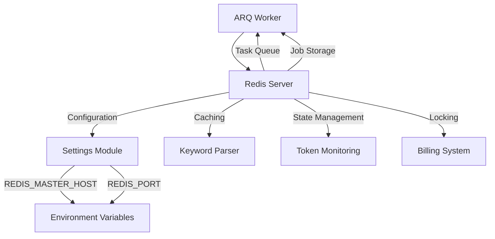
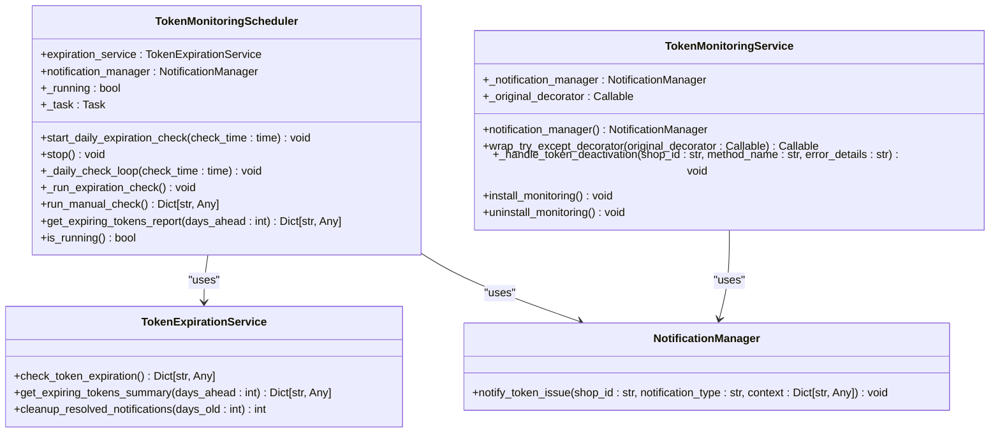
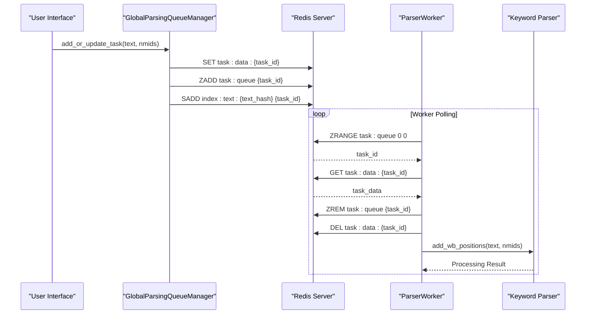

# Background Processing

<cite>
**Referenced Files in This Document**   
- [workers.py](file://app/arq_workers/workers.py)
- [arq_redis_settings.py](file://app/arq_workers/arq_redis_settings.py)
- [settings_master.py](file://app/settings/settings_master.py)
- [scheduler.py](file://app/modules/token_monitoring/scheduler.py)
- [token_monitoring_service.py](file://app/modules/token_monitoring/services/token_monitoring_service.py)
- [parser_worker.py](file://app/modules/wb_keywords_parser/parser_worker.py)
- [global_parsing_queue_manager.py](file://app/modules/wb_keywords_parser/global_parsing_queue_manager.py)
- [parsing_task.py](file://app/modules/wb_keywords_parser/parsing_task.py)
- [tasks.py](file://app/modules/adv_creator/backend/tasks.py)
- [update_wb_adv_phrases_in_neo.py](file://app/modules/wb_adv_updater/update_wb_adv_phrases_in_neo.py)
- [redis_lock.py](file://app/modules/billing/redis_lock.py)
</cite>

## Table of Contents
1. [Introduction](#introduction)
2. [ARQ Worker Implementation](#arq-worker-implementation)
3. [Redis Configuration](#redis-configuration)
4. [Scheduled Tasks](#scheduled-tasks)
5. [Real-time Update Mechanisms](#real-time-update-mechanisms)
6. [Background Task Examples](#background-task-examples)
7. [Task Lifecycle and Error Handling](#task-lifecycle-and-error-handling)
8. [Monitoring and Scaling](#monitoring-and-scaling)
9. [Common Issues and Troubleshooting](#common-issues-and-troubleshooting)
10. [Conclusion](#conclusion)

## Introduction
The adv-bot system implements a comprehensive background processing architecture to handle various asynchronous tasks, scheduled operations, and real-time updates. This document details the implementation of the ARQ-based worker system, Redis configuration, scheduled tasks through the token_monitoring scheduler, and event-driven architectures using Redis pub/sub patterns. The system is designed to efficiently process background jobs such as shop updates, keyword parsing, prediction services, and other critical operations while maintaining reliability and scalability.

## ARQ Worker Implementation

The background processing system in adv-bot is built on the ARQ framework, which provides a robust task queuing and processing mechanism. The implementation centers around the WorkerSettings class defined in the workers.py module, which configures the ARQ worker with specific functions, Redis settings, and lifecycle hooks.

The ARQ worker is configured to process tasks asynchronously, with a focus on creating complex advertising campaigns through the create_complex_advs function. The worker includes startup and shutdown hooks that initialize and clean up resources such as the bot instance and HTTP client session. During startup, the worker initializes the bot instance and stores it in the context, making it available for task execution. The shutdown process ensures proper cleanup by closing the bot session and HTTP client session.

The worker configuration includes several important parameters: keep_jobs is set to 86400 seconds (24 hours), allowing completed jobs to remain in Redis for a full day for potential inspection or debugging; max_tries is set to 10, providing robust retry capabilities for failed tasks; and job_timeout is set to 86400 seconds, allowing long-running tasks to complete without premature termination.

**Section sources**
- [workers.py](file://app/arq_workers/workers.py#L1-L51)

## Redis Configuration

Redis serves as the backbone of the background processing system in adv-bot, providing both task queuing capabilities through ARQ and general caching and data storage functionality. The Redis configuration is centralized in the arq_redis_settings.py file, which imports settings from the main application configuration and creates a RedisSettings object for ARQ to use.

The Redis connection is configured using environment variables, specifically REDIS_MASTER_HOST and REDIS_PORT, with a default port of 6379 if not specified. This configuration allows for flexible deployment across different environments while maintaining consistency in the connection approach. The settings module also includes REDIS_REPLICA_HOST for read operations, enabling a master-replica setup for improved performance and reliability.

Beyond ARQ integration, Redis is extensively used throughout the application for various purposes including caching parsed keyword data, storing temporary state information, and managing locks for critical operations. The application implements multiple Redis manager classes that extend base Redis functionality with specific mixins for different use cases, such as billing operations and prediction services.

**Diagram sources**
- [arq_redis_settings.py](file://app/arq_workers/arq_redis_settings.py#L1-L6)
- [settings_master.py](file://app/settings/settings_master.py#L1-L434)

## Scheduled Tasks

The adv-bot system implements scheduled tasks through the token_monitoring module, which includes a scheduler for regular token expiration checks and other periodic operations. The TokenMonitoringScheduler class provides a robust framework for executing tasks at specified intervals, with the primary function being daily token expiration checks.

The scheduler is designed to run daily at a configurable time (defaulting to 9:00 AM), checking for tokens that are approaching expiration. It calculates the time until the next scheduled run and uses asyncio.sleep to wait until that time, then executes the expiration check. This approach ensures that the check runs at the same time each day, regardless of when the application was started.

In addition to the daily expiration check, the scheduler includes functionality for cleaning up old resolved notifications on a weekly basis (every Monday). This helps maintain database cleanliness and performance by removing historical notification data that is no longer needed. The scheduler also provides methods for manual execution of checks and generating reports of expiring tokens, allowing administrators to run checks on demand or retrieve information about upcoming expirations.

The token monitoring system also includes a service layer that detects token deactivation events during API calls. When an ApiForbiddenError is encountered, the system triggers notifications to alert administrators of the issue, creating a comprehensive monitoring solution that handles both proactive expiration checks and reactive deactivation detection.

**Diagram sources**
- [scheduler.py](file://app/modules/token_monitoring/scheduler.py#L1-L186)
- [token_monitoring_service.py](file://app/modules/token_monitoring/services/token_monitoring_service.py#L1-L209)

## Real-time Update Mechanisms

The adv-bot system implements real-time update mechanisms through a combination of Redis-based queuing and event-driven architectures. The keyword parsing system exemplifies this approach, using a global parsing queue manager to coordinate tasks across multiple worker processes.

The GlobalParsingQueueManager class implements a Redis-backed priority queue for keyword parsing tasks. It uses Redis sorted sets (zset) to maintain task order based on submission time, ensuring that older tasks are processed first. Each task is assigned a unique ID based on a hash of the keyword text, preventing duplicate tasks for the same keyword. The manager also maintains an index of tasks by text hash, allowing for efficient lookup and deduplication.

The parser worker system implements a pool of worker processes that continuously poll the task queue for new work. Each worker runs in an infinite loop, retrieving tasks from the queue and processing them using the keyword parser. The workers are designed to handle failures gracefully, with error logging and automatic retry capabilities. The system uses an asyncio.Lock to ensure thread-safe access to the queue, preventing race conditions when multiple workers attempt to retrieve tasks simultaneously.

This architecture enables real-time processing of keyword parsing requests as they are submitted by users, with minimal delay between request and processing. The use of Redis as an intermediary allows for horizontal scaling of worker processes, as additional workers can be added to handle increased load without modifying the core architecture.

**Diagram sources**
- [global_parsing_queue_manager.py](file://app/modules/wb_keywords_parser/global_parsing_queue_manager.py#L1-L131)
- [parser_worker.py](file://app/modules/wb_keywords_parser/parser_worker.py#L1-L80)
- [parsing_task.py](file://app/modules/wb_keywords_parser/parsing_task.py#L1-L25)

## Background Task Examples

The adv-bot system implements several key background tasks that demonstrate the versatility of the ARQ and Redis-based processing architecture. These tasks include shop updates, keyword parsing, prediction services, and data synchronization operations.

The create_complex_advs task is a prime example of a complex background operation that creates comprehensive advertising campaigns. This task handles the entire workflow of creating both automatic and search advertising campaigns for a specified product (nmid) in a specific shop. It includes comprehensive error handling for various failure scenarios, such as insufficient balance, missing product cards, or API permission issues. When errors occur, the task sends appropriate notifications to the user and implements retry logic with exponential backoff.

Another important background task is the update_wb_adv_phrases_in_neo operation, which synchronizes advertising keyword data between ClickHouse and Neo4j databases. This task retrieves active advertising campaigns and their associated keywords, processes the text data by cleaning and vectorizing it, and then updates the Neo4j graph database with the latest information. The task processes data in batches to optimize performance and includes checks to avoid redundant updates by verifying whether phrases already exist in the target database.

The system also includes specialized tasks for billing operations, implemented through the RedisLock class which manages concurrency control for financial transactions. This ensures that billing operations are processed atomically and prevents race conditions that could lead to incorrect balance calculations.

**Section sources**
- [tasks.py](file://app/modules/adv_creator/backend/tasks.py#L1-L109)
- [update_wb_adv_phrases_in_neo.py](file://app/modules/wb_adv_updater/update_wb_adv_phrases_in_neo.py#L1-L101)
- [redis_lock.py](file://app/modules/billing/redis_lock.py#L1-L27)

## Task Lifecycle and Error Handling

The adv-bot background processing system implements a comprehensive task lifecycle management approach with robust error handling and retry mechanisms. Each task follows a well-defined lifecycle from creation to completion, with multiple safeguards to ensure reliability and data consistency.

Tasks are created with specific parameters and submitted to the ARQ queue for processing. During execution, tasks have access to shared resources through the context object, including the bot instance and HTTP client session. The system implements structured error handling with specific exception types for different failure modes, allowing for targeted recovery strategies.

For retry mechanisms, the system uses ARQ's built-in retry functionality with a maximum of 10 attempts. When a task encounters a transient error, it raises a Retry exception with a specified defer time, causing ARQ to reschedule the task after the specified delay. This approach allows the system to handle temporary issues such as network connectivity problems or API rate limiting without losing work.

The error handling strategy varies by task type. For user-facing operations like campaign creation, the system sends informative error messages to users through the bot interface, explaining the issue and suggesting potential solutions. For system-level operations, detailed error logging is implemented to aid in debugging and monitoring. The system also includes circuit breaker patterns in some components to prevent cascading failures when external services are unavailable.

Task completion is tracked through ARQ's job storage, with completed jobs retained for 24 hours to allow for auditing and debugging. The system also implements cleanup operations for temporary data and locks to ensure that resources are properly released even in error conditions.

**Section sources**
- [workers.py](file://app/arq_workers/workers.py#L1-L51)
- [tasks.py](file://app/modules/adv_creator/backend/tasks.py#L1-L109)

## Monitoring and Scaling

The adv-bot background processing system includes several features to support monitoring and scaling of worker processes. The architecture is designed to be horizontally scalable, allowing additional worker instances to be added to handle increased load.

Monitoring is implemented through comprehensive logging using Python's logging module, with structured log messages that include relevant context for debugging and analysis. The system logs key events such as worker startup and shutdown, task processing, and error conditions. These logs can be collected and analyzed to monitor system health and performance.

The Redis-based task queue naturally supports multiple worker processes, as each worker independently polls the queue for tasks. This allows the system to scale processing capacity by simply adding more worker instances. The number of parallel tasks per worker can be configured, allowing fine-tuning of resource utilization based on available CPU, memory, and network bandwidth.

Performance tuning can be achieved through several configuration parameters, including the number of worker processes, the maximum number of parallel tasks per worker, and Redis connection settings. The system also includes circuit breakers and rate limiting to prevent overwhelming external APIs and to maintain stability under heavy load.

For production deployments, the system can be configured with worker pools of appropriate size based on expected workload, with monitoring in place to detect performance bottlenecks and trigger scaling operations as needed.

**Section sources**
- [workers.py](file://app/arq_workers/workers.py#L1-L51)
- [parser_worker.py](file://app/modules/wb_keywords_parser/parser_worker.py#L1-L80)
- [settings_master.py](file://app/settings/settings_master.py#L1-L434)

## Common Issues and Troubleshooting

The adv-bot background processing system may encounter several common issues that require troubleshooting and resolution. Understanding these issues and their solutions is critical for maintaining system reliability and performance.

Task queuing delays can occur when the worker pool is undersized for the current workload or when individual tasks take longer than expected to complete. This can be addressed by monitoring queue length and adding additional worker processes to increase processing capacity. The system logs can be analyzed to identify tasks that are taking longer than expected, which may indicate performance bottlenecks in specific operations.

Worker failures can occur due to various reasons, including resource exhaustion, unhandled exceptions, or external service outages. The system includes automatic restart capabilities through process managers, but persistent failures should be investigated by examining error logs and stack traces. Implementing proper exception handling and resource management can prevent many common failure modes.

Redis connectivity issues can disrupt background processing, as Redis is critical for task queuing and state management. Ensuring proper Redis configuration, including connection pooling and timeout settings, can mitigate these issues. Monitoring Redis memory usage and performance metrics can help identify potential problems before they impact system operation.

Deadlocks or race conditions can occur in systems with multiple workers accessing shared resources. The use of Redis locks and atomic operations helps prevent these issues, but careful design of critical sections is necessary to ensure data consistency. Implementing proper timeout mechanisms for locks and monitoring for long-held locks can help identify potential deadlock situations.

**Section sources**
- [workers.py](file://app/arq_workers/workers.py#L1-L51)
- [parser_worker.py](file://app/modules/wb_keywords_parser/parser_worker.py#L1-L80)
- [redis_lock.py](file://app/modules/billing/redis_lock.py#L1-L27)

## Conclusion

The adv-bot background processing system provides a robust and scalable architecture for handling asynchronous tasks, scheduled operations, and real-time updates. By leveraging ARQ for task queuing and processing, Redis for data storage and coordination, and asyncio for efficient concurrency, the system achieves high performance and reliability.

The implementation demonstrates best practices in background processing, including proper error handling, retry mechanisms, monitoring, and scalability. The separation of concerns between task definition, queue management, and worker execution allows for flexible configuration and maintenance.

Future enhancements could include more sophisticated scheduling capabilities, improved monitoring and alerting, and enhanced scaling mechanisms based on dynamic workload analysis. The current architecture provides a solid foundation for these improvements while effectively meeting the current requirements for background processing in the adv-bot system.