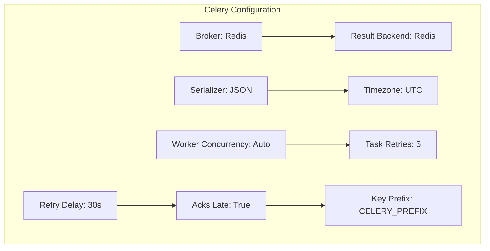
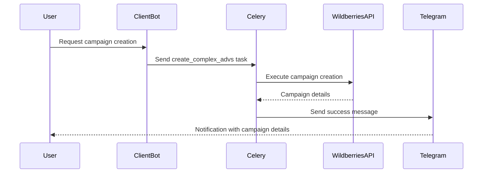
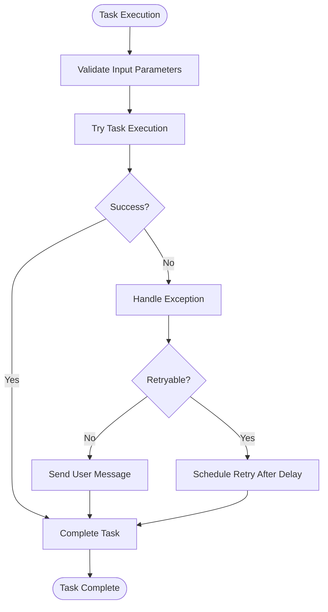
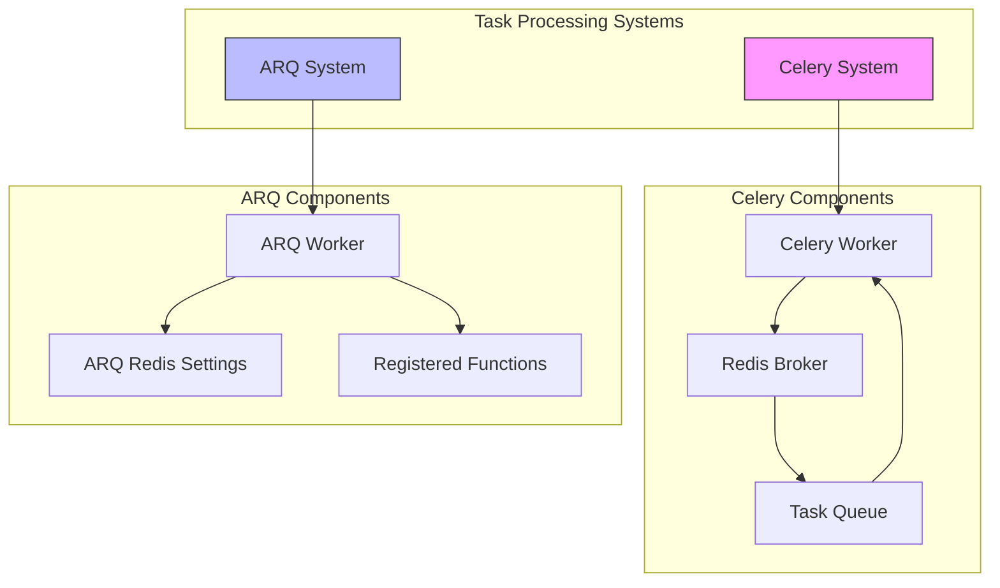
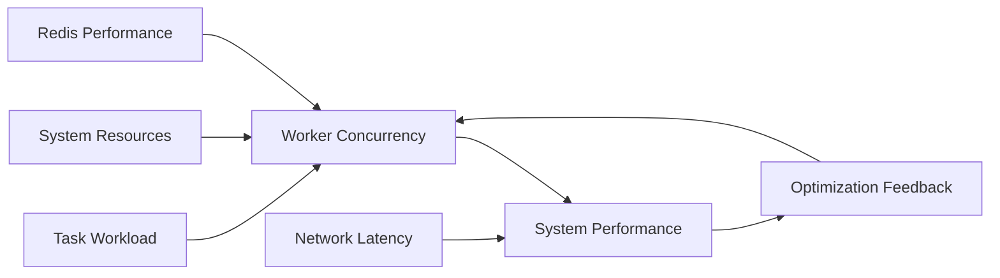
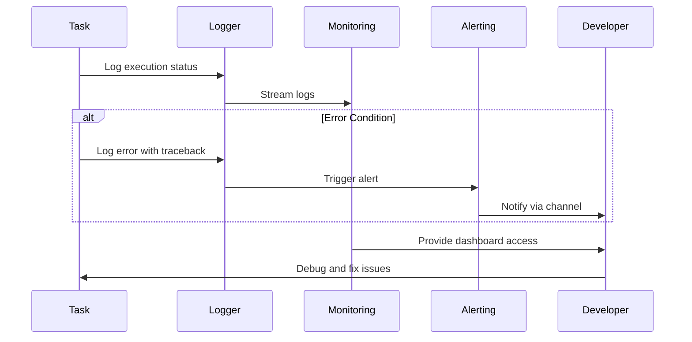
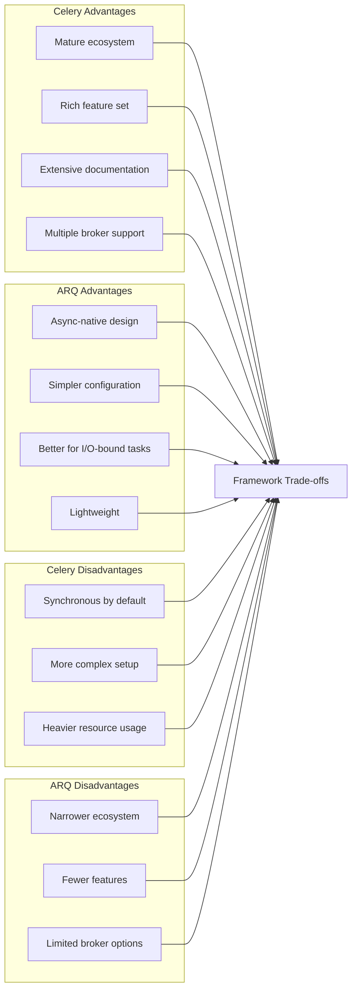

# Celery Integration

<cite>
**Referenced Files in This Document**   
- [celeryconfig.py](file://celeryconfig.py)
- [tasks.py](file://app/modules/adv_creator/backend/tasks.py)
- [workers.py](file://app/arq_workers/workers.py)
- [arq_redis_settings.py](file://app/arq_workers/arq_redis_settings.py)
- [settings_master.py](file://app/settings/settings_master.py)
</cite>

## Table of Contents
1. [Introduction](#introduction)
2. [Celery Configuration](#celery-configuration)
3. [Task Definition and Execution](#task-definition-and-execution)
4. [Error Handling and Retries](#error-handling-and-retries)
5. [Integration with ARQ](#integration-with-arq)
6. [Scaling and Performance](#scaling-and-performance)
7. [Monitoring and Debugging](#monitoring-and-debugging)
8. [Trade-offs Between Celery and ARQ](#trade-offs-between-celery-and-arq)
9. [Best Practices](#best-practices)

## Introduction
This document provides comprehensive documentation for the Celery integration within the system. It details the configuration, task management, error handling, and operational aspects of Celery in the context of background processing. The system employs both Celery and ARQ for distributed task processing, with Celery primarily handling complex advertising campaign creation tasks. This documentation covers the architectural decisions, configuration parameters, and operational guidelines for maintaining both systems effectively.

## Celery Configuration

The Celery integration is configured through the `celeryconfig.py` file, which defines all essential parameters for message brokering, result storage, serialization, and worker behavior. The configuration leverages Redis as both the message broker and result backend, ensuring consistent data storage and retrieval patterns across the distributed system.

**Diagram sources**
- [celeryconfig.py](file://celeryconfig.py#L1-L35)

**Section sources**
- [celeryconfig.py](file://celeryconfig.py#L1-L35)
- [settings_master.py](file://app/settings/settings_master.py#L1-L369)

### Broker and Result Backend Configuration
The system uses Redis as both the message broker and result backend, with both configured to use the same Redis instance on database 1. The broker URL and result backend are dynamically constructed using the `REDIS_MASTER_HOST` setting from the application configuration, ensuring environment-specific deployment flexibility.

The configuration includes a global key prefix derived from the `CELERY_PREFIX` environment variable, which helps isolate Celery operations within the Redis instance and prevents key collisions in shared Redis environments.

### Serialization and Time Settings
Celery is configured to use JSON for both task and result serialization, ensuring compatibility across different services and ease of debugging. The timezone is set to UTC with UTC enabled, providing consistent time handling across distributed components regardless of their physical location.

### Worker Configuration
Worker concurrency is set to 0, allowing Celery to automatically determine the optimal number of worker processes based on the available CPU cores. This auto-scaling approach maximizes resource utilization while preventing over-provisioning on systems with limited computational resources.

The configuration enables late acknowledgments (`task_acks_late=True`), meaning tasks are only acknowledged after successful completion. This prevents task loss in scenarios where workers fail during task execution, ensuring exactly-once semantics for critical operations.

## Task Definition and Execution

Celery tasks are defined in the `app/modules/adv_creator/backend/tasks.py` module, with the primary task being `create_complex_advs`. This task is responsible for creating complex advertising campaigns on the Wildberries platform, coordinating between auto and search advertising campaigns.

**Diagram sources**
- [tasks.py](file://app/modules/adv_creator/backend/tasks.py#L1-L107)
- [workers.py](file://app/arq_workers/workers.py#L1-L51)

**Section sources**
- [tasks.py](file://app/modules/adv_creator/backend/tasks.py#L1-L107)
- [workers.py](file://app/arq_workers/workers.py#L1-L51)

### Task Implementation
The `create_complex_advs` task follows a robust error handling pattern, catching specific exceptions and providing appropriate user feedback through the Telegram bot interface. The task implementation separates the main logic into a private `_create_complex_advs` function, allowing for cleaner error handling in the public interface.

When a task encounters a retryable exception, it raises an `arq.Retry` exception with a specified defer time, ensuring the task will be retried after the specified delay. For non-retryable errors, the task sends an appropriate message to the user and returns without raising an exception, preventing infinite retry loops for errors that cannot be resolved by repetition.

### Task Inclusion and Routing
The Celery configuration specifies which tasks to include through the `include` directive, which lists the modules containing Celery tasks. In this system, only the `app.modules.adv_creator.backend.tasks` module is included, indicating a focused use case for Celery within the application architecture.

## Error Handling and Retries

The system implements a comprehensive error handling strategy for Celery tasks, combining Celery's built-in retry mechanisms with application-specific exception handling.

**Diagram sources**
- [tasks.py](file://app/modules/adv_creator/backend/tasks.py#L1-L107)
- [celeryconfig.py](file://celeryconfig.py#L1-L35)

**Section sources**
- [tasks.py](file://app/modules/adv_creator/backend/tasks.py#L1-L107)
- [celeryconfig.py](file://celeryconfig.py#L1-L35)

### Built-in Retry Mechanisms
Celery is configured with automatic retry capabilities, with tasks set to retry up to 5 times (`task_retries=5`) with a 30-second delay between attempts (`task_retry_delay=30`). This configuration balances the need for resilience against transient failures with the requirement to avoid overwhelming external services with rapid retry attempts.

The `task_reject_on_worker_lost=True` setting ensures that tasks are re-queued if a worker process is unexpectedly terminated, preventing task loss during worker crashes or restarts.

### Application-Level Error Handling
The task implementation includes specific handling for various error conditions encountered when interacting with the Wildberries API:

- `ApiForbiddenError`: Indicates insufficient permissions, prompting the user to contact support
- `CardsNotFoundForShopError`: Indicates the product card doesn't exist on Wildberries
- `NotEnoughBalanceOnShopError`: Indicates insufficient funds for campaign creation
- `AdvNotFoundInWBError`: Indicates a campaign creation failure
- `StartComplexAdvError`: Indicates a failure to start created campaigns

Each error type triggers a specific user notification, providing clear guidance on the next steps required to resolve the issue.

## Integration with ARQ

The system employs both Celery and ARQ for background task processing, representing a hybrid approach to distributed task management. While Celery handles the complex advertising campaign creation tasks, ARQ is used for other background processing needs.

**Diagram sources**
- [workers.py](file://app/arq_workers/workers.py#L1-L51)
- [arq_redis_settings.py](file://app/arq_workers/arq_redis_settings.py#L1-L6)
- [celeryconfig.py](file://celeryconfig.py#L1-L35)

**Section sources**
- [workers.py](file://app/arq_workers/workers.py#L1-L51)
- [arq_redis_settings.py](file://app/arq_workers/arq_redis_settings.py#L1-L6)

### ARQ Worker Configuration
The ARQ worker configuration in `workers.py` defines a `WorkerSettings` class that specifies the functions to be processed, Redis connection settings, and lifecycle hooks. The `startup` and `shutdown` functions handle initialization and cleanup of resources such as the Telegram bot instance and HTTP client session.

ARQ is configured with different operational parameters than Celery:
- `keep_jobs=86400`: Jobs are retained in Redis for 24 hours
- `max_tries=10`: Maximum of 10 retry attempts
- `job_timeout=86400`: Maximum job execution time of 24 hours

These settings reflect ARQ's use for potentially longer-running tasks compared to Celery's more immediate processing requirements.

## Scaling and Performance

The Celery configuration is designed to scale efficiently based on system resources and workload demands. The automatic concurrency setting (`worker_concurrency=0`) allows Celery to determine the optimal number of worker processes based on the available CPU cores, maximizing throughput without overloading the system.

**Diagram sources**
- [celeryconfig.py](file://celeryconfig.py#L1-L35)
- [settings_master.py](file://app/settings/settings_master.py#L1-L369)

**Section sources**
- [celeryconfig.py](file://celeryconfig.py#L1-L35)

### Resource Management
The system employs several strategies to manage resources effectively:

1. **Connection Management**: The ARQ worker establishes a single HTTP client session shared across all tasks, reducing connection overhead and improving performance.

2. **Database Connection Pooling**: The application uses connection pooling for database access, with configurable pool size and overflow settings defined in the environment variables.

3. **Redis Key Prefixing**: The use of a global key prefix (`CELERY_PREFIX`) prevents naming conflicts in shared Redis instances and enables easier monitoring and management of Celery-related keys.

4. **Task Acknowledgment Strategy**: Late acknowledgment ensures that tasks are only removed from the queue after successful completion, preventing data loss during worker failures.

## Monitoring and Debugging

Effective monitoring and debugging are critical for maintaining the reliability of distributed task processing systems. The implementation includes comprehensive logging and error reporting mechanisms.

**Diagram sources**
- [tasks.py](file://app/modules/adv_creator/backend/tasks.py#L1-L107)
- [workers.py](file://app/arq_workers/workers.py#L1-L51)

**Section sources**
- [tasks.py](file://app/modules/adv_creator/backend/tasks.py#L1-L107)
- [workers.py](file://app/arq_workers/workers.py#L1-L51)

### Logging Strategy
The system uses Python's standard logging module with a configured logger instance in each module. Error conditions are logged with full traceback information using `exc_info=True`, providing complete context for debugging issues.

The logging level is configurable via the `LOG_LEVEL` environment variable, allowing for adjustment of verbosity based on the deployment environment (e.g., DEBUG in development, ERROR in production).

### Debugging Considerations
When debugging Celery tasks, developers should consider:

1. **Task State**: Check the task's state in Redis to determine if it's pending, in progress, or completed.
2. **Error Logs**: Examine the application logs for any exceptions or error messages related to the task.
3. **Retry Count**: Verify the number of retry attempts and whether the task has exceeded the maximum retry limit.
4. **Resource Availability**: Ensure that required resources (database connections, API tokens, etc.) are available and properly configured.

## Trade-offs Between Celery and ARQ

The decision to use both Celery and ARQ in the same system represents a strategic choice to leverage the strengths of each framework for different use cases.

**Diagram sources**
- [celeryconfig.py](file://celeryconfig.py#L1-L35)
- [workers.py](file://app/arq_workers/workers.py#L1-L51)

**Section sources**
- [celeryconfig.py](file://celeryconfig.py#L1-L35)
- [workers.py](file://app/arq_workers/workers.py#L1-L51)

### Strategic Usage
Based on the codebase analysis, Celery appears to be used for more complex, business-critical tasks (like advertising campaign creation) that benefit from its mature feature set and reliability guarantees. ARQ, being async-native and lightweight, is likely better suited for simpler, I/O-bound tasks that can take full advantage of Python's async/await capabilities.

This hybrid approach allows the system to optimize for both reliability and performance, using the right tool for each type of background processing need.

## Best Practices

To maintain both Celery and ARQ systems effectively, the following best practices should be observed:

### Configuration Management
- Use environment variables for all configuration parameters to enable environment-specific settings
- Maintain consistent naming conventions for configuration variables across both systems
- Document all configuration options and their acceptable values

### Error Handling
- Implement specific exception handling for known error conditions
- Provide clear user feedback for recoverable errors
- Use appropriate retry strategies based on error type
- Log sufficient context for debugging without exposing sensitive information

### Monitoring and Alerting
- Implement comprehensive logging with appropriate log levels
- Set up monitoring for task queue lengths, worker utilization, and error rates
- Configure alerts for critical failures or performance degradation
- Regularly review task execution metrics to identify bottlenecks

### Scaling Considerations
- Monitor system resource usage and adjust worker concurrency accordingly
- Consider using different worker pools for different task types
- Implement rate limiting for external API calls to prevent throttling
- Use connection pooling for database and HTTP connections

### Maintenance
- Regularly review and update dependencies for both Celery and ARQ
- Test task execution under various failure conditions
- Document task dependencies and execution requirements
- Implement graceful shutdown procedures for workers

By following these best practices, the system can maintain high reliability and performance in its background task processing capabilities.