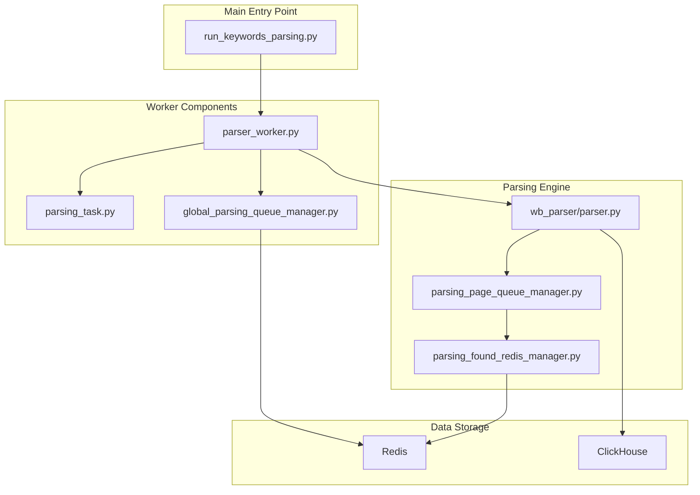
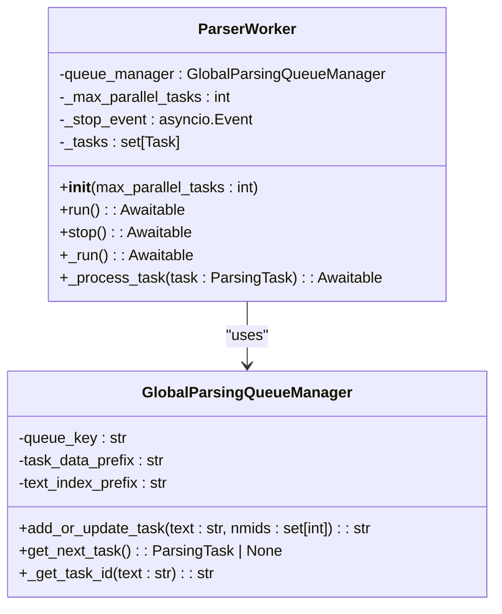
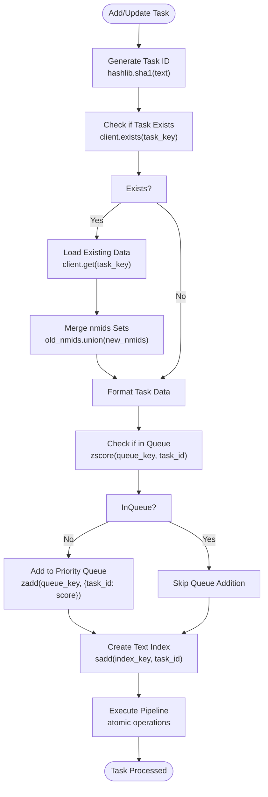
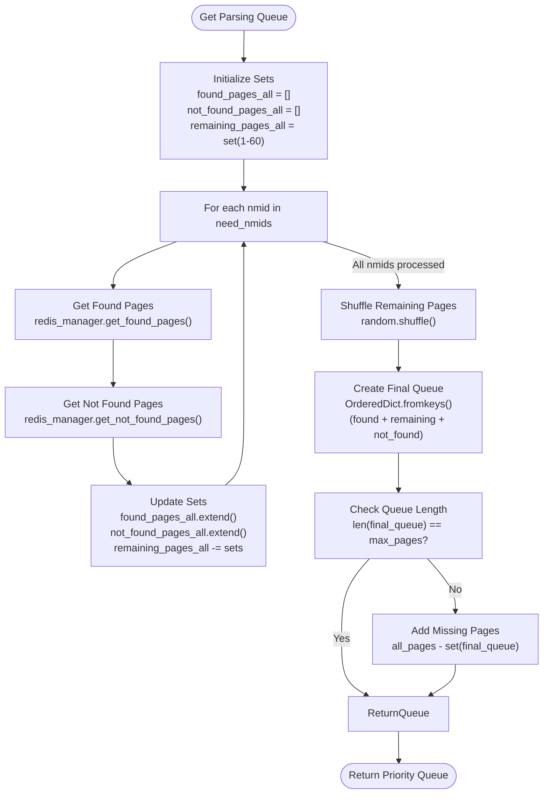
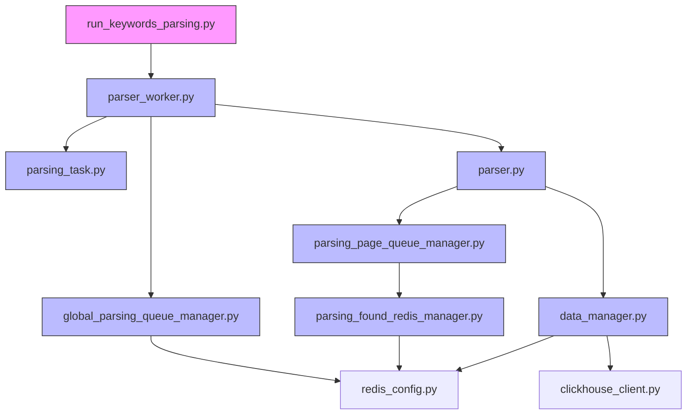

# Keywords Parsing Worker

<cite>
**Referenced Files in This Document**   
- [run_keywords_parsing.py](file://run_keywords_parsing.py)
- [parser_worker.py](file://app/modules/wb_keywords_parser/parser_worker.py)
- [parsing_task.py](file://app/modules/wb_keywords_parser/parsing_task.py)
- [global_parsing_queue_manager.py](file://app/modules/wb_keywords_parser/global_parsing_queue_manager.py)
- [parser.py](file://app/modules/wb_keywords_parser/wb_parser/parser.py)
- [parsing_page_queue_manager.py](file://app/modules/wb_keywords_parser/wb_parser/parsing_page_queue_manager.py)
- [parsing_found_redis_manager.py](file://app/modules/wb_keywords_parser/parsing_found_redis_manager.py)
- [data_manager.py](file://app/modules/wb_adv_updater/data_manager.py)
- [parsing_queue_settings.py](file://app/settings/parsing_queue_settings.py)
- [redis_config.py](file://app/configs/infrastructure_config/redis_config.py)
</cite>

## Table of Contents
1. [Introduction](#introduction)
2. [Project Structure](#project-structure)
3. [Core Components](#core-components)
4. [Architecture Overview](#architecture-overview)
5. [Detailed Component Analysis](#detailed-component-analysis)
6. [Dependency Analysis](#dependency-analysis)
7. [Performance Considerations](#performance-considerations)
8. [Troubleshooting Guide](#troubleshooting-guide)
9. [Conclusion](#conclusion)

## Introduction
The Keywords Parsing Worker system is responsible for tracking keyword positions on Wildberries by parsing search results and storing the data in Redis and ClickHouse. The system uses a distributed queue architecture with multiple components working together to efficiently process keyword queries while respecting API rate limits and ensuring data consistency.

## Project Structure



**Diagram sources**
- [run_keywords_parsing.py](file://run_keywords_parsing.py)
- [parser_worker.py](file://app/modules/wb_keywords_parser/parser_worker.py)
- [parsing_task.py](file://app/modules/wb_keywords_parser/parsing_task.py)
- [global_parsing_queue_manager.py](file://app/modules/wb_keywords_parser/global_parsing_queue_manager.py)
- [parser.py](file://app/modules/wb_keywords_parser/wb_parser/parser.py)
- [parsing_page_queue_manager.py](file://app/modules/wb_keywords_parser/wb_parser/parsing_page_queue_manager.py)
- [parsing_found_redis_manager.py](file://app/modules/wb_keywords_parser/parsing_found_redis_manager.py)

**Section sources**
- [run_keywords_parsing.py](file://run_keywords_parsing.py)
- [parser_worker.py](file://app/modules/wb_keywords_parser/parser_worker.py)

## Core Components

The keywords parsing system consists of several core components that work together to process keyword position tracking requests. The main entry point is run_keywords_parsing.py, which initializes the ParserWorker with the configured number of parallel tasks. The ParserWorker coordinates with the GlobalParsingQueueManager to retrieve parsing tasks and process them through the WB parser service.

The system uses a task-based architecture where each parsing task contains a keyword and a set of nmids to track. Tasks are managed in a Redis-backed priority queue that ensures efficient processing and prevents duplicate work. The parsing results are stored in both Redis for fast access and ClickHouse for long-term analytics.

**Section sources**
- [run_keywords_parsing.py](file://run_keywords_parsing.py)
- [parser_worker.py](file://app/modules/wb_keywords_parser/parser_worker.py)
- [parsing_task.py](file://app/modules/wb_keywords_parser/parsing_task.py)

## Architecture Overview

```mermaid
sequenceDiagram
participant Client as "Keyword Request"
participant Queue as "GlobalParsingQueueManager"
participant Worker as "ParserWorker"
participant Parser as "WB Parser Service"
participant Redis as "Redis Storage"
participant ClickHouse as "ClickHouse DB"
Client->>Queue : add_or_update_task(keyword, nmids)
loop Worker Processing
Worker->>Queue : get_next_task()
alt Task Available
Queue-->>Worker : ParsingTask
Worker->>Parser : add_wb_positions(task.keyword, task.nmids)
Parser->>Wildberries : HTTP GET (search API)
Wildberries-->>Parser : Search Results
Parser->>Redis : Store position data
Parser->>ClickHouse : Store position data
Parser-->>Worker : Processing Complete
Worker->>Queue : Task Removed
else No Task
Queue-->>Worker : None
Worker : Wait 1 second
end
end
```

**Diagram sources**
- [global_parsing_queue_manager.py](file://app/modules/wb_keywords_parser/global_parsing_queue_manager.py)
- [parser_worker.py](file://app/modules/wb_keywords_parser/parser_worker.py)
- [parser.py](file://app/modules/wb_keywords_parser/wb_parser/parser.py)
- [parsing_found_redis_manager.py](file://app/modules/wb_keywords_parser/parsing_found_redis_manager.py)
- [data_manager.py](file://app/modules/wb_adv_updater/data_manager.py)

## Detailed Component Analysis

### Parser Worker Analysis

The ParserWorker class is the main processing unit that manages multiple concurrent parsing tasks. It creates a configurable number of worker processes that continuously poll the global parsing queue for tasks. Each worker acquires a lock before retrieving a task to prevent race conditions.



**Diagram sources**
- [parser_worker.py](file://app/modules/wb_keywords_parser/parser_worker.py)
- [global_parsing_queue_manager.py](file://app/modules/wb_keywords_parser/global_parsing_queue_manager.py)

**Section sources**
- [parser_worker.py](file://app/modules/wb_keywords_parser/parser_worker.py)

### Parsing Task Management

The parsing system uses a sophisticated task management approach that combines deduplication, merging, and prioritization. When a new task is added with the same keyword as an existing task, the system merges the nmids sets rather than creating a duplicate task.



**Diagram sources**
- [global_parsing_queue_manager.py](file://app/modules/wb_keywords_parser/global_parsing_queue_manager.py)
- [parsing_task.py](file://app/modules/wb_keywords_parser/parsing_task.py)

**Section sources**
- [global_parsing_queue_manager.py](file://app/modules/wb_keywords_parser/global_parsing_queue_manager.py)

### Parsing Engine and Page Management

The parsing engine implements intelligent page scanning logic that optimizes the search process by leveraging historical data about where products were previously found or not found.



**Diagram sources**
- [parsing_page_queue_manager.py](file://app/modules/wb_keywords_parser/wb_parser/parsing_page_queue_manager.py)
- [parsing_found_redis_manager.py](file://app/modules/wb_keywords_parser/parsing_found_redis_manager.py)

**Section sources**
- [parsing_page_queue_manager.py](file://app/modules/wb_keywords_parser/wb_parser/parsing_page_queue_manager.py)

## Dependency Analysis



**Diagram sources**
- [run_keywords_parsing.py](file://run_keywords_parsing.py)
- [parser_worker.py](file://app/modules/wb_keywords_parser/parser_worker.py)
- [global_parsing_queue_manager.py](file://app/modules/wb_keywords_parser/global_parsing_queue_manager.py)
- [parsing_task.py](file://app/modules/wb_keywords_parser/parsing_task.py)
- [parser.py](file://app/modules/wb_keywords_parser/wb_parser/parser.py)
- [parsing_page_queue_manager.py](file://app/modules/wb_keywords_parser/wb_parser/parsing_page_queue_manager.py)
- [parsing_found_redis_manager.py](file://app/modules/wb_keywords_parser/parsing_found_redis_manager.py)
- [data_manager.py](file://app/modules/wb_adv_updater/data_manager.py)
- [redis_config.py](file://app/configs/infrastructure_config/redis_config.py)

**Section sources**
- [run_keywords_parsing.py](file://run_keywords_parsing.py)
- [parser_worker.py](file://app/modules/wb_keywords_parser/parser_worker.py)
- [global_parsing_queue_manager.py](file://app/modules/wb_keywords_parser/global_parsing_queue_manager.py)

## Performance Considerations

The keywords parsing system implements several performance optimizations to handle high volumes of keyword tracking requests efficiently:

1. **Parallel Processing**: The system can process multiple tasks concurrently, with the number of parallel workers configurable via settings.
2. **Task Deduplication**: Identical keyword tasks are merged rather than processed separately, reducing redundant API calls.
3. **Intelligent Page Scanning**: The parsing engine prioritizes pages where products were previously found, reducing unnecessary requests.
4. **Atomic Operations**: Redis operations are performed in pipelines to minimize network round trips.
5. **Rate Limiting**: The system includes built-in delays between requests to respect Wildberries API rate limits.

The system also implements proper error handling and retry mechanisms to ensure reliability during temporary API issues or network problems.

## Troubleshooting Guide

Common issues and their solutions:

1. **Queue Backlog Growth**: If the parsing queue continues to grow, check worker concurrency settings and consider increasing the number of parallel workers.

2. **Missing Position Data**: Verify that the nmids are correctly passed from the task to the parser and that the Wildberries API is returning expected data.

3. **Redis Connection Issues**: Ensure Redis configuration is correct and the Redis server is accessible from the application.

4. **ClickHouse Insertion Failures**: Check ClickHouse connection settings and ensure the target table schema matches the data being inserted.

5. **Rate Limiting Errors**: Monitor Wildberries API response codes and adjust request delays if rate limits are being exceeded.

6. **Memory Leaks**: The system uses asyncio and proper resource management, but monitor for any unbounded growth in task queues or cached data.

**Section sources**
- [parser_worker.py](file://app/modules/wb_keywords_parser/parser_worker.py)
- [global_parsing_queue_manager.py](file://app/modules/wb_keywords_parser/global_parsing_queue_manager.py)
- [parser.py](file://app/modules/wb_keywords_parser/wb_parser/parser.py)

## Conclusion

The Keywords Parsing Worker system provides a robust and scalable solution for tracking keyword positions on Wildberries. By using a distributed queue architecture with Redis as the coordination layer, the system efficiently processes keyword tracking requests while maintaining data consistency across multiple storage systems.

The architecture balances performance and reliability through parallel processing, intelligent task management, and comprehensive error handling. The system's modular design allows for easy tuning of performance parameters and straightforward troubleshooting of common issues.

Key strengths include task deduplication, intelligent page scanning based on historical data, and dual storage in Redis for fast access and ClickHouse for analytics. The system is well-positioned to handle growth in both the number of tracked keywords and the frequency of position updates.