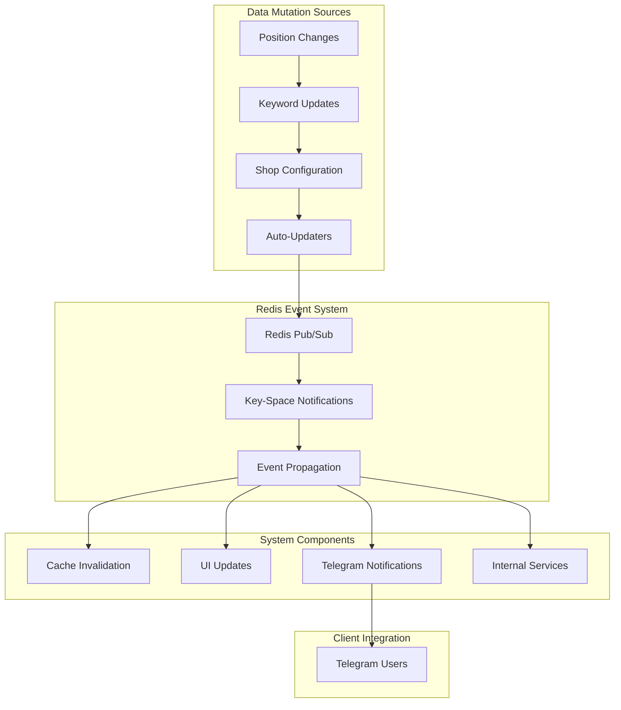
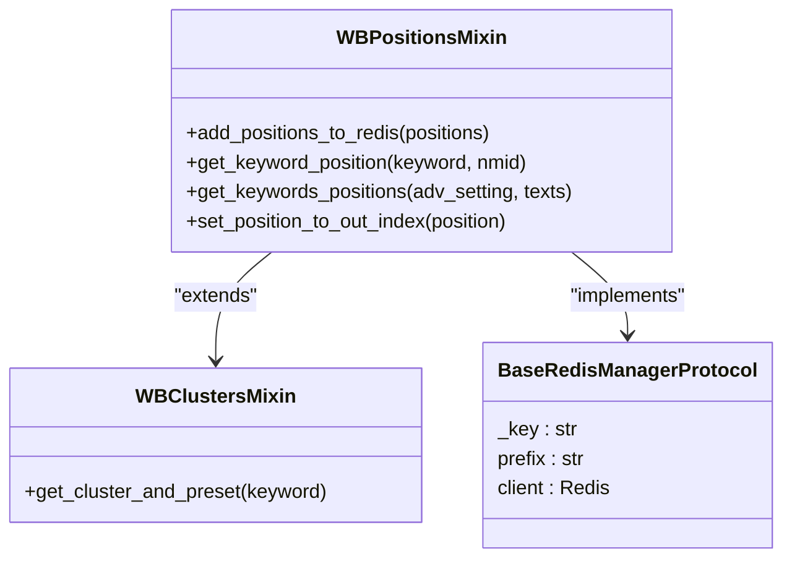
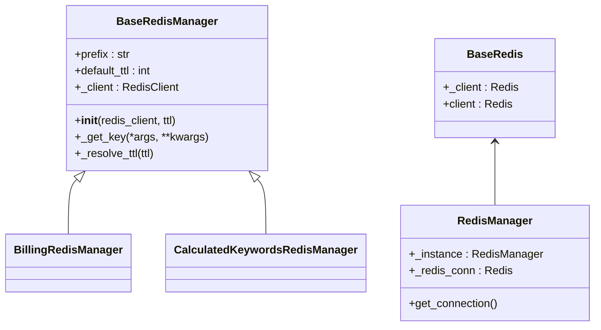
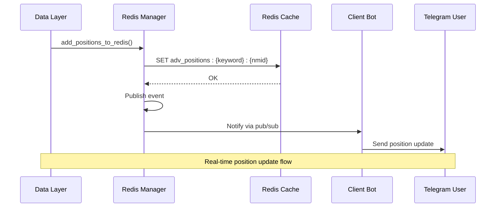
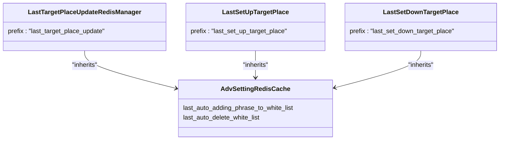
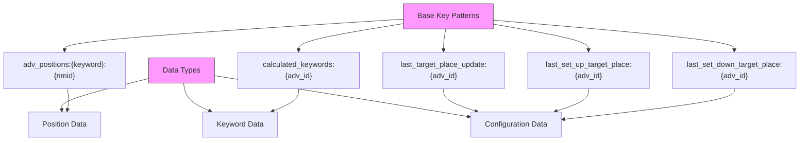
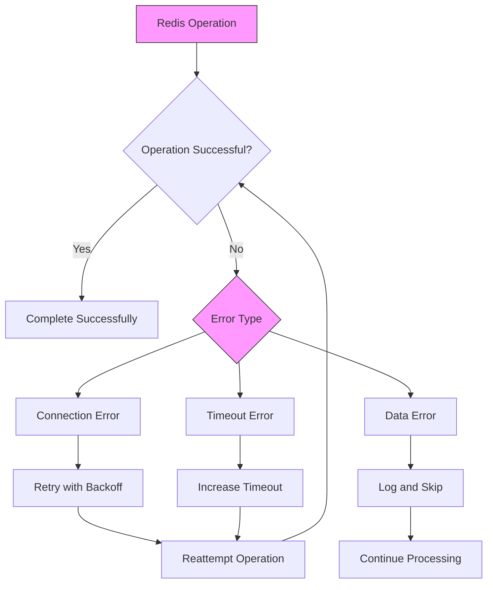
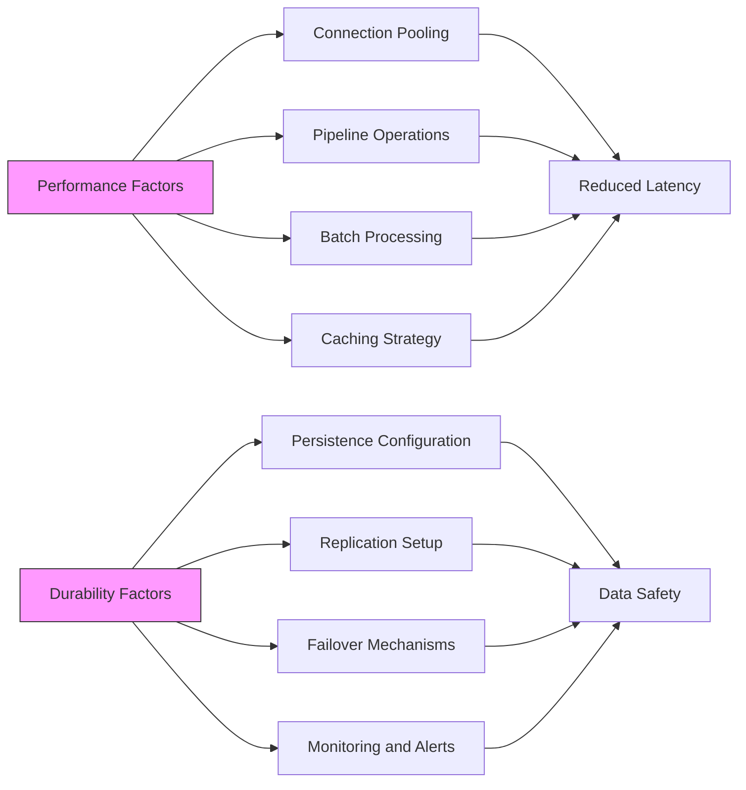
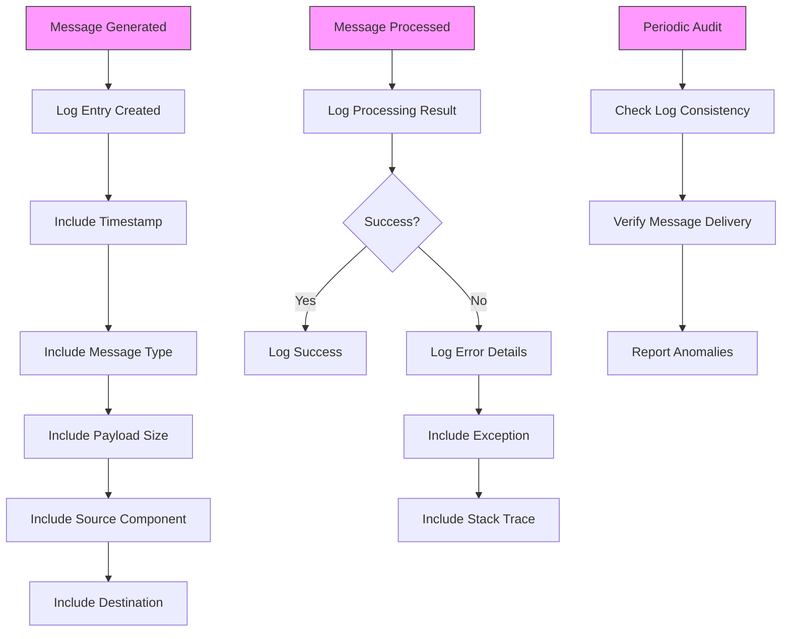
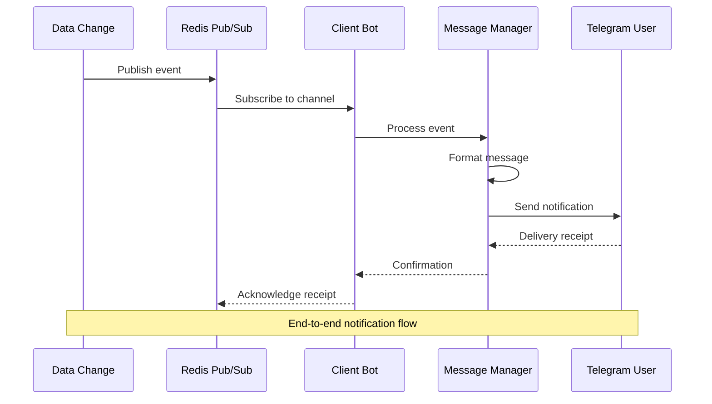

# Real-time Updates

<cite>
**Referenced Files in This Document**   
- [wb_positions.py](file://app/core/redis_manager_v2/mixins/wb_positions.py)
- [redis_manager.py](file://app/client_bot/redis_manager.py)
- [base_redis_manager.py](file://app/core/redis_manager_v2/base_redis_manager.py)
- [base_redis_manager.py](file://app/core/redis_manager/base_redis_manager.py)
- [redis_client.py](file://app/core/redis_manager/redis_client.py)
- [redis_client.py](file://app/core/redis_manager_v2/redis_client.py)
- [redis_config.py](file://app/configs/infrastructure_config/redis_config.py)
- [adv_setting_redis_cache.py](file://app/core/redis_cache/mixins/main_objects_mixins/adv_setting_redis_cache.py)
- [last_target_place_update_redis_manager.py](file://app/modules/shop_runner/service_manager/old_modules/auto_updater_target_place/last_target_place_update_redis_manager.py)
- [target_place_updater_redis_cache.py](file://app/modules/shop_runner/service_manager/old_modules/setting_auto_updater/modules/target_place_updater/redis_cache.py)
- [auto_white_list_updater_redis_cache.py](file://app/modules/shop_runner/service_manager/old_modules/setting_auto_updater/modules/white_list_updater/auto_white_list_updater/redis_cache/redis_cache.py)
- [billing_redis_manager.py](file://app/modules/billing/redis_manager.py)
- [calculated_keywords_redis_cache_manager.py](file://app/modules/calculated_keywords_redis_cache_manager/redis_manager.py)
</cite>

## Table of Contents
1. [Introduction](#introduction)
2. [Redis-Based Event Propagation Architecture](#redis-based-event-propagation-architecture)
3. [Core Components and Mixins](#core-components-and-mixins)
4. [Event Flow and Data Mutation](#event-flow-and-data-mutation)
5. [Channel Naming Conventions and Event Payloads](#channel-naming-conventions-and-event-payloads)
6. [Error Handling and Message Transmission](#error-handling-and-message-transmission)
7. [Performance Considerations and Message Durability](#performance-considerations-and-message-durability)
8. [Debugging Message Flow](#debugging-message-flow)
9. [Integration with Client Bot for Telegram Notifications](#integration-with-client-bot-for-telegram-notifications)
10. [Conclusion](#conclusion)

## Introduction
The adv-bot system implements a robust real-time update mechanism using Redis-based event propagation to ensure immediate synchronization across system components upon data changes. This document details how Redis pub/sub and key-space notifications are leveraged to trigger updates for position changes, keyword updates, and shop configuration modifications. The architecture utilizes specialized Redis mixins such as wb_positions.py and redis_manager.py to manage event publishing and subscription. The system ensures that data mutations result in appropriate cache invalidation or UI updates through real-time channels, maintaining consistency across distributed components.

**Section sources**
- [wb_positions.py](file://app/core/redis_manager_v2/mixins/wb_positions.py#L1-L94)
- [redis_manager.py](file://app/client_bot/redis_manager.py#L1-L23)

## Redis-Based Event Propagation Architecture

**Diagram sources**
- [wb_positions.py](file://app/core/redis_manager_v2/mixins/wb_positions.py#L1-L94)
- [redis_manager.py](file://app/client_bot/redis_manager.py#L1-L23)
- [base_redis_manager.py](file://app/core/redis_manager_v2/base_redis_manager.py#L1-L35)

**Section sources**
- [wb_positions.py](file://app/core/redis_manager_v2/mixins/wb_positions.py#L1-L94)
- [base_redis_manager.py](file://app/core/redis_manager_v2/base_redis_manager.py#L1-L35)

## Core Components and Mixins

### WBPositionsMixin Analysis
The WBPositionsMixin class provides specialized functionality for managing position data in Redis, serving as a critical component in the real-time update mechanism.

**Diagram sources**
- [wb_positions.py](file://app/core/redis_manager_v2/mixins/wb_positions.py#L1-L94)
- [wb_clusters.py](file://app/core/redis_manager_v2/mixins/wb_clusters.py#L1-L10)

**Section sources**
- [wb_positions.py](file://app/core/redis_manager_v2/mixins/wb_positions.py#L1-L94)

### Redis Manager Hierarchy
The Redis manager classes form a hierarchical structure that enables consistent Redis operations across the application.

**Diagram sources**
- [base_redis_manager.py](file://app/core/redis_manager_v2/base_redis_manager.py#L1-L35)
- [base_redis_manager.py](file://app/core/redis_manager/base_redis_manager.py#L1-L21)
- [redis_manager.py](file://app/client_bot/redis_manager.py#L1-L23)

**Section sources**
- [base_redis_manager.py](file://app/core/redis_manager_v2/base_redis_manager.py#L1-L35)
- [base_redis_manager.py](file://app/core/redis_manager/base_redis_manager.py#L1-L21)

## Event Flow and Data Mutation

### Position Update Flow
The system implements a comprehensive flow for position updates, from data mutation to client notification.

**Diagram sources**
- [wb_positions.py](file://app/core/redis_manager_v2/mixins/wb_positions.py#L1-L94)
- [redis_manager.py](file://app/client_bot/redis_manager.py#L1-L23)

**Section sources**
- [wb_positions.py](file://app/core/redis_manager_v2/mixins/wb_positions.py#L1-L94)

### Auto-Updater Integration
The auto-updater components integrate with Redis to track and propagate configuration changes.

**Diagram sources**
- [last_target_place_update_redis_manager.py](file://app/modules/shop_runner/service_manager/old_modules/auto_updater_target_place/last_target_place_update_redis_manager.py#L1-L17)
- [target_place_updater_redis_cache.py](file://app/modules/shop_runner/service_manager/old_modules/setting_auto_updater/modules/target_place_updater/redis_cache.py#L1-L26)
- [auto_white_list_updater_redis_cache.py](file://app/modules/shop_runner/service_manager/old_modules/setting_auto_updater/modules/white_list_updater/auto_white_list_updater/redis_cache/redis_cache.py#L1-L14)

**Section sources**
- [last_target_place_update_redis_manager.py](file://app/modules/shop_runner/service_manager/old_modules/auto_updater_target_place/last_target_place_update_redis_manager.py#L1-L17)

## Channel Naming Conventions and Event Payloads

### Redis Key Structure
The system follows a consistent naming convention for Redis keys to ensure predictable access patterns.

**Diagram sources**
- [wb_positions.py](file://app/core/redis_manager_v2/mixins/wb_positions.py#L1-L94)
- [calculated_keywords_redis_cache_manager.py](file://app/modules/calculated_keywords_redis_cache_manager/redis_manager.py#L1-L63)
- [last_target_place_update_redis_manager.py](file://app/modules/shop_runner/service_manager/old_modules/auto_updater_target_place/last_target_place_update_redis_manager.py#L1-L17)

**Section sources**
- [wb_positions.py](file://app/core/redis_manager_v2/mixins/wb_positions.py#L1-L94)
- [calculated_keywords_redis_cache_manager.py](file://app/modules/calculated_keywords_redis_cache_manager/redis_manager.py#L1-L63)

## Error Handling and Message Transmission

### Redis Connection Management
The system implements robust error handling for Redis operations to ensure message reliability.

**Diagram sources**
- [redis_manager.py](file://app/client_bot/redis_manager.py#L1-L23)
- [base_redis_manager.py](file://app/core/redis_manager_v2/base_redis_manager.py#L1-L35)

**Section sources**
- [redis_manager.py](file://app/client_bot/redis_manager.py#L1-L23)

## Performance Considerations and Message Durability

### Redis Configuration and Optimization
The system is configured to balance performance and durability requirements.

**Diagram sources**
- [redis_config.py](file://app/configs/infrastructure_config/redis_config.py#L1-L20)
- [base_redis_manager.py](file://app/core/redis_manager_v2/base_redis_manager.py#L1-L35)
- [redis_client.py](file://app/core/redis_manager/redis_client.py#L1-L15)

**Section sources**
- [redis_config.py](file://app/configs/infrastructure_config/redis_config.py#L1-L20)

## Debugging Message Flow

### Monitoring and Logging Strategy
The system implements comprehensive logging to facilitate debugging of message flows.

**Diagram sources**
- [calculated_keywords_redis_cache_manager.py](file://app/modules/calculated_keywords_redis_cache_manager/redis_manager.py#L1-L63)
- [redis_manager.py](file://app/client_bot/redis_manager.py#L1-L23)
- [wb_positions.py](file://app/core/redis_manager_v2/mixins/wb_positions.py#L1-L94)

**Section sources**
- [calculated_keywords_redis_cache_manager.py](file://app/modules/calculated_keywords_redis_cache_manager/redis_manager.py#L1-L63)

## Integration with Client Bot for Telegram Notifications

### Notification Propagation Path
The system integrates Redis events with the client bot to deliver real-time notifications to Telegram users.

**Diagram sources**
- [redis_manager.py](file://app/client_bot/redis_manager.py#L1-L23)
- [message_manager.py](file://app/client_bot/message_manager.py#L1-L15)
- [single_messages.py](file://app/client_bot/single_messages.py#L1-L10)

**Section sources**
- [redis_manager.py](file://app/client_bot/redis_manager.py#L1-L23)

## Conclusion
The adv-bot system implements a sophisticated real-time update mechanism using Redis-based event propagation. The architecture leverages Redis pub/sub and key-space notifications to ensure immediate synchronization across system components upon data changes. Key components like the WBPositionsMixin and various Redis manager classes provide specialized functionality for handling position changes, keyword updates, and shop configuration modifications. The system follows consistent channel naming conventions and implements robust error handling to ensure message reliability. Performance considerations are addressed through connection pooling, pipeline operations, and batch processing, while comprehensive logging enables effective debugging of message flows. The integration with the client bot allows for real-time notifications to be pushed to Telegram users, completing the end-to-end real-time update mechanism.