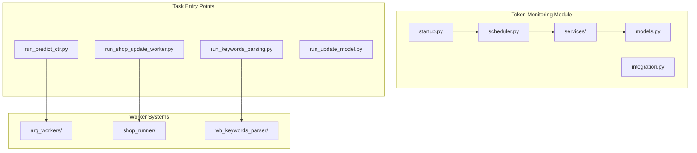
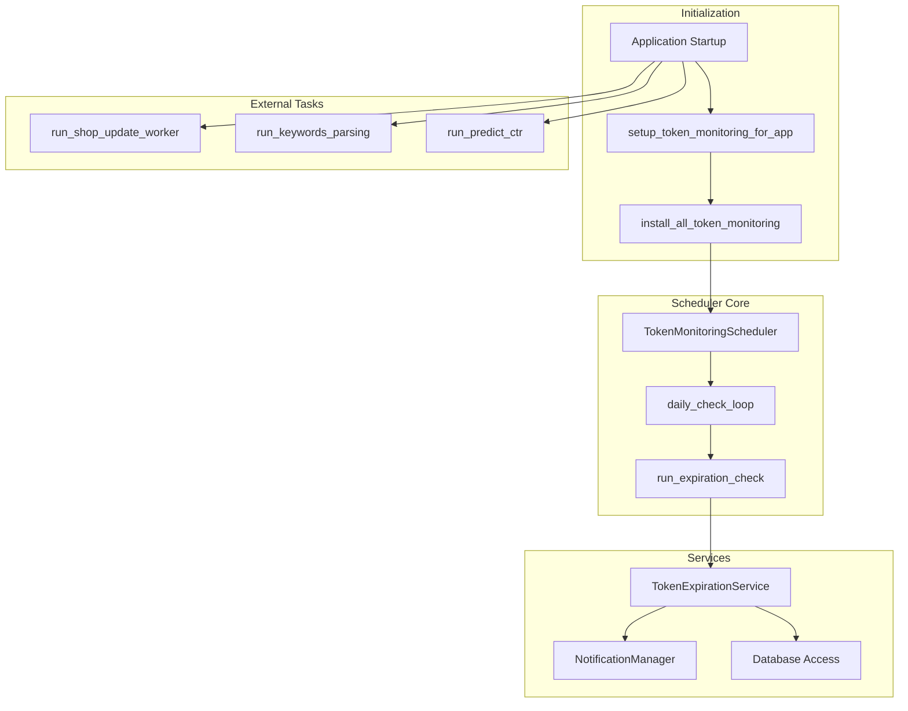
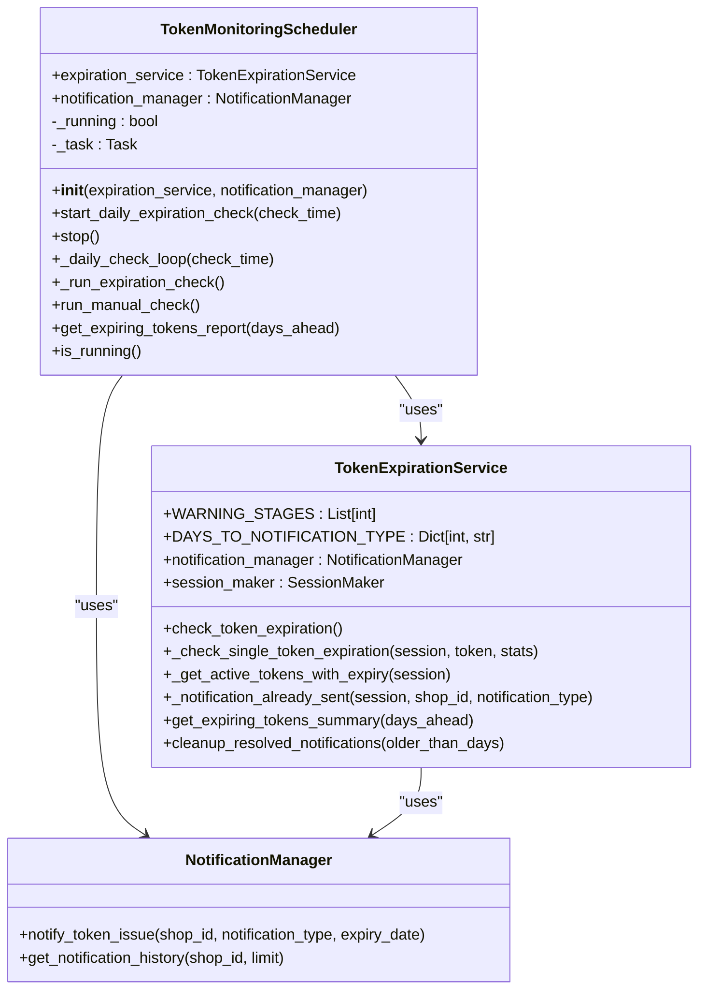
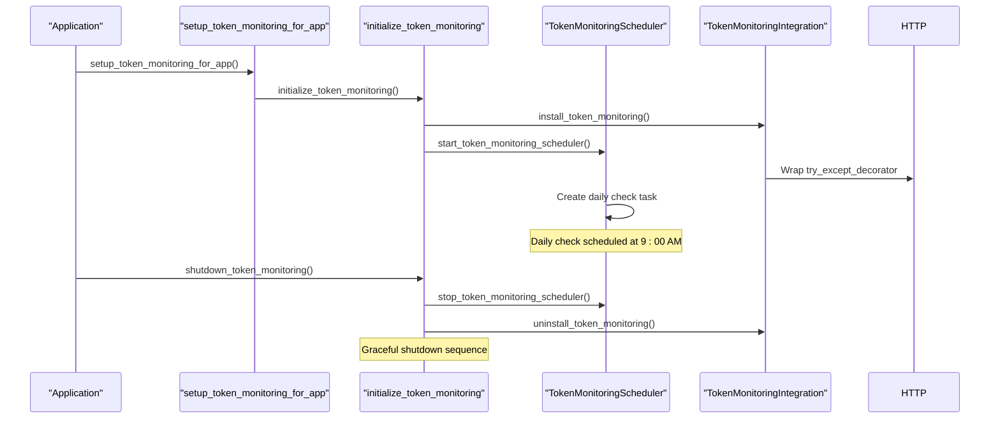
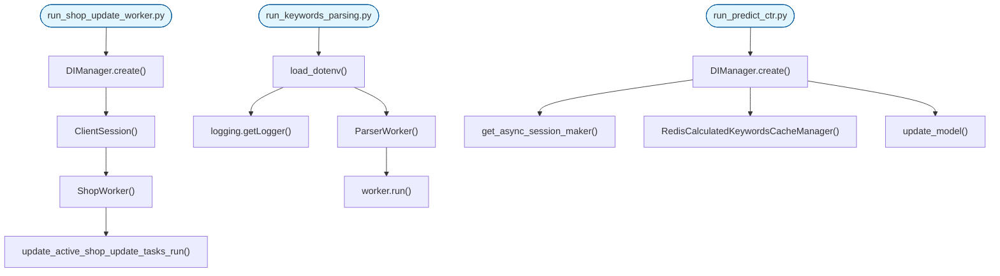
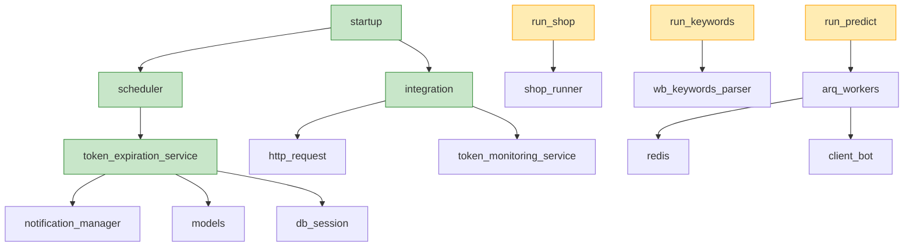

# Scheduled Tasks

<cite>
**Referenced Files in This Document**   
- [scheduler.py](file://app/modules/token_monitoring/scheduler.py)
- [startup.py](file://app/modules/token_monitoring/startup.py)
- [token_expiration_service.py](file://app/modules/token_monitoring/services/token_expiration_service.py)
- [run_shop_update_worker.py](file://run_shop_update_worker.py)
- [run_keywords_parsing.py](file://run_keywords_parsing.py)
- [integration.py](file://app/modules/token_monitoring/integration.py)
- [models.py](file://app/modules/token_monitoring/models.py)
- [runner.py](file://app/modules/wb_adv_updater/runner.py)
- [workers.py](file://app/arq_workers/workers.py)
</cite>

## Table of Contents
1. [Introduction](#introduction)
2. [Project Structure](#project-structure)
3. [Core Components](#core-components)
4. [Architecture Overview](#architecture-overview)
5. [Detailed Component Analysis](#detailed-component-analysis)
6. [Dependency Analysis](#dependency-analysis)
7. [Performance Considerations](#performance-considerations)
8. [Troubleshooting Guide](#troubleshooting-guide)
9. [Conclusion](#conclusion)

## Introduction
The adv-bot system implements a comprehensive scheduled task framework for monitoring token validity, updating shop data, parsing keywords, and running prediction services. This documentation details the architecture and implementation of the scheduling system, focusing on the token_monitoring module's use of asyncio for periodic job execution. The system integrates startup initialization, cron-style task definitions, failure recovery, logging strategies, and cluster coordination to ensure reliable execution of critical background operations.

## Project Structure
The scheduled task system is organized within the token_monitoring module and integrated with various entry point scripts. The core scheduling functionality resides in the token_monitoring package, while specific task implementations are distributed across different modules.

**Diagram sources**
- [scheduler.py](file://app/modules/token_monitoring/scheduler.py)
- [startup.py](file://app/modules/token_monitoring/startup.py)
- [run_shop_update_worker.py](file://run_shop_update_worker.py)
- [run_keywords_parsing.py](file://run_keywords_parsing.py)

**Section sources**
- [scheduler.py](file://app/modules/token_monitoring/scheduler.py)
- [startup.py](file://app/modules/token_monitoring/startup.py)
- [run_shop_update_worker.py](file://run_shop_update_worker.py)
- [run_keywords_parsing.py](file://run_keywords_parsing.py)

## Core Components
The scheduled task system consists of several core components that work together to ensure reliable execution of periodic jobs. The TokenMonitoringScheduler class in scheduler.py provides the foundation for time-based task execution, while the startup.py module handles initialization and integration with the application lifecycle. The system uses asyncio for asynchronous task management and implements robust error handling and recovery mechanisms.

**Section sources**
- [scheduler.py](file://app/modules/token_monitoring/scheduler.py#L1-L185)
- [startup.py](file://app/modules/token_monitoring/startup.py#L1-L119)

## Architecture Overview
The scheduled task architecture follows a modular design with clear separation of concerns. The system uses a global scheduler instance pattern to ensure singleton behavior across the application. Task registration occurs through both direct API calls and entry point scripts, with different modules handling specific types of scheduled operations.

**Diagram sources**
- [scheduler.py](file://app/modules/token_monitoring/scheduler.py#L1-L185)
- [startup.py](file://app/modules/token_monitoring/startup.py#L1-L119)
- [token_expiration_service.py](file://app/modules/token_monitoring/services/token_expiration_service.py#L1-L313)

## Detailed Component Analysis

### Token Monitoring Scheduler Analysis
The TokenMonitoringScheduler class implements a robust scheduling mechanism for token expiration checks. It uses asyncio to manage asynchronous task execution and provides methods for starting, stopping, and running manual checks.

**Diagram sources**
- [scheduler.py](file://app/modules/token_monitoring/scheduler.py#L1-L185)
- [token_expiration_service.py](file://app/modules/token_monitoring/services/token_expiration_service.py#L1-L313)

**Section sources**
- [scheduler.py](file://app/modules/token_monitoring/scheduler.py#L1-L185)
- [token_expiration_service.py](file://app/modules/token_monitoring/services/token_expiration_service.py#L1-L313)

### Startup and Integration Analysis
The startup module provides the integration point between the application lifecycle and the scheduled task system. It ensures proper initialization and shutdown of monitoring components.

**Diagram sources**
- [startup.py](file://app/modules/token_monitoring/startup.py#L1-L119)
- [integration.py](file://app/modules/token_monitoring/integration.py#L1-L111)

**Section sources**
- [startup.py](file://app/modules/token_monitoring/startup.py#L1-L119)
- [integration.py](file://app/modules/token_monitoring/integration.py#L1-L111)

### Entry Point Scripts Analysis
The system uses dedicated entry point scripts to launch specific scheduled tasks. These scripts provide the main execution context for different worker processes.

**Diagram sources**
- [run_shop_update_worker.py](file://run_shop_update_worker.py#L1-L27)
- [run_keywords_parsing.py](file://run_keywords_parsing.py#L1-L31)
- [runner.py](file://app/modules/wb_adv_updater/runner.py#L1-L144)

**Section sources**
- [run_shop_update_worker.py](file://run_shop_update_worker.py#L1-L27)
- [run_keywords_parsing.py](file://run_keywords_parsing.py#L1-L31)
- [runner.py](file://app/modules/wb_adv_updater/runner.py#L1-L144)

## Dependency Analysis
The scheduled task system has a well-defined dependency structure that ensures proper initialization order and component isolation. The core dependencies are managed through the DI (Dependency Injection) system and module-level imports.

**Diagram sources**
- [scheduler.py](file://app/modules/token_monitoring/scheduler.py)
- [startup.py](file://app/modules/token_monitoring/startup.py)
- [integration.py](file://app/modules/token_monitoring/integration.py)
- [run_shop_update_worker.py](file://run_shop_update_worker.py)
- [run_keywords_parsing.py](file://run_keywords_parsing.py)
- [workers.py](file://app/arq_workers/workers.py)

**Section sources**
- [scheduler.py](file://app/modules/token_monitoring/scheduler.py)
- [startup.py](file://app/modules/token_monitoring/startup.py)
- [integration.py](file://app/modules/token_monitoring/integration.py)
- [run_shop_update_worker.py](file://run_shop_update_worker.py)
- [run_keywords_parsing.py](file://run_keywords_parsing.py)
- [workers.py](file://app/arq_workers/workers.py)

## Performance Considerations
The scheduled task system incorporates several performance optimizations to ensure efficient execution and resource utilization. The token expiration check runs once daily at 9:00 AM, minimizing database load while providing timely notifications. The system uses asyncio.sleep() for non-blocking delays, allowing other tasks to execute during waiting periods.

The TokenNotificationTracker model includes database indexes on shop_id, user_telegram_id, and sent_at fields to optimize query performance. The unique constraint on (shop_id, user_telegram_id, notification_type) prevents duplicate notifications while maintaining data integrity.

For high-frequency tasks like keyword parsing, the system limits parallel execution through the PARALLER_PARSE_TASKS setting, preventing resource exhaustion. The ARQ worker system manages task queues in Redis with configurable job retention (keep_jobs=86400) and retry limits (max_tries=10), balancing reliability with storage efficiency.

**Section sources**
- [scheduler.py](file://app/modules/token_monitoring/scheduler.py#L1-L185)
- [models.py](file://app/modules/token_monitoring/models.py#L1-L80)
- [run_keywords_parsing.py](file://run_keywords_parsing.py#L1-L31)
- [workers.py](file://app/arq_workers/workers.py#L1-L50)

## Troubleshooting Guide
When troubleshooting scheduled task issues, consider the following common problems and solutions:

1. **Scheduler not starting**: Verify that setup_token_monitoring_for_app() is called during application startup. Check logs for initialization errors in the startup module.

2. **Missing notifications**: Ensure the TokenNotificationTracker table exists in the database and that the unique constraint is properly configured. Verify that user_telegram_id values are correctly populated.

3. **Task overlap**: The system prevents overlap by checking the _running flag before starting new tasks. If overlap occurs, ensure proper shutdown sequences are called during application termination.

4. **Database connection issues**: The token expiration service uses get_async_session_maker() for database access. Verify database configuration and connection pooling settings.

5. **HTTP decorator integration failure**: Check that app.core.wb_api.http_request module is properly imported and that the try_except_decorator is accessible.

6. **Cluster coordination**: In clustered environments, ensure Redis is properly configured for ARQ workers and that database transactions are handled correctly to prevent race conditions.

**Section sources**
- [scheduler.py](file://app/modules/token_monitoring/scheduler.py#L1-L185)
- [startup.py](file://app/modules/token_monitoring/startup.py#L1-L119)
- [integration.py](file://app/modules/token_monitoring/integration.py#L1-L111)
- [models.py](file://app/modules/token_monitoring/models.py#L1-L80)

## Conclusion
The adv-bot scheduled task system provides a robust framework for executing periodic jobs with reliable error handling and recovery. The token_monitoring module demonstrates effective use of asyncio for time-based scheduling, with clear separation between the scheduler, services, and integration components. The system's design supports both automated daily checks and manual intervention through well-defined APIs.

Key strengths include the global scheduler pattern, comprehensive logging, and graceful shutdown handling. The integration with ARQ for distributed task processing and the use of database constraints to prevent duplicate notifications demonstrate thoughtful architectural decisions. For new scheduled tasks, follow the established patterns of using dedicated entry point scripts and integrating with the DI system for dependency management.