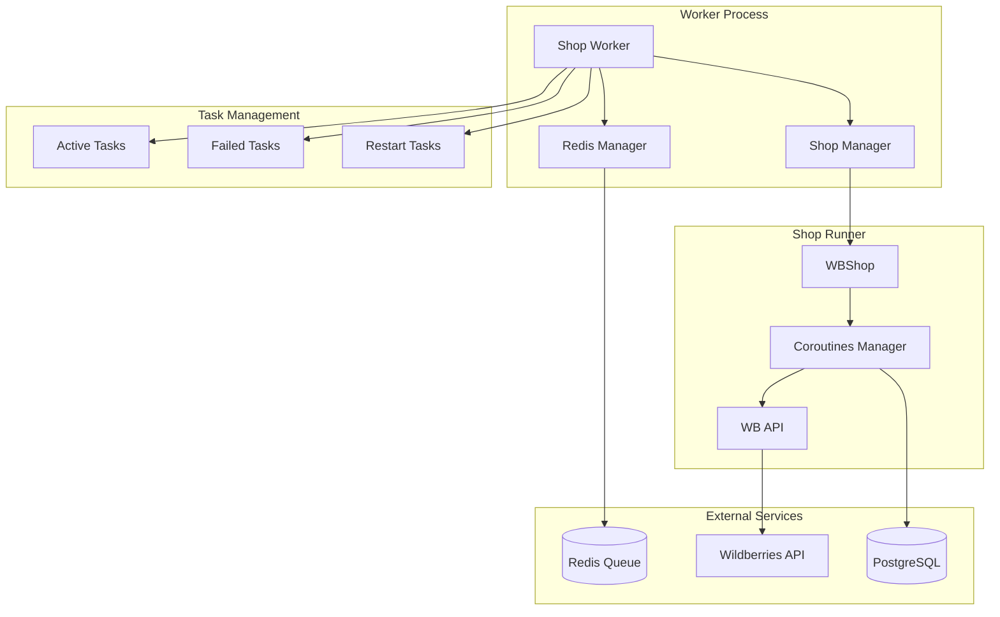
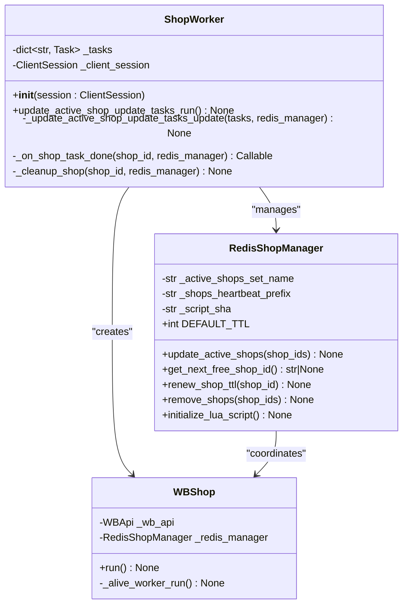
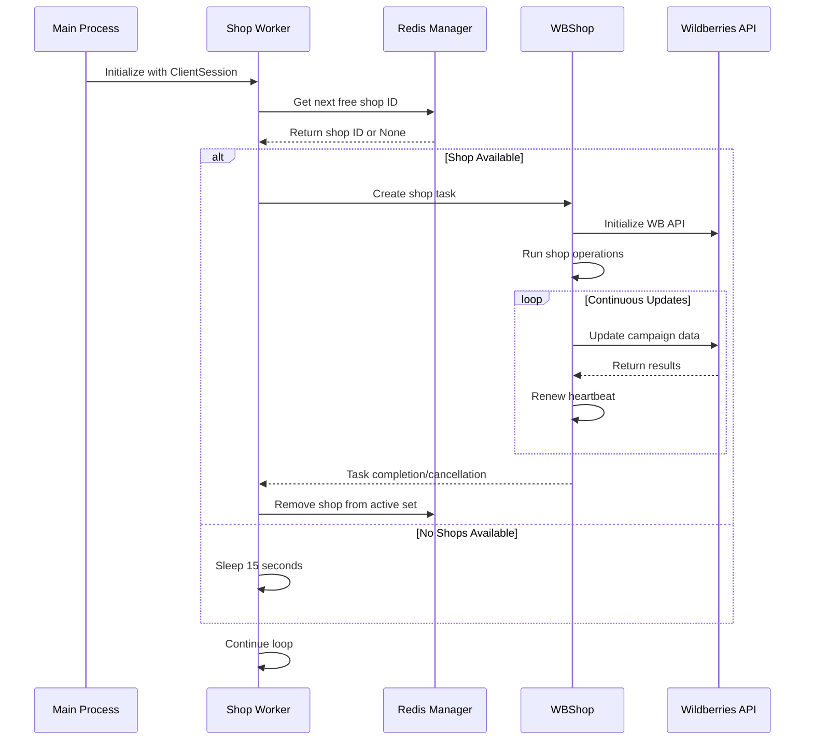
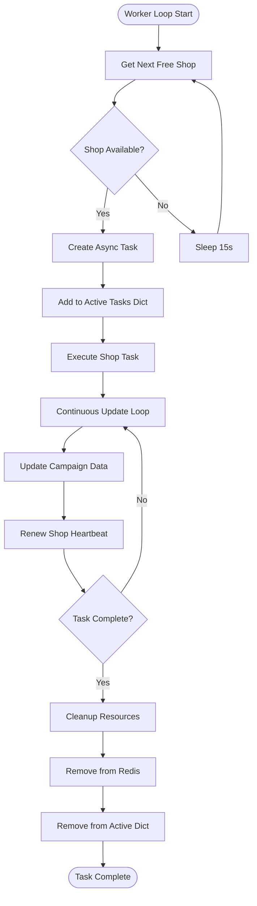
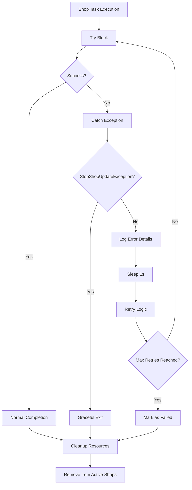
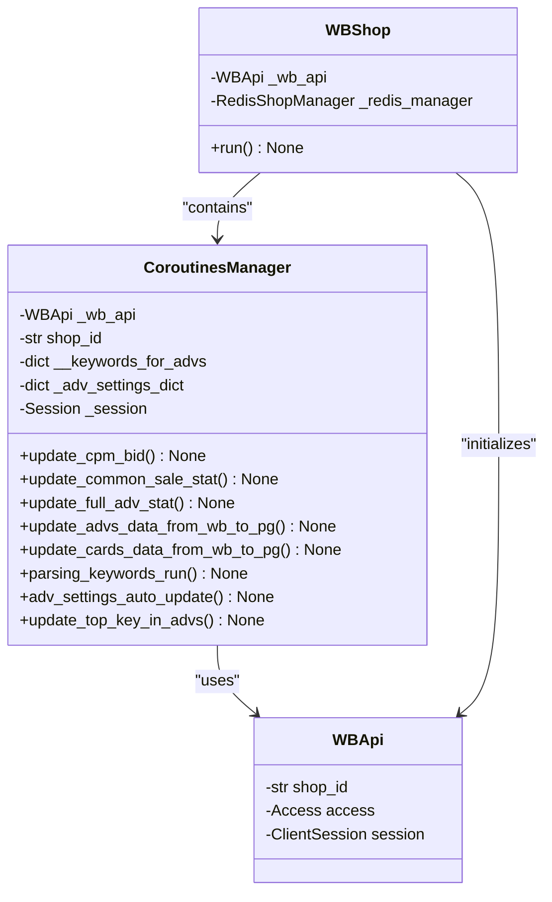
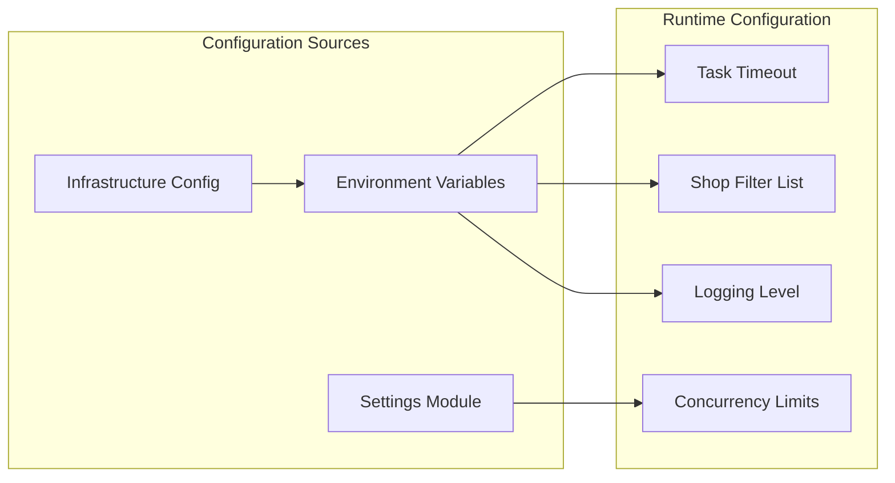
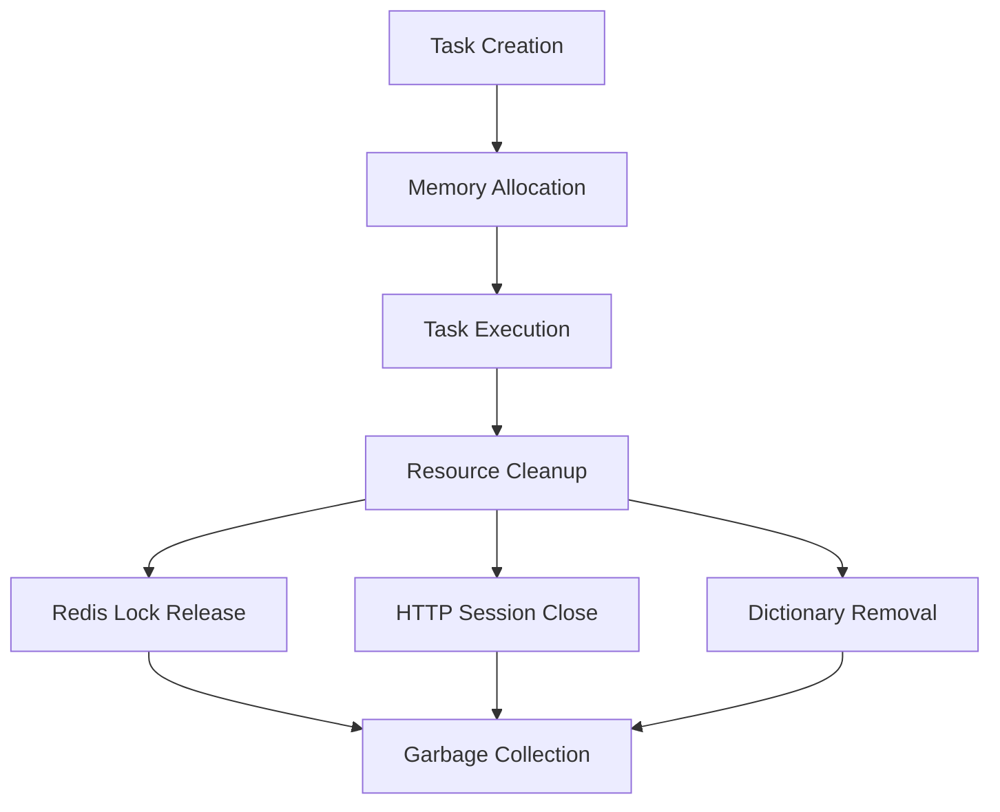

# Shop Update Worker

<cite>
**Referenced Files in This Document**
- [run_shop_update_worker.py](file://run_shop_update_worker.py)
- [worker.py](file://app/modules/shop_runner/shop_run_worker/worker/worker.py)
- [redis_manager.py](file://app/modules/shop_runner/shop_run_worker/redis_manager/redis_manager.py)
- [run_process_func.py](file://app/modules/shop_runner/run_process_func.py)
- [manager.py](file://app/modules/shop_runner/service_manager/manager.py)
- [wb_shop.py](file://app/modules/shop_runner/wb_shop.py)
- [update_active_shop_ids_in_redis.py](file://app/modules/shop_runner/shop_run_worker/update_active_shop_ids_in_redis.py)
- [excs.py](file://app/modules/shop_runner/shop_run_worker/worker/excs.py)
- [settings_master.py](file://app/settings/settings_master.py)
- [logger.py](file://python_modules/logger.py)
- [wb_config.py](file://app/configs/infrastructure_config/wb_config.py)
</cite>

## Table of Contents
1. [Introduction](#introduction)
2. [System Architecture](#system-architecture)
3. [Core Components](#core-components)
4. [Worker Lifecycle Management](#worker-lifecycle-management)
5. [Shop Iteration Logic](#shop-iteration-logic)
6. [Error Resilience Mechanisms](#error-resilience-mechanisms)
7. [Integration Points](#integration-points)
8. [Configuration Options](#configuration-options)
9. [Performance Optimization](#performance-optimization)
10. [Operational Guidance](#operational-guidance)
11. [Troubleshooting Guide](#troubleshooting-guide)
12. [Conclusion](#conclusion)

## Introduction

The Shop Update Worker is a critical component of the Wildberries advertising automation system designed to synchronize advertising campaigns across multiple Wildberries shops. This asynchronous worker process continuously monitors and updates shop configurations, campaign data, and performance metrics in real-time.

The worker operates as a long-running background service that manages concurrent tasks for individual shops, ensuring optimal performance and reliability across large shop portfolios. It integrates seamlessly with Redis for distributed coordination and employs sophisticated error handling mechanisms to maintain system stability.

## System Architecture

The Shop Update Worker follows a distributed architecture pattern with clear separation of concerns:



**Diagram sources**
- [worker.py](file://app/modules/shop_runner/shop_run_worker/worker/worker.py#L1-L70)
- [redis_manager.py](file://app/modules/shop_runner/shop_run_worker/redis_manager/redis_manager.py#L1-L79)

## Core Components

### Shop Worker

The Shop Worker serves as the central orchestrator for managing shop update tasks. It maintains a dictionary of active tasks and coordinates the lifecycle of shop processing operations.



**Diagram sources**
- [worker.py](file://app/modules/shop_runner/shop_run_worker/worker/worker.py#L10-L70)
- [redis_manager.py](file://app/modules/shop_runner/shop_run_worker/redis_manager/redis_manager.py#L8-L79)
- [wb_shop.py](file://app/modules/shop_runner/wb_shop.py#L15-L40)

**Section sources**
- [worker.py](file://app/modules/shop_runner/shop_run_worker/worker/worker.py#L1-L70)
- [redis_manager.py](file://app/modules/shop_runner/shop_run_worker/redis_manager/redis_manager.py#L1-L79)

### Redis Manager

The Redis Manager handles distributed coordination and shop queue management using Lua scripts for atomic operations. It implements a sophisticated locking mechanism to prevent race conditions and ensure fair shop distribution.

**Section sources**
- [redis_manager.py](file://app/modules/shop_runner/shop_run_worker/redis_manager/redis_manager.py#L1-L79)

## Worker Lifecycle Management

The Shop Update Worker operates through a continuous loop that manages the complete lifecycle of shop update tasks:



**Diagram sources**
- [worker.py](file://app/modules/shop_runner/shop_run_worker/worker/worker.py#L58-L70)
- [run_process_func.py](file://app/modules/shop_runner/run_process_func.py#L15-L35)

The worker maintains a dictionary of active tasks and continuously monitors for completed or failed tasks. When a shop task completes, the worker automatically cleans up resources and removes the shop from the active queue.

**Section sources**
- [worker.py](file://app/modules/shop_runner/shop_run_worker/worker/worker.py#L34-L70)
- [run_process_func.py](file://app/modules/shop_runner/run_process_func.py#L15-L97)

## Shop Iteration Logic

The shop iteration logic implements a sophisticated queuing system using Redis sorted sets and Lua scripts for atomic operations:



**Diagram sources**
- [redis_manager.py](file://app/modules/shop_runner/shop_run_worker/redis_manager/redis_manager.py#L35-L55)
- [worker.py](file://app/modules/shop_runner/shop_run_worker/worker/worker.py#L34-L62)

The Lua script ensures atomicity by attempting to acquire a lock for each shop ID in the active set. This prevents multiple workers from processing the same shop simultaneously.

**Section sources**
- [redis_manager.py](file://app/modules/shop_runner/shop_run_worker/redis_manager/redis_manager.py#L15-L35)
- [run_process_func.py](file://app/modules/shop_runner/run_process_func.py#L40-L97)

## Error Resilience Mechanisms

The Shop Update Worker implements comprehensive error handling and recovery mechanisms:

### Exception Handling Strategy



**Diagram sources**
- [run_process_func.py](file://app/modules/shop_runner/run_process_func.py#L20-L35)
- [worker.py](file://app/modules/shop_runner/shop_run_worker/worker/worker.py#L20-L30)

### Heartbeat Monitoring

The worker implements a heartbeat system to detect and recover from stalled shop tasks:

```python
async def _alive_worker_run(self):
    redis_manager: RedisShopManager = self._redis_manager
    ping_timeout = redis_manager.DEFAULT_TTL / 2
    while True:
        await redis_manager.renew_shop_ttl(self._wb_api.shop_id)
        await asyncio.sleep(ping_timeout)
```

**Section sources**
- [wb_shop.py](file://app/modules/shop_runner/wb_shop.py#L35-L40)
- [run_process_func.py](file://app/modules/shop_runner/run_process_func.py#L20-L35)

## Integration Points

### Shop Runner Module Integration

The Shop Update Worker integrates deeply with the shop runner module through the CoroutinesManager, which orchestrates various shop operations:



**Diagram sources**
- [manager.py](file://app/modules/shop_runner/service_manager/manager.py#L40-L60)
- [wb_shop.py](file://app/modules/shop_runner/wb_shop.py#L15-L25)

### Campaign State Management

The worker maintains campaign state through Redis caching and PostgreSQL persistence. It coordinates updates across multiple data streams:

**Section sources**
- [manager.py](file://app/modules/shop_runner/service_manager/manager.py#L1-L242)

## Configuration Options

The Shop Update Worker supports extensive configuration through environment variables and settings:

### Core Configuration Parameters

| Parameter | Description | Default Value | Environment Variable |
|-----------|-------------|---------------|---------------------|
| `SHOPS_WORKS_TLL` | Shop task timeout in seconds | 300 | `SHOPS_WORKS_TLL` |
| `SHOP_FILTER_LIST` | Comma-separated shop IDs to process | Empty | `SHOP_FILTER_LIST` |
| `LOG_LEVEL` | Logging level | ERROR | `LOG_LEVEL` |
| `SHOP_UPDATE_TIMEOUT_MINUTES` | Maximum update duration | 60 | `SHOP_UPDATE_TIMEOUT_MINUTES` |

### Advanced Configuration



**Diagram sources**
- [settings_master.py](file://app/settings/settings_master.py#L340-L360)
- [wb_config.py](file://app/configs/infrastructure_config/wb_config.py#L1-L23)

**Section sources**
- [settings_master.py](file://app/settings/settings_master.py#L340-L360)
- [run_shop_update_worker.py](file://run_shop_update_worker.py#L1-L33)

## Performance Optimization

### Concurrency Control

The worker implements several strategies for optimal performance:

1. **Task Pool Management**: Maintains a dictionary of active tasks with automatic cleanup
2. **Heartbeat Monitoring**: Prevents resource leaks from stalled tasks
3. **Rate Limiting**: Implements delays between shop processing cycles
4. **Resource Cleanup**: Automatically releases Redis locks and database connections

### Memory Management



**Section sources**
- [worker.py](file://app/modules/shop_runner/shop_run_worker/worker/worker.py#L30-L40)
- [redis_manager.py](file://app/modules/shop_runner/shop_run_worker/redis_manager/redis_manager.py#L70-L79)

## Operational Guidance

### Monitoring and Restart Procedures

The worker provides comprehensive logging for operational monitoring:

```python
# Example log entries
logger.debug(f"Процесс обновления магазина {new_free_shop_id} запущен")
logger.exception(f"Не обработанная ошибка выполнения задачи магазина: {exc}")
logger.debug(f"Магазин {shop_id} удалён из активных после завершения задачи")
```

### Scaling Strategies

1. **Horizontal Scaling**: Deploy multiple worker instances with Redis coordination
2. **Vertical Scaling**: Increase thread pool sizes for database connections
3. **Shop Filtering**: Use `SHOP_FILTER_LIST` to distribute load across workers

### Health Checks

The worker implements health monitoring through:
- Redis connection status
- Task completion rates
- Error frequency monitoring
- Heartbeat validation

**Section sources**
- [logger.py](file://python_modules/logger.py#L1-L34)
- [worker.py](file://app/modules/shop_runner/shop_run_worker/worker/worker.py#L20-L30)

## Troubleshooting Guide

### Common Issues and Solutions

#### Rate Limiting Issues

**Symptom**: Frequent API rate limit errors
**Solution**: 
- Adjust `SHOPS_WORKS_TLL` to increase task timeout
- Implement exponential backoff in retry logic
- Monitor API usage patterns

#### Token Expiration

**Symptom**: Authentication failures
**Solution**:
- Implement token refresh mechanisms
- Monitor token expiration timestamps
- Use secure storage for tokens

#### Partial Update Recovery

**Symptom**: Inconsistent campaign states
**Solution**:
- Implement idempotent update operations
- Use transactional database updates
- Maintain rollback capabilities

### Diagnostic Commands

```bash
# Check Redis shop queue status
redis-cli smembers active_shops

# Monitor worker logs
tail -f worker.log | grep "shop_update_worker"

# Check shop task status
redis-cli keys "shops_heartbeat:*"
```

**Section sources**
- [redis_manager.py](file://app/modules/shop_runner/shop_run_worker/redis_manager/redis_manager.py#L55-L79)
- [excs.py](file://app/modules/shop_runner/shop_run_worker/worker/excs.py#L1-L3)

## Conclusion

The Shop Update Worker represents a sophisticated distributed system designed for reliable, scalable advertising campaign synchronization across multiple Wildberries shops. Its architecture emphasizes fault tolerance, performance optimization, and operational simplicity.

Key strengths include:
- **Distributed Coordination**: Redis-based queuing prevents race conditions
- **Error Resilience**: Comprehensive exception handling and recovery mechanisms
- **Performance Optimization**: Concurrent task management with automatic resource cleanup
- **Operational Excellence**: Extensive logging and monitoring capabilities

The worker's modular design allows for easy maintenance and extension, while its robust error handling ensures system stability even under adverse conditions. Regular monitoring and proper configuration enable optimal performance across diverse deployment scenarios.