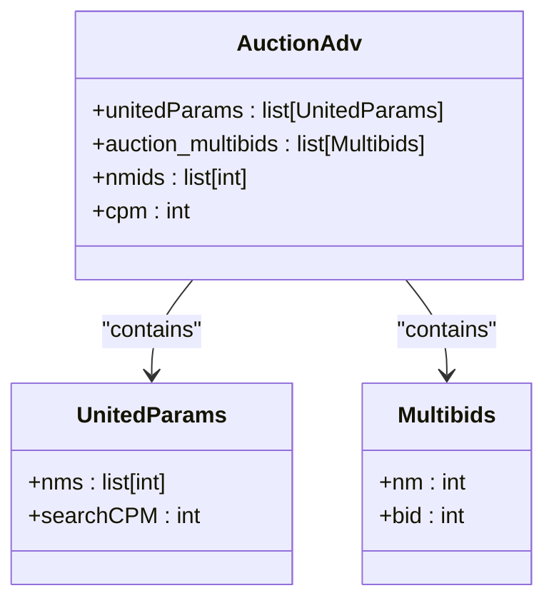

# Auction Strategies

<cite>
**Referenced Files in This Document**   
- [auction_adv.py](file://app/core/wb_api/data_classes/advs/auction_adv.py)
- [bidder.py](file://app/modules/wb_adv_updater/bidder.py)
- [models.py](file://app/modules/common_slaves/wildberries/models/models.py)
- [data_manager.py](file://app/modules/wb_adv_updater/data_manager.py)
</cite>

## Table of Contents
1. [Introduction](#introduction)
2. [Auction Strategy Overview](#auction-strategy-overview)
3. [Forward and Keep Placement Modes](#forward-and-keep-placement-modes)
4. [Auction-Specific Data Structures](#auction-specific-data-structures)
5. [Bidder Behavior and Adaptation](#bidder-behavior-and-adaptation)
6. [Bid Calculation Methods](#bid-calculation-methods)
7. [Placement Optimization Techniques](#placement-optimization-techniques)
8. [Configuration Requirements](#configuration-requirements)
9. [Performance Implications](#performance-implications)
10. [Common Issues and Troubleshooting](#common-issues-and-troubleshooting)
11. [Best Practices](#best-practices)
12. [Conclusion](#conclusion)

## Introduction
The Auction Strategies component of the Bidding Engine provides sophisticated control over advertising campaigns on the Wildberries marketplace. This document details the implementation and usage of auction strategies, focusing on the forward and keep placement modes as defined in the AdvSetting model. The system enables advertisers to optimize their bidding behavior based on campaign goals, market conditions, and performance metrics. The core functionality is implemented across multiple components, including data classes that handle multi-bid configurations and united parameters for auction campaigns, as well as the bidder logic that adapts its behavior based on the selected auction strategy.

## Auction Strategy Overview
The auction strategy system in the Bidding Engine supports two primary placement modes: forward and keep. These strategies are defined in the AdvSetting model and control how the bidder adapts its behavior during campaign execution. The forward strategy focuses on progressively improving ad placement by adjusting bids based on current performance, while the keep strategy aims to maintain a consistent position in search results. Both strategies are designed to optimize campaign performance while respecting budget constraints and target placement goals. The system handles multi-bid configurations through the AuctionAdv class, which supports both united parameters for campaign-level settings and individual bid configurations for specific products.

**Section sources**
- [models.py](file://app/modules/common_slaves/wildberries/models/models.py#L400-L653)

## Forward and Keep Placement Modes
The forward and keep placement modes represent two distinct approaches to auction bidding strategy. The forward strategy, activated when target_ctr_mode_strategy is set to "forward", implements a progressive bidding approach that seeks to improve ad placement over time. When the current promotion position is better than the target maximum position, the system gradually reduces the cost-per-thousand impressions (CPM) to optimize spending efficiency. Conversely, when the position is worse than the target, the CPM is increased to improve visibility.

The keep strategy, activated when target_ctr_mode_strategy is set to "keep", focuses on maintaining a stable position in search results. This approach is particularly useful for campaigns with specific placement requirements or when consistent visibility is more important than aggressive position improvement. The keep strategy monitors the current position and makes bid adjustments to maintain the desired placement, minimizing fluctuations in ad visibility.

**Section sources**
- [models.py](file://app/modules/common_slaves/wildberries/models/models.py#L400-L653)
- [bidder.py](file://app/modules/wb_adv_updater/bidder.py#L100-L129)

## Auction-Specific Data Structures
The auction strategy implementation relies on several key data structures defined in the auction_adv.py module. The AuctionAdv class extends the base Adv class and incorporates two primary components: UnitedParams and Multibids. The UnitedParams class manages campaign-level settings, including a list of nms (nomer modeli) and an optional searchCPM value that defines the base CPM for search campaigns. This structure enables unified parameter management across multiple products within a campaign.

The Multibids class handles individual bid configurations for specific products, with each instance containing an nm identifier and a corresponding bid amount. This allows for granular control over bidding behavior at the product level. The AuctionAdv class combines these structures to support both unified campaign settings and individual product bidding, providing flexibility in auction strategy implementation. The class also includes properties for accessing nmids and cpm values, simplifying data retrieval for bidding calculations.

**Diagram sources**
- [auction_adv.py](file://app/core/wb_api/data_classes/advs/auction_adv.py#L0-L37)

## Bidder Behavior and Adaptation
The bidder component adapts its behavior based on the selected auction strategy through a sophisticated decision-making process implemented in the _run_bidder_process_for_adv function. The bidder continuously monitors campaign performance and adjusts bids to achieve the desired placement while optimizing spending efficiency. When the current promotion position is better than the target maximum position, the bidder reduces the CPM by a predefined step to conserve budget. When the position is worse than the target, the CPM is increased to improve visibility.

The bidder also implements safety checks to prevent excessive spending, including validation of maximum CPM limits and automatic adjustment of target positions when necessary. If the calculated bid exceeds the maximum allowed CPM, the system sets the bid to the maximum value and may adjust the target position to maintain campaign viability. The bidder handles both auction and automatic campaigns, applying the same strategic principles across different campaign types while respecting their specific constraints and requirements.

**Section sources**
- [bidder.py](file://app/modules/wb_adv_updater/bidder.py#L50-L129)

## Bid Calculation Methods
The bid calculation methods in the auction strategy system combine multiple data sources to determine optimal bid values. The primary calculation is based on the difference between the current promotion position and the target maximum position, with bid adjustments made in increments defined by the BIDDER_STEP setting. When the current position is better than the target, the CPM is decreased; when it's worse, the CPM is increased.

The system also considers maximum bid constraints, ensuring that calculated bids do not exceed configured limits. If a calculated bid would exceed the maximum allowed CPM, the system caps the bid at the maximum value and may adjust the target position to maintain campaign effectiveness. The bid calculation process incorporates data from both the auction campaign and the associated automatic campaign, allowing for coordinated bidding across related campaigns. The final bid value is determined by taking the maximum of available CPM values from different sources, ensuring optimal visibility while respecting budget constraints.

**Section sources**
- [bidder.py](file://app/modules/wb_adv_updater/bidder.py#L80-L129)
- [data_manager.py](file://app/modules/wb_adv_updater/data_manager.py#L1600-L1809)

## Placement Optimization Techniques
The auction strategy system employs several techniques to optimize ad placement and maximize campaign effectiveness. The primary optimization method is position-based bid adjustment, where bids are increased or decreased based on the difference between current and target positions. This approach ensures that campaigns maintain visibility while avoiding unnecessary spending when positions exceed targets.

The system also implements automatic position adjustment when maximum bid limits are reached. If a campaign consistently fails to achieve its target position despite reaching the maximum bid, the system can automatically adjust the target position to a more achievable level, preventing budget exhaustion while maintaining campaign viability. Additionally, the system incorporates a reset mechanism that adjusts the target position based on current performance, allowing campaigns to adapt to changing market conditions and competition levels.

**Section sources**
- [bidder.py](file://app/modules/wb_adv_updater/bidder.py#L80-L129)
- [models.py](file://app/modules/common_slaves/wildberries/models/models.py#L400-L653)

## Configuration Requirements
Effective implementation of auction strategies requires proper configuration of several key parameters in the AdvSetting model. The target_ctr_mode_strategy field must be set to either "forward" or "keep" to specify the desired placement approach. The max_place parameter defines the target maximum position for the campaign, while the max_cpm setting establishes the upper limit for bid amounts.

Additional configuration options include the bidder_step parameter, which controls the increment size for bid adjustments, and the reset_place flag, which enables automatic position adjustment when maximum bids are reached. For campaigns using the auction_boost_all_phrase_mode, additional configuration is required to define the boosting parameters for specific phrases. Proper configuration of these parameters is essential for achieving optimal campaign performance and aligning bidding behavior with business objectives.

**Section sources**
- [models.py](file://app/modules/common_slaves/wildberries/models/models.py#L400-L653)

## Performance Implications
The choice of auction strategy has significant performance implications for advertising campaigns. The forward strategy typically results in more aggressive position improvement but may lead to higher spending, especially in competitive markets. This approach is most effective when rapid visibility improvement is a priority and sufficient budget is available. The keep strategy generally provides more stable spending patterns and consistent visibility but may be less effective at capturing new market opportunities.

Performance monitoring should focus on key metrics such as position stability, cost efficiency, and return on advertising spend. The system's automatic adjustment mechanisms help maintain performance within acceptable parameters, but regular monitoring is recommended to ensure alignment with business goals. Campaigns with frequent position fluctuations may benefit from adjusting the bidder_step parameter or revising target positions to better match market conditions.

**Section sources**
- [bidder.py](file://app/modules/wb_adv_updater/bidder.py#L50-L129)
- [data_manager.py](file://app/modules/wb_adv_updater/data_manager.py#L1600-L1809)

## Common Issues and Troubleshooting
Several common issues may arise when implementing auction strategies, including strategy misconfiguration and unexpected placement behavior. One frequent issue is setting unrealistic target positions that cannot be achieved within budget constraints, leading to maximum bid exhaustion and campaign underperformance. This can be addressed by reviewing market competition levels and adjusting target positions to more realistic values.

Another common issue is unexpected position fluctuations, which may indicate inappropriate bidder_step values or conflicting campaign settings. Troubleshooting should begin with verification of configuration parameters, particularly the target_ctr_mode_strategy, max_place, and max_cpm settings. Monitoring bid adjustment patterns can help identify whether the system is responding appropriately to position changes. In cases of persistent issues, reviewing the bidder logs and performance metrics can provide insights into the root cause and guide corrective actions.

**Section sources**
- [bidder.py](file://app/modules/wb_adv_updater/bidder.py#L50-L129)
- [models.py](file://app/modules/common_slaves/wildberries/models/models.py#L400-L653)

## Best Practices
To maximize the effectiveness of auction strategies, several best practices should be followed. First, target positions should be set based on market research and competitive analysis rather than arbitrary values. This ensures that campaigns have realistic goals that can be achieved within budget constraints. Second, the bidder_step parameter should be tuned based on campaign volatility and market conditions, with smaller steps used in stable markets and larger steps in more dynamic environments.

Regular monitoring and adjustment of campaign parameters is essential for maintaining optimal performance. This includes periodic review of target positions, maximum bids, and strategy selection based on performance metrics and business objectives. For campaigns with specific visibility requirements, the keep strategy is generally recommended, while the forward strategy is more suitable for campaigns focused on rapid position improvement. Finally, proper budget allocation and monitoring are critical to prevent premature campaign exhaustion and ensure sustained visibility.

**Section sources**
- [bidder.py](file://app/modules/wb_adv_updater/bidder.py#L50-L129)
- [models.py](file://app/modules/common_slaves/wildberries/models/models.py#L400-L653)

## Conclusion
The Auction Strategies component of the Bidding Engine provides a comprehensive framework for managing advertising campaigns on the Wildberries marketplace. By implementing both forward and keep placement modes, the system offers flexibility in achieving different campaign objectives while maintaining spending efficiency. The integration of sophisticated bid calculation methods and placement optimization techniques enables advertisers to adapt to changing market conditions and competition levels. Proper configuration and monitoring of auction strategies are essential for maximizing campaign performance and achieving business objectives. With the right approach, these strategies can significantly enhance advertising effectiveness and return on investment.