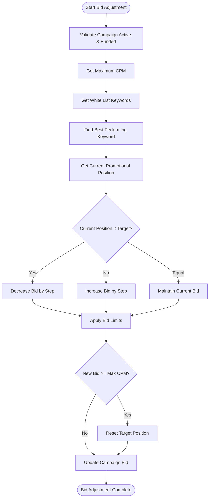
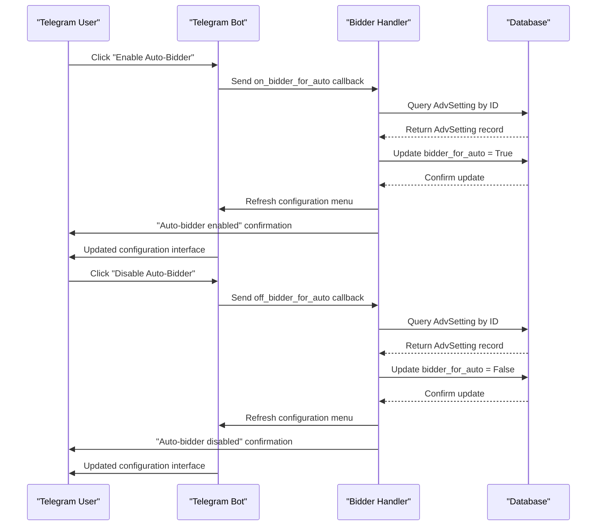
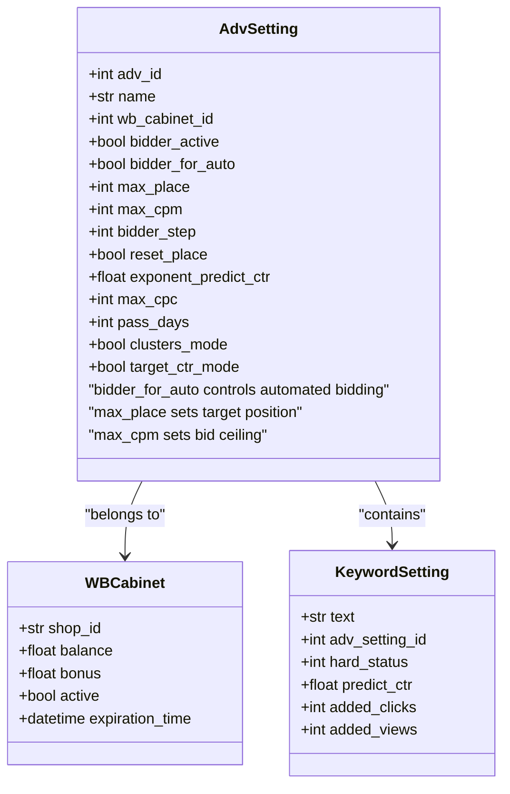

# Automated Bidding

<cite>
**Referenced Files in This Document**   
- [bidder.py](file://app/modules/wb_adv_updater/bidder.py)
- [handlers.py](file://app/modules/bidder_auto_mode/handlers.py)
- [models.py](file://app/modules/common_slaves/wildberries/models/models.py)
- [data_manager.py](file://app/modules/wb_adv_updater/data_manager.py)
- [settings_master.py](file://app/settings/settings_master.py)
</cite>

## Table of Contents
1. [Introduction](#introduction)
2. [Core Components](#core-components)
3. [Bidder Logic Implementation](#bidder-logic-implementation)
4. [Auto-Bidder State Management](#auto-bidder-state-management)
5. [Configuration and Control Flow](#configuration-and-control-flow)
6. [Telegram Interface Integration](#telegram-interface-integration)
7. [Common Issues and Troubleshooting](#common-issues-and-troubleshooting)
8. [Performance Optimization](#performance-optimization)

## Introduction
The Automated Bidding sub-feature of the Bidding Engine enables automatic bid adjustments based on campaign performance metrics and machine learning predictions. This system dynamically optimizes advertising costs by analyzing keyword performance, position data, and predictive analytics to maintain desired ad placements while maximizing return on investment. The implementation consists of two primary components: the bid calculation logic in `bidder.py` and the state management handler in `handlers.py`, which controls the activation and deactivation of the auto-bidder functionality through the Telegram interface.

## Core Components

The Automated Bidding system comprises several interconnected components that work together to optimize bid strategies. The core functionality is distributed across multiple modules, with the primary logic residing in the `wb_adv_updater` and `bidder_auto_mode` modules. The system leverages machine learning predictions for click-through rate (CTR) estimation, combines this with real-time performance metrics, and applies configurable business rules to determine optimal bid adjustments.

**Section sources**
- [bidder.py](file://app/modules/wb_adv_updater/bidder.py#L0-L130)
- [handlers.py](file://app/modules/bidder_auto_mode/handlers.py#L0-L53)

## Bidder Logic Implementation

The bid calculation logic is implemented in `app/modules/wb_adv_updater/bidder.py`, which contains the core functions for automated bid adjustments. The system operates on a continuous loop that evaluates active advertising campaigns and adjusts bids based on performance metrics and target positioning.

The bidding process begins with `_run_bidder_process()`, which queries the database for all active `AdvSetting` records where `bidder_active` is True and the associated cabinet has sufficient balance or bonus funds. For each qualifying campaign, the system creates an asynchronous task to process bid adjustments independently.

The core bid calculation occurs in `_run_bidder_process_for_adv()`, which follows this sequence:
1. Retrieves the campaign's access credentials and configuration
2. Obtains the maximum allowable bid (`max_cpm`) from campaign settings
3. Fetches keyword performance data, including views, clicks, and spend
4. Calculates the current effective bid (`fact_cpm`) from parsing data
5. Identifies the best-performing keyword from the white list (keywords with `hard_status` = 2)
6. Compares the current promotional position against the target maximum position (`max_place`)
7. Adjusts the bid incrementally based on the position comparison

Bid adjustments follow a simple but effective algorithm:
- If the current position is better (lower) than the target position, decrease the bid by the configured step amount
- If the current position is worse (higher) than the target position, increase the bid by the configured step amount  
- If the current position matches the target position, maintain the current bid
- Ensure the new bid does not exceed the campaign's `max_cpm` limit
- Apply a minimum bid floor of 125 rubles, with an additional adjustment to 250 rubles after updating

The system also implements a position reset mechanism when the bid reaches its maximum. When `reset_place` is enabled in the campaign settings, the target position is automatically adjusted to one position below the current promotional position, allowing the system to potentially achieve better placement at a lower cost.

**Diagram sources **
- [bidder.py](file://app/modules/wb_adv_updater/bidder.py#L64-L97)

**Section sources**
- [bidder.py](file://app/modules/wb_adv_updater/bidder.py#L0-L130)

## Auto-Bidder State Management

The activation and deactivation of the automated bidding system is managed through handlers in `app/modules/bidder_auto_mode/handlers.py`. This component provides the interface for users to control the auto-bidder functionality via the Telegram bot interface.

The state management is implemented using two callback handlers:
- `on_bidder_for_auto` - Activates the automated bidding system for a specific campaign
- `off_bidder_for_auto` - Deactivates the automated bidding system for a specific campaign

Both handlers follow the same pattern:
1. Receive a callback from the Telegram interface with the campaign identifier
2. Query the database for the corresponding `AdvSetting` record
3. Update the `bidder_for_auto` field to the appropriate boolean value
4. Commit the changes to the database
5. Refresh the user interface to reflect the new state

The handlers are registered with the Telegram bot router and respond to specific callback data patterns (`on_bidder_for_auto` and `off_bidder_for_auto`). After successfully updating the campaign settings, the handlers refresh the configuration menu message to provide immediate visual feedback to the user and send a confirmation message indicating the new state of the auto-bidder.

**Diagram sources **
- [handlers.py](file://app/modules/bidder_auto_mode/handlers.py#L0-L53)

**Section sources**
- [handlers.py](file://app/modules/bidder_auto_mode/handlers.py#L0-L53)

## Configuration and Control Flow

The Automated Bidding system is controlled through several configuration parameters in the `AdvSetting` model, which determine how the bidding algorithm behaves. The most critical field is `bidder_for_auto`, a boolean flag that enables or disables the automated bidding functionality for a specific campaign.

The `bidder_for_auto` field in the `AdvSetting` model serves as the primary control switch for the automated bidding system. When set to `True`, the campaign becomes eligible for automatic bid adjustments according to the algorithm described in the previous section. When set to `False`, the campaign's bids remain static and are not modified by the automated system.

Additional configuration parameters that influence the bidding behavior include:
- `max_place`: The target maximum position for the advertisement
- `max_cpm`: The maximum allowable cost-per-thousand impressions
- `bidder_step`: The incremental amount by which bids are adjusted
- `reset_place`: A flag that enables automatic adjustment of the target position when the maximum bid is reached
- `exponent_predict_ctr`: An exponent factor applied to machine learning CTR predictions

The system also considers the campaign's financial status through the associated `WBCabinet` balance and bonus funds. The bidding process only proceeds if the cabinet has sufficient funds, ensuring that campaigns do not exceed their allocated budgets.

The control flow begins with the main bidding process querying for all active campaigns with `bidder_active` set to `True`. For each campaign, the system then checks the `bidder_for_auto` flag as a secondary filter. Only campaigns that pass both filters are processed for bid adjustments, creating a two-tiered activation system that allows for granular control over which campaigns are subject to automated bidding.

**Diagram sources **
- [models.py](file://app/modules/common_slaves/wildberries/models/models.py#L450-L650)

**Section sources**
- [models.py](file://app/modules/common_slaves/wildberries/models/models.py#L450-L650)
- [bidder.py](file://app/modules/wb_adv_updater/bidder.py#L0-L130)

## Telegram Interface Integration

The Telegram interface serves as the primary user interface for controlling the Automated Bidding system. Users interact with the system through callback buttons in the campaign configuration menu, which trigger the state management handlers to update the `bidder_for_auto` setting.

The integration follows a standard Telegram bot pattern using the aiogram framework. When a user clicks the "Enable Auto-Bidder" or "Disable Auto-Bidder" button in the configuration menu, a callback query is sent to the bot with specific action data. The router in `handlers.py` matches this callback data to the appropriate handler function, which then processes the request by updating the database and refreshing the user interface.

The user experience is designed to provide immediate feedback. After processing the state change, the system updates the configuration menu message to reflect the new state and sends a confirmation message to the user. This ensures that users receive clear visual confirmation of their actions, reducing the likelihood of configuration errors.

The integration also handles error conditions gracefully. If a campaign cannot be found in the database, the system sends an appropriate error message to the user rather than failing silently. This error handling improves the user experience by providing clear feedback when operations cannot be completed.

## Common Issues and Troubleshooting

Several common issues can arise when using the Automated Bidding system, primarily related to configuration errors, data availability, and system limitations.

**Bid Instability**: Rapid oscillations in bid amounts can occur when the step size is too large relative to the competitive landscape. This can be mitigated by reducing the `bidder_step` value in the system settings or adjusting the target position to a less competitive range.

**Incorrect Thresholds**: If the `max_place` is set too aggressively (too low a number), the system may continuously increase bids to achieve the desired position, potentially exhausting the campaign budget. Review the competitive landscape for target keywords and set realistic position goals based on historical performance data.

**Missing Position Data**: The bidding algorithm relies on accurate position data from the parsing system. If position data is unavailable or delayed, bid calculations cannot proceed. Ensure the keyword parsing system is functioning correctly and that the target keywords are being actively monitored.

**Insufficient Funding**: The system will not adjust bids for campaigns in cabinets with insufficient balance or bonus funds. Verify that the associated `WBCabinet` has adequate funding and that the `bidder_active` flag is enabled.

**Configuration Conflicts**: Ensure that `bidder_active` is enabled at the campaign level and that `bidder_for_auto` is specifically enabled for automated bidding. Both flags must be active for the system to process bid adjustments.

For debugging bid calculation errors, check the application logs for error messages related to bid processing. Key indicators include:
- "Максимальная позиция не задана!" (Maximum position not set)
- "Максимальная ставка не найдена!" (Maximum bid not found) 
- "Не удалось получить ставку из парсинга" (Failed to obtain bid from parsing)

These errors typically indicate missing configuration values or data pipeline issues that need to be addressed before automated bidding can function correctly.

**Section sources**
- [bidder.py](file://app/modules/wb_adv_updater/bidder.py#L64-L97)
- [handlers.py](file://app/modules/bidder_auto_mode/handlers.py#L0-L53)

## Performance Optimization

To reduce latency in bid updates and improve overall system performance, several optimization strategies can be implemented:

**Database Query Optimization**: The bidding process queries for all active campaigns on each iteration. Implement caching mechanisms to reduce database load and improve response times. Consider using Redis to cache campaign settings and only query the database when changes are detected.

**Parallel Processing**: The current implementation processes campaigns sequentially. Modify the system to process multiple campaigns concurrently using asyncio.gather() to reduce overall processing time, especially when dealing with large numbers of active campaigns.

**Configuration Caching**: Cache frequently accessed configuration values such as `BIDDER_STEP` from the settings module to avoid repeated environment variable lookups. The current implementation retrieves this value on each bid calculation, creating unnecessary overhead.

**Selective Processing**: Implement more sophisticated filtering to prioritize campaigns that are most likely to benefit from bid adjustments. For example, focus on campaigns where the current position differs significantly from the target position, rather than processing all active campaigns uniformly.

**Batch Database Operations**: When updating multiple campaigns, batch the database operations to reduce the number of round trips to the database. This is particularly important when implementing the position reset functionality, which requires updating the `max_place` value.

**Monitoring and Alerting**: Implement comprehensive monitoring of bid adjustment frequency, success rates, and performance metrics. Set up alerts for异常 patterns such as excessive bid fluctuations or prolonged periods without bid adjustments, which may indicate underlying system issues.

**Section sources**
- [bidder.py](file://app/modules/wb_adv_updater/bidder.py#L0-L130)
- [settings_master.py](file://app/settings/settings_master.py#L250-L260)