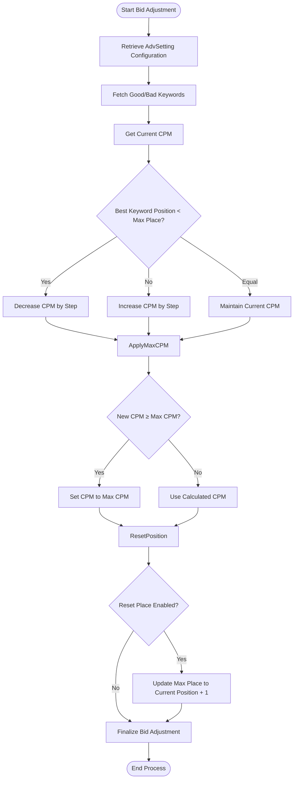
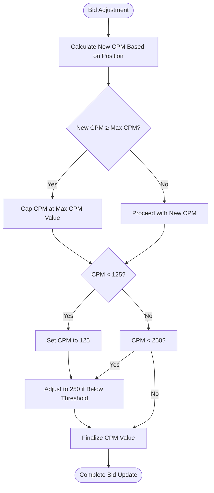
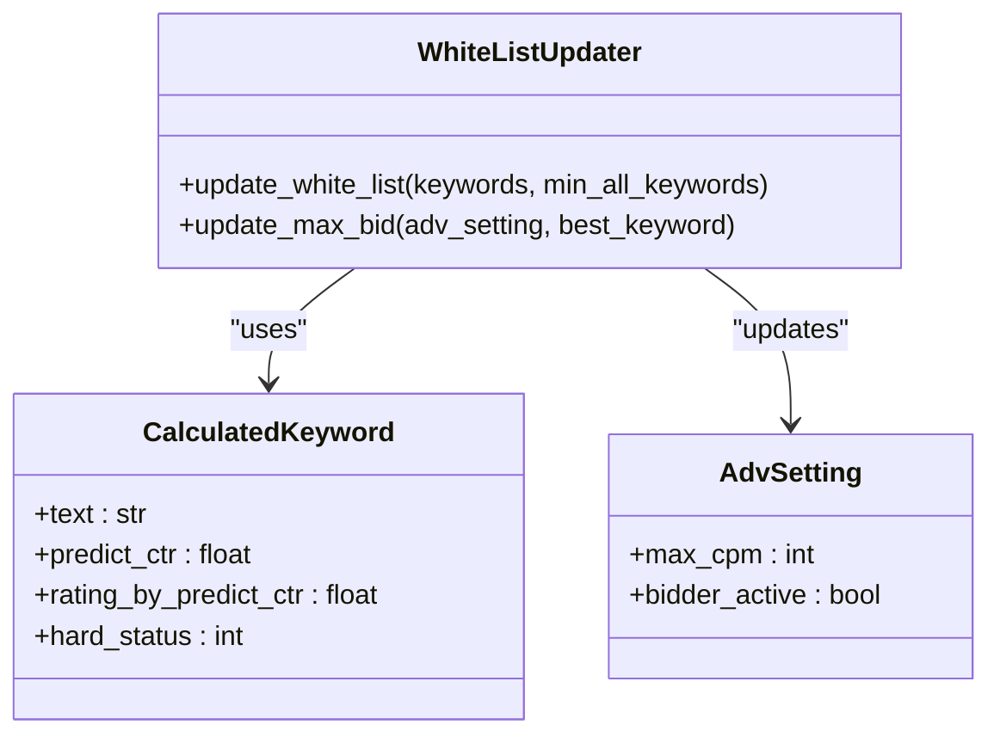
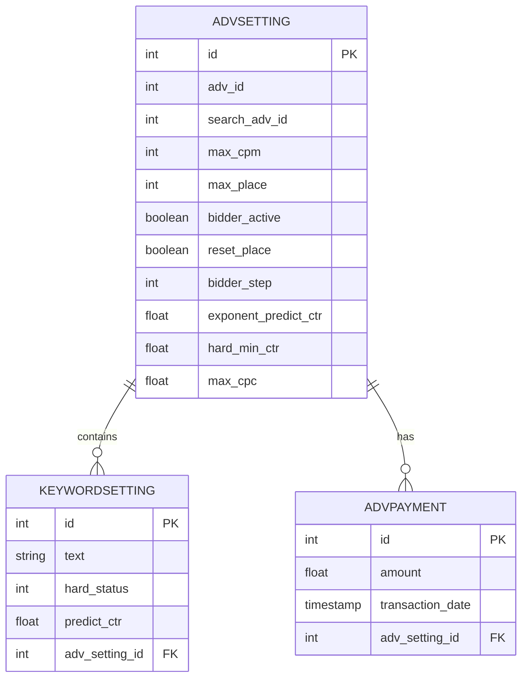
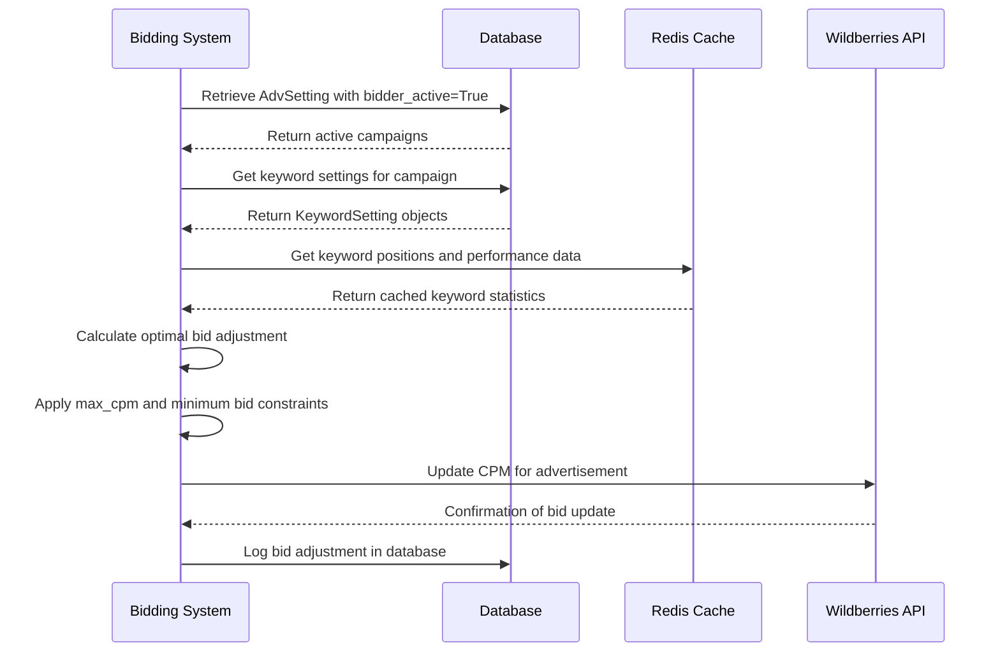

# Bid Optimization

<cite>
**Referenced Files in This Document**   
- [bidder.py](file://app/modules/wb_adv_updater/bidder.py)
- [white_list_updater.py](file://app/modules/white_list_updater/backend/white_list_updater.py)
- [models.py](file://app/modules/common_slaves/wildberries/models/models.py)
- [data_manager.py](file://app/modules/wb_adv_updater/data_manager.py)
</cite>

## Table of Contents
1. [Introduction](#introduction)
2. [Bid Optimization Logic](#bid-optimization-logic)
3. [Maximum Bid Constraints and Overbidding Prevention](#maximum-bid-constraints-and-overbidding-prevention)
4. [Integration with White List Updater](#integration-with-white-list-updater)
5. [Configuration Options in AdvSetting Model](#configuration-options-in-advsetting-model)
6. [Common Optimization Challenges](#common-optimization-challenges)
7. [Parameter Tuning for Campaign Types](#parameter-tuning-for-campaign-types)
8. [Bid Adjustment Workflow](#bid-adjustment-workflow)

## Introduction
The Bid Optimization functionality within the Bidding Engine is designed to dynamically adjust advertising bids based on performance data, keyword relevance, and business goals. This system ensures efficient budget utilization while maximizing return on investment (ROI) by leveraging real-time data analysis and strategic bid adjustments. The core logic resides in the `bidder.py` module, which interacts with various components to optimize bids according to predefined rules and constraints.

**Section sources**
- [bidder.py](file://app/modules/wb_adv_updater/bidder.py#L1-L129)

## Bid Optimization Logic
The bid optimization process is driven by performance metrics such as click-through rates (CTR), keyword positions, and spending patterns. The system evaluates keywords associated with advertising campaigns and adjusts bids to maintain desired ad positions. The primary function `_run_bidder_process_for_adv` orchestrates this process by retrieving campaign settings, analyzing keyword performance, and determining optimal bid adjustments.

Bid adjustments are calculated based on the difference between the current promotional position of the best-performing keyword and the target maximum position (`max_place`) set in the campaign configuration. If the current position exceeds the target, the bid is increased; if it's better than the target, the bid is decreased. This ensures that campaigns maintain visibility at the desired position without overspending.

**Diagram sources**
- [bidder.py](file://app/modules/wb_adv_updater/bidder.py#L50-L129)

**Section sources**
- [bidder.py](file://app/modules/wb_adv_updater/bidder.py#L50-L129)

## Maximum Bid Constraints and Overbidding Prevention
The system enforces maximum bid constraints through the `max_cpm` parameter defined in the `AdvSetting` model. During the bid adjustment process, the system checks whether the calculated new CPM would exceed the configured `max_cpm`. If so, the bid is capped at the maximum value to prevent overbidding.

Additionally, the system implements a minimum bid floor of 125, ensuring that bids do not fall below a threshold that could render ads ineffective. After updating the CPM, if the new value is below 250, it is automatically adjusted upward to maintain competitive positioning. These safeguards ensure that bid adjustments remain within business-defined limits while preserving campaign effectiveness.

**Diagram sources**
- [bidder.py](file://app/modules/wb_adv_updater/bidder.py#L90-L115)

**Section sources**
- [bidder.py](file://app/modules/wb_adv_updater/bidder.py#L90-L115)

## Integration with White List Updater
The bid optimization system integrates with the White List Updater to influence bid decisions based on keyword quality. The `WhiteListUpdater` class in `white_list_updater.py` manages the process of promoting high-performing keywords to the white list (status 2) based on their predicted CTR and performance metrics.

When a keyword is promoted to the white list, it becomes eligible for more aggressive bidding strategies. The updater also adjusts the maximum bid (`max_cpm`) for campaigns based on the performance of the top-ranking keyword. If no maximum bid is found in Redis, a default value of 500 is applied. This integration ensures that bidding strategies are aligned with keyword quality, prioritizing investment in high-performing search terms.

**Diagram sources**
- [white_list_updater.py](file://app/modules/white_list_updater/backend/white_list_updater.py#L1-L43)
- [models.py](file://app/modules/common_slaves/wildberries/models/models.py#L400-L653)

**Section sources**
- [white_list_updater.py](file://app/modules/white_list_updater/backend/white_list_updater.py#L1-L43)

## Configuration Options in AdvSetting Model
The `AdvSetting` model defines several key configuration options that influence bid optimization behavior. These include:

- `max_cpm`: The maximum cost-per-thousand impressions allowed for the campaign
- `max_place`: The target maximum position for ad placement
- `bidder_active`: A boolean flag enabling or disabling automated bidding
- `reset_place`: A flag indicating whether to automatically adjust the target position when reaching maximum bid
- `bidder_step`: The increment/decrement step for bid adjustments
- `exponent_predict_ctr`: An exponent factor used in CTR prediction calculations

These parameters allow fine-grained control over bidding behavior, enabling different strategies for various campaign types and business objectives. For example, a campaign focused on brand visibility might use a higher `max_cpm` and aggressive `bidder_step`, while a performance-driven campaign might prioritize efficiency with tighter constraints.

**Diagram sources**
- [models.py](file://app/modules/common_slaves/wildberries/models/models.py#L200-L653)

**Section sources**
- [models.py](file://app/modules/common_slaves/wildberries/models/models.py#L200-L653)

## Common Optimization Challenges
Several challenges can arise during bid optimization, including budget exhaustion and poor ROI. Budget exhaustion occurs when campaigns spend their allocated budget too quickly, often due to overly aggressive bidding or high competition for keywords. Poor ROI typically results from bidding on irrelevant or low-converting keywords.

To address budget exhaustion, the system monitors daily spending patterns and can be configured with `max_balance_adding_for_day` to limit daily budget increases. For poor ROI, the system uses keyword filtering through blacklists and whitelists, ensuring that bids are only placed on high-quality, relevant terms. The `auto_add_only_relevant_phrase` setting further enhances this by restricting automatic phrase additions to only those deemed relevant.

**Section sources**
- [models.py](file://app/modules/common_slaves/wildberries/models/models.py#L400-L653)

## Parameter Tuning for Campaign Types
Effective bid optimization requires tuning parameters according to campaign type and business objectives. For brand awareness campaigns, configure:
- Higher `max_cpm` values (e.g., 800-1000)
- Aggressive `bidder_step` (e.g., 50-75)
- `reset_place` disabled to maintain consistent positioning

For performance-driven campaigns focused on conversions:
- Lower `max_cpm` values (e.g., 400-600)
- Conservative `bidder_step` (e.g., 25-35)
- `hard_min_ctr` set to ensure minimum quality thresholds
- `target_ctr_mode` enabled to focus on CTR optimization

For balanced campaigns:
- Moderate `max_cpm` (e.g., 600-800)
- Standard `bidder_step` (e.g., 40-50)
- `exponent_predict_ctr` tuned based on historical performance data

These configurations should be adjusted based on historical performance data and business goals, with regular monitoring to ensure optimal results.

**Section sources**
- [models.py](file://app/modules/common_slaves/wildberries/models/models.py#L400-L653)

## Bid Adjustment Workflow
The complete bid adjustment workflow begins with retrieving active campaign settings and their associated keywords. The system then evaluates keyword performance, determines the best-performing white-listed keyword, and compares its position against the target `max_place`. Based on this comparison, the system calculates a new CPM value, applies maximum and minimum constraints, and updates the bid through the Wildberries API.

The workflow ensures that bid adjustments are made systematically, with proper error handling and logging. Each step is designed to maintain campaign stability while optimizing for the desired business outcomes. The integration with Redis for caching keyword positions and performance data enables efficient processing without overloading external APIs.

**Diagram sources**
- [bidder.py](file://app/modules/wb_adv_updater/bidder.py#L1-L129)
- [data_manager.py](file://app/modules/wb_adv_updater/data_manager.py#L1-L1810)

**Section sources**
- [bidder.py](file://app/modules/wb_adv_updater/bidder.py#L1-L129)
- [data_manager.py](file://app/modules/wb_adv_updater/data_manager.py#L1-L1810)