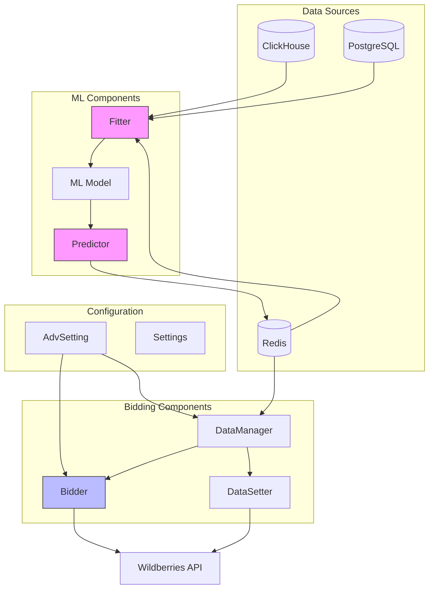
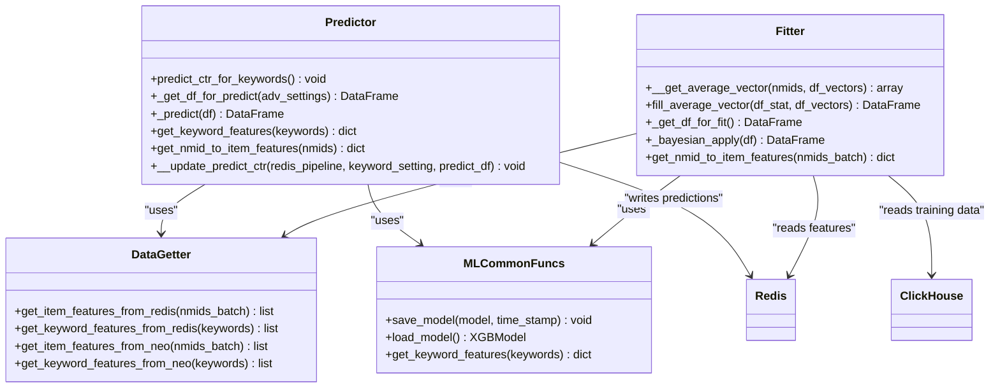
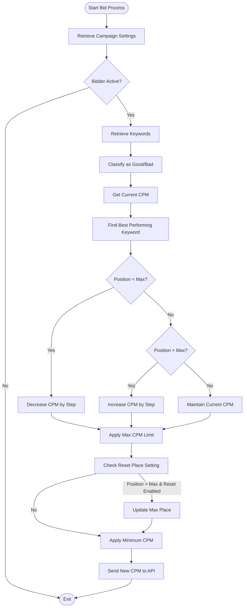
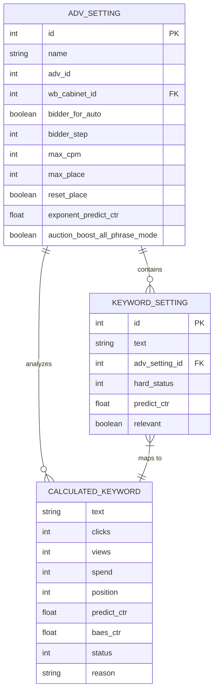
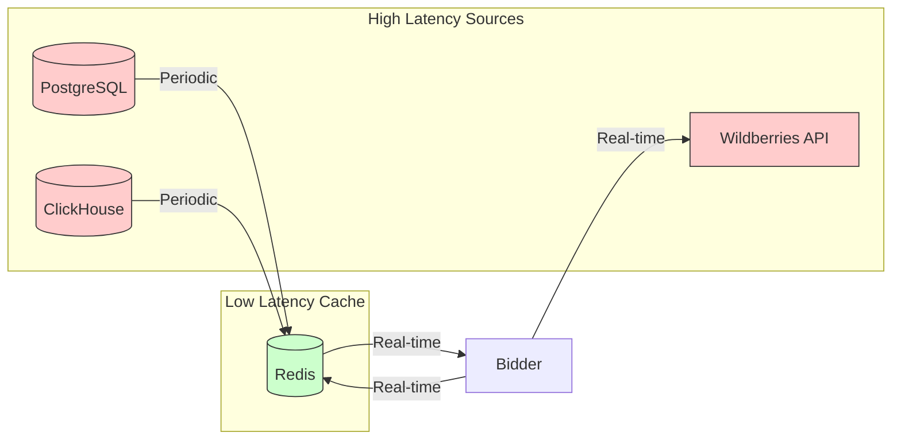
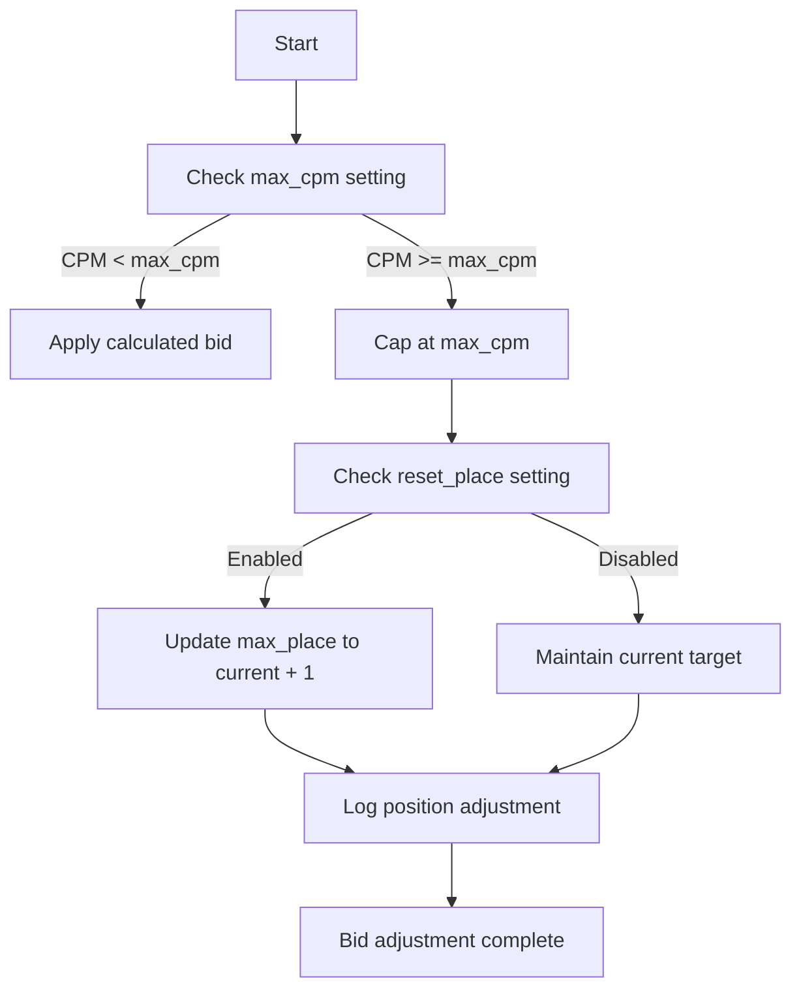
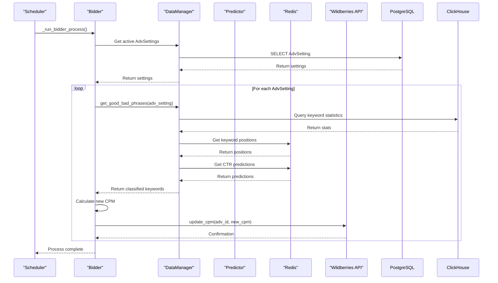

# Bidding Engine

<cite>
**Referenced Files in This Document**   
- [ML.py](file://app/modules/wb_adv_updater/ML.py)
- [bidder.py](file://app/modules/wb_adv_updater/bidder.py)
- [data_manager.py](file://app/modules/wb_adv_updater/data_manager.py)
- [fitter.py](file://app/modules/wb_adv_updater/fitter.py)
- [models.py](file://app/modules/wb_adv_updater/models.py)
- [data_getter.py](file://app/modules/wb_adv_updater/data_getter.py)
- [ml_common_funcs.py](file://app/modules/wb_adv_updater/ml_common_funcs.py)
- [models.py](file://app/modules/common_slaves/wildberries/models/models.py)
- [auction_adv.py](file://app/core/wb_api/data_classes/advs/auction_adv.py)
</cite>

## Table of Contents
1. [Introduction](#introduction)
2. [Bidding Engine Architecture](#bidding-engine-architecture)
3. [Core Components](#core-components)
4. [CTR Prediction System](#ctr-prediction-system)
5. [Bid Optimization Logic](#bid-optimization-logic)
6. [Bidding Modes and Configuration](#bidding-modes-and-configuration)
7. [Domain Models](#domain-models)
8. [Performance Considerations](#performance-considerations)
9. [Common Issues and Solutions](#common-issues-and-solutions)
10. [Integration and Invocation Flow](#integration-and-invocation-flow)

## Introduction
The Bidding Engine component of the adv-bot system is responsible for automated bidding decisions in Wildberries advertising campaigns. This document provides a comprehensive analysis of the bidding system, covering machine learning-based CTR prediction, bid optimization algorithms, auction strategies, and configuration options. The system integrates machine learning models with real-time bidding logic to optimize advertising performance while preventing overbidding and managing campaign budgets effectively.

## Bidding Engine Architecture

**Diagram sources**
- [ML.py](file://app/modules/wb_adv_updater/ML.py)
- [bidder.py](file://app/modules/wb_adv_updater/bidder.py)
- [data_manager.py](file://app/modules/wb_adv_updater/data_manager.py)
- [fitter.py](file://app/modules/wb_adv_updater/fitter.py)

**Section sources**
- [ML.py](file://app/modules/wb_adv_updater/ML.py)
- [bidder.py](file://app/modules/wb_adv_updater/bidder.py)
- [data_manager.py](file://app/modules/wb_adv_updater/data_manager.py)

## Core Components

The Bidding Engine consists of several interconnected components that work together to make intelligent bidding decisions. The system combines machine learning predictions with rule-based optimization logic to adjust bids based on campaign performance and market conditions.

**Section sources**
- [ML.py](file://app/modules/wb_adv_updater/ML.py)
- [bidder.py](file://app/modules/wb_adv_updater/bidder.py)
- [data_manager.py](file://app/modules/wb_adv_updater/data_manager.py)

## CTR Prediction System

### Machine Learning Model Architecture

**Diagram sources**
- [ML.py](file://app/modules/wb_adv_updater/ML.py)
- [fitter.py](file://app/modules/wb_adv_updater/fitter.py)
- [data_getter.py](file://app/modules/wb_adv_updater/data_getter.py)
- [ml_common_funcs.py](file://app/modules/wb_adv_updater/ml_common_funcs.py)

**Section sources**
- [ML.py](file://app/modules/wb_adv_updater/ML.py)
- [fitter.py](file://app/modules/wb_adv_updater/fitter.py)
- [data_getter.py](file://app/modules/wb_adv_updater/data_getter.py)

The CTR prediction system uses an XGBoost regression model trained on historical campaign data to predict click-through rates for keywords. The model combines item features (derived from product vectors) and keyword features (derived from text vectors) to make predictions.

The training process in `fitter.py` collects data from active advertising campaigns, normalizes features, and trains the model using cross-validation to ensure robustness. The prediction process in `ML.py` retrieves the trained model, gathers current campaign data, and generates CTR predictions that are stored in Redis for low-latency access during bidding.

## Bid Optimization Logic

### Bidding Decision Flow

**Diagram sources**
- [bidder.py](file://app/modules/wb_adv_updater/bidder.py)
- [data_manager.py](file://app/modules/wb_adv_updater/data_manager.py)

**Section sources**
- [bidder.py](file://app/modules/wb_adv_updater/bidder.py)
- [data_manager.py](file://app/modules/wb_adv_updater/data_manager.py)

The bid optimization logic in `bidder.py` implements a feedback control system that adjusts bids based on keyword performance and position. The algorithm compares the current position of the best-performing keyword against the target maximum position and adjusts the CPM accordingly:

- If the position is better than the target, decrease the bid by the configured step
- If the position is worse than the target, increase the bid by the configured step
- If the position matches the target, maintain the current bid

The system enforces maximum and minimum bid constraints to prevent overbidding and ensure bids remain within acceptable ranges.

## Bidding Modes and Configuration

### Configuration Options

| Configuration Parameter | Description | Default Value | Source |
|------------------------|-------------|---------------|------|
| bidder_for_auto | Enables/disables automatic bidding | True | [models.py](file://app/modules/common_slaves/wildberries/models/models.py#L425) |
| bidder_step | Bid adjustment step in rubles | DEFAULT_BIDDER_STEP | [models.py](file://app/modules/common_slaves/wildberries/models/models.py#L405) |
| max_cpm | Maximum allowable CPM | None | [models.py](file://app/modules/common_slaves/wildberries/models/models.py#L391) |
| max_place | Target maximum position | None | [models.py](file://app/modules/common_slaves/wildberries/models/models.py#L392) |
| reset_place | Automatically adjust max_place when target is achieved | True | [models.py](file://app/modules/common_slaves/wildberries/models/models.py#L403) |
| exponent_predict_ctr | Exponent for CTR prediction | settings.DEFAULT_CTR_EXPONENTA | [models.py](file://app/modules/common_slaves/wildberries/models/models.py#L408) |
| auction_boost_all_phrase_mode | Enable auction boost for all phrases | False | [models.py](file://app/modules/common_slaves/wildberries/models/models.py#L414) |

The system supports different bidding modes through configuration settings stored in the `AdvSetting` model. The primary mode is automatic bidding (`bidder_for_auto`), which enables the bid optimization algorithm to run continuously. The step mode allows for manual bid adjustments with the system providing recommendations based on performance data.

**Section sources**
- [models.py](file://app/modules/common_slaves/wildberries/models/models.py)
- [bidder.py](file://app/modules/wb_adv_updater/bidder.py)

## Domain Models

### BidStrategy and Related Entities

**Diagram sources**
- [models.py](file://app/modules/common_slaves/wildberries/models/models.py)
- [data_manager.py](file://app/modules/wb_adv_updater/data_manager.py)

The domain model centers around the `AdvSetting` entity, which contains configuration for bidding behavior. Each advertising campaign has associated keywords stored in `KeywordSetting`, which are analyzed and classified as good or bad based on performance metrics. The `CalculatedKeyword` entity represents the runtime analysis of keyword performance, including predicted CTR, actual performance, and bidding status.

## Performance Considerations

### Low-Latency Bid Processing

**Diagram sources**
- [data_manager.py](file://app/modules/wb_adv_updater/data_manager.py)
- [bidder.py](file://app/modules/wb_adv_updater/bidder.py)
- [data_getter.py](file://app/modules/wb_adv_updater/data_getter.py)

The Bidding Engine is optimized for low-latency operations by leveraging Redis as a high-performance cache. All frequently accessed data, including CTR predictions, keyword positions, and campaign settings, are stored in Redis to minimize database queries during the bidding process.

The system uses several optimization techniques:
- Asynchronous I/O operations to prevent blocking
- Batch processing of keyword updates
- In-memory data structures for fast access
- Connection pooling for database and API access
- Caching of frequently accessed data

These optimizations ensure that bid decisions can be made quickly, typically within milliseconds, allowing the system to respond rapidly to changing market conditions.

**Section sources**
- [data_manager.py](file://app/modules/wb_adv_updater/data_manager.py)
- [bidder.py](file://app/modules/wb_adv_updater/bidder.py)
- [data_getter.py](file://app/modules/wb_adv_updater/data_getter.py)

## Common Issues and Solutions

### Overbidding Prevention

**Diagram sources**
- [bidder.py](file://app/modules/wb_adv_updater/bidder.py)
- [data_manager.py](file://app/modules/wb_adv_updater/data_manager.py)

The system addresses common bidding issues through several mechanisms:

**Overbidding Prevention**: The system enforces maximum bid limits through the `max_cpm` parameter and automatically caps bids that exceed this threshold. When the maximum bid is reached, the system can optionally adjust the target position to prevent continuous bid escalation.

**Prediction Inaccuracies**: The CTR prediction model uses Bayesian averaging to handle keywords with limited historical data. For keywords with insufficient views, the system applies a conservative approach by not classifying them as bad based solely on low performance.

**Position Instability**: The bid adjustment algorithm uses a step-based approach rather than proportional control to prevent oscillation and ensure stable positioning. The step size is configurable to balance responsiveness and stability.

**Budget Management**: The system checks cabinet balance before making bid adjustments to ensure sufficient funds are available for continued advertising.

**Section sources**
- [bidder.py](file://app/modules/wb_adv_updater/bidder.py)
- [data_manager.py](file://app/modules/wb_adv_updater/data_manager.py)
- [ML.py](file://app/modules/wb_adv_updater/ML.py)

## Integration and Invocation Flow

### Campaign Update and Bidding Decision Sequence

**Diagram sources**
- [bidder.py](file://app/modules/wb_adv_updater/bidder.py)
- [data_manager.py](file://app/modules/wb_adv_updater/data_manager.py)
- [ML.py](file://app/modules/wb_adv_updater/ML.py)

The integration flow begins with a scheduler that invokes the bidding process at regular intervals. The `Bidder` component retrieves active campaign settings from the database and processes each campaign individually. For each campaign, it requests keyword analysis from the `DataManager`, which aggregates data from multiple sources including ClickHouse (historical statistics), Redis (current positions and predictions), and the database (campaign configuration).

The classified keywords are used to determine the appropriate bid adjustment, which is then applied through the Wildberries API. This end-to-end process ensures that bidding decisions are based on comprehensive, up-to-date information from multiple data sources.

**Section sources**
- [bidder.py](file://app/modules/wb_adv_updater/bidder.py)
- [data_manager.py](file://app/modules/wb_adv_updater/data_manager.py)
- [ML.py](file://app/modules/wb_adv_updater/ML.py)