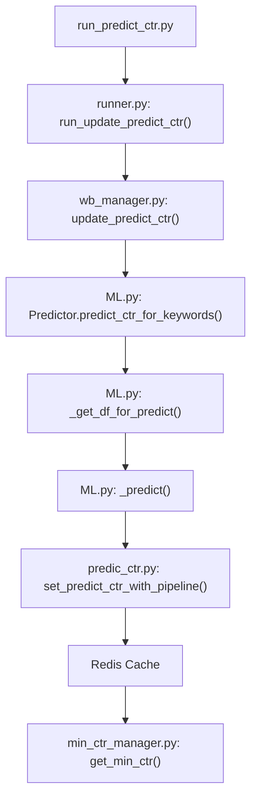
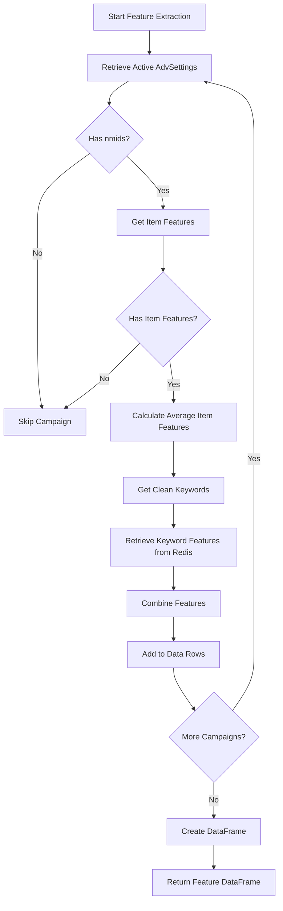
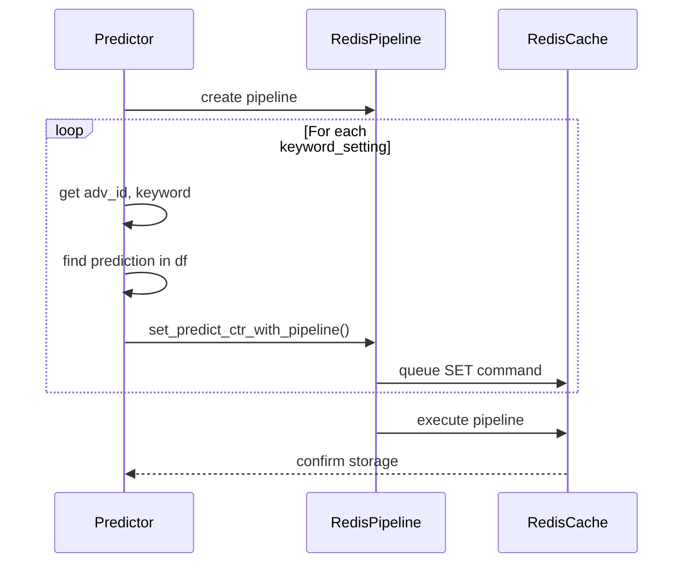
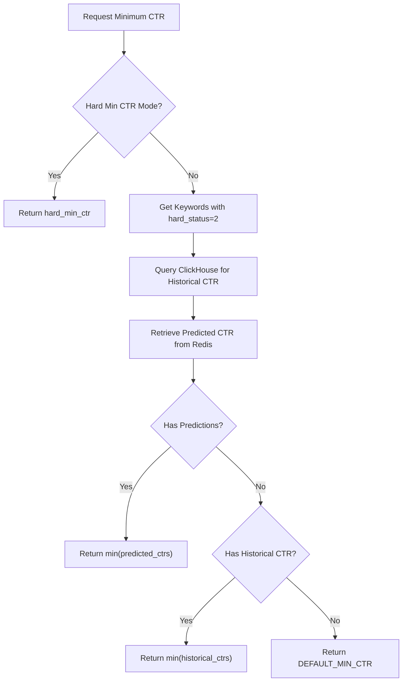

# CTR Prediction

<cite>
**Referenced Files in This Document**   
- [ML.py](file://app/modules/wb_adv_updater/ML.py)
- [predic_ctr.py](file://app/core/redis_manager_v2/mixins/predic_ctr.py)
- [min_ctr_manager.py](file://app/modules/wb_adv_updater/min_ctr_manager/min_ctr_manager.py)
- [redis_manager/__init__.py](file://app/utils/redis_manager/__init__.py)
- [wb_manager.py](file://app/modules/wb_adv_updater/wb_manager.py)
- [runner.py](file://app/modules/wb_adv_updater/runner.py)
- [run_predict_ctr.py](file://run_predict_ctr.py)
</cite>

## Table of Contents
1. [Introduction](#introduction)
2. [CTR Prediction Pipeline](#ctr-prediction-pipeline)
3. [Feature Extraction Process](#feature-extraction-process)
4. [Model Architecture and Prediction](#model-architecture-and-prediction)
5. [Redis-Based Caching Mechanism](#redis-based-caching-mechanism)
6. [Integration with Bidding Decisions](#integration-with-bidding-decisions)
7. [Data Flow from Historical Performance to Real-Time Predictions](#data-flow-from-historical-performance-to-real-time-predictions)
8. [Common Issues and Troubleshooting](#common-issues-and-troubleshooting)
9. [Optimization Strategies](#optimization-strategies)
10. [Conclusion](#conclusion)

## Introduction
The CTR Prediction component of the Bidding Engine is a critical system responsible for forecasting click-through rates for keywords in advertising campaigns. This document provides a comprehensive analysis of the machine learning model implemented in `app/modules/wb_adv_updater/ML.py`, the Redis-based caching mechanism in `app/core/redis_manager_v2/mixins/predic_ctr.py`, and how predicted CTR values influence bidding decisions and minimum CTR calculations in `app/modules/wb_adv_updater/min_ctr_manager/min_ctr_manager.py`. The system integrates historical performance data, machine learning predictions, and real-time caching to optimize advertising effectiveness.

**Section sources**
- [ML.py](file://app/modules/wb_adv_updater/ML.py#L1-L257)
- [predic_ctr.py](file://app/core/redis_manager_v2/mixins/predic_ctr.py#L1-L77)
- [min_ctr_manager.py](file://app/modules/wb_adv_updater/min_ctr_manager/min_ctr_manager.py#L1-L125)

## CTR Prediction Pipeline
The CTR prediction pipeline is orchestrated through a series of interconnected components that process data from retrieval to prediction storage. The pipeline begins with the execution of `run_predict_ctr.py`, which calls the `run_update_predict_ctr()` function from `runner.py`. This function initiates the `update_predict_ctr()` method in `wb_manager.py`, which creates an instance of the `Predictor` class from `ML.py` and executes the `predict_ctr_for_keywords()` method.

The pipeline follows a structured sequence:
1. Retrieve active advertising settings from the database
2. Extract relevant features for prediction
3. Generate prediction data frame
4. Apply machine learning model to generate CTR predictions
5. Store predictions in Redis cache
6. Update minimum CTR calculations based on predictions

This pipeline operates asynchronously using Python's asyncio framework, allowing for efficient processing of multiple advertising campaigns concurrently. The system employs a semaphore (`update_predict_ctr_process_semaphore`) to limit concurrent operations and prevent resource exhaustion.



**Diagram sources**
- [run_predict_ctr.py](file://run_predict_ctr.py#L1-L8)
- [runner.py](file://app/modules/wb_adv_updater/runner.py#L1-L96)
- [wb_manager.py](file://app/modules/wb_adv_updater/wb_manager.py#L1-L443)
- [ML.py](file://app/modules/wb_adv_updater/ML.py#L1-L257)

**Section sources**
- [run_predict_ctr.py](file://run_predict_ctr.py#L1-L8)
- [runner.py](file://app/modules/wb_adv_updater/runner.py#L1-L96)
- [wb_manager.py](file://app/modules/wb_adv_updater/wb_manager.py#L1-L443)

## Feature Extraction Process
The feature extraction process in the CTR prediction system is designed to transform raw advertising data into meaningful inputs for the machine learning model. The `_get_df_for_predict()` method in the `Predictor` class orchestrates this process by gathering data from multiple sources and constructing a comprehensive feature set for each keyword.

The feature extraction process involves several key steps:
1. **Item Feature Aggregation**: For each advertising campaign, the system retrieves item features (nmids) and calculates average feature values across all items in the campaign. This creates a consistent representation of the product portfolio.
2. **Keyword Feature Retrieval**: The system fetches pre-computed keyword features from Redis cache using the `get_keyword_features_from_redis()` method. These features likely include semantic embeddings or other vector representations of keywords.
3. **Text Preprocessing**: All keywords undergo text cleaning through the `text_cleaner.clear()` function, which standardizes text format and removes special characters.
4. **Feature Combination**: The system combines campaign-level features (adv_type), item-level features (item_feature_i), and keyword-level features (keyword_feature_i) into a unified feature vector for each keyword.

The feature extraction process handles edge cases such as missing nmids or empty keyword lists, ensuring robust operation even with incomplete data. The system also manages potential exceptions during data retrieval, logging errors appropriately without terminating the entire prediction process.



**Diagram sources**
- [ML.py](file://app/modules/wb_adv_updater/ML.py#L1-L257)

**Section sources**
- [ML.py](file://app/modules/wb_adv_updater/ML.py#L1-L257)

## Model Architecture and Prediction
The CTR prediction system employs an XGBoost machine learning model for forecasting click-through rates. The architecture follows a modular design with clear separation between data preparation, model application, and result processing components.

The prediction process is implemented in the `_predict()` method of the `Predictor` class, which performs the following steps:
1. Loads the pre-trained XGBoost model using the `load_model()` function from `ml_common_funcs.py`
2. Removes non-feature columns (keyword, adv_id) from the input dataframe
3. Applies the model to generate predictions
4. Attaches predictions to the original dataframe
5. Ensures predictions are non-negative by clipping negative values to zero

The model architecture leverages XGBoost's strengths in handling tabular data with mixed feature types. The system processes predictions in a separate thread using `asyncio.to_thread()`, allowing the main event loop to continue processing other tasks while the computationally intensive prediction occurs in the background.

The prediction pipeline includes comprehensive error handling at each stage, with detailed logging to facilitate debugging and monitoring. The system also saves the prediction results to a CSV file in the work_folder directory, providing a persistent record of predictions for analysis and validation.

```mermaid
classDiagram
class Predictor {
+_predict(df : DataFrame) DataFrame
+predict_ctr_for_keywords() None
+_get_df_for_predict(adv_settings : list[AdvSetting]) DataFrame
+get_nmid_to_item_features(nmids) dict
+get_keyword_features(clear_keywords) dict
+__update_predict_ctr(redis_pipeline, keyword_setting, predict_df) None
}
class Fitter {
+__get_average_vector(nmids, df_vectors) array
+fill_average_vector(df_stat, df_vectors) DataFrame
}
Predictor --> Fitter : "uses"
Predictor --> "xgboost.XGBModel" : "applies"
Predictor --> "BaseRedis" : "stores results"
Predictor --> "DataGetter" : "retrieves features"
```

**Diagram sources**
- [ML.py](file://app/modules/wb_adv_updater/ML.py#L1-L257)

**Section sources**
- [ML.py](file://app/modules/wb_adv_updater/ML.py#L1-L257)

## Redis-Based Caching Mechanism
The Redis-based caching mechanism is a critical component of the CTR prediction system, enabling efficient storage and retrieval of predicted CTR values. The system implements a dual-key strategy with both legacy and new key formats to support backward compatibility while introducing improved organization.

The caching mechanism is implemented in the `PredictCTRRedisMixin` class in `predic_ctr.py`, which provides several key methods:
- `_get_legacy_key(adv_id, keyword)`: Creates a legacy key format "predict_ctr:{adv_id}:{keyword}"
- `_get_new_key(nmids, keyword)`: Creates a new key format "predict_ctr_v2:{sorted_nmids}:{keyword}"
- `set_predict_ctr_with_pipeline_legacy()`: Stores CTR values using the legacy key format
- `set_predict_ctr_with_pipeline_by_nmids()`: Stores CTR values using the new key format
- `get_predict_ctr_by_nmids()`: Retrieves CTR values by nmids and keyword
- `_get_predict_ctr_by_key()`: Internal method for retrieving CTR values with error handling

The system uses Redis pipelines to batch multiple SET operations, improving performance when updating multiple predictions. The caching mechanism includes comprehensive error handling for value conversion issues (ValueError, TypeError) and general Redis exceptions, ensuring robust operation even when encountering corrupted or malformed data.

The key structure evolution from campaign-based to product-based (nmids) reflects a strategic shift toward more granular and reusable predictions. This allows the system to share CTR predictions across campaigns that feature the same products, reducing redundant calculations and improving consistency.



**Diagram sources**
- [predic_ctr.py](file://app/core/redis_manager_v2/mixins/predic_ctr.py#L1-L77)
- [ML.py](file://app/modules/wb_adv_updater/ML.py#L1-L257)

**Section sources**
- [predic_ctr.py](file://app/core/redis_manager_v2/mixins/predic_ctr.py#L1-L77)
- [redis_manager/__init__.py](file://app/utils/redis_manager/__init__.py#L1-L825)

## Integration with Bidding Decisions
The predicted CTR values are integral to the bidding decision process, particularly in determining minimum CTR thresholds for advertising campaigns. The `MinCtrManager` class in `min_ctr_manager.py` implements the logic for calculating minimum CTR values based on both predicted and historical performance data.

The integration process follows this workflow:
1. When minimum CTR is requested, the system first checks if hard_min_ctr mode is enabled
2. If auto mode is active, the system retrieves keywords with hard_status=2 (presumably high-performing keywords)
3. The system queries ClickHouse for historical CTR data for these keywords across both auto and search advertising campaigns
4. For each keyword, the system retrieves the predicted CTR from Redis
5. The minimum CTR is determined as the minimum of predicted CTRs, falling back to historical CTRs if predictions are unavailable

This integration creates a feedback loop where machine learning predictions directly influence bidding strategy. The system prioritizes predicted CTRs over historical data, reflecting confidence in the model's ability to forecast future performance. This approach allows the bidding engine to be proactive rather than reactive, adjusting bids based on anticipated performance rather than past results.

The integration also handles edge cases gracefully, falling back to default minimum CTR values when neither predictions nor historical data are available. This ensures that the bidding system can continue operating even when prediction systems are temporarily unavailable.



**Diagram sources**
- [min_ctr_manager.py](file://app/modules/wb_adv_updater/min_ctr_manager/min_ctr_manager.py#L1-L125)
- [redis_manager/__init__.py](file://app/utils/redis_manager/__init__.py#L1-L825)

**Section sources**
- [min_ctr_manager.py](file://app/modules/wb_adv_updater/min_ctr_manager/min_ctr_manager.py#L1-L125)

## Data Flow from Historical Performance to Real-Time Predictions
The data flow from historical performance to real-time predictions follows a comprehensive pipeline that integrates multiple data sources and processing stages. The system begins with historical advertising performance data stored in ClickHouse, which serves as the foundation for both model training and validation.

The data flow process can be broken down into the following stages:
1. **Data Collection**: Historical performance data (views, clicks, spend) is collected from Wildberries API and stored in ClickHouse through the `insert_or_update_keywords()` function in `wb_manager.py`
2. **Feature Preparation**: Item features and keyword features are prepared and stored in Redis, creating a feature repository for prediction
3. **Model Application**: The trained XGBoost model is applied to current campaign data to generate CTR predictions
4. **Prediction Storage**: Predictions are stored in Redis using the `PredictCTRRedisMixin` methods
5. **Decision Integration**: Predicted CTR values are retrieved by the `MinCtrManager` to influence bidding decisions

The system maintains data consistency through careful synchronization between database records, Redis cache, and model predictions. The use of timestamps and versioning in ClickHouse ensures that the most recent data is used for analysis, while the Redis cache provides low-latency access to frequently requested predictions.

The data flow is designed to handle both batch and real-time requirements. Batch processing occurs during scheduled prediction updates, while real-time access is supported through the Redis cache. This hybrid approach balances computational efficiency with responsiveness to changing market conditions.


**Diagram sources**
- [wb_manager.py](file://app/modules/wb_adv_updater/wb_manager.py#L1-L443)
- [ML.py](file://app/modules/wb_adv_updater/ML.py#L1-L257)
- [predic_ctr.py](file://app/core/redis_manager_v2/mixins/predic_ctr.py#L1-L77)

**Section sources**
- [wb_manager.py](file://app/modules/wb_adv_updater/wb_manager.py#L1-L443)
- [ML.py](file://app/modules/wb_adv_updater/ML.py#L1-L257)

## Common Issues and Troubleshooting
The CTR prediction system may encounter several common issues that require troubleshooting and resolution. Understanding these issues and their solutions is essential for maintaining system reliability and prediction accuracy.

**Prediction Drift**: Over time, the model's predictions may diverge from actual performance due to changing market conditions or product characteristics. This can be detected by monitoring the discrepancy between predicted and actual CTR values. The solution involves regular model retraining using recent performance data to maintain prediction accuracy.

**Cache Misses**: When predicted CTR values are not found in Redis, the system falls back to historical data or default values. This can occur due to prediction pipeline failures, cache expiration, or incomplete data processing. Monitoring cache hit rates and implementing cache warming strategies can mitigate this issue.

**Data Inconsistencies**: Discrepancies between database records, Redis cache, and API data can lead to incorrect predictions. Implementing data validation checks and synchronization processes helps maintain data integrity across systems.

**Performance Bottlenecks**: The prediction process may experience delays due to large data volumes or computational complexity. Optimizing data retrieval, implementing efficient batching, and scaling infrastructure can address performance issues.

**Error Handling**: The system includes comprehensive logging and error handling, but unexpected exceptions may still occur. Regular monitoring of error logs and implementing automated alerts helps identify and resolve issues promptly.

Troubleshooting these issues requires a systematic approach, starting with log analysis to identify the root cause, followed by targeted interventions to resolve the specific problem. Regular system health checks and performance monitoring are essential for proactive issue detection and resolution.

**Section sources**
- [ML.py](file://app/modules/wb_adv_updater/ML.py#L1-L257)
- [predic_ctr.py](file://app/core/redis_manager_v2/mixins/predic_ctr.py#L1-L77)
- [min_ctr_manager.py](file://app/modules/wb_adv_updater/min_ctr_manager/min_ctr_manager.py#L1-L125)

## Optimization Strategies
Several optimization strategies can be implemented to improve prediction accuracy and system responsiveness in the CTR prediction component.

**Model Optimization**: Regular retraining of the XGBoost model with recent data helps maintain prediction accuracy. Implementing automated model validation and selection processes ensures that the best-performing model is always in use. Feature engineering improvements, such as incorporating additional contextual features or refining existing feature representations, can enhance prediction quality.

**Caching Optimization**: Implementing a multi-tier caching strategy with different expiration policies for different data types can improve cache efficiency. Cache warming procedures before peak usage periods ensure that predictions are readily available when needed. Monitoring cache hit rates and adjusting cache size and eviction policies optimizes memory usage.

**Pipeline Optimization**: Parallelizing independent operations in the prediction pipeline reduces overall processing time. Implementing incremental updates rather than full recalculations when possible improves efficiency. Optimizing database queries and data retrieval processes reduces latency in the feature extraction stage.

**Infrastructure Optimization**: Scaling the prediction infrastructure based on demand patterns ensures adequate resources during peak periods. Implementing load balancing across multiple prediction servers improves system responsiveness. Monitoring system performance metrics helps identify and address bottlenecks proactively.

**Data Quality Optimization**: Implementing data validation and cleansing procedures ensures high-quality input data for predictions. Establishing data quality metrics and monitoring them regularly helps maintain data integrity. Implementing automated data correction processes reduces manual intervention requirements.

These optimization strategies work together to create a robust and efficient CTR prediction system that delivers accurate forecasts with minimal latency, supporting effective bidding decisions in the advertising platform.

**Section sources**
- [ML.py](file://app/modules/wb_adv_updater/ML.py#L1-L257)
- [predic_ctr.py](file://app/core/redis_manager_v2/mixins/predic_ctr.py#L1-L77)
- [min_ctr_manager.py](file://app/modules/wb_adv_updater/min_ctr_manager/min_ctr_manager.py#L1-L125)

## Conclusion
The CTR Prediction component of the Bidding Engine represents a sophisticated integration of machine learning, data engineering, and real-time decision systems. By leveraging historical performance data, advanced feature engineering, and XGBoost modeling, the system generates accurate click-through rate predictions that directly influence bidding strategies. The Redis-based caching mechanism ensures efficient storage and retrieval of predictions, while the integration with minimum CTR calculations creates a feedback loop that optimizes advertising effectiveness.

The system's modular architecture, comprehensive error handling, and well-defined data flow make it robust and maintainable. However, ongoing optimization and monitoring are essential to address challenges such as prediction drift, cache misses, and performance bottlenecks. By implementing the optimization strategies outlined in this document, the system can continue to deliver high-quality predictions that support effective advertising campaigns in a dynamic marketplace.

The CTR prediction system exemplifies how machine learning can be effectively integrated into real-time decision systems, providing a competitive advantage through data-driven insights and automated optimization.