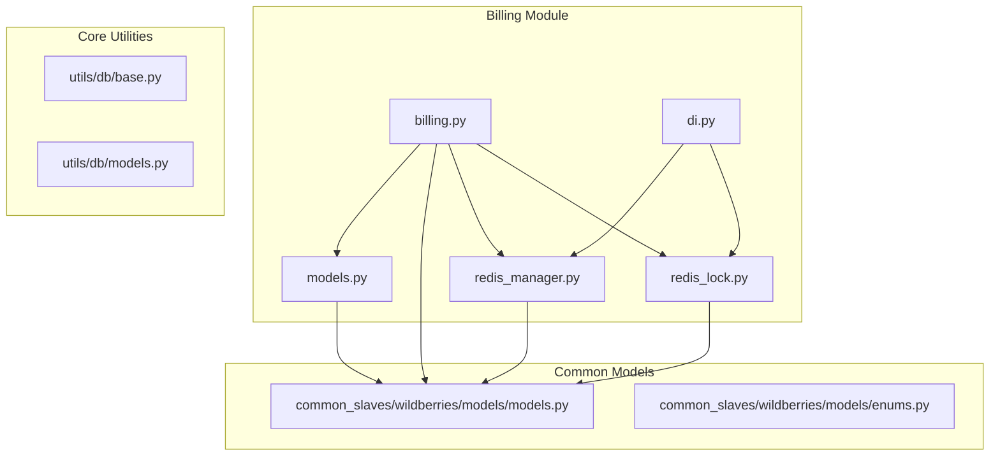
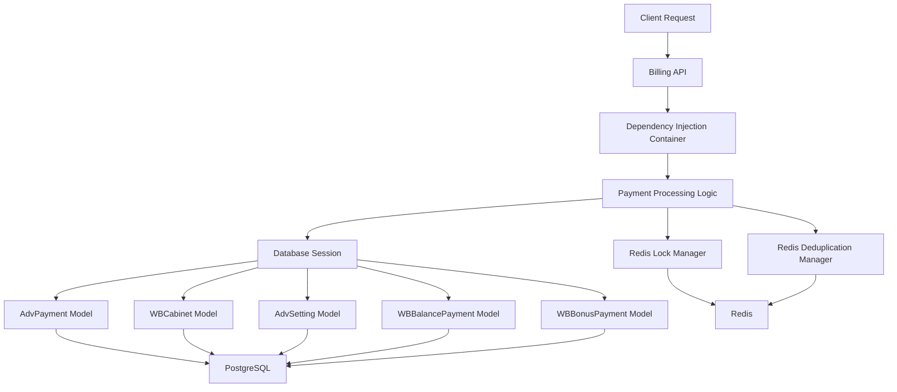
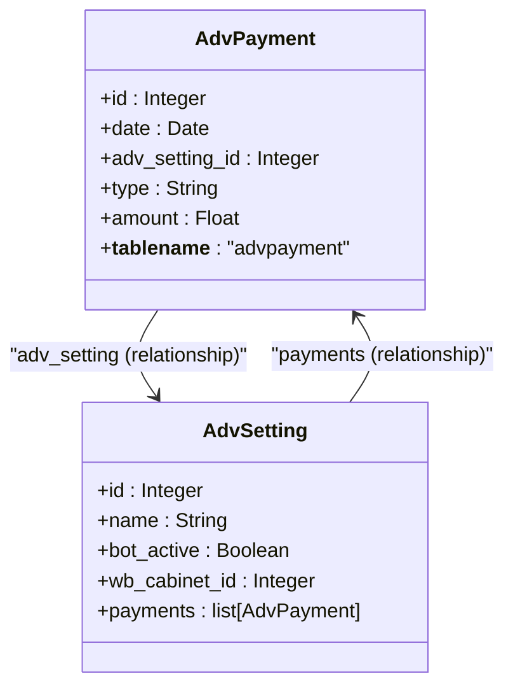
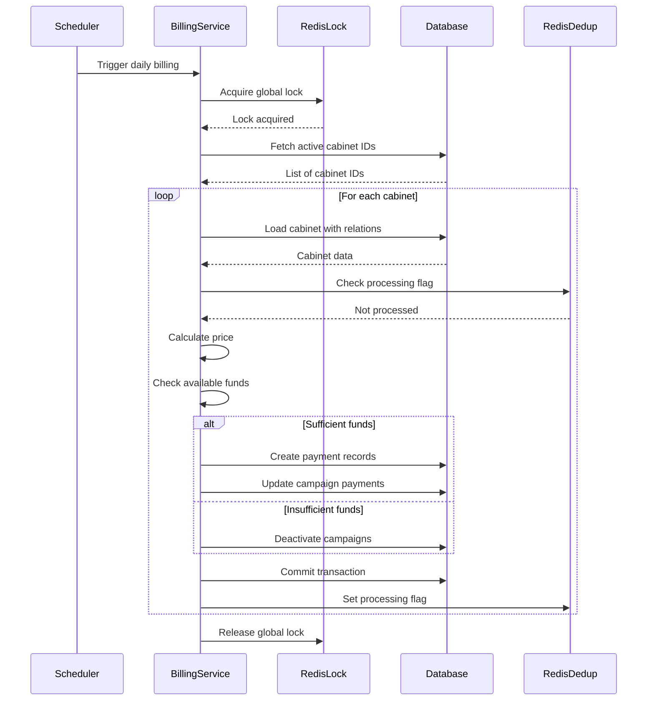
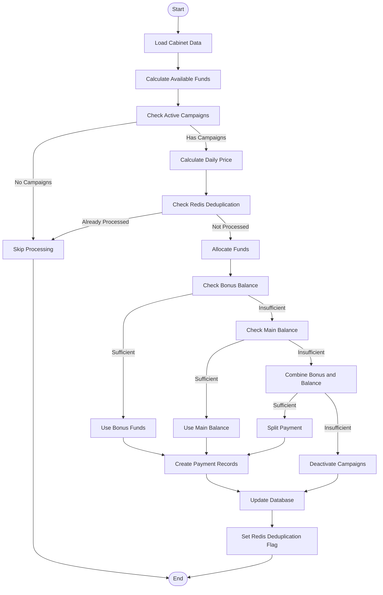
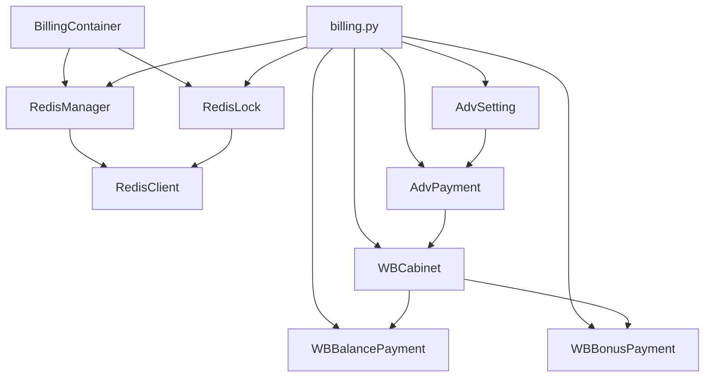

# Billing Data Model

<cite>
**Referenced Files in This Document**   
- [AdvPayment](file://app/modules/billing/models.py)
- [WBCabinet](file://app/modules/common_slaves/wildberries/models/models.py)
- [AdvSetting](file://app/modules/common_slaves/wildberries/models/models.py)
- [WBBalancePayment](file://app/modules/common_slaves/wildberries/models/models.py)
- [WBBonusPayment](file://app/modules/common_slaves/wildberries/models/models.py)
- [User](file://app/utils/db/models.py)
- [billing.py](file://app/modules/billing/billing.py)
- [base.py](file://app/utils/db/base.py)
</cite>

## Table of Contents
1. [Introduction](#introduction)
2. [Project Structure](#project-structure)
3. [Core Components](#core-components)
4. [Architecture Overview](#architecture-overview)
5. [Detailed Component Analysis](#detailed-component-analysis)
6. [Dependency Analysis](#dependency-analysis)
7. [Performance Considerations](#performance-considerations)
8. [Troubleshooting Guide](#troubleshooting-guide)
9. [Conclusion](#conclusion)

## Introduction
This document provides comprehensive documentation for the billing system data model in the advertising automation platform. The system manages daily charges for advertising campaigns, handling payments through cabinet balances and bonuses. It includes models for tracking payments, calculating pricing based on shop configurations, and managing financial transactions with proper validation and constraints. The documentation covers entity relationships, field definitions, data validation rules, business logic enforcement, and integration with ORM and caching layers.

## Project Structure
The billing system is organized within the application's modular structure, with dedicated components for models, business logic, dependency injection, and Redis integration. The core billing functionality resides in the `app/modules/billing` directory, which contains models, processing logic, and Redis management components. The system integrates with user and cabinet management through shared models in the common slaves module.

**Diagram sources**
- [models.py](file://app/modules/billing/models.py)
- [billing.py](file://app/modules/billing/billing.py)
- [redis_manager.py](file://app/modules/billing/redis_manager.py)
- [redis_lock.py](file://app/modules/billing/redis_lock.py)
- [models.py](file://app/modules/common_slaves/wildberries/models/models.py)

**Section sources**
- [app/modules/billing](file://app/modules/billing)
- [app/modules/common_slaves/wildberries/models](file://app/modules/common_slaves/wildberries/models)

## Core Components
The billing system consists of several core components that work together to process daily charges for advertising campaigns. The main entities include AdvPayment for tracking individual campaign charges, WBCabinet for managing cabinet-level balances, and AdvSetting for representing advertising campaigns. The system uses Redis for locking and deduplication to ensure idempotent processing of daily charges. Payment processing follows a specific priority order: first using bonus funds, then balance funds, and finally deactivating campaigns if insufficient funds are available.

**Section sources**
- [models.py](file://app/modules/billing/models.py#L1-L24)
- [billing.py](file://app/modules/billing/billing.py#L1-L347)
- [models.py](file://app/modules/common_slaves/wildberries/models/models.py#L1-L660)

## Architecture Overview
The billing architecture follows a layered approach with clear separation of concerns. At the data layer, SQLAlchemy models define the database schema with proper relationships and constraints. The business logic layer implements the payment processing workflow, including price calculation, fund allocation, and campaign management. The integration layer handles Redis operations for locking and deduplication. The dependency injection system manages component dependencies, allowing for easy testing and configuration.

**Diagram sources**
- [billing.py](file://app/modules/billing/billing.py#L1-L347)
- [di.py](file://app/modules/billing/di.py#L1-L42)
- [redis_manager.py](file://app/modules/billing/redis_manager.py#L1-L10)
- [redis_lock.py](file://app/modules/billing/redis_lock.py#L1-L25)

## Detailed Component Analysis

### AdvPayment Model Analysis
The AdvPayment model represents individual charges for advertising campaigns on a daily basis. It tracks the amount charged to each campaign and maintains a relationship with the corresponding AdvSetting.

**Diagram sources**
- [models.py](file://app/modules/billing/models.py#L1-L24)
- [models.py](file://app/modules/common_slaves/wildberries/models/models.py#L400-L659)

**Section sources**
- [models.py](file://app/modules/billing/models.py#L1-L24)

### Payment Processing Workflow
The payment processing workflow handles daily charges for all active advertising campaigns. It follows a systematic approach to ensure reliable and consistent processing.

**Diagram sources**
- [billing.py](file://app/modules/billing/billing.py#L1-L347)
- [redis_manager.py](file://app/modules/billing/redis_manager.py#L1-L10)
- [redis_lock.py](file://app/modules/billing/redis_lock.py#L1-L25)

### Financial Data Flow
The financial data flow illustrates how funds are allocated and tracked within the billing system, showing the relationship between cabinets, balances, bonuses, and campaign charges.

**Diagram sources**
- [billing.py](file://app/modules/billing/billing.py#L1-L347)
- [models.py](file://app/modules/common_slaves/wildberries/models/models.py#L1-L200)

## Dependency Analysis
The billing system has well-defined dependencies between components, ensuring loose coupling and high cohesion. The core dependencies include the relationship between AdvPayment and AdvSetting, the integration with Redis for locking and deduplication, and the dependency injection configuration that wires components together.

**Diagram sources**
- [di.py](file://app/modules/billing/di.py#L1-L42)
- [billing.py](file://app/modules/billing/billing.py#L1-L347)
- [models.py](file://app/modules/billing/models.py#L1-L24)
- [models.py](file://app/modules/common_slaves/wildberries/models/models.py#L1-L660)

**Section sources**
- [di.py](file://app/modules/billing/di.py#L1-L42)
- [billing.py](file://app/modules/billing/billing.py#L1-L347)

## Performance Considerations
The billing system incorporates several performance optimizations to handle large volumes of data efficiently. These include database indexing on frequently queried fields, batch processing of cabinets, and Redis-based deduplication to avoid redundant database operations. The system uses read-only sessions for initial data loading and separate transactional sessions for updates, minimizing lock contention. The Redis lock has a TTL of 1 hour to prevent indefinite blocking, while the deduplication flag has a TTL of 1 day to ensure daily processing.

## Troubleshooting Guide
Common issues in the billing system typically relate to Redis connectivity, database transaction failures, or insufficient funds handling. The system logs detailed information about each processing step, including reasons for skipping cabinets or failing transactions. Monitoring should focus on the global lock acquisition rate, Redis deduplication hit rate, and the distribution of processing reasons (success, insufficient funds, already processed). Error handling includes proper rollback of database transactions and fallback mechanisms for Redis operations.

**Section sources**
- [billing.py](file://app/modules/billing/billing.py#L1-L347)
- [redis_manager.py](file://app/modules/billing/redis_manager.py#L1-L10)
- [redis_lock.py](file://app/modules/billing/redis_lock.py#L1-L25)

## Conclusion
The billing system provides a robust foundation for managing daily charges for advertising campaigns. It combines reliable database persistence with efficient Redis-based coordination to ensure consistent processing. The modular design with clear separation of concerns makes the system maintainable and testable. Future enhancements could include more sophisticated pricing models, improved error recovery mechanisms, and enhanced monitoring capabilities.