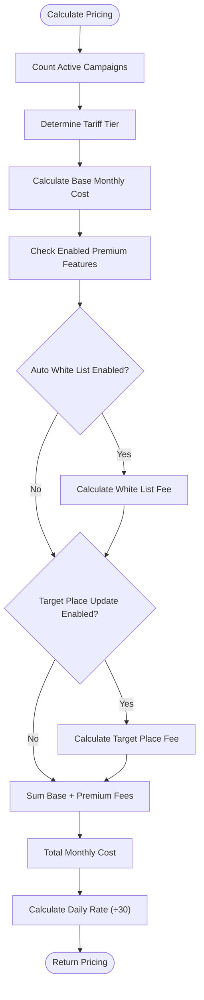
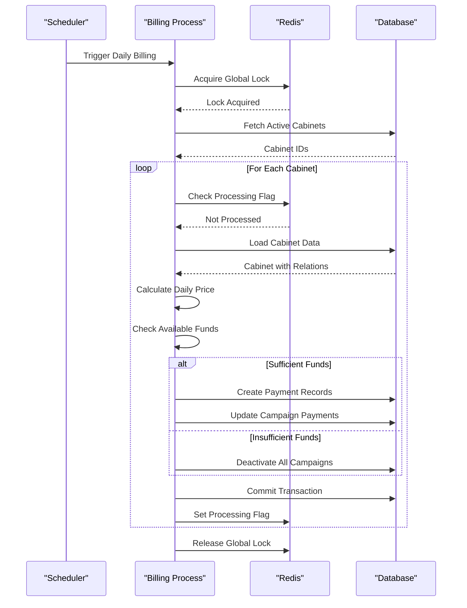
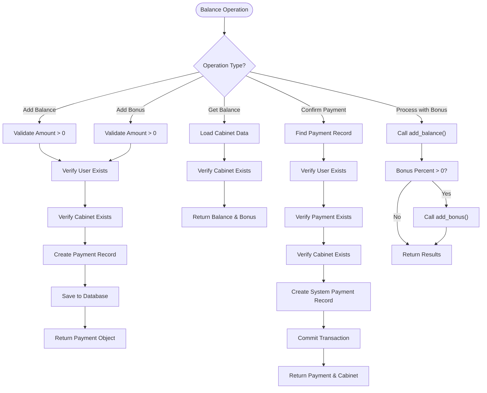
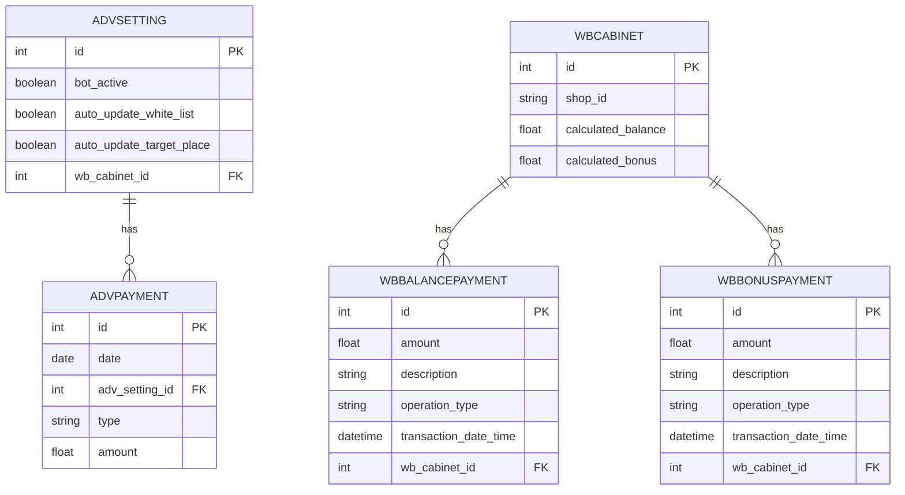
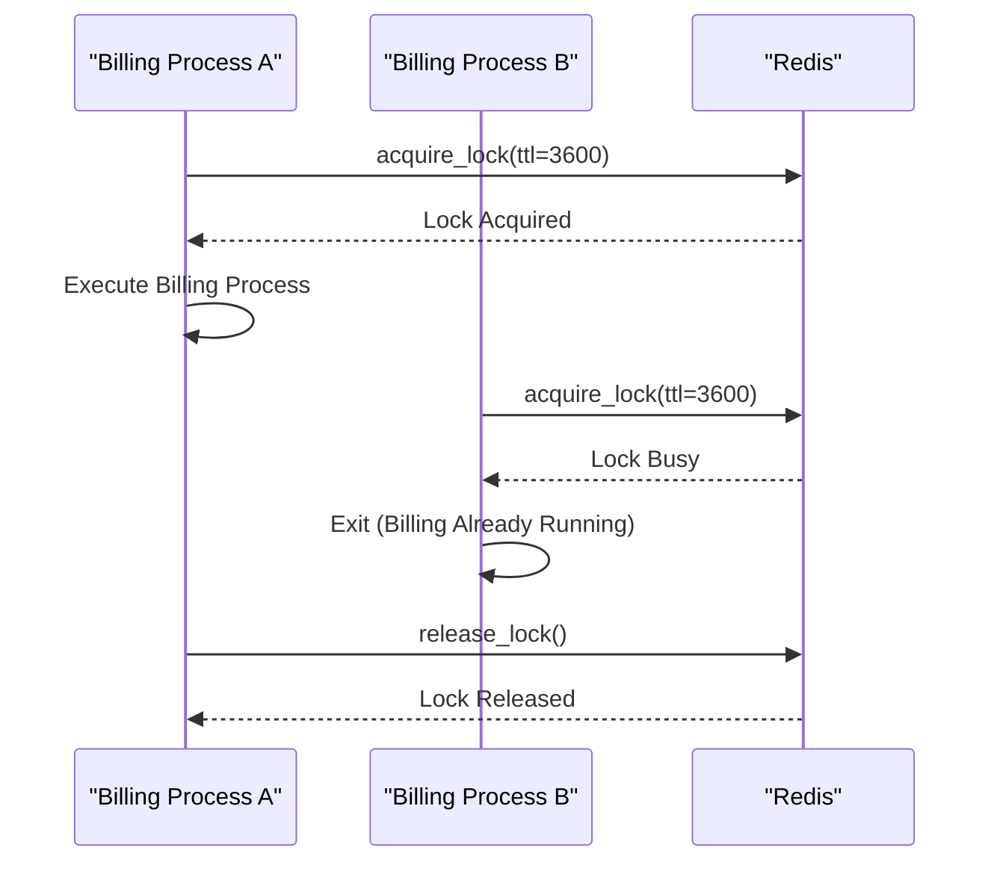
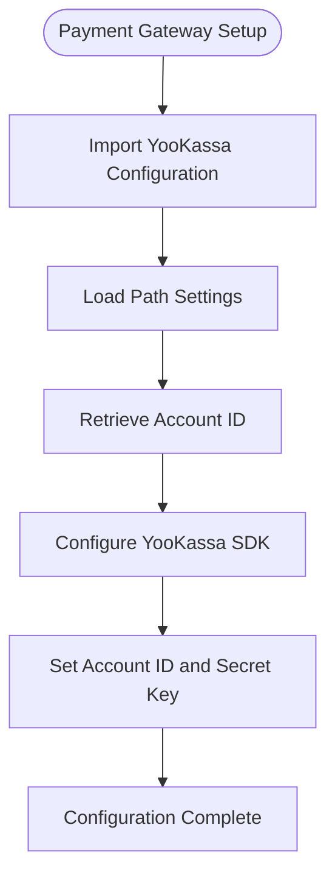

# Billing and Subscription System

<cite>
**Referenced Files in This Document**   
- [tariffs.py](file://app/modules/billing/pricer/tariffs.py)
- [pricer.py](file://app/modules/billing/pricer/pricer.py)
- [billing.py](file://app/modules/billing/billing.py)
- [balance_service.py](file://app/modules/balance_manager/balance_service.py)
- [manager.py](file://app/payments/manager.py)
- [models.py](file://app/modules/billing/models.py)
- [redis_lock.py](file://app/modules/billing/redis_lock.py)
- [redis_manager.py](file://app/modules/billing/redis_manager.py)
- [di.py](file://app/modules/billing/di.py)
- [tariffs_text.py](file://app/modules/billing/pricer/tariffs_text.py)
</cite>

## Table of Contents
1. [Introduction](#introduction)
2. [Subscription Model and Tariff Structure](#subscription-model-and-tariff-structure)
3. [Pricing Logic and Calculation Engine](#pricing-logic-and-calculation-engine)
4. [Billing Lifecycle and Payment Processing](#billing-lifecycle-and-payment-processing)
5. [Usage Tracking and Balance Management](#usage-tracking-and-balance-management)
6. [Data Model for Billing Records](#data-model-for-billing-records)
7. [Concurrency Control and Race Condition Prevention](#concurrency-control-and-race-condition-prevention)
8. [Payment Gateway Integration](#payment-gateway-integration)
9. [Configuration of Pricing Tiers and Promotional Offers](#configuration-of-pricing-tiers-and-promotional-offers)
10. [Error Handling and Edge Cases](#error-handling-and-edge-cases)

## Introduction
The billing and subscription management system provides a comprehensive solution for handling subscription-based services, usage tracking, and financial transactions. The system is designed to support multiple pricing tiers, automated billing cycles, and robust balance management with concurrency controls. This documentation details the architecture, implementation, and operational aspects of the system, focusing on the core components that enable subscription management, pricing calculations, and payment processing.

## Subscription Model and Tariff Structure
The subscription model is defined in the `tariffs.py` module, which establishes a tiered pricing structure based on the number of active advertising campaigns (artikuls) in a user's cabinet. The tariff system implements volume-based pricing where the cost per campaign decreases as the number of campaigns increases, providing economies of scale for larger accounts.

The tariff structure is implemented as a dictionary mapping campaign count thresholds to monthly prices per campaign:

```python
tariffs = {
    2: 1699,
    5: 1299,
    10: 899,
    20: 799,
    50: 649,
    150: 549,
    500: 399,
}
```

This structure means that accounts with 1-2 campaigns pay 1699 rubles per campaign per month, while accounts with 501 or more campaigns pay 399 rubles per campaign per month. The system automatically applies the appropriate tier based on the total number of active campaigns in a cabinet.

**Section sources**
- [tariffs.py](file://app/modules/billing/pricer/tariffs.py#L1-L10)
- [tariffs_text.py](file://app/modules/billing/pricer/tariffs_text.py#L1-L29)

## Pricing Logic and Calculation Engine
The pricing logic is implemented in the `pricer.py` module through the `Pricer` class, which calculates daily and monthly subscription costs based on the number of active campaigns and additional service features. The pricing engine considers both the base subscription cost and additional fees for premium features.

### Core Pricing Methods
The `Pricer` class provides several key methods for cost calculation:

- `get_month_tariff_for_count_advs(shop_id)`: Calculates the total monthly tariff for a shop based on active campaign count and enabled premium features
- `get_price_for_day_for_shop(shop_id)`: Converts the monthly tariff to a daily rate by dividing by 30
- `get_price_for_count_advs_in_cabinet_for_month(count_advs)`: Determines the base monthly price per campaign based on the tariff tiers

### Premium Feature Pricing
The system includes additional charges for premium automation features:
- White list auto-updater: Charged at `settings.WHITE_LIST_AUTO_UPDATER_MONTH_TARIFF` per campaign
- Target place auto-updater: Charged at `settings.AUTO_UPDATE_TARGET_PLACE_MONTH_TARIFF` per campaign

These additional fees are calculated based on the number of campaigns that have each feature enabled and are added to the base subscription cost.



**Diagram sources**
- [pricer.py](file://app/modules/billing/pricer/pricer.py#L1-L103)

**Section sources**
- [pricer.py](file://app/modules/billing/pricer/pricer.py#L1-L103)
- [tariffs.py](file://app/modules/billing/pricer/tariffs.py#L1-L10)

## Billing Lifecycle and Payment Processing
The billing lifecycle is managed by the `billing.py` module, which implements a daily automated payment processing system. The process follows a structured workflow to ensure reliable and consistent billing operations.

### Billing Process Flow
The billing process executes in the following sequence:

1. **Global Lock Acquisition**: A Redis-based global lock prevents concurrent execution of the billing process
2. **Active Cabinet Identification**: The system identifies all cabinets with active advertising campaigns
3. **Per-Cabinet Processing**: Each cabinet is processed individually in a separate transaction
4. **Payment Deduction**: Funds are deducted from the cabinet's balance or bonus pool
5. **Status Update**: Payment records are created and cabinet status is updated

### Payment Processing Logic
The `_process_single_cabinet` function handles the billing logic for individual cabinets:

- **Idempotency Check**: Uses Redis to prevent duplicate processing of the same cabinet on the same day
- **Balance Verification**: Checks if sufficient funds are available in the bonus and balance pools
- **Payment Hierarchy**: Applies payments in the following order: bonus pool first, then balance
- **Insufficient Funds Handling**: Deactivates all campaigns if insufficient funds are available



**Diagram sources**
- [billing.py](file://app/modules/billing/billing.py#L1-L347)

**Section sources**
- [billing.py](file://app/modules/billing/billing.py#L1-L347)
- [redis_lock.py](file://app/modules/billing/redis_lock.py#L1-L25)
- [redis_manager.py](file://app/modules/billing/redis_manager.py#L1-L10)

## Usage Tracking and Balance Management
The balance management system is implemented in the `balance_service.py` module, providing comprehensive functionality for tracking and managing user balances and bonuses.

### Core Balance Operations
The balance service supports the following key operations:

- **Balance Addition**: `add_balance()` creates records for balance top-ups
- **Bonus Addition**: `add_bonus()` creates records for bonus allocations
- **Balance Retrieval**: `get_cabinet_balance()` returns current balance and bonus amounts
- **Payment Confirmation**: `confirm_payment()` verifies and finalizes payments
- **Combined Processing**: `process_payment_with_bonus()` handles payments with bonus allocation

### Balance Management Workflow
The system maintains two separate but related financial pools for each cabinet:
- **Balance Pool**: Primary funds available for subscription payments
- **Bonus Pool**: Secondary funds that can be used for payments but may have different terms

When processing payments, the system follows a specific hierarchy:
1. Attempt to pay from the bonus pool if sufficient funds are available
2. If bonus funds are insufficient, use the balance pool
3. If both pools are insufficient, combine available funds from both pools
4. If combined funds are still insufficient, deactivate all campaigns



**Diagram sources**
- [balance_service.py](file://app/modules/balance_manager/balance_service.py#L1-L241)

**Section sources**
- [balance_service.py](file://app/modules/balance_manager/balance_service.py#L1-L241)

## Data Model for Billing Records
The billing system uses a relational data model to track financial transactions and payment history. The primary entities are defined in the `models.py` file and integrated with the application's database schema.

### AdvPayment Entity
The `AdvPayment` class represents individual payment records for advertising campaigns:

- **id**: Primary key (Integer, auto-increment)
- **date**: Payment date (Date, not nullable)
- **adv_setting_id**: Foreign key to AdvSetting (Integer, not nullable)
- **adv_setting**: Relationship to AdvSetting model
- **type**: Payment type (String, nullable)
- **amount**: Payment amount (Float, nullable with default None)
- **Unique Constraint**: Ensures uniqueness of (date, adv_setting_id, type)

The model inherits from `BaseTable` and is mapped to the "advpayment" table in the database. The relationship with `AdvSetting` allows for easy retrieval of payment history for specific campaigns.



**Diagram sources**
- [models.py](file://app/modules/billing/models.py#L1-L24)
- [balance_service.py](file://app/modules/balance_manager/balance_service.py#L1-L241)

**Section sources**
- [models.py](file://app/modules/billing/models.py#L1-L24)

## Concurrency Control and Race Condition Prevention
The system implements robust concurrency controls to prevent race conditions during balance updates and payment processing. This is achieved through a combination of Redis-based locking mechanisms and database transaction isolation.

### Redis Locking Strategy
The concurrency control system uses two complementary Redis-based mechanisms:

1. **Global Billing Lock**: Prevents multiple instances of the billing process from running simultaneously
2. **Per-Cabinet Processing Flags**: Ensures idempotency by preventing the same cabinet from being processed twice on the same day

The `RedisLock` class provides the global locking functionality, while the `RedisManager` class manages per-cabinet processing flags.

### Lock Implementation Details
The `RedisLock` class is implemented as a thin wrapper around the `BillingLockMixin` and `BaseRedisManager`, with the following configuration:
- **prefix**: "billing_lock" - Key prefix for lock entries
- **default_ttl**: 60 seconds - Default time-to-live for the lock

The `RedisManager` class manages per-cabinet processing flags with:
- **prefix**: "billing:processed" - Key prefix for processing flags
- **default_ttl**: 93600 seconds (26 hours) - Time-to-live for processing flags

This extended TTL provides a safety margin to ensure that cabinets are not processed twice even if the billing process runs at slightly different times on consecutive days.



**Diagram sources**
- [redis_lock.py](file://app/modules/billing/redis_lock.py#L1-L25)
- [redis_manager.py](file://app/modules/billing/redis_manager.py#L1-L10)
- [billing.py](file://app/modules/billing/billing.py#L1-L347)

**Section sources**
- [redis_lock.py](file://app/modules/billing/redis_lock.py#L1-L25)
- [redis_manager.py](file://app/modules/billing/redis_manager.py#L1-L10)
- [di.py](file://app/modules/billing/di.py#L1-L42)

## Payment Gateway Integration
The payment gateway integration is configured in the `manager.py` file within the payments module. The system uses YooKassa (formerly Yandex.Money) as the payment processing provider.

### Gateway Configuration
The integration is set up with the following components:
- **YooKassa SDK**: Imported from the `yookassa` package
- **Account Credentials**: Loaded from external configuration files
- **Configuration Setup**: Initialized with Account ID and Secret Key

The configuration process involves:
1. Importing the YooKassa Configuration class
2. Loading path settings using utility functions
3. Retrieving Account ID from configuration files
4. Setting up the YooKassa Configuration with credentials

Note that the SecretKey is currently implemented as an ellipsis (`...`), indicating that it should be securely loaded from a protected configuration source rather than hardcoded.



**Diagram sources**
- [manager.py](file://app/payments/manager.py#L1-L12)

**Section sources**
- [manager.py](file://app/payments/manager.py#L1-L12)

## Configuration of Pricing Tiers and Promotional Offers
The system provides flexible mechanisms for configuring pricing tiers and promotional offers through a combination of code-based tariff definitions and runtime configuration parameters.

### Pricing Tier Configuration
Pricing tiers are configured in two locations:

1. **Base Tariffs**: Defined in `tariffs.py` as a dictionary mapping campaign count thresholds to monthly prices
2. **Premium Feature Tariffs**: Configured through settings variables:
   - `WHITE_LIST_AUTO_UPDATER_MONTH_TARIFF`
   - `AUTO_UPDATE_TARGET_PLACE_MONTH_TARIFF`

To add new pricing tiers, developers can modify the `tariffs` dictionary in `tariffs.py` by adding new key-value pairs where the key is the campaign count threshold and the value is the monthly price per campaign.

### Promotional Offer Implementation
While the current codebase does not explicitly implement promotional offers, the architecture supports several approaches for adding promotions:

1. **Time-Limited Discounts**: Modify the `get_price_for_count_advs_in_cabinet_for_month` method to apply temporary multipliers based on date ranges
2. **Bonus Allocation**: Use the existing `add_bonus` function to provide promotional bonus funds
3. **Tier Upgrades**: Implement temporary tier upgrades that provide lower pricing for a limited period

The `tariffs_text.py` module also provides a mechanism for communicating pricing information to users, including a link to the current pricing page and information about the minimum deposit amount from settings.

**Section sources**
- [tariffs.py](file://app/modules/billing/pricer/tariffs.py#L1-L10)
- [pricer.py](file://app/modules/billing/pricer/pricer.py#L1-L103)
- [tariffs_text.py](file://app/modules/billing/pricer/tariffs_text.py#L1-L29)
- [settings.py](file://app/settings/settings_master.py) (referenced indirectly)

## Error Handling and Edge Cases
The billing system implements comprehensive error handling to manage various edge cases and failure scenarios.

### Payment Failure Scenarios
The system handles several payment failure scenarios:

1. **Insufficient Funds**: When a cabinet lacks sufficient balance or bonus funds, all campaigns are automatically deactivated
2. **Database Commit Errors**: The `_safe_commit` function handles database transaction failures with proper rollback and error logging
3. **Redis Communication Errors**: Operations that fail to update Redis flags are logged as warnings but do not prevent billing completion

### Idempotency and Retry Safety
The system is designed to be idempotent and safe for retries:
- **Redis Processing Flags**: Prevent duplicate processing of the same cabinet on the same day
- **Database Constraints**: Unique constraints prevent duplicate payment records
- **Graceful Degradation**: If Redis is unavailable, the system falls back to database checks

### Exception Handling
The system raises specific exceptions for different error conditions:
- `UserNotFoundError`: When attempting to operate on a non-existent user
- `CabinetNotFoundError`: When attempting to operate on a non-existent cabinet
- `InvalidAmountError`: When attempting to add a non-positive amount to balance or bonus
- `PaymentNotFoundError`: When attempting to confirm a non-existent payment

These exceptions are caught and handled appropriately throughout the system, with detailed logging to facilitate troubleshooting.

**Section sources**
- [billing.py](file://app/modules/billing/billing.py#L1-L347)
- [balance_service.py](file://app/modules/balance_manager/balance_service.py#L1-L241)
- [exceptions.py](file://app/modules/balance_manager/exceptions.py) (referenced indirectly)