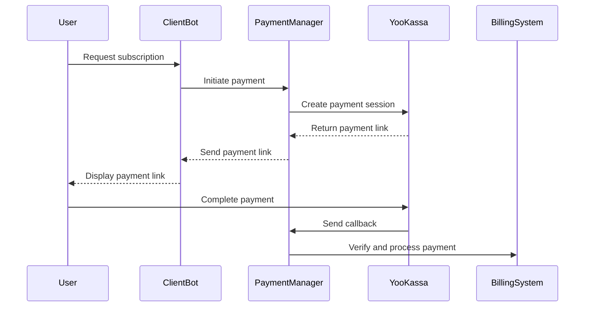
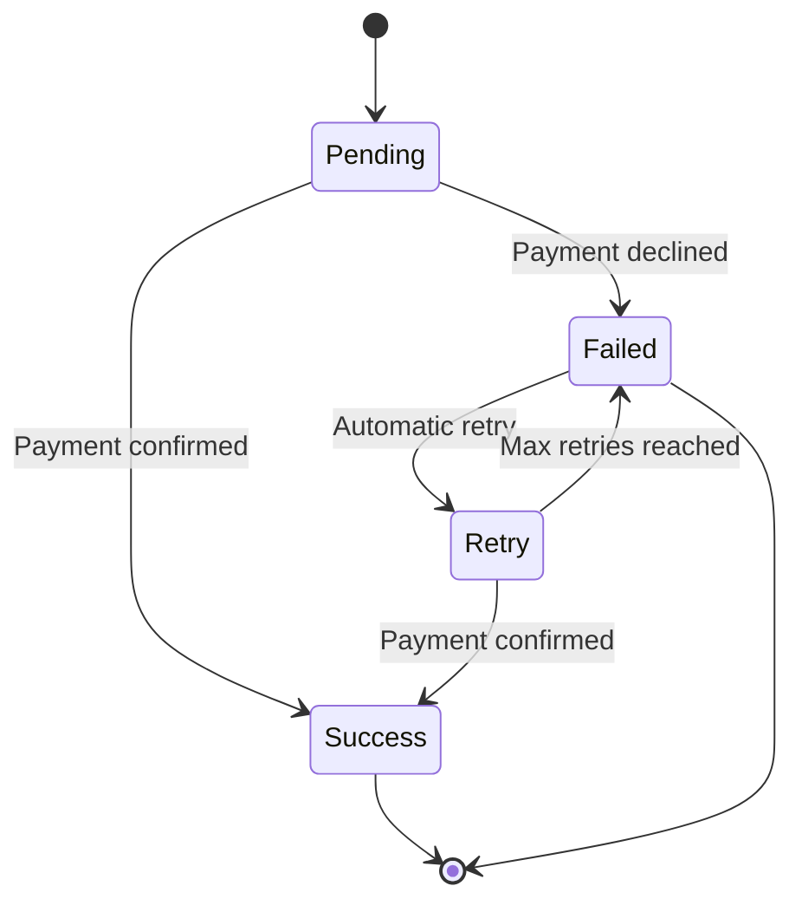
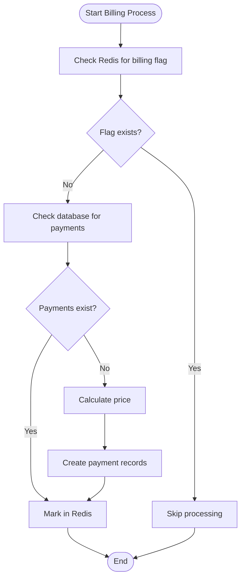
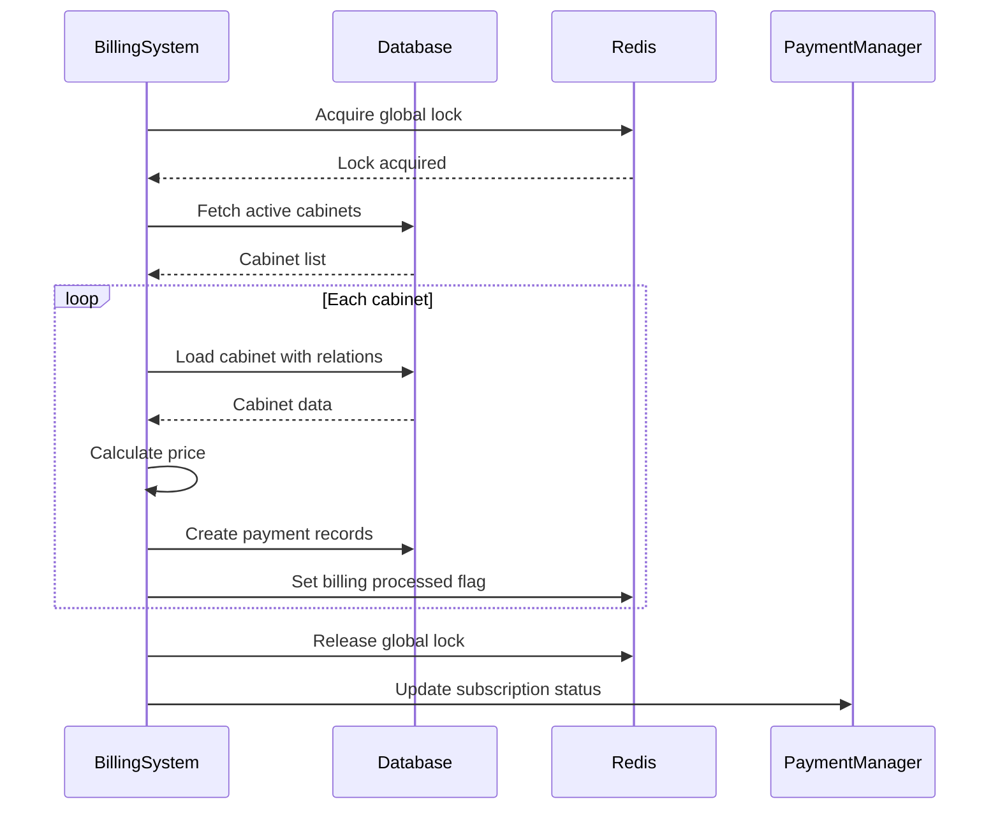
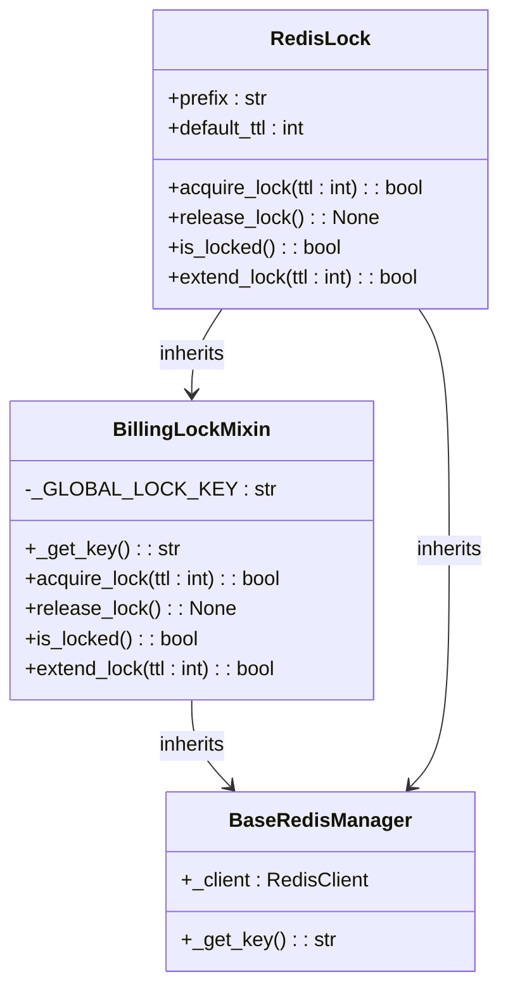

# Payment Processing

<cite>
**Referenced Files in This Document**   
- [manager.py](file://app/payments/manager.py)
- [models.py](file://app/payments/db/models.py)
- [billing.py](file://app/modules/billing/billing.py)
- [redis_lock.py](file://app/modules/billing/redis_lock.py)
- [redis_manager.py](file://app/modules/billing/redis_manager.py)
- [pricer.py](file://app/modules/billing/pricer/pricer.py)
- [tariffs.py](file://app/modules/billing/pricer/tariffs.py)
- [settings_master.py](file://app/settings/settings_master.py)
- [infrastructure_config.py](file://app/configs/infrastructure_config/infrastructure_config.py)
- [redis_config.py](file://app/configs/infrastructure_config/redis_config.py)
</cite>

## Table of Contents
1. [Introduction](#introduction)
2. [Payment Initiation and Gateway Communication](#payment-initiation-and-gateway-communication)
3. [Transaction State Management](#transaction-state-management)
4. [Idempotency Mechanisms](#idempotency-mechanisms)
5. [Billing Coordination](#billing-coordination)
6. [Race Condition Prevention](#race-condition-prevention)
7. [Payment Failure Handling and Retries](#payment-failure-handling-and-retries)
8. [User Notifications](#user-notifications)
9. [Webhook Security and Signature Validation](#webhook-security-and-signature-validation)
10. [Reconciliation Processes](#reconciliation-processes)
11. [Integration of New Payment Providers](#integration-of-new-payment-providers)
12. [Sandbox Testing](#sandbox-testing)

## Introduction
The payment processing system in the adv-bot application handles subscription-based billing for advertising services. The system integrates with external payment gateways, manages transaction states, ensures idempotency, and coordinates with the billing module to update subscription statuses. This document details the implementation of these components, focusing on the core payment processing logic, state management, and integration patterns.

**Section sources**
- [manager.py](file://app/payments/manager.py#L1-L12)
- [billing.py](file://app/modules/billing/billing.py#L1-L347)

## Payment Initiation and Gateway Communication
The payment initiation process is managed through the YooKassa payment gateway. The system uses the YooKassa SDK to create payment sessions and handle communication with the payment provider. Configuration for the payment gateway is initialized with account credentials retrieved from the application settings.

The payment manager sets up the YooKassa configuration with the AccountId and SecretKey obtained from the path settings. This configuration enables the application to create payment links, check payment statuses, and process callbacks from the payment gateway.

**Diagram sources**
- [manager.py](file://app/payments/manager.py#L1-L12)
- [billing.py](file://app/modules/billing/billing.py#L280-L315)

**Section sources**
- [manager.py](file://app/payments/manager.py#L1-L12)
- [billing.py](file://app/modules/billing/billing.py#L280-L315)

## Transaction State Management
The system manages transaction states through a combination of database records and Redis caching. Payment transactions can exist in pending, success, or failed states, with transitions managed through the payment processing workflow.

The Payment model in the database stores transaction details including amount, target, timestamp, and user reference. When a payment is initiated, a record is created with a pending state. Upon successful verification of the payment callback, the state is updated to success. Failed payments are marked accordingly and may trigger retry mechanisms.

The billing system also maintains state information for daily processing, tracking whether billing has been processed for specific cabinets on specific days. This prevents duplicate processing and ensures consistent state management across the system.

**Diagram sources**
- [models.py](file://app/payments/db/models.py#L1-L12)
- [billing.py](file://app/modules/billing/billing.py#L248-L283)

**Section sources**
- [models.py](file://app/payments/db/models.py#L1-L12)
- [billing.py](file://app/modules/billing/billing.py#L248-L283)

## Idempotency Mechanisms
The payment processing system implements idempotency at multiple levels to prevent duplicate processing of payments. The primary mechanism uses Redis to track processed billing operations, ensuring that each cabinet is billed only once per day.

The RedisManager in the billing module uses a dedicated Redis key pattern to store billing processing flags. Before processing a cabinet, the system checks if a flag exists for that cabinet and day. If the flag exists, processing is skipped, preventing duplicate charges.

Additionally, the system checks the database for existing payment records before creating new ones. This dual-layer approach (Redis for performance, database for durability) ensures robust idempotency even in the event of Redis failures.

**Diagram sources**
- [redis_manager.py](file://app/modules/billing/redis_manager.py#L1-L8)
- [billing.py](file://app/modules/billing/billing.py#L248-L283)

**Section sources**
- [redis_manager.py](file://app/modules/billing/redis_manager.py#L1-L8)
- [billing.py](file://app/modules/billing/billing.py#L248-L283)

## Billing Coordination
The billing system coordinates with the payment manager to update subscription statuses upon successful payment. The process_payment_for_advs function serves as the main entry point for daily billing operations, processing all active cabinets and applying charges based on their subscription plans.

The billing process follows a specific sequence:
1. Acquire a global lock to prevent concurrent billing runs
2. Fetch all active cabinets with campaigns
3. Process each cabinet individually in separate transactions
4. Apply charges based on available balance and bonus funds
5. Update campaign statuses based on payment success
6. Release the global lock

When a payment is successful, the system creates corresponding payment records in the database and updates the cabinet's campaign statuses. If insufficient funds are available, campaigns are deactivated automatically.

**Diagram sources**
- [billing.py](file://app/modules/billing/billing.py#L280-L315)
- [pricer.py](file://app/modules/billing/pricer/pricer.py#L1-L103)

**Section sources**
- [billing.py](file://app/modules/billing/billing.py#L280-L315)
- [pricer.py](file://app/modules/billing/pricer/pricer.py#L1-L103)

## Race Condition Prevention
The system prevents race conditions during concurrent payment attempts using Redis-based locking mechanisms. The RedisLock class implements a global billing lock that ensures only one billing process can run at a time.

The lock is implemented using Redis's SETNX (set if not exists) operation, which atomically sets a key only if it doesn't already exist. This prevents multiple instances of the billing process from running simultaneously, which could lead to double-charging or inconsistent state.

The lock has a configurable TTL (time to live) of 3600 seconds (1 hour), which prevents the system from becoming permanently locked if a billing process fails to release the lock properly. The lock is automatically released when the billing process completes, whether successfully or with an error.

**Diagram sources**
- [redis_lock.py](file://app/modules/billing/redis_lock.py#L1-L23)
- [billing_lock.py](file://app/core/redis_manager_v2/mixins/billing_lock.py#L1-L65)

**Section sources**
- [redis_lock.py](file://app/modules/billing/redis_lock.py#L1-L23)
- [billing_lock.py](file://app/core/redis_manager_v2/mixins/billing_lock.py#L1-L65)

## Payment Failure Handling and Retries
The system implements comprehensive error handling for payment failures, with multiple layers of protection and recovery mechanisms. When a payment fails, the system logs the error and updates the transaction status accordingly.

For database commit errors, the system performs a rollback and marks the transaction with a "db_commit_error" reason. For unexpected errors, the system captures the exception details and logs them for debugging purposes.

The billing process is designed to continue processing other cabinets even if one cabinet fails, ensuring that a single failure doesn't prevent the entire billing run from completing. Failed cabinets can be retried in subsequent billing cycles.

The system also handles cases where insufficient funds are available by deactivating campaigns automatically. This prevents continued service without payment and provides a clear signal to users that their subscription has lapsed.

**Section sources**
- [billing.py](file://app/modules/billing/billing.py#L248-L283)
- [models.py](file://app/payments/db/models.py#L1-L12)

## User Notifications
While the provided code does not include direct notification logic, the system is designed to integrate with user notification mechanisms. The billing process logs detailed information about each cabinet's processing result, which can be used to trigger notifications.

The logging includes information about whether processing occurred, whether payment was successful, the reason for any failures, the number of campaigns, and the price for the day. This information can be used by external systems to send appropriate notifications to users.

For successful payments, users could be notified of the charge and their continued service. For failed payments, users could be notified of the issue and instructed to update their payment method. The system's detailed logging provides the necessary information to create informative and helpful notifications.

**Section sources**
- [billing.py](file://app/modules/billing/billing.py#L248-L283)
- [models.py](file://app/payments/db/models.py#L1-L12)

## Webhook Security and Signature Validation
The system implements security measures for webhook handling, including secret-based authentication. The WEBHOOK_SECRET environment variable is required for the application to start, ensuring that webhook endpoints are protected.

While the specific webhook validation logic is not shown in the provided code, the presence of the WEBHOOK_SECRET suggests that incoming webhook requests from payment providers are validated against this secret. This prevents unauthorized parties from simulating payment callbacks and triggering false payment confirmations.

The system likely validates the signature of incoming webhook requests using the YooKassa token and webhook secret, ensuring that callbacks are genuinely from the payment provider and have not been tampered with in transit.

**Section sources**
- [settings_master.py](file://app/settings/settings_master.py#L1-L369)
- [manager.py](file://app/payments/manager.py#L1-L12)

## Reconciliation Processes
The system implements reconciliation processes through its idempotency mechanisms and state tracking. By using both Redis flags and database records to track processed payments, the system can reconcile discrepancies between cache and persistent storage.

The daily billing process includes checks against both Redis and the database to determine whether a cabinet has already been billed. This dual-check system ensures that even if Redis data is lost, the database serves as the source of truth, preventing double-charging.

The system also reconciles payment amounts by calculating the price based on the number of active campaigns and applying the appropriate tariff. The pricer module calculates monthly and daily rates based on tiered pricing, ensuring accurate billing according to the service plan.

**Section sources**
- [billing.py](file://app/modules/billing/billing.py#L248-L283)
- [pricer.py](file://app/modules/billing/pricer/pricer.py#L1-L103)
- [tariffs.py](file://app/modules/billing/pricer/tariffs.py#L1-L10)

## Integration of New Payment Providers
The current implementation is tightly coupled to YooKassa, but the architecture allows for integration of new payment providers with minimal changes. The payment initiation and callback handling are centralized in the payment manager, making it a natural extension point for additional providers.

To integrate a new payment provider, the following steps would be required:
1. Add configuration for the new provider in the settings
2. Implement provider-specific initialization in the payment manager
3. Create provider-specific payment creation and status checking methods
4. Implement callback validation for the new provider
5. Update the billing coordination logic to handle payments from the new provider

The use of dependency injection in the billing module makes it easier to extend the system with new payment providers without modifying existing code.

**Section sources**
- [manager.py](file://app/payments/manager.py#L1-L12)
- [settings_master.py](file://app/settings/settings_master.py#L1-L369)
- [billing.py](file://app/modules/billing/billing.py#L280-L315)

## Sandbox Testing
The system supports sandbox testing through environment configuration. The settings module loads configuration from environment variables, allowing different settings to be used for production and testing environments.

The YooKassa integration can be configured to use test mode by providing test credentials and setting the appropriate environment variables. This allows payment flows to be tested without processing real transactions.

The modular design of the billing system, with separate components for Redis management, database operations, and pricing calculations, facilitates unit and integration testing. The use of dependency injection allows mock objects to be injected during testing, enabling comprehensive test coverage without requiring external services.

**Section sources**
- [settings_master.py](file://app/settings/settings_master.py#L1-L369)
- [manager.py](file://app/payments/manager.py#L1-L12)
- [billing.py](file://app/modules/billing/billing.py#L280-L315)