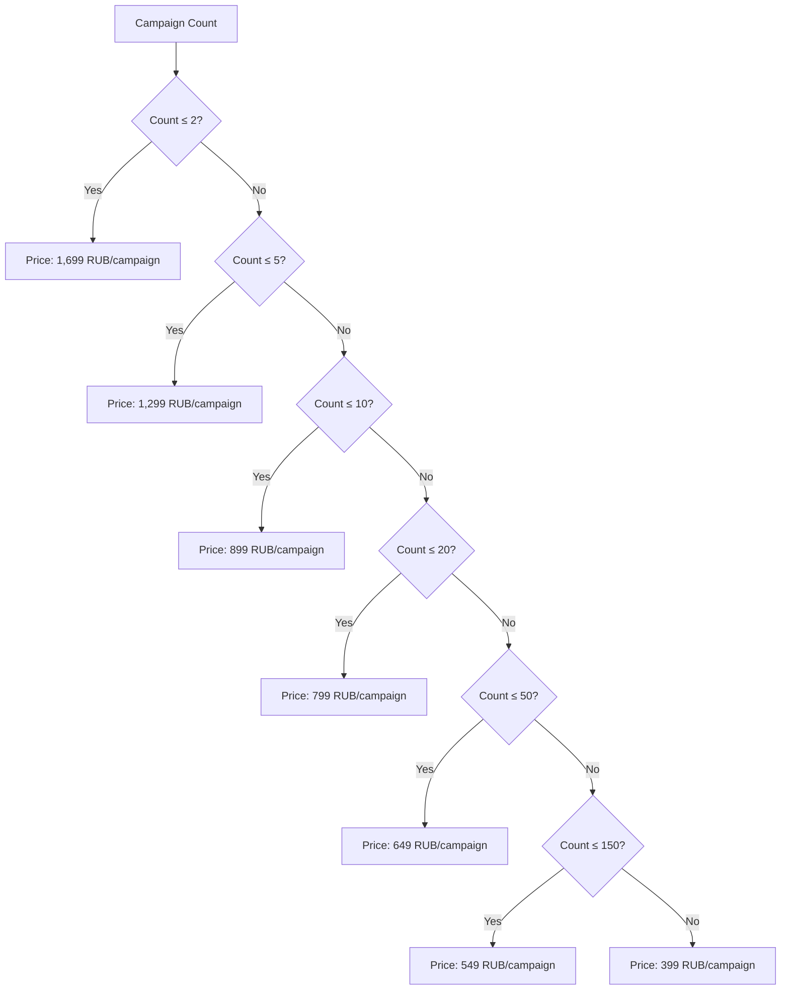
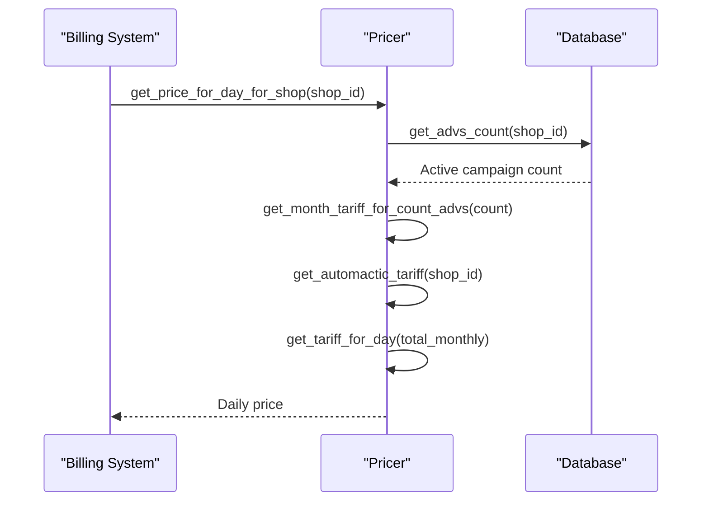
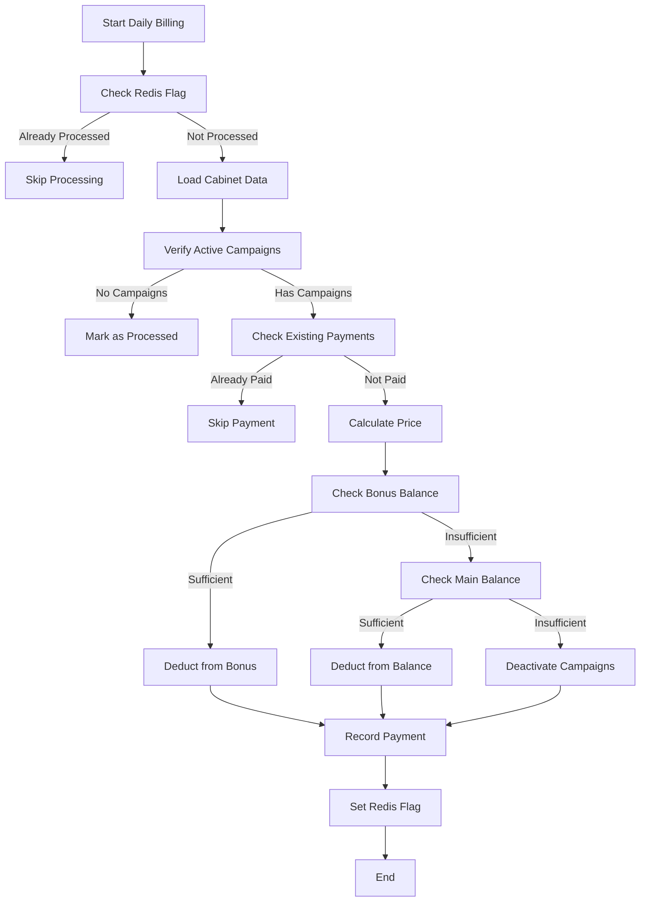
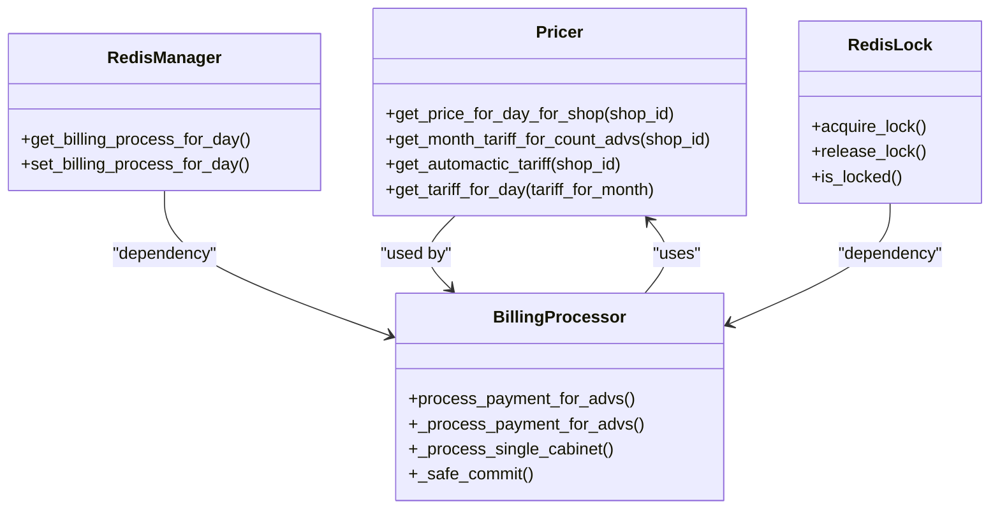
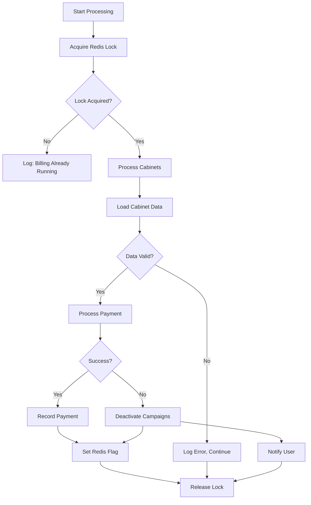
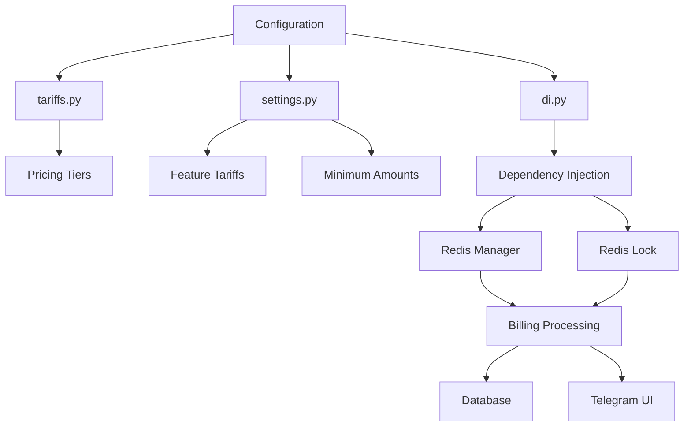

# Subscription Management

<cite>
**Referenced Files in This Document**   
- [tariffs.py](file://app/modules/billing/pricer/tariffs.py)
- [pricer.py](file://app/modules/billing/pricer/pricer.py)
- [billing.py](file://app/modules/billing/billing.py)
- [tariffs_text.py](file://app/modules/billing/pricer/tariffs_text.py)
- [models.py](file://app/modules/billing/models.py)
- [redis_manager.py](file://app/modules/billing/redis_manager.py)
- [di.py](file://app/modules/billing/di.py)
</cite>

## Table of Contents
1. [Introduction](#introduction)
2. [Pricing Tier Definition](#pricing-tier-definition)
3. [Cost Calculation and Pricing Logic](#cost-calculation-and-pricing-logic)
4. [Subscription Lifecycle Management](#subscription-lifecycle-management)
5. [Plan Transition and Feature Gating](#plan-transition-and-feature-gating)
6. [Integration with Telegram UI](#integration-with-telegram-ui)
7. [Data Validation and Error Handling](#data-validation-and-error-handling)
8. [Audit Logging and Monitoring](#audit-logging-and-monitoring)
9. [Configuration and Extensibility](#configuration-and-extensibility)
10. [Conclusion](#conclusion)

## Introduction
The subscription management system in the adv-bot application handles pricing tiers, billing calculations, and subscription lifecycle management for advertising campaigns. The system is designed to automatically calculate daily charges based on active campaigns, manage payment processing, and handle subscription state transitions. This document details the implementation of pricing tiers using Pydantic models (via dictionary structures), the cost calculation engine, subscription workflows, and integration points with the Telegram user interface.

## Pricing Tier Definition
The pricing tier system is defined in the `tariffs.py` module using a dictionary-based structure that maps campaign count thresholds to monthly prices in rubles. The system implements a tiered pricing model with volume discounts, where the price per campaign decreases as the number of active campaigns increases.

The pricing tiers are structured as follows:
- 1-2 campaigns: 1,699 rubles per campaign per month
- 3-5 campaigns: 1,299 rubles per campaign per month  
- 6-10 campaigns: 899 rubles per campaign per month
- 11-20 campaigns: 799 rubles per campaign per month
- 21-50 campaigns: 649 rubles per campaign per month
- 51-150 campaigns: 549 rubles per campaign per month
- 151+ campaigns: 399 rubles per campaign per month

This tiered structure incentivizes users to manage more campaigns by offering progressively better rates at higher volumes. The pricing model is implemented as a simple dictionary mapping the maximum number of campaigns in each tier to the corresponding price per campaign.

**Diagram sources**
- [tariffs.py](file://app/modules/billing/pricer/tariffs.py#L1-L9)

**Section sources**
- [tariffs.py](file://app/modules/billing/pricer/tariffs.py#L1-L9)

## Cost Calculation and Pricing Logic
The cost calculation system is implemented in the `pricer.py` module through the `Pricer` class, which handles all aspects of tariff calculation, daily rate computation, and additional service pricing.

The pricing engine follows a multi-step calculation process:
1. Determine the number of active campaigns for a shop
2. Apply the tiered pricing model to calculate the base monthly tariff
3. Add additional charges for premium features (auto white list updates, auto target place updates)
4. Convert the monthly total to a daily rate

The `get_price_for_day_for_shop` method serves as the primary entry point for cost calculation, orchestrating the entire pricing workflow. It first retrieves the active campaign count using `get_advs_count`, then calculates the base monthly tariff with `get_month_tariff_for_count_advs`, and finally converts this to a daily rate using `get_tariff_for_day` (dividing by 30).

Additional services are priced separately and added to the base tariff:
- Auto white list updater: Charged per campaign at a rate defined in settings
- Auto target place updater: Charged per campaign at a rate defined in settings

The system also provides utility methods like `get_payment_for_adv` to calculate the average payment per campaign, which is used for distributing costs across multiple campaigns.

**Diagram sources**
- [pricer.py](file://app/modules/billing/pricer/pricer.py#L50-L100)

**Section sources**
- [pricer.py](file://app/modules/billing/pricer/pricer.py#L10-L100)

## Subscription Lifecycle Management
The subscription lifecycle is managed through the `billing.py` module, which implements the core billing workflow for processing daily charges and managing subscription states.

The lifecycle consists of several key phases:
1. **Selection**: Users select their desired plan through the Telegram interface
2. **Activation**: The system activates campaigns when sufficient funds are available
3. **Daily Processing**: The system processes daily charges for active campaigns
4. **Deactivation**: Campaigns are automatically deactivated when funds are insufficient
5. **Cancellation**: Users can cancel their subscriptions through the interface

The daily processing workflow is implemented in the `_process_single_cabinet` function, which handles billing for individual user accounts. The process begins with idempotency checks using Redis to prevent duplicate processing, followed by verification of active campaigns. The system then checks for existing daily payments to avoid double charging.

When processing payments, the system follows a specific order of operations:
1. Attempt to charge from bonus balance
2. If insufficient, charge from main balance
3. If both balances are insufficient, deactivate all campaigns

The payment processing is wrapped in database transactions with comprehensive error handling to ensure data consistency. Successful payments are recorded in the `AdvPayment` table, with separate entries for bonus and balance deductions.

**Diagram sources**
- [billing.py](file://app/modules/billing/billing.py#L150-L300)

**Section sources**
- [billing.py](file://app/modules/billing/billing.py#L1-L347)

## Plan Transition and Feature Gating
Plan transitions and feature gating are implemented through a combination of pricing logic and campaign state management. When users change their subscription level, the system automatically adjusts the daily charges based on the new campaign count.

The system handles plan transitions through the following mechanisms:
- **Downgrades**: When users reduce their campaign count, they automatically move to a lower pricing tier with higher per-campaign costs
- **Upgrades**: When users increase their campaign count, they automatically qualify for volume discounts at higher tiers
- **Grace Periods**: The system does not implement explicit grace periods; deactivation occurs immediately when funds are insufficient

Feature gating is implemented through boolean flags in the `AdvSetting` model, which control access to premium features:
- `auto_update_white_list`: Enables automatic white list updates
- `auto_update_target_place`: Enables automatic target place updates

These features incur additional charges calculated by the `get_automactic_tariff` method, which queries the database for the count of campaigns using each premium feature and applies the corresponding monthly tariff from the application settings.

The system ensures atomicity during plan transitions by using Redis locks to prevent concurrent modifications. The global billing lock prevents multiple instances of the billing process from running simultaneously, ensuring data consistency during high-volume operations.

**Diagram sources**
- [pricer.py](file://app/modules/billing/pricer/pricer.py#L10-L100)
- [billing.py](file://app/modules/billing/billing.py#L1-L347)
- [redis_manager.py](file://app/modules/billing/redis_manager.py#L1-L10)
- [redis_lock.py](file://app/modules/billing/redis_lock.py#L1-L25)

**Section sources**
- [pricer.py](file://app/modules/billing/pricer/pricer.py#L10-L100)
- [billing.py](file://app/modules/billing/billing.py#L1-L347)

## Integration with Telegram UI
The subscription management system integrates with the Telegram user interface through several mechanisms that facilitate plan selection, payment confirmation, and status updates.

The integration is primarily handled through:
- Payment status messages that inform users of successful or failed charges
- Balance notifications that alert users when funds are low
- Service information that explains pricing tiers and features

The `tariffs_text.py` module provides formatted text for displaying pricing information to users in the Telegram interface. This includes:
- A link to the current pricing page
- Description of included services (keyword parsing, bid management)
- Minimum top-up amount information

The system uses the `WaitingForAmount` message class in the balance manager to prompt users for payment amounts, displaying current balance information and pricing details to guide their decisions. This creates a seamless experience where users can view their current plan, understand the pricing structure, and make payments directly through the Telegram interface.

Error conditions are communicated through the Telegram interface, informing users when their campaigns have been deactivated due to insufficient funds and providing instructions for reactivation.

**Section sources**
- [tariffs_text.py](file://app/modules/billing/pricer/tariffs_text.py#L1-L30)
- [balance_manager/messages.py](file://app/modules/balance_manager/messages.py#L1-L40)

## Data Validation and Error Handling
The subscription management system implements comprehensive data validation and error handling to ensure reliability and data integrity.

Key validation and error handling mechanisms include:
- **Database transaction safety**: The `_safe_commit` function wraps database commits in try-catch blocks, ensuring proper rollback on errors and logging of failure reasons
- **Idempotency checks**: Redis flags prevent duplicate processing of daily charges for the same cabinet
- **Concurrent access protection**: Redis locks prevent multiple billing processes from running simultaneously
- **Input validation**: The system validates campaign counts, shop IDs, and payment amounts before processing

Error conditions are categorized and logged with specific reason codes:
- `redis_flag_skip`: Processing skipped due to existing Redis flag
- `cabinet_not_found`: Cabinet ID not found in database
- `no_active_campaigns`: No active campaigns to bill
- `already_processed_db`: Payment already recorded in database
- `zero_price`: Price calculation resulted in zero
- `db_commit_error`: Database commit failure
- `unexpected_error`: Unhandled exception during processing

The system prioritizes graceful degradation over failure, with mechanisms to continue processing other cabinets even when individual processing fails. This ensures that billing issues with one account do not affect the entire system.

**Diagram sources**
- [billing.py](file://app/modules/billing/billing.py#L100-L300)

**Section sources**
- [billing.py](file://app/modules/billing/billing.py#L100-L300)

## Audit Logging and Monitoring
The subscription management system includes comprehensive audit logging and monitoring capabilities to track all billing activities and system operations.

Key logging features include:
- Detailed processing logs for each cabinet, including cabinet ID, processing status, payment success, reason codes, campaign counts, and daily prices
- Error logging with full stack traces for debugging
- Warning logs for non-critical issues like Redis flag setting failures
- Informational logs for system status and lock operations

The logging system uses structured logging with consistent message formats that include cabinet identifiers and operation outcomes. This enables effective monitoring and troubleshooting of billing operations.

Audit trails are maintained through:
- Database records of all payments in the `AdvPayment` table
- Redis flags that track daily processing status
- Transaction logs that record all database operations
- Application logs that capture the complete processing workflow

The system also supports monitoring through external tools, with logs available for collection by monitoring systems like Filebeat (configured in `filebeat.yml`) and logging infrastructure defined in `logging_config.json`.

**Section sources**
- [billing.py](file://app/modules/billing/billing.py#L1-L347)
- [models.py](file://app/modules/billing/models.py#L1-L25)
- [filebeat.yml](file://filebeat.yml#L1-L10)
- [logging_config.json](file://logging_config.json#L1-L10)

## Configuration and Extensibility
The subscription management system is designed for extensibility and easy configuration through several mechanisms.

The pricing model can be extended by:
- Modifying the `tariffs` dictionary in `tariffs.py` to add new tiers or adjust prices
- Updating the `WHITE_LIST_AUTO_UPDATER_MONTH_TARIFF` and `AUTO_UPDATE_TARGET_PLACE_MONTH_TARIFF` settings for premium features
- Adjusting the `MIN_SUM` setting for minimum top-up amounts

The system architecture supports extensibility through:
- Dependency injection via the `BillingContainer` in `di.py`, allowing easy replacement of components for testing or enhancement
- Modular design with separate concerns for pricing, billing, and Redis management
- Well-defined interfaces that can be extended without modifying core logic

To add new tariff plans, developers can simply update the `tariffs` dictionary with additional threshold-price pairs. The existing calculation logic will automatically apply the new tiers based on the sorted order of thresholds.

Trial periods could be implemented by extending the system with:
- A new database field to track trial status and expiration
- Modified pricing logic to apply zero or discounted rates during trial periods
- Additional Redis flags to track trial usage
- Updated Telegram messages to communicate trial status

The system's use of Redis for idempotency and locking makes it suitable for distributed environments, and the dependency injection framework facilitates testing and component replacement.

**Diagram sources**
- [tariffs.py](file://app/modules/billing/pricer/tariffs.py#L1-L9)
- [di.py](file://app/modules/billing/di.py#L1-L42)
- [settings.py](file://app/settings/settings_master.py#L1-L10)

**Section sources**
- [tariffs.py](file://app/modules/billing/pricer/tariffs.py#L1-L9)
- [di.py](file://app/modules/billing/di.py#L1-L42)

## Conclusion
The subscription management system in the adv-bot application provides a robust framework for handling pricing tiers, billing calculations, and subscription lifecycle management. The system implements a tiered pricing model with volume discounts, automated daily billing, and comprehensive error handling.

Key strengths of the system include:
- Clear separation of concerns between pricing calculation and billing processing
- Use of Redis for idempotency and concurrency control
- Comprehensive logging and error handling
- Integration with the Telegram user interface for seamless user experience
- Extensible architecture that supports easy modification of pricing tiers and features

The system effectively manages the complete subscription lifecycle from plan selection through daily processing to deactivation, ensuring reliable operation even in high-concurrency environments. By leveraging dependency injection and modular design, the system remains maintainable and adaptable to future requirements.