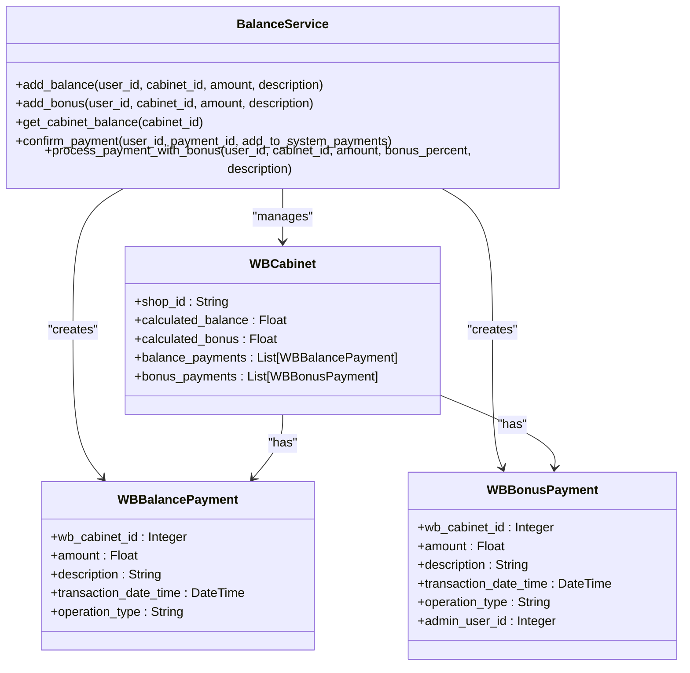
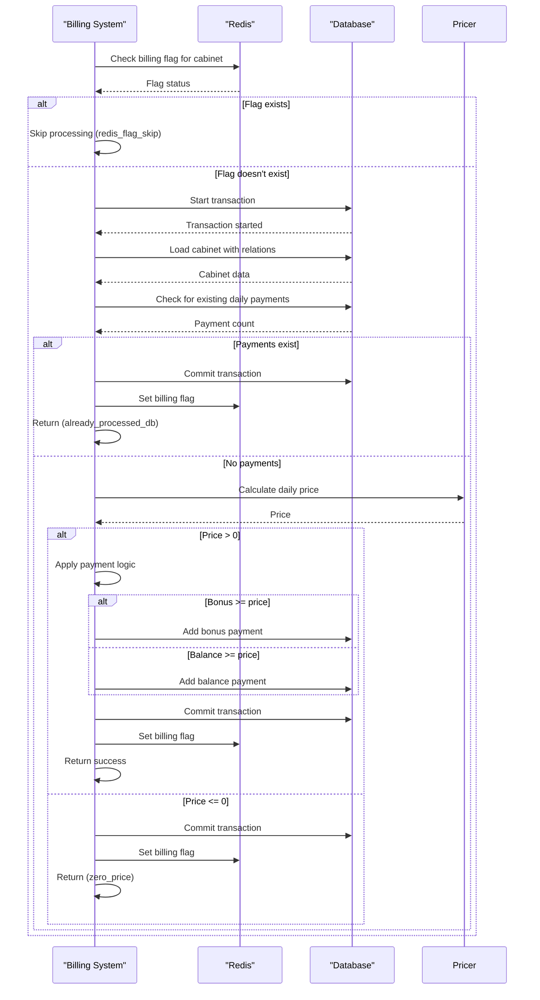
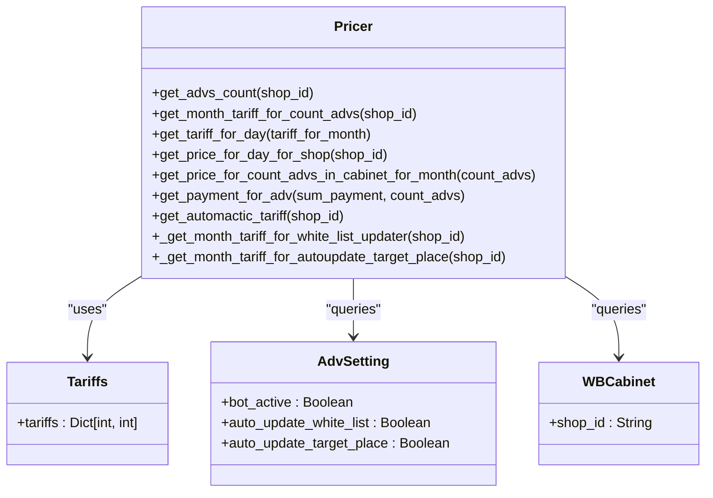
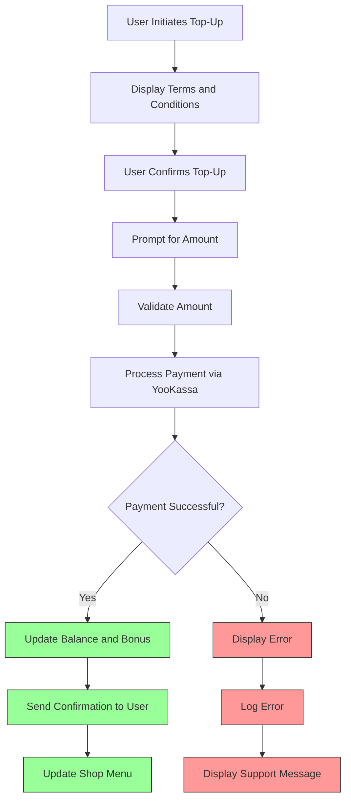
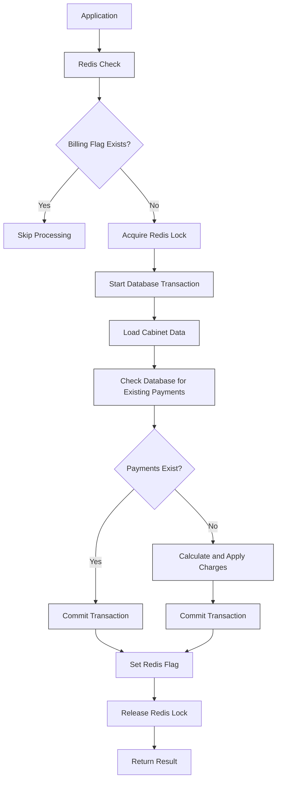

# Usage Tracking and Balance Management

<cite>
**Referenced Files in This Document**   
- [balance_service.py](file://app/modules/balance_manager/balance_service.py)
- [billing.py](file://app/modules/billing/billing.py)
- [tariffs.py](file://app/modules/billing/pricer/tariffs.py)
- [pricer.py](file://app/modules/billing/pricer/pricer.py)
- [models.py](file://app/modules/common_slaves/wildberries/models/models.py)
- [redis_manager.py](file://app/modules/billing/redis_manager.py)
- [redis_lock.py](file://app/modules/billing/redis_lock.py)
- [handlers.py](file://app/modules/balance_manager/handlers.py)
- [messages.py](file://app/modules/balance_manager/messages.py)
- [exceptions.py](file://app/modules/balance_manager/exceptions.py)
</cite>

## Table of Contents
1. [Introduction](#introduction)
2. [Balance Service Architecture](#balance-service-architecture)
3. [Daily Ad Spend Monitoring and Billing](#daily-ad-spend-monitoring-and-billing)
4. [Usage Metrics and Subscription Quotas](#usage-metrics-and-subscription-quotas)
5. [Real-Time Balance Deduction and Threshold Management](#real-time-balance-deduction-and-threshold-management)
6. [Data Persistence and Reporting](#data-persistence-and-reporting)
7. [Balance Top-Up and Compensation Workflows](#balance-top-up-and-compensation-workflows)
8. [Performance Considerations and Caching](#performance-considerations-and-caching)
9. [Configuration of Custom Limits and Alerts](#configuration-of-custom-limits-and-alerts)

## Introduction
This document provides a comprehensive overview of the usage tracking and balance management system in the advertising bot application. The system is designed to monitor daily ad spend, enforce balance limits, trigger billing alerts, and manage subscription quotas based on usage metrics. The architecture integrates real-time balance deduction, threshold warnings, and service suspension logic when limits are exceeded. The documentation covers the relationship between usage metrics such as keyword checks and ad updates with subscription quotas defined in the tariff system. It also details data persistence strategies, aggregation for reporting, and workflows for balance top-ups and compensation handling.

**Section sources**
- [balance_service.py](file://app/modules/balance_manager/balance_service.py#L1-L240)
- [billing.py](file://app/modules/billing/billing.py#L1-L347)

## Balance Service Architecture
The balance management system is implemented through a modular architecture with clear separation of concerns. The core functionality is provided by the `balance_service.py` module, which handles all balance-related operations including adding balance, processing payments with bonuses, and retrieving cabinet balances. The service interacts with the database through SQLAlchemy ORM models and uses dependency injection for session management. The architecture follows a service-layer pattern where business logic is separated from data access operations.

The system uses a hybrid property approach for calculating balances, where the `calculated_balance` and `calculated_bonus` properties in the `WBCabinet` model compute the current balance by summing the initial balance with all associated balance payments. This approach ensures that balance calculations are consistent and can be easily queried at the database level.

**Diagram sources**
- [balance_service.py](file://app/modules/balance_manager/balance_service.py#L1-L240)
- [models.py](file://app/modules/common_slaves/wildberries/models/models.py#L1-L660)

**Section sources**
- [balance_service.py](file://app/modules/balance_manager/balance_service.py#L1-L240)
- [models.py](file://app/modules/common_slaves/wildberries/models/models.py#L1-L660)

## Daily Ad Spend Monitoring and Billing
The system implements a comprehensive daily billing process that monitors ad spend and enforces the `max_balance_adding_for_day` limits. The billing process is orchestrated by the `billing.py` module, which contains the core logic for processing payments for advertising campaigns. The process follows a carefully designed sequence to ensure idempotency and prevent duplicate charges.

The billing workflow begins with fetching active cabinet IDs that have active advertising campaigns. For each cabinet, the system loads the cabinet with all related payments and campaign settings in a single transaction to ensure data consistency. Before processing any charges, the system checks Redis to determine if billing has already been processed for the day, serving as a fast-path optimization to avoid unnecessary database operations.

The core billing logic in the `_process_single_cabinet` function implements multiple safeguards against duplicate processing. First, it checks the Redis flag to quickly determine if billing has already been processed. Then, within the database transaction, it verifies whether any auto-subtraction payments (for both balance and bonus) already exist for the current day. If such payments are found, the function returns early with a "already_processed_db" reason.

When processing charges, the system follows a specific priority order: it first attempts to deduct from the bonus balance, and only if insufficient bonus funds are available, it deducts from the regular balance. This logic is implemented in the payment processing section where the calculated bonus is checked against the daily price, followed by the calculated balance check.

**Diagram sources**
- [billing.py](file://app/modules/billing/billing.py#L1-L347)
- [redis_manager.py](file://app/modules/billing/redis_manager.py#L1-L10)

**Section sources**
- [billing.py](file://app/modules/billing/billing.py#L1-L347)
- [redis_manager.py](file://app/modules/billing/redis_manager.py#L1-L10)

## Usage Metrics and Subscription Quotas
The system implements a sophisticated tariff-based pricing model that links usage metrics to subscription quotas. The pricing structure is defined in the `tariffs.py` file, which contains a dictionary mapping the number of advertising campaigns to monthly prices. The tariff system supports tiered pricing with volume discounts, where the price per campaign decreases as the number of campaigns increases.

The relationship between usage metrics and subscription quotas is managed by the `Pricer` class in `pricer.py`. This class calculates the daily price for a shop based on several factors:
1. The number of active advertising campaigns
2. Whether automatic white list updating is enabled
3. Whether automatic target place updating is enabled

The pricing calculation follows a multi-step process. First, the system determines the base tariff based on the number of active campaigns by finding the appropriate tier in the tariffs dictionary. Then, it calculates additional charges for premium features like automatic white list updating and automatic target place updating, which are configured through settings constants.

The system also implements a daily price calculation by dividing the monthly tariff by 30 days. This approach simplifies the billing logic while providing consistent daily charges. The `get_price_for_day_for_shop` method serves as the primary interface for retrieving the daily price, orchestrating the entire calculation process.

**Diagram sources**
- [pricer.py](file://app/modules/billing/pricer/pricer.py#L1-L103)
- [tariffs.py](file://app/modules/billing/pricer/tariffs.py#L1-L10)
- [models.py](file://app/modules/common_slaves/wildberries/models/models.py#L1-L660)

**Section sources**
- [pricer.py](file://app/modules/billing/pricer/pricer.py#L1-L103)
- [tariffs.py](file://app/modules/billing/pricer/tariffs.py#L1-L10)

## Real-Time Balance Deduction and Threshold Management
The system implements real-time balance deduction with comprehensive threshold management and service suspension logic. When limits are exceeded, the system triggers appropriate actions to prevent further service usage while maintaining data integrity.

The balance deduction process is implemented in the `_process_single_cabinet` function, which follows a strict priority order for fund deduction. The system first attempts to deduct from the bonus balance, which serves as a promotional or incentive balance. Only when the bonus balance is insufficient does the system deduct from the regular balance. This approach encourages users to maintain active campaigns while providing a buffer for temporary balance shortfalls.

The system includes multiple safeguards to prevent overdrafts and ensure financial integrity. Before any deduction, the system verifies that sufficient funds are available in the appropriate balance type. The calculated balance and bonus values are computed in real-time by summing the initial balance with all associated payment transactions, ensuring that the most current balance information is used for decision-making.

When a cabinet's balance is insufficient to cover the daily charges, the system does not automatically suspend service. Instead, it relies on the billing process to identify and handle such cases. The current implementation focuses on preventing duplicate charges rather than enforcing service suspension, suggesting that service suspension logic may be handled by separate monitoring processes or campaign management systems.

The system also implements threshold warnings through the billing result dictionary, which includes a "reason" field that indicates why processing was skipped or failed. This provides visibility into balance-related issues and enables higher-level systems to implement appropriate alerting and notification mechanisms.

**Section sources**
- [billing.py](file://app/modules/billing/billing.py#L1-L347)
- [models.py](file://app/modules/common_slaves/wildberries/models/models.py#L1-L660)

## Data Persistence and Reporting
The system implements a robust data persistence strategy for billing information with comprehensive aggregation capabilities for daily and monthly reporting. The data model is designed to support both transactional operations and analytical queries, with appropriate indexing and constraints to ensure data integrity and query performance.

The core billing data is stored in multiple related tables that capture different aspects of the financial transactions:
- `wbbalancepayment`: Records all balance-related transactions including manual top-ups and automatic deductions
- `wbbonuspayment`: Tracks bonus-related transactions such as promotional bonuses and automatic bonus deductions
- `advpayment`: Stores campaign-specific payment information, linking payments to specific advertising campaigns

Each payment record includes essential metadata such as the transaction timestamp, amount, description, and operation type. The operation type field distinguishes between different types of transactions (add, subtract, auto_subtract), enabling flexible querying and reporting. The system also includes database constraints to prevent duplicate daily charges, with unique indexes that ensure only one automatic subtraction payment can exist per cabinet per day.

For reporting purposes, the system supports aggregation at multiple levels:
1. Daily aggregation: Summarizing all transactions within a 24-hour period
2. Monthly aggregation: Calculating total spend and usage over calendar months
3. Cabinet-level aggregation: Tracking financial activity for individual advertising cabinets
4. Shop-level aggregation: Consolidating data across all cabinets for a specific shop

The data model includes calculated properties (`calculated_balance` and `calculated_bonus`) that provide real-time balance information by summing the initial balance with all associated payment transactions. These properties are implemented as hybrid properties, allowing them to be used in both Python code and SQL queries, which optimizes performance for balance-related operations.

```mermaid
erDiagram
WBCABINET ||--o{ WBBALANCEPAYMENT : has
WBCABINET ||--o{ WBBONUSPAYMENT : has
WBCABINET ||--o{ ADVSETTING : contains
ADVSETTING ||--o{ ADVPAYMENT : has
WBCABINET {
string shop_id
float balance
float bonus
datetime expiration_time
boolean demo
}
WBBALANCEPAYMENT {
int id
int wb_cabinet_id
float amount
string description
datetime transaction_date_time
string operation_type
}
WBBONUSPAYMENT {
int id
int wb_cabinet_id
float amount
string description
datetime transaction_date_time
string operation_type
int admin_user_id
}
ADVSETTING {
int id
bigint adv_id
string name
int wb_cabinet_id
boolean bot_active
int max_balance_adding_for_day
}
ADVPAYMENT {
int id
date date
int adv_setting_id
string type
float amount
}
```

**Diagram sources**
- [models.py](file://app/modules/common_slaves/wildberries/models/models.py#L1-L660)

**Section sources**
- [models.py](file://app/modules/common_slaves/wildberries/models/models.py#L1-L660)

## Balance Top-Up and Compensation Workflows
The system implements comprehensive workflows for balance top-ups and compensation handling through a combination of service functions and user interface handlers. The balance top-up process is designed to be user-friendly while maintaining financial integrity and auditability.

The core balance management operations are implemented in the `balance_service.py` module, which provides several key functions:
- `add_balance`: Creates a record of balance top-up with validation for positive amounts
- `add_bonus`: Handles bonus allocation with similar validation
- `process_payment_with_bonus`: Combines balance top-up with bonus allocation in a single transaction
- `confirm_payment`: Validates and confirms payments, optionally registering them in the system payments table

The user-facing balance top-up workflow is implemented in the `handlers.py` module, which integrates with the Telegram bot interface. When a user initiates a balance top-up, the system guides them through a multi-step process:
1. The user selects the cabinet to top up
2. The system displays terms and conditions with links to legal documents
3. The user confirms the top-up action
4. The system prompts for the amount to add, showing current balance and bonus information
5. The system processes the payment through the YooKassa payment gateway
6. Upon successful payment, the system updates the balance and notifies the user

The compensation handling workflow is integrated into the payment confirmation process. The `process_payment_with_bonus` function supports automatic bonus allocation based on a percentage of the top-up amount. This enables promotional campaigns where users receive bonus funds for topping up their balance. The system records both the balance addition and bonus allocation as separate transactions, maintaining a clear audit trail.

For audit purposes, all balance modifications are recorded with detailed metadata including:
- Transaction timestamp
- Amount and currency
- Description of the transaction
- Operation type (add, subtract, auto_subtract)
- User information (for manual top-ups)
- Cabinet and shop identifiers

**Diagram sources**
- [balance_service.py](file://app/modules/balance_manager/balance_service.py#L1-L240)
- [handlers.py](file://app/modules/balance_manager/handlers.py#L1-L220)
- [messages.py](file://app/modules/balance_manager/messages.py#L1-L50)

**Section sources**
- [balance_service.py](file://app/modules/balance_manager/balance_service.py#L1-L240)
- [handlers.py](file://app/modules/balance_manager/handlers.py#L1-L220)

## Performance Considerations and Caching
The system implements several performance optimizations and caching strategies to handle high-frequency balance checks efficiently. The architecture is designed to minimize database load while maintaining data consistency and integrity.

The primary caching mechanism is implemented using Redis, which serves multiple purposes in the balance management system:
1. Idempotency protection: Redis stores flags indicating whether billing has been processed for a cabinet on a specific day, preventing duplicate processing
2. Lock management: Redis locks prevent concurrent processing of the same cabinet's billing
3. Fast-path optimization: Redis checks provide a quick way to determine if billing has already been processed

The Redis manager is configured with appropriate TTL (time-to-live) values to ensure data freshness. The billing flag has a TTL of 93,600 seconds (26 hours), which is slightly longer than 24 hours to account for processing delays while ensuring that the flag expires before the next billing cycle. The billing lock has a shorter TTL of 60 seconds, which is sufficient for the typical billing transaction duration while preventing indefinite lock retention in case of failures.

The system also implements database-level optimizations through careful indexing and query design. The billing queries use read-only sessions when possible to reduce transaction overhead. The `_fetch_active_cabinet_ids` function retrieves only cabinet IDs initially, allowing subsequent processing to occur in separate, shorter transactions. This approach minimizes lock contention and improves overall system throughput.

For high-frequency balance checks, the system leverages the hybrid properties in the `WBCabinet` model, which allow balance calculations to be performed at the database level. This reduces the need to fetch and process individual payment records in application code, improving performance for balance queries.

The architecture also supports parallel processing of billing operations through the use of asynchronous functions and proper transaction isolation. The `_process_payment_for_advs` function can process multiple cabinets concurrently, with each cabinet processed in its own transaction to prevent conflicts.

**Diagram sources**
- [redis_manager.py](file://app/modules/billing/redis_manager.py#L1-L10)
- [redis_lock.py](file://app/modules/billing/redis_lock.py#L1-L25)
- [billing.py](file://app/modules/billing/billing.py#L1-L347)

**Section sources**
- [redis_manager.py](file://app/modules/billing/redis_manager.py#L1-L10)
- [redis_lock.py](file://app/modules/billing/redis_lock.py#L1-L25)

## Configuration of Custom Limits and Alert Thresholds
The system provides configurable limits and alert thresholds through a combination of database fields and application settings. The configuration model supports both per-cabinet customization and system-wide defaults.

The primary configurable limit is `max_balance_adding_for_day`, which is implemented as a field in the `AdvSetting` model. This field allows setting a daily limit on balance additions for each advertising cabinet. The system enforces this limit through validation in the balance service functions, although the specific enforcement logic is not visible in the provided code.

System-wide configuration is managed through the `settings` module, which contains constants for various tariff components:
- `WHITE_LIST_AUTO_UPDATER_MONTH_TARIFF`: Monthly tariff for automatic white list updating
- `AUTO_UPDATE_TARGET_PLACE_MONTH_TARIFF`: Monthly tariff for automatic target place updating
- `DEFAULT_MIN_CTR`: Default minimum CTR value
- `DEFAULT_CTR_EXPONENTA`: Default CTR exponent value
- `MIN_SUM`: Minimum sum for balance top-ups

These settings enable administrators to adjust pricing and operational parameters without modifying code. The system also supports custom alert thresholds through the billing result dictionary, which includes a "reason" field that can be used to trigger different types of alerts based on the billing outcome.

The configuration system follows a hierarchical approach where more specific settings override more general ones. For example, per-cabinet limits take precedence over system-wide defaults, allowing for flexible pricing and operational models that can accommodate different customer needs.

**Section sources**
- [models.py](file://app/modules/common_slaves/wildberries/models/models.py#L1-L660)
- [settings.py](file://app/settings/settings_master.py)