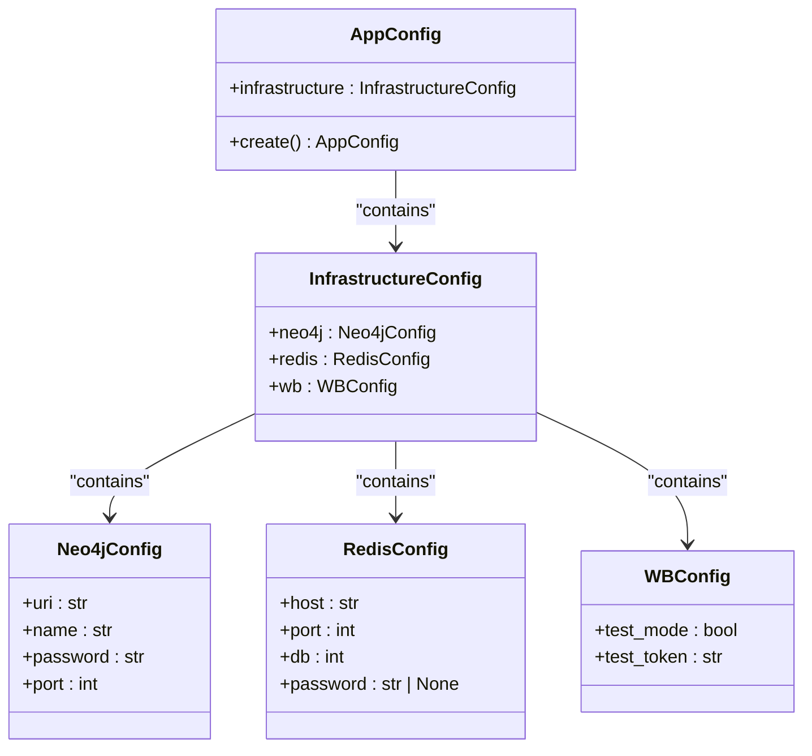
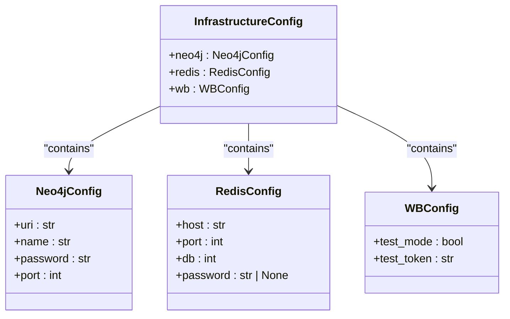
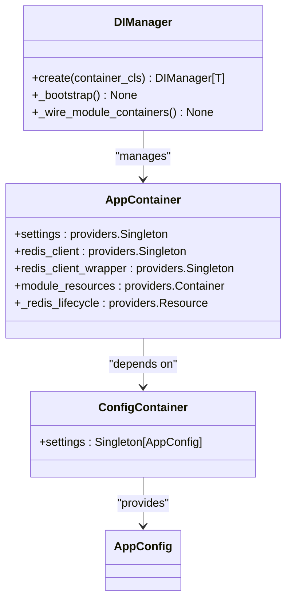
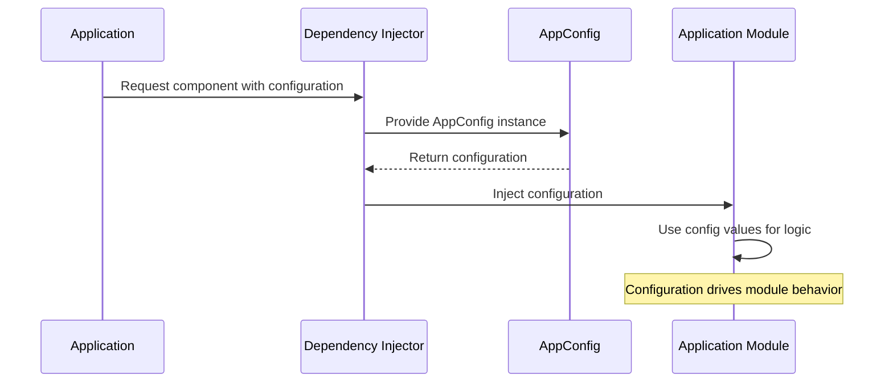

# Application Configuration

<cite>
**Referenced Files in This Document**   
- [app_config.py](file://app/configs/app_config.py)
- [infrastructure_config.py](file://app/configs/infrastructure_config/infrastructure_config.py)
- [neo4j_config.py](file://app/configs/infrastructure_config/neo4j_config.py)
- [redis_config.py](file://app/configs/infrastructure_config/redis_config.py)
- [wb_config.py](file://app/configs/infrastructure_config/wb_config.py)
- [config.py](file://app/core/di/configs/config.py)
- [app_container.py](file://app/core/di/app_container.py)
- [auto_updater_target_place.py](file://app/modules/shop_runner/service_manager/old_modules/auto_updater_target_place/auto_updater_target_place.py)
- [setting_auto_updater.py](file://app/modules/shop_runner/service_manager/old_modules/setting_auto_updater/setting_auto_updater.py)
- [data_classes.py](file://app/modules/shop_runner/service_manager/old_modules/setting_auto_updater/data_classes.py)
- [plan_fact_change_redis_caches.py](file://app/modules/shop_runner/service_manager/old_modules/setting_auto_updater/plan_fact_change_redis_caches.py)
- [update_adv_setting.py](file://app/modules/shop_runner/service_manager/old_modules/setting_auto_updater/update_adv_setting.py)
</cite>

## Table of Contents
1. [Introduction](#introduction)
2. [Configuration Architecture](#configuration-architecture)
3. [AppConfig Structure and Initialization](#appconfig-structure-and-initialization)
4. [Infrastructure Configuration Hierarchy](#infrastructure-configuration-hierarchy)
5. [Integration with Dependency Injector](#integration-with-dependency-injector)
6. [Accessing Configuration in Application Modules](#accessing-configuration-in-application-modules)
7. [Feature Flags and Operational Modes](#feature-flags-and-operational-modes)
8. [Configuration Best Practices](#configuration-best-practices)
9. [Common Misconfigurations and Troubleshooting](#common-misconfigurations-and-troubleshooting)
10. [Conclusion](#conclusion)

## Introduction
The application configuration system in the adv-bot project is built around a hierarchical structure centered on the AppConfig class, which serves as the central point for managing core application settings. This configuration system handles feature flags, default values for advertising strategies, and system-wide parameters through a well-structured hierarchy that promotes type safety and maintainability. The configuration is implemented using Pydantic models with the SettingsConfigDict, enabling environment variable integration and validation. The system is tightly integrated with the Dependency Injector framework, allowing seamless access to configuration values across different modules. This document provides a comprehensive overview of the configuration architecture, its implementation, and best practices for customization and maintenance.

## Configuration Architecture
The configuration architecture follows a hierarchical composition pattern where the main AppConfig class contains an instance of InfrastructureConfig, which in turn composes specific configuration classes for different infrastructure components. This layered approach enables separation of concerns while maintaining a unified configuration interface. The architecture leverages Pydantic's BaseModel and Field features to provide type hints, default values, and validation rules for configuration parameters. Environment variables are automatically loaded from a .env file with specific prefixes for different configuration sections, allowing for environment-specific settings without code changes. The configuration system supports nested objects, making it easy to organize related settings together while maintaining a clean and intuitive structure. This architecture ensures that configuration values are strongly typed, validated at startup, and easily accessible throughout the application.

**Diagram sources**
- [app_config.py](file://app/configs/app_config.py#L1-L22)
- [infrastructure_config.py](file://app/configs/infrastructure_config/infrastructure_config.py#L1-L19)
- [neo4j_config.py](file://app/configs/infrastructure_config/neo4j_config.py#L1-L16)
- [redis_config.py](file://app/configs/infrastructure_config/redis_config.py#L1-L15)
- [wb_config.py](file://app/configs/infrastructure_config/wb_config.py#L1-L22)

**Section sources**
- [app_config.py](file://app/configs/app_config.py#L1-L22)
- [infrastructure_config.py](file://app/configs/infrastructure_config/infrastructure_config.py#L1-L19)

## AppConfig Structure and Initialization
The AppConfig class serves as the root configuration object for the application, defined as a Pydantic BaseSettings subclass with a factory method for instantiation. It contains a single field, "infrastructure," which holds an instance of InfrastructureConfig created via default_factory. The class uses SettingsConfigDict to specify configuration loading parameters, including the .env file location, encoding, and environment variable prefix "APP_". The extra="ignore" setting ensures that additional environment variables beyond those defined in the model are ignored rather than causing validation errors. The create class method provides a standardized way to instantiate the configuration, ensuring consistent initialization across the application. This structure allows for easy extension of the configuration hierarchy while maintaining type safety and validation. The AppConfig class is designed to be immutable once created, preventing runtime modifications that could lead to inconsistent application state.

**Section sources**
- [app_config.py](file://app/configs/app_config.py#L1-L22)

## Infrastructure Configuration Hierarchy
The infrastructure configuration hierarchy is implemented through the InfrastructureConfig class, which acts as a container for service-specific configuration objects. This class composes Neo4jConfig, RedisConfig, and WBConfig instances using Field with default_factory to ensure proper initialization. Each service configuration class is responsible for defining the specific parameters required by that service, with appropriate type hints and validation rules. The Neo4jConfig class requires URI, username, password, and port settings with the "NEO4J_" environment prefix. The RedisConfig class defines host, port, database number, and optional password with the "REDIS_" prefix. The WBConfig class includes test_mode and test_token settings with the "WB_" prefix, enabling test environment configuration. This hierarchical structure allows for logical grouping of related settings while maintaining separation between different infrastructure components, making the configuration system both organized and extensible.

**Diagram sources**
- [infrastructure_config.py](file://app/configs/infrastructure_config/infrastructure_config.py#L1-L19)
- [neo4j_config.py](file://app/configs/infrastructure_config/neo4j_config.py#L1-L16)
- [redis_config.py](file://app/configs/infrastructure_config/redis_config.py#L1-L15)
- [wb_config.py](file://app/configs/infrastructure_config/wb_config.py#L1-L22)

**Section sources**
- [infrastructure_config.py](file://app/configs/infrastructure_config/infrastructure_config.py#L1-L19)

## Integration with Dependency Injector
The configuration system is integrated with the Dependency Injector framework through the ConfigContainer class in the di.configs module, which provides a singleton provider for the AppConfig instance. This integration allows configuration values to be injected into any component that requires them, promoting loose coupling and testability. The AppContainer class references the settings provider, making the configuration available throughout the application's dependency injection hierarchy. The wiring configuration in AppContainer specifies packages that can receive injected dependencies, including modules that need access to configuration values. This integration pattern ensures that configuration is treated as a first-class dependency, with proper lifecycle management and resource cleanup. The DIManager class handles the asynchronous initialization and shutdown of the container, ensuring that configuration resources are properly managed throughout the application lifecycle.

**Diagram sources**
- [config.py](file://app/core/di/configs/config.py#L1-L18)
- [app_container.py](file://app/core/di/app_container.py#L1-L50)
- [di_manager.py](file://app/core/di/di_manager.py#L1-L58)

**Section sources**
- [config.py](file://app/core/di/configs/config.py#L1-L18)
- [app_container.py](file://app/core/di/app_container.py#L1-L50)

## Accessing Configuration in Application Modules
Configuration values are accessed in application modules through the Dependency Injector system, which injects the AppConfig instance or specific configuration values as dependencies. In the shop_runner module, configuration parameters influence advertising strategy decisions, such as target place updates and keyword management. The auto_updater_target_place module uses configuration-derived values to determine when and how to update advertising campaign settings based on performance metrics. Similarly, the wb_adv_updater module accesses configuration settings to control update behaviors and ML prediction modes. The setting_auto_updater module uses configuration values to implement business logic for automatic campaign optimization, comparing plan and fact data to make decisions about campaign adjustments. This pattern of configuration access ensures that modules remain decoupled from the specific configuration implementation while still having access to the settings they need to function properly.

**Diagram sources**
- [auto_updater_target_place.py](file://app/modules/shop_runner/service_manager/old_modules/auto_updater_target_place/auto_updater_target_place.py#L1-L108)
- [setting_auto_updater.py](file://app/modules/shop_runner/service_manager/old_modules/setting_auto_updater/setting_auto_updater.py#L1-L161)

**Section sources**
- [auto_updater_target_place.py](file://app/modules/shop_runner/service_manager/old_modules/auto_updater_target_place/auto_updater_target_place.py#L1-L108)
- [setting_auto_updater.py](file://app/modules/shop_runner/service_manager/old_modules/setting_auto_updater/setting_auto_updater.py#L1-L161)

## Feature Flags and Operational Modes
The configuration system supports various feature flags and operational modes that control application behavior. The WBConfig class includes a test_mode flag that determines whether test tokens and settings should be used, enabling safe testing of functionality without affecting production systems. This flag can be toggled via environment variables, allowing different behavior in development, staging, and production environments. The system also supports operational modes for advertising strategies, such as auto-update target place and predict CTR mode, which are controlled through configuration settings. These modes determine how aggressively the system optimizes advertising campaigns, with different risk profiles and performance characteristics. The configuration system allows these modes to be changed dynamically without code modifications, enabling rapid experimentation and optimization. Feature flags are implemented as boolean values with clear default settings, making their purpose and behavior explicit in the codebase.

**Section sources**
- [wb_config.py](file://app/configs/infrastructure_config/wb_config.py#L1-L22)
- [data_classes.py](file://app/modules/shop_runner/service_manager/old_modules/setting_auto_updater/data_classes.py#L1-L26)

## Configuration Best Practices
The configuration system exemplifies several best practices for maintaining readability and type safety. By using Pydantic models, the system ensures that all configuration values are properly typed and validated at startup, preventing runtime errors caused by invalid settings. The hierarchical structure improves readability by grouping related settings together, making it easier to understand the configuration landscape. Default values are provided for optional settings, reducing the configuration burden for common use cases. The use of environment variable prefixes prevents naming conflicts and makes it clear which settings belong to which component. Documentation strings are included for complex settings, explaining their purpose and expected values. The factory method pattern for configuration creation ensures consistent initialization and allows for additional setup logic if needed. These practices combine to create a configuration system that is both robust and maintainable, reducing the likelihood of configuration-related bugs.

**Section sources**
- [app_config.py](file://app/configs/app_config.py#L1-L22)
- [infrastructure_config.py](file://app/configs/infrastructure_config/infrastructure_config.py#L1-L19)

## Common Misconfigurations and Troubleshooting
Common misconfigurations in the system typically involve incorrect environment variable names or values that fail validation. Since the configuration uses specific prefixes (APP_, NEO4J_, REDIS_, WB_), using the wrong prefix will result in settings being ignored. Numeric values provided as strings may fail validation if they cannot be converted to the expected type. Missing required settings will prevent the application from starting, with clear error messages indicating which settings are missing. When troubleshooting configuration issues, it's important to verify that the .env file is in the correct location and that environment variables are properly formatted. The extra="ignore" setting means that unrecognized variables won't cause errors, so typos may go unnoticed. For Redis and Neo4j connections, incorrect hostnames or ports will result in connection failures that should be handled gracefully by the application. Testing configuration changes in a development environment before deploying to production is recommended to avoid service disruptions.

**Section sources**
- [app_config.py](file://app/configs/app_config.py#L1-L22)
- [redis_config.py](file://app/configs/infrastructure_config/redis_config.py#L1-L15)
- [neo4j_config.py](file://app/configs/infrastructure_config/neo4j_config.py#L1-L16)

## Conclusion
The application configuration system in the adv-bot project provides a robust, type-safe, and maintainable approach to managing application settings. By leveraging Pydantic models and the Dependency Injector framework, the system ensures that configuration values are properly validated, easily accessible, and safely managed throughout the application lifecycle. The hierarchical structure promotes organization and clarity, while the integration with environment variables enables flexible deployment across different environments. The system supports feature flags and operational modes that allow for dynamic behavior changes without code modifications. Following best practices for configuration management, the system prioritizes readability, type safety, and maintainability, reducing the risk of configuration-related issues. This comprehensive configuration approach provides a solid foundation for the application's functionality and adaptability.