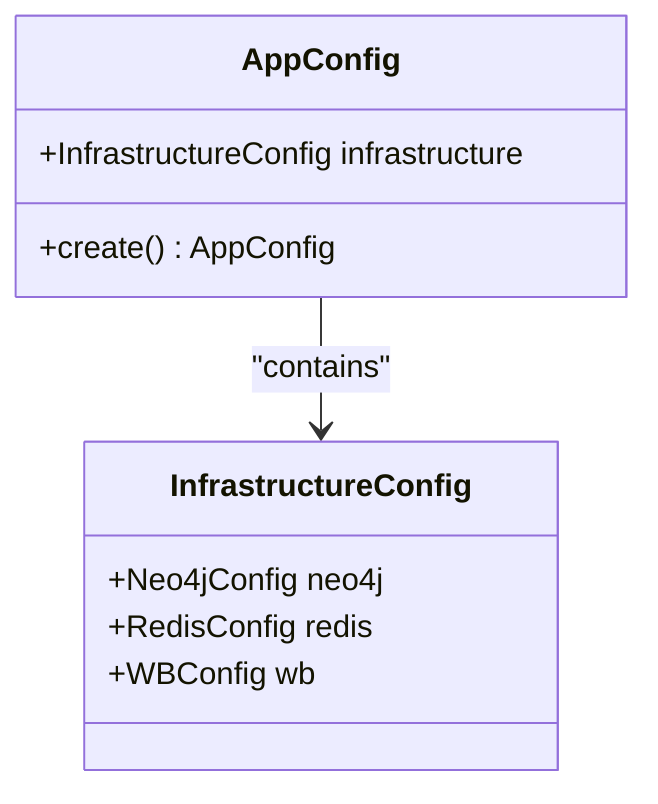
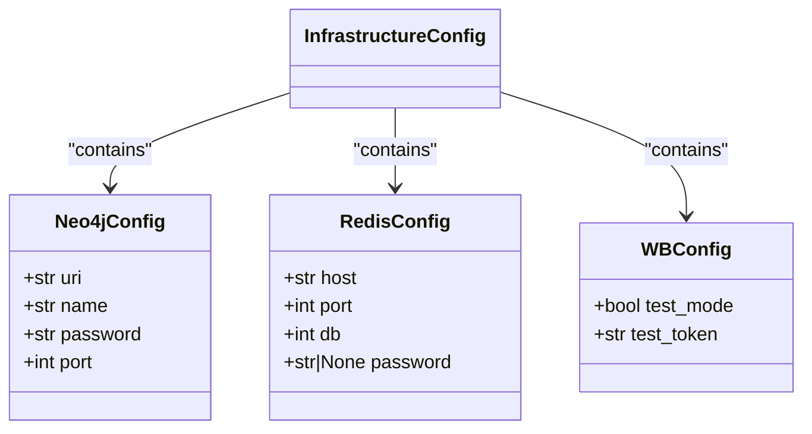
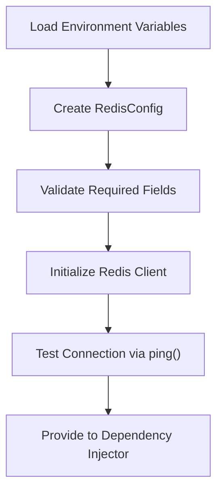
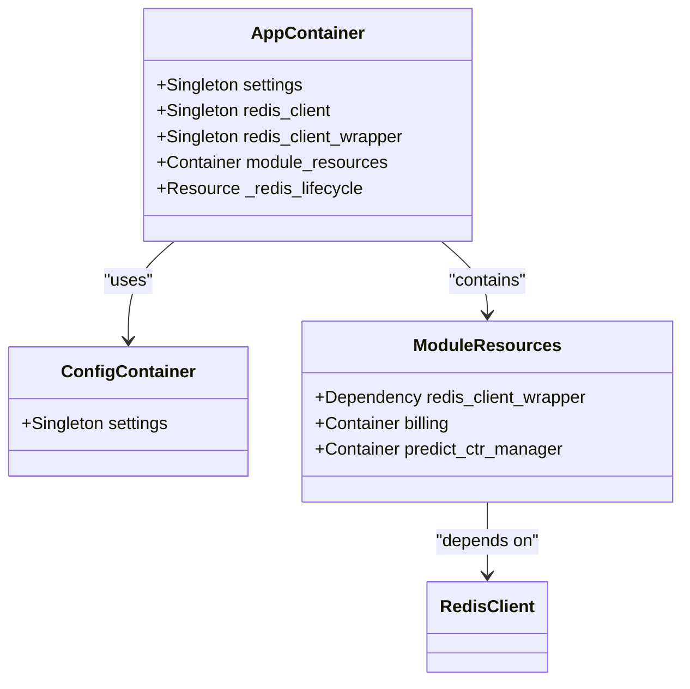
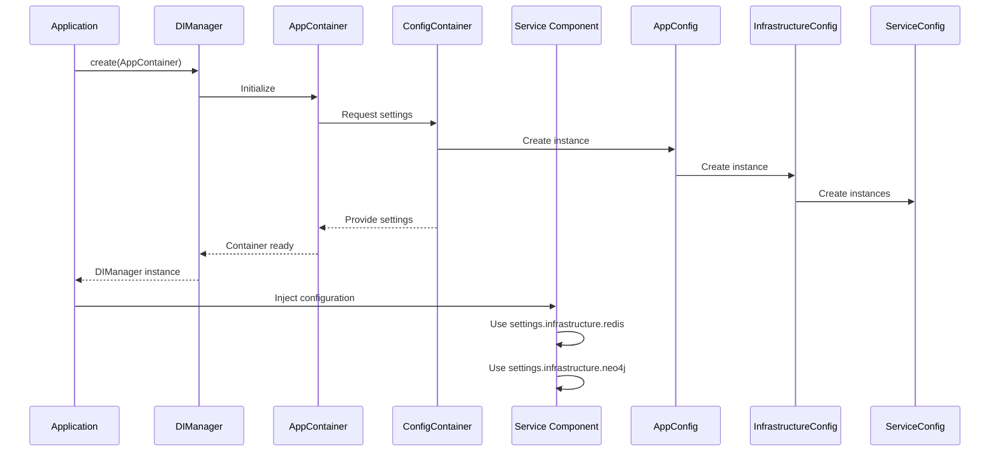

# Configuration Guide

<cite>
**Referenced Files in This Document**   
- [app_config.py](file://app/configs/app_config.py)
- [infrastructure_config.py](file://app/configs/infrastructure_config/infrastructure_config.py)
- [neo4j_config.py](file://app/configs/infrastructure_config/neo4j_config.py)
- [redis_config.py](file://app/configs/infrastructure_config/redis_config.py)
- [wb_config.py](file://app/configs/infrastructure_config/wb_config.py)
- [config.py](file://app/core/di/configs/config.py)
- [app_container.py](file://app/core/di/app_container.py)
- [settings_master.py](file://app/settings/settings_master.py)
- [redis.py](file://app/core/di/databases/redis.py)
- [neo4j.py](file://app/core/di/databases/neo4j.py)
</cite>

## Table of Contents
1. [Configuration System Overview](#configuration-system-overview)
2. [Configuration Hierarchy Structure](#configuration-hierarchy-structure)
3. [Environment Variables and Service Configuration](#environment-variables-and-service-configuration)
4. [Dependency Injection Configuration System](#dependency-injection-configuration-system)
5. [Environment Setup and Management](#environment-setup-and-management)
6. [Common Configuration Issues and Troubleshooting](#common-configuration-issues-and-troubleshooting)
7. [Security Best Practices for Configuration](#security-best-practices-for-configuration)

## Configuration System Overview

The adv-bot project implements a hierarchical configuration system using Pydantic Settings to manage application settings and infrastructure connections. The configuration system is designed to separate application-level settings from infrastructure-level services, providing a clear structure for managing different environments and service connections.

The configuration system follows a layered approach where the main `AppConfig` class contains an `InfrastructureConfig` object that in turn holds configuration objects for specific services like Redis, Neo4j, ClickHouse, and Wildberries API. This hierarchical structure allows for organized management of configuration settings while maintaining flexibility for different deployment environments.

**Section sources**
- [app_config.py](file://app/configs/app_config.py#L1-L23)
- [infrastructure_config.py](file://app/configs/infrastructure_config/infrastructure_config.py#L1-L20)

## Configuration Hierarchy Structure

The configuration system is organized in a hierarchical structure with two main levels: application configuration and infrastructure configuration.

### Application Configuration (app_config.py)

The `AppConfig` class serves as the root configuration object and is responsible for application-level settings. It uses Pydantic's BaseSettings with the following configuration:



**Diagram sources**
- [app_config.py](file://app/configs/app_config.py#L1-L23)
- [infrastructure_config.py](file://app/configs/infrastructure_config/infrastructure_config.py#L1-L20)

### Infrastructure Configuration Components

The infrastructure configuration is divided into specialized configuration classes for different services:



**Diagram sources**
- [neo4j_config.py](file://app/configs/infrastructure_config/neo4j_config.py#L1-L17)
- [redis_config.py](file://app/configs/infrastructure_config/redis_config.py#L1-L16)
- [wb_config.py](file://app/configs/infrastructure_config/wb_config.py#L1-L23)

The configuration hierarchy allows for environment-specific settings to be loaded from a `.env` file with appropriate prefixes for each configuration level. The `AppConfig` uses the prefix "APP_" while infrastructure components use their respective service prefixes (e.g., "NEO4J_", "REDIS_", "WB_").

**Section sources**
- [app_config.py](file://app/configs/app_config.py#L1-L23)
- [infrastructure_config.py](file://app/configs/infrastructure_config/infrastructure_config.py#L1-L20)
- [neo4j_config.py](file://app/configs/infrastructure_config/neo4j_config.py#L1-L17)
- [redis_config.py](file://app/configs/infrastructure_config/redis_config.py#L1-L16)
- [wb_config.py](file://app/configs/infrastructure_config/wb_config.py#L1-L23)

## Environment Variables and Service Configuration

The configuration system relies heavily on environment variables to set up service connections. Each service has specific environment variables that must be defined for proper operation.

### Redis Configuration

Redis connections are configured using the following environment variables:

- `REDIS_MASTER_HOST`: Host address for Redis master
- `REDIS_REPLICA_HOST`: Host address for Redis replica
- `REDIS_PORT`: Port number (default: 6379)
- `REDIS_DB`: Database number (default: 0)



**Diagram sources**
- [redis_config.py](file://app/configs/infrastructure_config/redis_config.py#L1-L16)
- [redis.py](file://app/core/di/databases/redis.py#L1-L37)

### Neo4j Configuration

Neo4j database connections require the following environment variables:

- `NEO4J_URI`: Database URI
- `NEO4J_NAME`: Username
- `NEO4J_PASSWORD`: Password
- `NEO4J_PORT`: Port number

### Wildberries API Configuration

The Wildberries API integration uses these environment variables:

- `WB_TEST_MODE`: Boolean flag for test mode
- `WB_TEST_TOKEN`: Test token value

### ClickHouse Configuration

ClickHouse connections are managed through the legacy settings system with these variables:

- `CLICK_HOUSE_HOST`: Host address
- `CLICK_HOUSE_USER`: Username
- `CLICK_HOUSE_PASSWORD`: Password
- `CLICKHOUSE_PORT`: Port number

### Additional Service Environment Variables

The system also uses various other environment variables for different services:

- `POSTGRES_MASTER_HOST`, `POSTGRES_REPLICA_HOST`: PostgreSQL database hosts
- `TELEGRAM_BOT_TOKEN`: Telegram bot authentication token
- `YOOKASSA_TOKEN`: Payment processing token
- `PREDICT_CTR_HOST`, `PREDICT_CTR_PORT`: Predictive CTR service endpoints

**Section sources**
- [settings_master.py](file://app/settings/settings_master.py#L1-L434)
- [redis_config.py](file://app/configs/infrastructure_config/redis_config.py#L1-L16)
- [neo4j_config.py](file://app/configs/infrastructure_config/neo4j_config.py#L1-L17)
- [wb_config.py](file://app/configs/infrastructure_config/wb_config.py#L1-L23)

## Dependency Injection Configuration System

The adv-bot project uses the Dependency Injector library to manage configuration injection throughout the application. This system ensures that configuration objects are properly instantiated and provided to components that require them.

### Configuration Container Structure

The configuration system is implemented using a container hierarchy:



**Diagram sources**
- [config.py](file://app/core/di/configs/config.py#L1-L18)
- [app_container.py](file://app/core/di/app_container.py#L1-L50)
- [module_resources.py](file://app/core/di/module_resources.py#L1-L35)

### Configuration Injection Process

The configuration injection follows this sequence:



**Diagram sources**
- [di_manager.py](file://app/core/di/di_manager.py#L1-L84)
- [app_container.py](file://app/core/di/app_container.py#L1-L50)
- [config.py](file://app/core/di/configs/config.py#L1-L18)

The DIManager class serves as a context manager that handles the lifecycle of the dependency injection container, ensuring proper initialization and shutdown of resources.

**Section sources**
- [app_container.py](file://app/core/di/app_container.py#L1-L50)
- [config.py](file://app/core/di/configs/config.py#L1-L18)
- [di_manager.py](file://app/core/di/di_manager.py#L1-L84)
- [module_resources.py](file://app/core/di/module_resources.py#L1-L35)

## Environment Setup and Management

The configuration system supports different environments through environment variable management and configuration loading.

### Development Environment Setup

For development environments, create a `.env` file in the project root with the following structure:

```env
# Application Settings
APP_ENV=development

# Redis Configuration
REDIS_MASTER_HOST=localhost
REDIS_REPLICA_HOST=localhost
REDIS_PORT=6379
REDIS_DB=0

# Neo4j Configuration
NEO4J_URI=bolt://localhost
NEO4J_NAME=neo4j
NEO4J_PASSWORD=password
NEO4J_PORT=7687

# Wildberries API
WB_TEST_MODE=true
WB_TEST_TOKEN=test_token_value

# PostgreSQL
POSTGRES_MASTER_HOST=localhost
POSTGRES_REPLICA_HOST=localhost
POSTGRES_PORT=5432
POSTGRES_USER=postgres
POSTGRES_PASSWORD=password
POSTGRES_DBNAME=adv_bot

# ClickHouse
CLICK_HOUSE_HOST=localhost
CLICK_HOUSE_USER=default
CLICK_HOUSE_PASSWORD=
CLICKHOUSE_PORT=8123

# Telegram
TELEGRAM_BOT_TOKEN=your_telegram_bot_token
```

### Production Environment Setup

In production environments, configuration should be provided through environment variables rather than `.env` files. Use the same variable names but set them at the system level or through your deployment platform.

### Configuration Loading Process

The configuration loading process follows these steps:

1. Load environment variables from `.env` file (if present)
2. Create AppConfig instance using environment variables
3. Validate all required configuration values
4. Initialize dependency injection container
5. Wire dependencies to application components

The system uses Pydantic's validation to ensure all required configuration values are present and properly typed.

**Section sources**
- [app_config.py](file://app/configs/app_config.py#L1-L23)
- [infrastructure_config.py](file://app/configs/infrastructure_config/infrastructure_config.py#L1-L20)
- [settings_master.py](file://app/settings/settings_master.py#L1-L434)

## Common Configuration Issues and Troubleshooting

### Missing Environment Variables

When required environment variables are missing, the application will raise a `ValueError`. Common issues include:

- Redis connection errors due to missing `REDIS_MASTER_HOST`
- Database connection failures from missing PostgreSQL variables
- Authentication issues with external services

**Troubleshooting steps:**
1. Verify all required environment variables are set
2. Check for typos in variable names
3. Ensure the `.env` file is in the correct location
4. Validate that variables have the correct data types

### Connection Issues

Connection problems with services like Redis or Neo4j can occur due to:

- Incorrect host or port configuration
- Network connectivity issues
- Authentication failures

**Troubleshooting steps:**
1. Test connectivity to the service host and port
2. Verify credentials are correct
3. Check firewall rules and network configuration
4. Validate service is running and accessible

### Configuration Validation Errors

Pydantic may raise validation errors for incorrectly formatted values:

```python
# Example of common validation error
# Environment variable expects boolean but receives string
TEST_MODE=invalid_value  # This will raise an exception
```

**Troubleshooting steps:**
1. Ensure boolean values are 'true' or 'false' (lowercase)
2. Verify numeric values are valid integers or floats
3. Check string values for required formats

### Dependency Injection Issues

Problems with dependency injection typically manifest as:

- Missing dependency errors
- Circular dependency issues
- Incorrect provider configuration

**Troubleshooting steps:**
1. Verify all dependencies are properly declared
2. Check container wiring configuration
3. Ensure lifecycle resources are properly defined

**Section sources**
- [app_config.py](file://app/configs/app_config.py#L1-L23)
- [redis_config.py](file://app/configs/infrastructure_config/redis_config.py#L1-L16)
- [neo4j_config.py](file://app/configs/infrastructure_config/neo4j_config.py#L1-L17)
- [settings_master.py](file://app/settings/settings_master.py#L1-L434)
- [di_manager.py](file://app/core/di/di_manager.py#L1-L84)

## Security Best Practices for Configuration

### Sensitive Data Protection

Never commit sensitive configuration data to version control:

- Use `.env` files for local development but add them to `.gitignore`
- Store production credentials in environment variables or secret management systems
- Never hardcode passwords, tokens, or API keys in source code

### Environment Variable Management

Implement proper environment variable management:

- Use different `.env` files for different environments (e.g., `.env.development`, `.env.production`)
- Set strict permissions on configuration files
- Regularly rotate credentials and tokens

### Configuration Validation

Always validate configuration values:

- Use Pydantic's type validation and field constraints
- Implement custom validation for complex requirements
- Provide clear error messages for invalid configurations

### Secure Deployment Practices

Follow secure deployment practices:

- Use environment-specific configuration
- Implement configuration auditing and logging
- Regularly review and update configuration settings
- Monitor for unauthorized configuration changes

The configuration system in adv-bot provides a robust foundation for managing application settings while maintaining security and flexibility across different environments.

**Section sources**
- [app_config.py](file://app/configs/app_config.py#L1-L23)
- [settings_master.py](file://app/settings/settings_master.py#L1-L434)
- [redis_config.py](file://app/configs/infrastructure_config/redis_config.py#L1-L16)
- [neo4j_config.py](file://app/configs/infrastructure_config/neo4j_config.py#L1-L17)