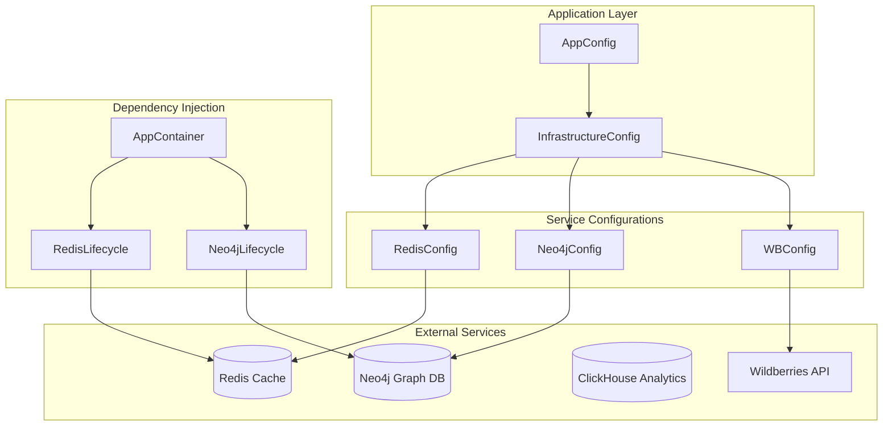
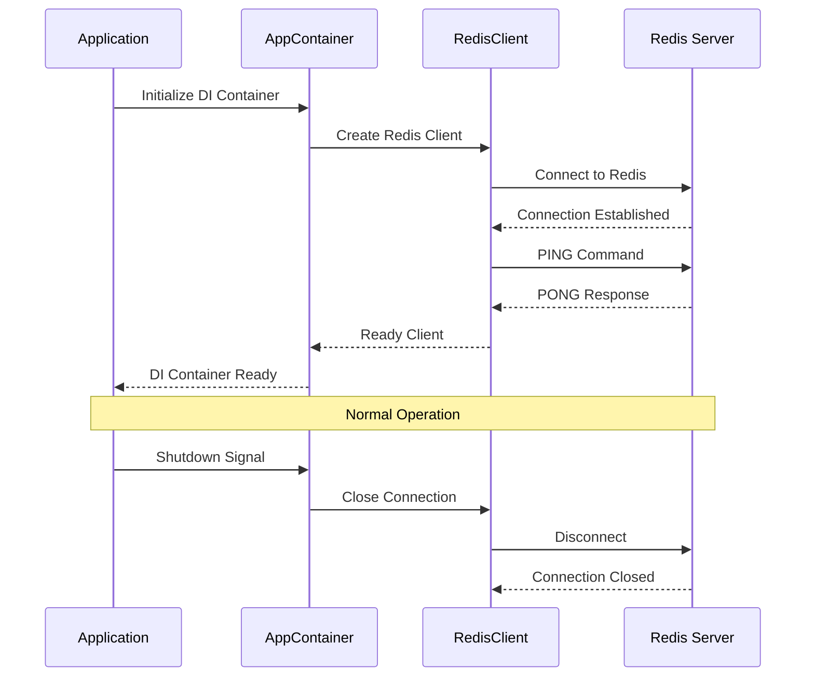
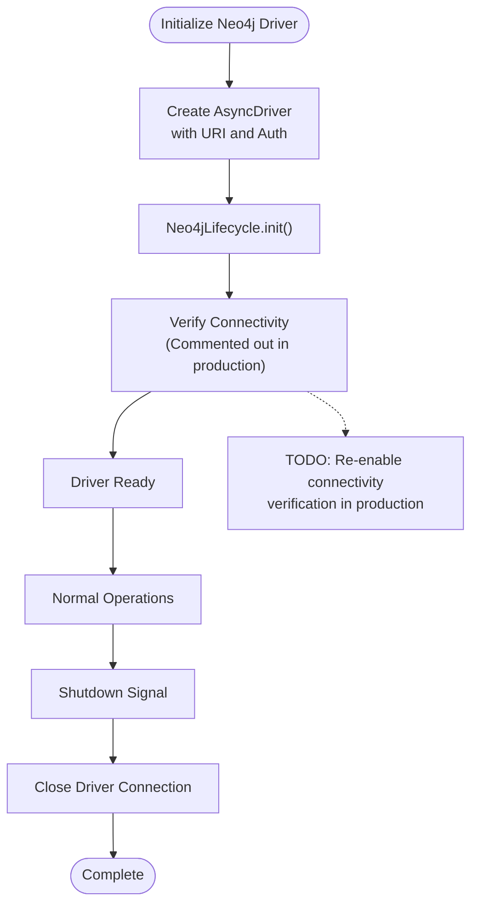
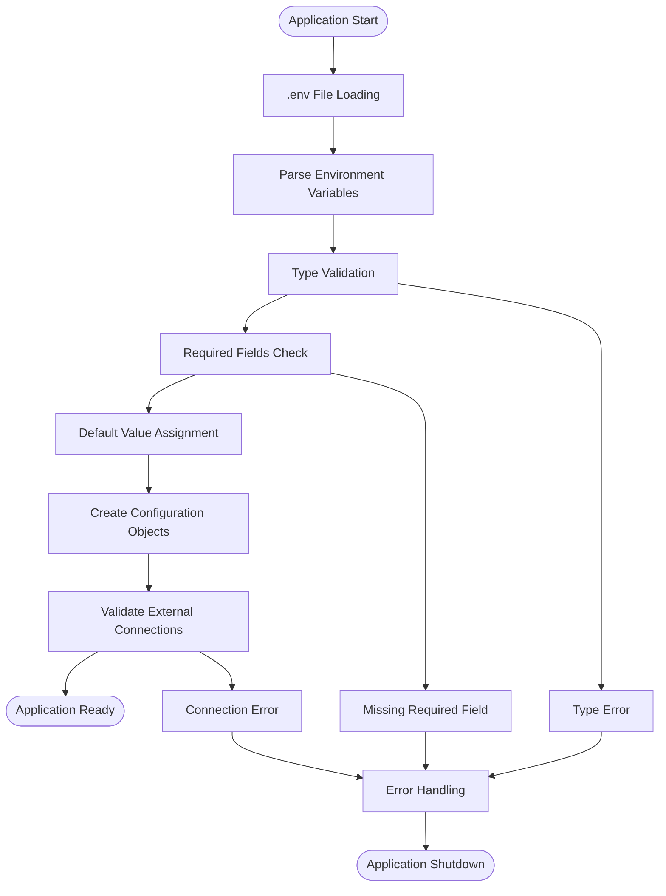
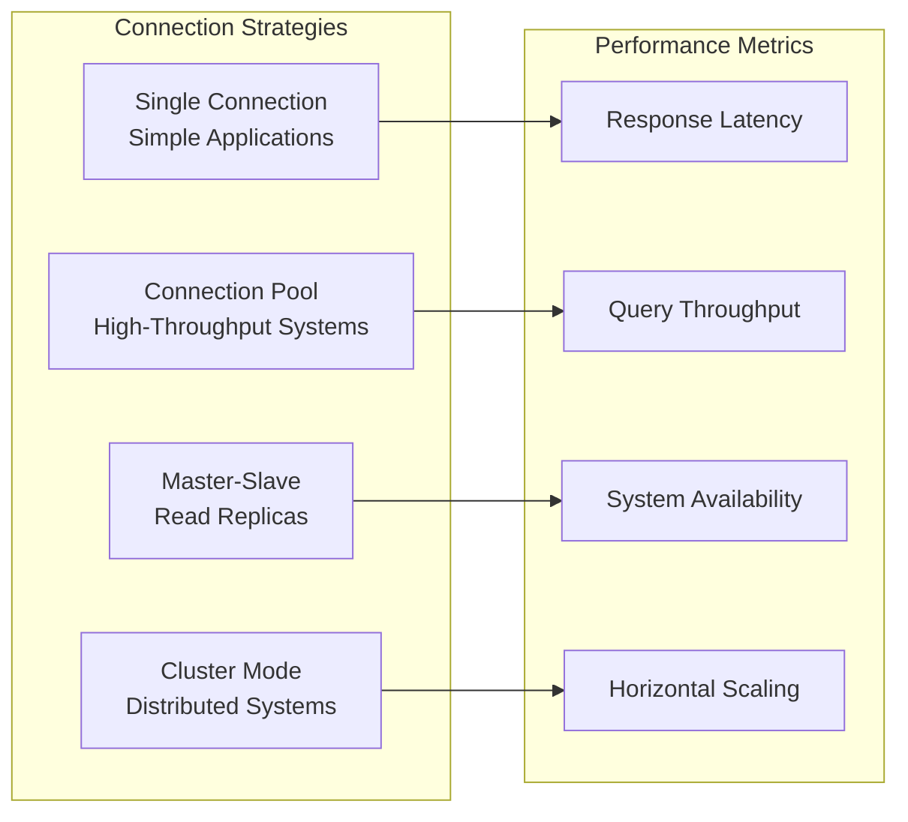

# Infrastructure Configuration

<cite>
**Referenced Files in This Document**
- [infrastructure_config.py](file://app/configs/infrastructure_config/infrastructure_config.py)
- [redis_config.py](file://app/configs/infrastructure_config/redis_config.py)
- [neo4j_config.py](file://app/configs/infrastructure_config/neo4j_config.py)
- [wb_config.py](file://app/configs/infrastructure_config/wb_config.py)
- [app_config.py](file://app/configs/app_config.py)
- [redis.py](file://app/core/di/databases/redis.py)
- [neo4j.py](file://app/core/di/databases/neo4j.py)
- [app_container.py](file://app/core/di/app_container.py)
- [settings_master.py](file://app/settings/settings_master.py)
</cite>

## Table of Contents
1. [Introduction](#introduction)
2. [Architecture Overview](#architecture-overview)
3. [Core Configuration Components](#core-configuration-components)
4. [Redis Configuration](#redis-configuration)
5. [Neo4j Configuration](#neo4j-configuration)
6. [Wildberries API Configuration](#wildberries-api-configuration)
7. [Environment Variable Management](#environment-variable-management)
8. [Configuration Loading and Validation](#configuration-loading-and-validation)
9. [Real-World Configuration Examples](#real-world-configuration-examples)
10. [Performance Impact and Reliability](#performance-impact-and-reliability)
11. [Troubleshooting Guide](#troubleshooting-guide)
12. [Best Practices](#best-practices)

## Introduction

The infrastructure configuration system in this advanced advertising bot project provides a centralized, type-safe, and environment-aware approach to managing external service connections. This system orchestrates critical infrastructure components including Redis caching, Neo4j graph database, ClickHouse analytics database, and Wildberries marketplace API connections.

The configuration architecture follows modern Python best practices using Pydantic for data validation and environment variable management, ensuring robustness and maintainability across development and production environments.

## Architecture Overview

The infrastructure configuration system is built around a hierarchical structure that promotes separation of concerns and modular design:



**Diagram sources**
- [app_config.py](file://app/configs/app_config.py#L1-L23)
- [infrastructure_config.py](file://app/configs/infrastructure_config/infrastructure_config.py#L1-L20)
- [redis_config.py](file://app/configs/infrastructure_config/redis_config.py#L1-L16)
- [neo4j_config.py](file://app/configs/infrastructure_config/neo4j_config.py#L1-L17)
- [wb_config.py](file://app/configs/infrastructure_config/wb_config.py#L1-L23)

**Section sources**
- [app_config.py](file://app/configs/app_config.py#L1-L23)
- [infrastructure_config.py](file://app/configs/infrastructure_config/infrastructure_config.py#L1-L20)

## Core Configuration Components

### InfrastructureConfig Class

The `InfrastructureConfig` serves as the central hub for all external service configurations, leveraging Pydantic's `BaseSettings` for automatic environment variable loading and validation:

```python
class InfrastructureConfig(BaseSettings):
    """Конфигурация инфраструктуры - централизованное место для всех внешних сервисов"""

    neo4j: Neo4jConfig = Field(default_factory=partial(Neo4jConfig))
    redis: RedisConfig = Field(default_factory=partial(RedisConfig))
    wb: WBConfig = Field(default_factory=lambda: WBConfig())

    model_config = {"env_file": ".env", "env_file_encoding": "utf-8", "extra": "ignore"}
```

This design provides several key benefits:
- **Centralized Management**: All external service configurations are consolidated in one place
- **Type Safety**: Pydantic ensures strict type checking and validation
- **Environment Awareness**: Automatic loading from `.env` files with UTF-8 encoding
- **Flexible Defaults**: Configurable defaults with factory functions
- **Error Prevention**: Early validation prevents runtime configuration errors

### AppConfig Integration

The `AppConfig` class wraps the infrastructure configuration with application-wide settings:

```python
class AppConfig(BaseSettings):
    """Главная конфигурация приложения"""

    # Инфраструктурные настройки
    infrastructure: InfrastructureConfig = Field(default_factory=InfrastructureConfig)

    model_config = SettingsConfigDict(
        env_file=".env", env_file_encoding="utf-8", extra="ignore", env_prefix="APP_"
    )
```

**Section sources**
- [infrastructure_config.py](file://app/configs/infrastructure_config/infrastructure_config.py#L1-L20)
- [app_config.py](file://app/configs/app_config.py#L1-L23)

## Redis Configuration

### RedisConfig Structure

The Redis configuration manages caching and session storage connections with comprehensive parameter control:

```python
class RedisConfig(BaseSettings):
    host: str
    port: int
    db: int = 0
    password: str | None = None

    model_config = {
        "env_prefix": "REDIS_",
        "env_file": ".env",
        "env_file_encoding": "utf-8",
        "extra": "ignore",
    }
```

### Key Parameters Explained

- **host**: Redis server hostname or IP address
- **port**: Redis server port (default: 6379)
- **db**: Database index (default: 0)
- **password**: Authentication password (optional)

### Redis Lifecycle Management

The system implements sophisticated lifecycle management for Redis connections:



**Diagram sources**
- [redis.py](file://app/core/di/databases/redis.py#L1-L37)
- [app_container.py](file://app/core/di/app_container.py#L1-L50)

**Section sources**
- [redis_config.py](file://app/configs/infrastructure_config/redis_config.py#L1-L16)
- [redis.py](file://app/core/di/databases/redis.py#L1-L37)

## Neo4j Configuration

### Neo4jConfig Structure

The Neo4j configuration handles graph database connections with comprehensive authentication and connectivity management:

```python
class Neo4jConfig(BaseSettings):
    uri: str = Field(..., description="Neo4j URI")
    name: str = Field(..., description="Neo4j user")
    password: str = Field(..., description="Neo4j password")
    port: int = Field(..., description="Neo4j port")

    model_config = {
        "env_prefix": "NEO4J_",
        "env_file": ".env",
        "env_file_encoding": "utf-8",
        "extra": "ignore",
    }
```

### Connection Parameters

- **uri**: Neo4j server URI (e.g., "bolt://localhost")
- **name**: Database username for authentication
- **password**: Database password for authentication
- **port**: Neo4j Bolt protocol port (default: 7687)

### Neo4j Lifecycle Implementation

The Neo4j lifecycle management focuses on connection verification and graceful shutdown:



**Diagram sources**
- [neo4j.py](file://app/core/di/databases/neo4j.py#L1-L45)

**Section sources**
- [neo4j_config.py](file://app/configs/infrastructure_config/neo4j_config.py#L1-L17)
- [neo4j.py](file://app/core/di/databases/neo4j.py#L1-L45)

## Wildberries API Configuration

### WBConfig Structure

The Wildberries configuration manages API credentials and operational modes:

```python
class WBConfig(BaseSettings):
    """Настройки, относящиеся к работе с WB API и токенами"""

    test_mode: bool = Field(
        default=False,
        description="Флаг тестового режима. Если True, используются тестовые токены и настройки.",
    )
    test_token: str = Field(
        default="test_token_value",
        description="Тестовый токен для использования в тестовом режиме.",
    )

    model_config = {
        "env_prefix": "WB_",
        "env_file": ".env",
        "env_file_encoding": "utf-8",
        "extra": "ignore",
    }
```

### Configuration Modes

- **test_mode**: Boolean flag enabling/disabling test mode
- **test_token**: Default test token value for development

### Environment Prefix Strategy

Each configuration class uses distinct environment variable prefixes:
- Redis: `REDIS_*`
- Neo4j: `NEO4J_*`
- Wildberries: `WB_*`

This prevents namespace collisions and enables clear separation of concerns.

**Section sources**
- [wb_config.py](file://app/configs/infrastructure_config/wb_config.py#L1-L23)

## Environment Variable Management

### Centralized Environment Loading

All configurations inherit from Pydantic's `BaseSettings`, which automatically loads environment variables from `.env` files:

```python
model_config = {
    "env_file": ".env",
    "env_file_encoding": "utf-8",
    "extra": "ignore",
}
```

### Environment Variable Naming Convention

The system uses a hierarchical naming convention:
- `APP_*`: Application-level settings
- `REDIS_*`: Redis configuration parameters
- `NEO4J_*`: Neo4j configuration parameters
- `WB_*`: Wildberries API configuration parameters

### Environment Variable Examples

```bash
# Redis Configuration
REDIS_HOST=localhost
REDIS_PORT=6379
REDIS_DB=0
REDIS_PASSWORD=your_redis_password

# Neo4j Configuration  
NEO4J_URI=bolt://localhost
NEO4J_NAME=neo4j
NEO4J_PASSWORD=neo4j_password
NEO4J_PORT=7687

# Wildberries Configuration
WB_TEST_MODE=false
WB_TEST_TOKEN=your_test_token_here
```

**Section sources**
- [infrastructure_config.py](file://app/configs/infrastructure_config/infrastructure_config.py#L18-L18)
- [redis_config.py](file://app/configs/infrastructure_config/redis_config.py#L11-L11)
- [neo4j_config.py](file://app/configs/infrastructure_config/neo4j_config.py#L12-L12)
- [wb_config.py](file://app/configs/infrastructure_config/wb_config.py#L18-L18)

## Configuration Loading and Validation

### Startup Validation Process

The configuration system performs comprehensive validation during application startup:



### Validation Features

1. **Type Safety**: Automatic type conversion and validation
2. **Required Field Checking**: Ensures all mandatory fields are present
3. **Default Value Handling**: Provides sensible defaults for optional fields
4. **Error Reporting**: Clear error messages for configuration issues
5. **Graceful Degradation**: Handles missing optional configurations

**Section sources**
- [app_config.py](file://app/configs/app_config.py#L15-L17)
- [infrastructure_config.py](file://app/configs/infrastructure_config/infrastructure_config.py#L18-L18)

## Real-World Configuration Examples

### Development Environment Configuration

```bash
# .env.development
# Redis Configuration
REDIS_HOST=localhost
REDIS_PORT=6379
REDIS_DB=0
REDIS_PASSWORD=

# Neo4j Configuration
NEO4J_URI=bolt://localhost
NEO4J_NAME=neo4j
NEO4J_PASSWORD=neo4j
NEO4J_PORT=7687

# Wildberries Configuration
WB_TEST_MODE=true
WB_TEST_TOKEN=test_token_12345

# Application Configuration
APP_ENVIRONMENT=development
APP_DEBUG=true
```

### Production Environment Configuration

```bash
# .env.production
# Redis Configuration
REDIS_HOST=redis-cluster.internal
REDIS_PORT=6379
REDIS_DB=1
REDIS_PASSWORD=${REDIS_PASSWORD}

# Neo4j Configuration
NEO4J_URI=bolt://neo4j-cluster.internal
NEO4J_NAME=${NEO4J_USERNAME}
NEO4J_PASSWORD=${NEO4J_PASSWORD}
NEO4J_PORT=7687

# Wildberries Configuration
WB_TEST_MODE=false
WB_TEST_TOKEN=${WB_API_TOKEN}

# Application Configuration
APP_ENVIRONMENT=production
APP_DEBUG=false
APP_LOG_LEVEL=INFO
```

### High-Availability Configuration

```bash
# .env.high-availability
# Redis Master Configuration
REDIS_MASTER_HOST=redis-master.internal
REDIS_MASTER_PORT=6379
REDIS_MASTER_DB=0
REDIS_MASTER_PASSWORD=${REDIS_MASTER_PASSWORD}

# Redis Replica Configuration
REDIS_REPLICA_HOST=redis-replica.internal
REDIS_REPLICA_PORT=6379
REDIS_REPLICA_DB=0
REDIS_REPLICA_PASSWORD=${REDIS_REPLICA_PASSWORD}

# Neo4j Cluster Configuration
NEO4J_URI=bolt://neo4j-cluster.internal
NEO4J_NAME=${NEO4J_CLUSTER_USER}
NEO4J_PASSWORD=${NEO4J_CLUSTER_PASSWORD}
NEO4J_PORT=7687

# Wildberries Configuration
WB_TEST_MODE=false
WB_TEST_TOKEN=${PROD_WB_API_TOKEN}
WB_API_ENDPOINT=https://api.wildberries.ru/v1
WB_TIMEOUT_SECONDS=30
```

## Performance Impact and Reliability

### Connection Pooling and Optimization

The configuration system supports various performance optimization strategies:



### Configuration Impact on Performance

1. **Redis Configuration Impact**:
   - **Host Selection**: Local vs. remote affects latency
   - **Port Configuration**: Standard vs. custom ports impact firewall rules
   - **Database Index**: Separate databases for different purposes
   - **Authentication**: Password protection adds minimal overhead

2. **Neo4j Configuration Impact**:
   - **URI Format**: Bolt vs. HTTP protocols
   - **Connection Pool Size**: Managed by Neo4j driver
   - **Authentication**: SSL/TLS overhead for secure connections

3. **Wildberries API Impact**:
   - **Test Mode**: Enables local development without API limits
   - **Endpoint Configuration**: Different regions have varying response times
   - **Rate Limiting**: Managed by API provider, not configuration

### Reliability Considerations

- **Connection Retry Logic**: Implemented at the driver level
- **Timeout Configuration**: Prevents hanging connections
- **Health Checks**: Regular connectivity verification
- **Fallback Mechanisms**: Graceful degradation when services unavailable

## Troubleshooting Guide

### Common Configuration Issues

#### Redis Connection Problems

**Issue**: Cannot connect to Redis server
```
Error: Connection refused
```

**Diagnosis Steps**:
1. Verify Redis server is running: `redis-cli ping`
2. Check network connectivity: `telnet redis-host 6379`
3. Validate environment variables: `echo $REDIS_HOST`

**Solutions**:
```bash
# Check Redis service status
sudo systemctl status redis

# Test connection manually
redis-cli -h localhost -p 6379 ping

# Verify environment variables
printenv | grep REDIS
```

#### Neo4j Authentication Failures

**Issue**: Authentication failed for Neo4j
```
Error: Unauthorized
```

**Diagnosis Steps**:
1. Verify Neo4j credentials in environment variables
2. Check Neo4j server logs for authentication errors
3. Confirm user permissions in Neo4j database

**Solutions**:
```bash
# Test Neo4j connection
cypher-shell -u neo4j -p neo4j_password "RETURN 1"

# Reset Neo4j password if needed
neo4j-admin set-initial-password new_password
```

#### Wildberries API Token Issues

**Issue**: Invalid or expired Wildberries API token
```
Error: 401 Unauthorized
```

**Diagnosis Steps**:
1. Verify token validity in Wildberries developer portal
2. Check token expiration date
3. Validate test mode configuration

**Solutions**:
```python
# Debug token configuration
import os
print(f"Test Mode: {os.getenv('WB_TEST_MODE')}")
print(f"Test Token: {os.getenv('WB_TEST_TOKEN')}")

# Generate new test token if needed
# Visit Wildberries developer portal to create new tokens
```

### Configuration Validation Tools

#### Environment Variable Validator

```python
def validate_environment_variables():
    """Validate all required environment variables"""
    required_vars = [
        'REDIS_HOST', 'REDIS_PORT', 'NEO4J_URI', 'NEO4J_NAME',
        'NEO4J_PASSWORD', 'WB_TEST_MODE', 'WB_TEST_TOKEN'
    ]
    
    missing_vars = []
    for var in required_vars:
        if not os.getenv(var):
            missing_vars.append(var)
    
    if missing_vars:
        raise ValueError(f"Missing environment variables: {missing_vars}")
    
    return True
```

#### Connection Health Checker

```python
async def check_infrastructure_health():
    """Check connectivity to all infrastructure components"""
    health_status = {}
    
    # Check Redis
    try:
        redis_client = Redis(host=os.getenv('REDIS_HOST'), port=int(os.getenv('REDIS_PORT')))
        await redis_client.ping()
        health_status['redis'] = 'healthy'
    except Exception as e:
        health_status['redis'] = f'unhealthy: {str(e)}'
    
    # Check Neo4j
    try:
        driver = AsyncGraphDatabase.driver(
            f"{os.getenv('NEO4J_URI')}:{os.getenv('NEO4J_PORT')}",
            auth=(os.getenv('NEO4J_NAME'), os.getenv('NEO4J_PASSWORD'))
        )
        await driver.verify_connectivity()
        health_status['neo4j'] = 'healthy'
    except Exception as e:
        health_status['neo4j'] = f'unhealthy: {str(e)}'
    
    return health_status
```

**Section sources**
- [redis.py](file://app/core/di/databases/redis.py#L15-L25)
- [neo4j.py](file://app/core/di/databases/neo4j.py#L25-L35)

## Best Practices

### Security Best Practices

1. **Environment Variable Protection**:
   ```bash
   # Use .env files in .gitignore
   echo ".env*" >> .gitignore
   
   # Set appropriate file permissions
   chmod 600 .env
   ```

2. **Secret Management**:
   ```bash
   # Use environment-specific secrets
   export REDIS_PASSWORD=$(cat /secrets/redis_password)
   export NEO4J_PASSWORD=$(cat /secrets/neo4j_password)
   ```

3. **Token Rotation**:
   ```bash
   # Regular token rotation schedule
   # Update tokens in environment variables
   # Test with WB_TEST_MODE=true before switching to production
   ```

### Performance Optimization

1. **Connection Pool Tuning**:
   ```python
   # Optimize Redis connection pool
   redis_client = Redis(
       host=redis_config.host,
       port=redis_config.port,
       max_connections=20,  # Adjust based on workload
       timeout=5           # Reasonable timeout
   )
   ```

2. **Caching Strategy**:
   ```python
   # Implement intelligent caching with Redis
   @cache_with_redis(ttl=3600)  # 1 hour TTL
   def expensive_operation():
       # Expensive computation here
       pass
   ```

3. **Database Indexing**:
   ```python
   # Configure Neo4j indexes for performance
   CREATE INDEX ON :User(username)
   CREATE INDEX ON :Product(category)
   ```

### Monitoring and Observability

1. **Health Check Endpoints**:
   ```python
   @app.get("/health/infrastructure")
   async def infrastructure_health():
       """Check health of all infrastructure components"""
       return await check_infrastructure_health()
   ```

2. **Metrics Collection**:
   ```python
   # Track connection metrics
   redis_connection_count = Counter('redis_connections_total', 'Total Redis connections')
   neo4j_query_duration = Histogram('neo4j_query_duration_seconds', 'Neo4j query duration')
   ```

3. **Logging Configuration**:
   ```python
   # Structured logging for configuration issues
   logger.error("Failed to connect to Redis", extra={
       "host": redis_config.host,
       "port": redis_config.port,
       "error": str(exception)
   })
   ```

### Deployment Considerations

1. **Environment Separation**:
   ```bash
   # Use different .env files for each environment
   cp .env.development .env
   # Or use environment variables in deployment pipeline
   export APP_ENVIRONMENT=production
   ```

2. **Configuration Validation**:
   ```python
   # Add pre-deployment validation
   def validate_production_config():
       assert os.getenv('APP_ENVIRONMENT') == 'production'
       assert not os.getenv('WB_TEST_MODE') == 'true'
       assert os.getenv('REDIS_PASSWORD'), "Production requires Redis password"
   ```

3. **Backup and Recovery**:
   ```bash
   # Backup configuration before deployment
   tar -czf config-backup.tar.gz .env* docker-compose.yml
   
   # Restore configuration if needed
   tar -xzf config-backup.tar.gz
   ```

This comprehensive infrastructure configuration system provides a robust foundation for managing external service connections in the advanced advertising bot project. By following these guidelines and utilizing the provided examples, developers can ensure reliable, secure, and high-performance integration with Redis, Neo4j, and Wildberries API services.