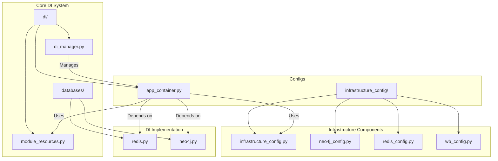
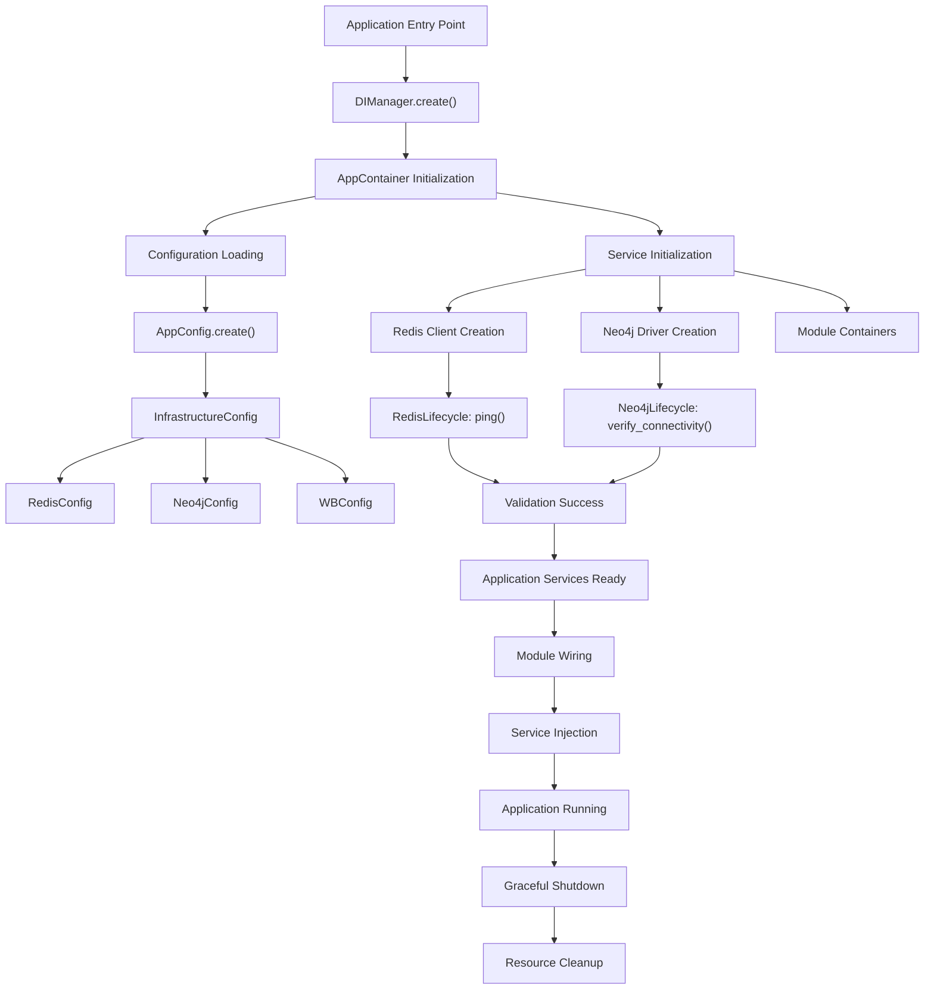
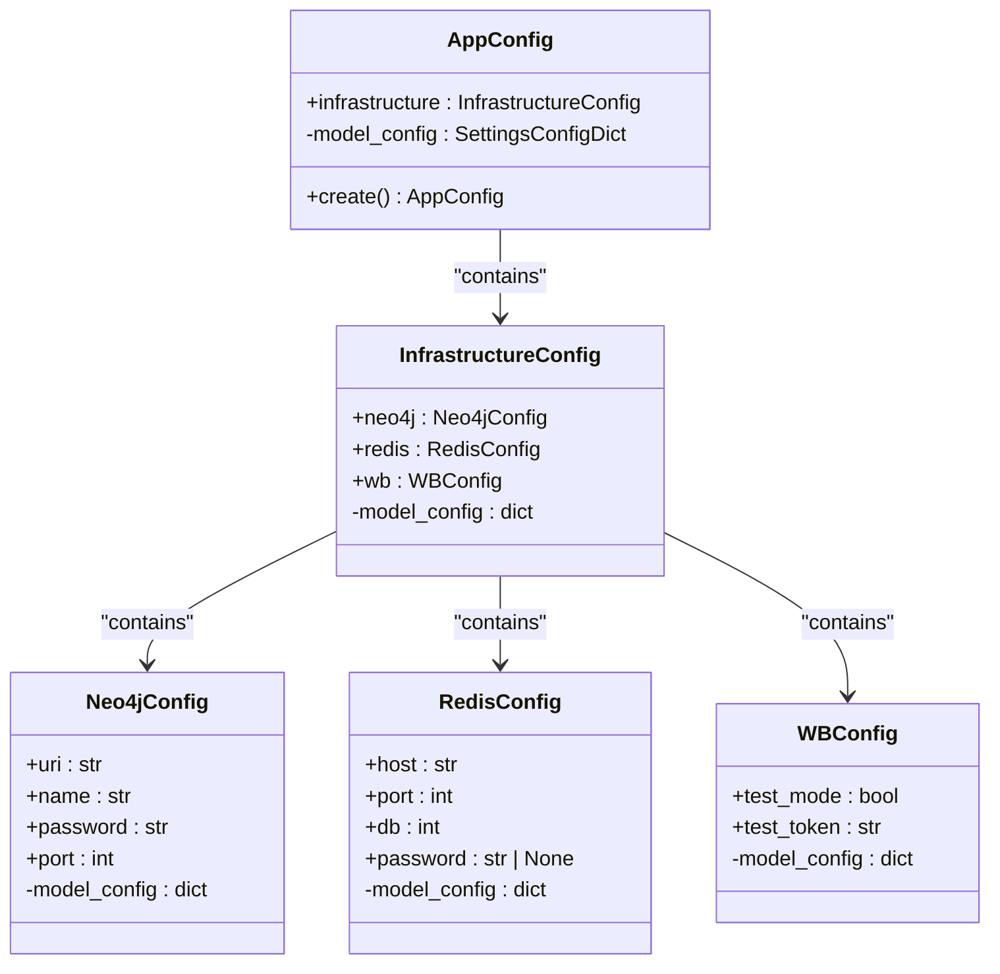
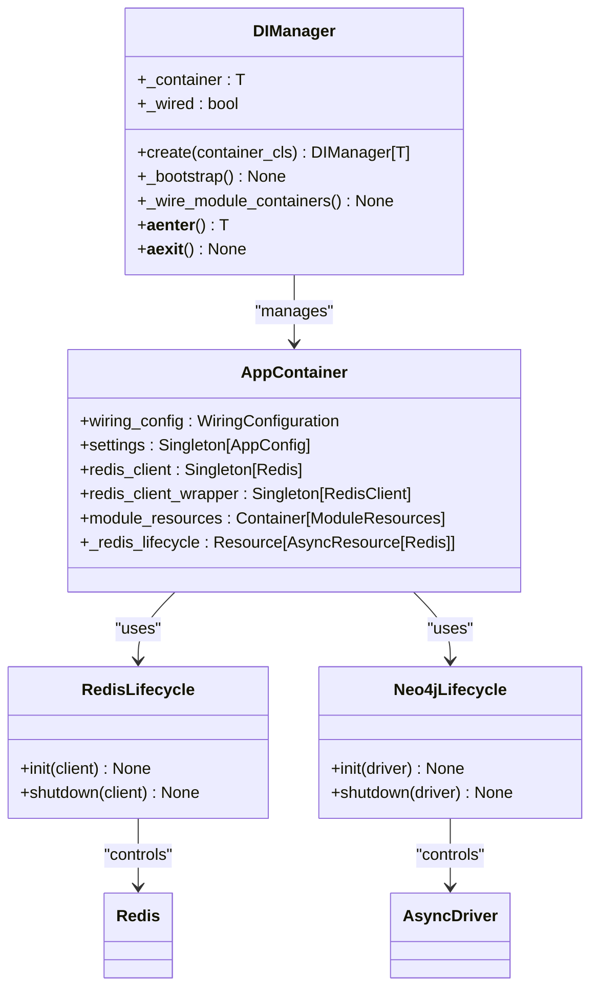
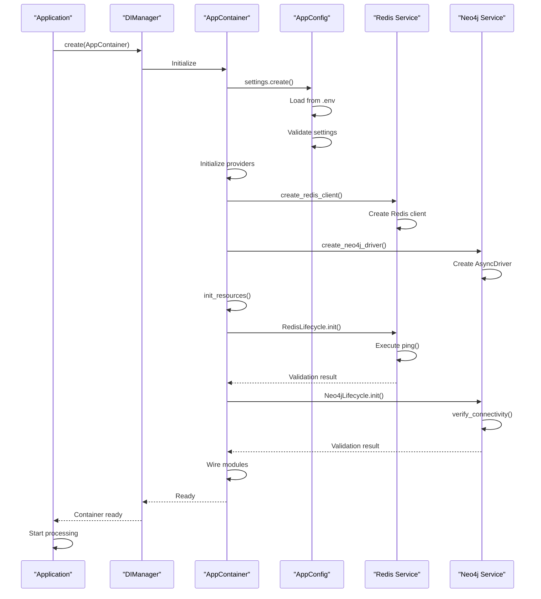
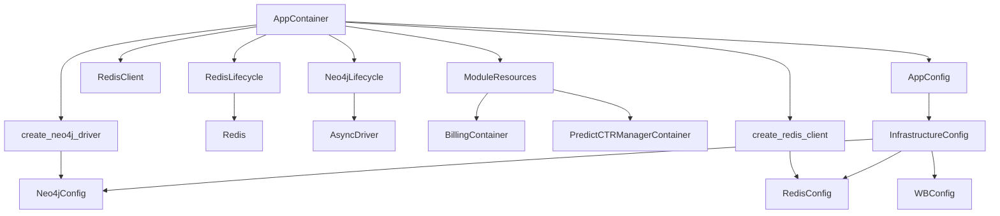

# Infrastructure Orchestration

<cite>
**Referenced Files in This Document**   
- [infrastructure_config.py](file://app/configs/infrastructure_config/infrastructure_config.py)
- [neo4j_config.py](file://app/configs/infrastructure_config/neo4j_config.py)
- [redis_config.py](file://app/configs/infrastructure_config/redis_config.py)
- [wb_config.py](file://app/configs/infrastructure_config/wb_config.py)
- [app_config.py](file://app/configs/app_config.py)
- [app_container.py](file://app/core/di/app_container.py)
- [di_manager.py](file://app/core/di/di_manager.py)
- [redis.py](file://app/core/di/databases/redis.py)
- [neo4j.py](file://app/core/di/databases/neo4j.py)
- [neo4j_container.py](file://app/core/di/containers/neo4j_container.py)
- [module_resources.py](file://app/core/di/module_resources.py)
- [client_bot_run.py](file://client_bot_run.py)
- [run_shop_update_worker.py](file://run_shop_update_worker.py)
</cite>

## Table of Contents
1. [Introduction](#introduction)
2. [Project Structure](#project-structure)
3. [Core Components](#core-components)
4. [Architecture Overview](#architecture-overview)
5. [Detailed Component Analysis](#detailed-component-analysis)
6. [Dependency Analysis](#dependency-analysis)
7. [Performance Considerations](#performance-considerations)
8. [Troubleshooting Guide](#troubleshooting-guide)
9. [Conclusion](#conclusion)

## Introduction
This document provides a comprehensive analysis of the infrastructure-level service orchestration system in the adv-bot application. It details how the configuration system aggregates and initializes services such as Redis, Neo4j, ClickHouse, and Wildberries API into a unified service registry. The document explains the initialization sequence, dependency injection setup via DIContainer, and validation logic that ensures all external services are reachable at startup. It also covers configuration layering with environment-specific overrides and integration with the core dependency injection system to provide ready-to-use clients for caching, database access, and HTTP operations.

## Project Structure

The infrastructure orchestration system is organized in a modular structure within the application:

**Diagram sources**
- [infrastructure_config.py](file://app/configs/infrastructure_config/infrastructure_config.py)
- [app_config.py](file://app/configs/app_config.py)
- [app_container.py](file://app/core/di/app_container.py)

**Section sources**
- [infrastructure_config.py](file://app/configs/infrastructure_config/infrastructure_config.py)
- [app_config.py](file://app/configs/app_config.py)

## Core Components

The infrastructure orchestration system consists of several core components that work together to provide a robust service initialization and dependency management framework. The system is built around Pydantic settings models for configuration management and the Dependency Injector library for dependency injection. The main components include the InfrastructureConfig class that aggregates service configurations, the AppConfig class that serves as the root configuration, and the AppContainer class that manages dependency injection. The DIManager class provides a context manager interface for proper initialization and shutdown of the dependency injection container, ensuring that all resources are properly managed throughout the application lifecycle.

**Section sources**
- [infrastructure_config.py](file://app/configs/infrastructure_config/infrastructure_config.py)
- [app_config.py](file://app/configs/app_config.py)
- [app_container.py](file://app/core/di/app_container.py)
- [di_manager.py](file://app/core/di/di_manager.py)

## Architecture Overview

The infrastructure orchestration architecture follows a layered approach with clear separation of concerns between configuration, dependency injection, and service initialization. The system uses a hierarchical configuration model where the root AppConfig contains an InfrastructureConfig instance, which in turn contains configuration objects for individual services like Redis, Neo4j, and Wildberries API. This configuration is then used by the AppContainer to initialize service clients through dependency injection. The DIManager provides a context manager interface that ensures proper initialization and shutdown of all resources, including connection validation and cleanup.

**Diagram sources**
- [app_config.py](file://app/configs/app_config.py)
- [infrastructure_config.py](file://app/configs/infrastructure_config/infrastructure_config.py)
- [app_container.py](file://app/core/di/app_container.py)
- [di_manager.py](file://app/core/di/di_manager.py)

## Detailed Component Analysis

### Infrastructure Configuration System

The infrastructure configuration system is implemented as a hierarchical structure of Pydantic settings classes that provide type-safe configuration management with environment variable support. The system uses Pydantic's BaseSettings class to automatically load configuration from environment variables and .env files, with support for environment-specific overrides through the env_prefix parameter.

#### Configuration Classes Structure

**Diagram sources**
- [app_config.py](file://app/configs/app_config.py)
- [infrastructure_config.py](file://app/configs/infrastructure_config/infrastructure_config.py)
- [neo4j_config.py](file://app/configs/infrastructure_config/neo4j_config.py)
- [redis_config.py](file://app/configs/infrastructure_config/redis_config.py)
- [wb_config.py](file://app/configs/infrastructure_config/wb_config.py)

**Section sources**
- [app_config.py](file://app/configs/app_config.py)
- [infrastructure_config.py](file://app/configs/infrastructure_config/infrastructure_config.py)

### Dependency Injection Container

The dependency injection system is implemented using the Dependency Injector library and provides a comprehensive framework for managing service lifecycles and dependencies. The AppContainer class serves as the main dependency injection container, defining providers for all core services and managing their initialization and shutdown.

#### DI Container Architecture

**Diagram sources**
- [app_container.py](file://app/core/di/app_container.py)
- [di_manager.py](file://app/core/di/di_manager.py)
- [redis.py](file://app/core/di/databases/redis.py)
- [neo4j.py](file://app/core/di/databases/neo4j.py)

**Section sources**
- [app_container.py](file://app/core/di/app_container.py)
- [di_manager.py](file://app/core/di/di_manager.py)

### Service Initialization Flow

The service initialization process follows a well-defined sequence that ensures all dependencies are properly configured and validated before the application becomes operational. The process begins with configuration loading, followed by service client creation, connection validation, and finally module wiring.

#### Initialization Sequence Diagram

**Diagram sources**
- [app_config.py](file://app/configs/app_config.py)
- [app_container.py](file://app/core/di/app_container.py)
- [di_manager.py](file://app/core/di/di_manager.py)
- [redis.py](file://app/core/di/databases/redis.py)
- [neo4j.py](file://app/core/di/databases/neo4j.py)

**Section sources**
- [di_manager.py](file://app/core/di/di_manager.py)
- [app_container.py](file://app/core/di/app_container.py)

## Dependency Analysis

The infrastructure orchestration system has a well-defined dependency structure that ensures proper initialization order and resource management. The system uses a hierarchical dependency injection approach where the main AppContainer depends on configuration classes and database module utilities, while individual service lifecycle managers depend on the specific service clients they manage.

**Diagram sources**
- [app_container.py](file://app/core/di/app_container.py)
- [app_config.py](file://app/configs/app_config.py)
- [infrastructure_config.py](file://app/configs/infrastructure_config/infrastructure_config.py)
- [redis.py](file://app/core/di/databases/redis.py)
- [neo4j.py](file://app/core/di/databases/neo4j.py)
- [module_resources.py](file://app/core/di/module_resources.py)

**Section sources**
- [app_container.py](file://app/core/di/app_container.py)
- [app_config.py](file://app/configs/app_config.py)

## Performance Considerations

The infrastructure orchestration system is designed with performance and reliability in mind. The configuration system uses lazy initialization patterns to avoid unnecessary resource allocation, and the dependency injection container caches singleton instances to prevent redundant service creation. Connection validation is performed during startup to ensure service availability before the application begins processing requests, reducing the likelihood of runtime failures. The use of asynchronous lifecycle management allows for efficient resource cleanup during application shutdown, preventing resource leaks. The modular container structure enables selective wiring of only the required modules, reducing initialization overhead in specialized deployment scenarios.

## Troubleshooting Guide

When encountering issues with the infrastructure orchestration system, consider the following troubleshooting steps:

1. **Configuration Loading Issues**: Verify that the .env file exists and contains all required environment variables with correct prefixes (APP_, REDIS_, NEO4J_, WB_). Check that the file encoding is UTF-8 and that there are no syntax errors in the file.

2. **Service Connection Problems**: If Redis or Neo4j connections fail during initialization, verify the service endpoints, ports, and authentication credentials. Check network connectivity between the application and the services, and ensure that firewalls are not blocking the connections.

3. **Circular Import Detection**: The system includes circular import detection in the test suite. If circular imports are suspected, run the circular import test script to identify problematic import chains.

4. **Delayed Service Initialization**: If services appear to initialize slowly, check the network latency between the application and external services. Consider adjusting timeout settings in the lifecycle management code if appropriate.

5. **Module Wiring Failures**: If module containers fail to wire properly, verify that the wiring configuration includes all required packages and that the module containers are properly registered in the ModuleResources container.

6. **Environment-Specific Configuration**: When deploying to different environments (Docker, Kubernetes), ensure that environment variables are properly mapped and that configuration overrides are applied in the correct order.

**Section sources**
- [di_manager.py](file://app/core/di/di_manager.py)
- [app_container.py](file://app/core/di/app_container.py)
- [app_config.py](file://app/configs/app_config.py)
- [redis.py](file://app/core/di/databases/redis.py)
- [neo4j.py](file://app/core/di/databases/neo4j.py)

## Conclusion

The infrastructure orchestration system in the adv-bot application provides a robust and flexible framework for managing external service dependencies. By combining Pydantic settings models with the Dependency Injector library, the system achieves a clean separation of configuration and dependency management concerns. The hierarchical configuration structure allows for easy extension with new services, while the lifecycle management system ensures proper validation and cleanup of resources. The modular design supports both monolithic and microservice deployment patterns, making it suitable for various deployment scenarios including Docker and Kubernetes environments. The comprehensive error handling and logging provide visibility into the initialization process, facilitating troubleshooting and maintenance.