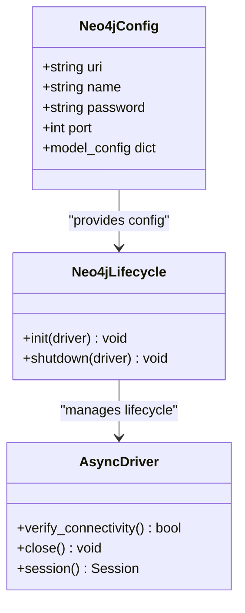
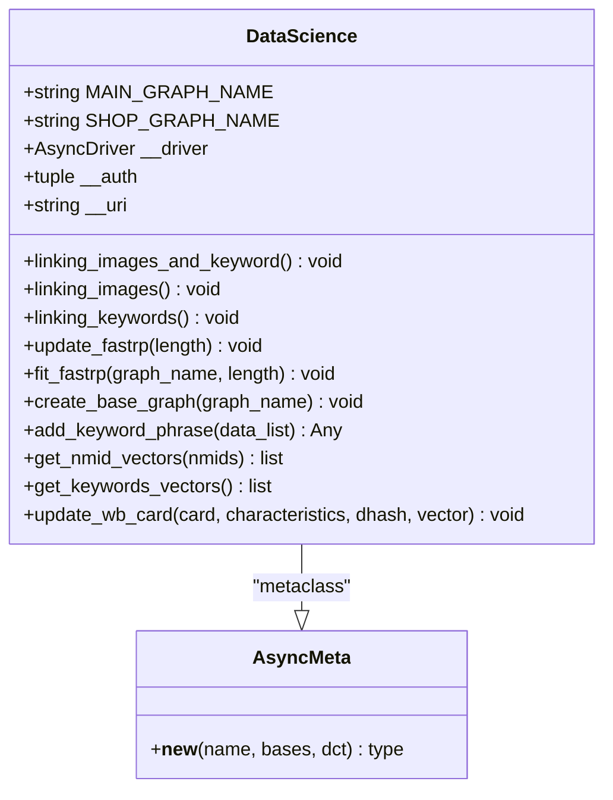
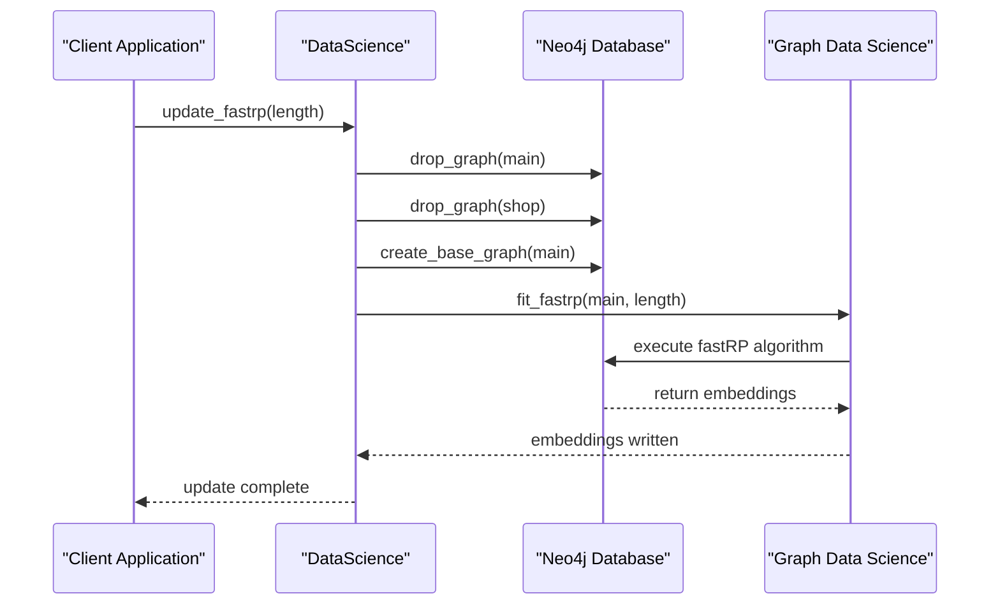
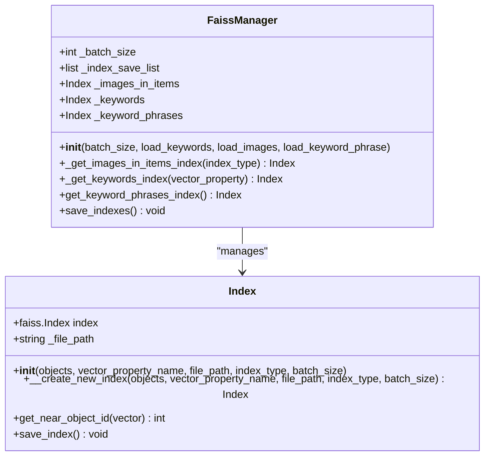

# Neo4j Configuration

<cite>
**Referenced Files in This Document**
- [neo4j_config.py](file://app/configs/infrastructure_config/neo4j_config.py)
- [neo4j.py](file://app/core/di/databases/neo4j.py)
- [neo4j_container.py](file://app/core/di/containers/neo4j_container.py)
- [driver.py](file://app/utils/NeoDataScience/driver.py)
- [graph_vector_updater.py](file://app/modules/wb_adv_updater/graph_vector_updater.py)
- [faiss_index_manager.py](file://app/utils/faiss_manager/faiss_index_manager.py)
- [faiss_index.py](file://app/utils/faiss_manager/faiss_index.py)
- [Dockerfile](file://dockers/neo4j/Dockerfile)
- [update_wb_adv_phrases_in_neo.py](file://app/modules/wb_adv_updater/update_wb_adv_phrases_in_neo.py)
- [gds_object.py](file://app/modules/wb_adv_updater/gds_object.py)
</cite>

## Table of Contents
1. [Introduction](#introduction)
2. [Neo4j Configuration Setup](#neo4j-configuration-setup)
3. [Connection Management](#connection-management)
4. [Graph Data Science Integration](#graph-data-science-integration)
5. [Vector-Based Recommendations](#vector-based-recommendations)
6. [Faiss Index Manager](#faiss-index-manager)
7. [Performance Optimization](#performance-optimization)
8. [Troubleshooting Guide](#troubleshooting-guide)
9. [Best Practices](#best-practices)
10. [Conclusion](#conclusion)

## Introduction

The Neo4j configuration system in this advertisement bot project provides a comprehensive framework for managing graph database connections, vector-based recommendations, and advanced graph analytics. The system integrates Neo4j with Graph Data Science (GDS) capabilities to support keyword clustering, phrase relevance analysis, and vector-based recommendations through sophisticated indexing mechanisms.

The architecture leverages dependency injection for clean separation of concerns, asynchronous operations for optimal performance, and modular design patterns that facilitate maintenance and scalability. The Neo4j integration serves as the backbone for storing keyword relationships, advertising hierarchies, and product category graphs, enabling sophisticated recommendation engines and analytics capabilities.

## Neo4j Configuration Setup

### Configuration Class Structure

The Neo4j configuration is built around a Pydantic-based configuration class that provides type safety and environment variable integration:

```python
class Neo4jConfig(BaseSettings):
    uri: str = Field(..., description="Neo4j URI")
    name: str = Field(..., description="Neo4j user")
    password: str = Field(..., description="Neo4j password")
    port: int = Field(..., description="Neo4j port")
```

### Environment Variable Integration

The configuration system automatically loads settings from environment variables with the prefix `NEO4J_`. This enables seamless deployment across different environments without code changes:

```python
model_config = {
    "env_prefix": "NEO4J_",
    "env_file": ".env",
    "env_file_encoding": "utf-8",
    "extra": "ignore",
}
```

### Configuration Parameters

| Parameter | Type | Description | Example |
|-----------|------|-------------|---------|
| `uri` | string | Neo4j server URI | `localhost` |
| `name` | string | Authentication username | `neo4j` |
| `password` | string | Authentication password | `your_password` |
| `port` | integer | Bolt protocol port | `7687` |

**Section sources**
- [neo4j_config.py](file://app/configs/infrastructure_config/neo4j_config.py#L1-L17)

## Connection Management

### Driver Creation and Lifecycle

The Neo4j connection management follows a sophisticated dependency injection pattern that ensures proper resource lifecycle management:



**Diagram sources**
- [neo4j_config.py](file://app/configs/infrastructure_config/neo4j_config.py#L1-L17)
- [neo4j.py](file://app/core/di/databases/neo4j.py#L1-L45)

### Connection Pooling and Authentication

The system creates asynchronous Neo4j drivers with built-in connection pooling:

```python
def create_neo4j_driver(neo4j_config: Neo4jConfig) -> AsyncDriver:
    driver = AsyncGraphDatabase.driver(
        f"{neo4j_config.uri}:{neo4j_config.port}",
        auth=(
            neo4j_config.name,
            neo4j_config.password,
        ),
    )
    return driver
```

### Dependency Injection Container

The Neo4j container manages all dependencies through a declarative approach:

```python
class Neo4jContainer(containers.DeclarativeContainer):
    settings: Dependency[Any] = providers.Dependency()
    
    neo4j_driver = providers.Singleton(
        create_neo4j_driver,
        neo4j_config=settings.provided.infrastructure.neo4j,
    )
    
    _neo4j_lifecycle = providers.Resource(
        Neo4jLifecycle,
        driver=neo4j_driver,
    )
```

**Section sources**
- [neo4j.py](file://app/core/di/databases/neo4j.py#L1-L45)
- [neo4j_container.py](file://app/core/di/containers/neo4j_container.py#L1-L29)

## Graph Data Science Integration

### DataScience Class Architecture

The `DataScience` class serves as the primary interface for Neo4j Graph Data Science operations, providing asynchronous methods for graph creation, manipulation, and analysis:



**Diagram sources**
- [driver.py](file://app/utils/NeoDataScience/driver.py#L1-L711)

### Graph Creation and Management

The system supports dynamic graph creation with automatic cleanup and validation:

```python
async def create_base_graph(self, graph_name: str) -> None:
    query = """
    CALL gds.graph.project(
        $graph_name,
        {
            Item: {properties: []}, 
            Image: {properties: []},
            Keyword: {properties: []},
            KeywordPhrase: {properties: []},
            WBChar: {properties: []},
            Brand: {properties: []},
            WbCategory: {properties: []}
        },
        {
            IS: {
                type: 'IS',
                properties: {
                    dist: {
                        property: 'dist',
                        defaultValue:1
                    }
                }
            }
        }
    )
    """
```

### Vector-Based Graph Operations

The system implements sophisticated vector-based graph operations using FAISS and Neo4j GDS:



**Diagram sources**
- [driver.py](file://app/utils/NeoDataScience/driver.py#L150-L200)

**Section sources**
- [driver.py](file://app/utils/NeoDataScience/driver.py#L1-L711)

## Vector-Based Recommendations

### Keyword Phrase Management

The system maintains comprehensive keyword phrase relationships with vector embeddings:

```python
async def add_keyword_phrase(self, phrase_data_list: list[KeywordPhrase]) -> Any:
    query = """
    UNWIND $data_list AS phrase
    MERGE (keyword_phrase:KeywordPhrase {text: phrase.text})
    ON CREATE SET keyword_phrase.word2vec = phrase.word2vec
    ON MATCH SET keyword_phrase.word2vec = phrase.word2vec
    WITH keyword_phrase, phrase
    UNWIND phrase.words AS word
        MERGE (keyword:Keyword {text: word.text})
        ON CREATE SET keyword.word2vec = word.word2vec
        ON MATCH SET keyword.word2vec = word.word2vec
        MERGE (keyword_phrase)-[r:IS]->(keyword)
        ON CREATE SET r.dist = phrase.dist_to_word
        ON MATCH SET r.dist = phrase.dist_to_word
    """
```

### Vector Retrieval and Processing

The system provides efficient vector retrieval for various entity types:

```python
async def get_nmid_vectors(self, nmids: list[int]) -> list[tuple[int, list[float]]]:
    query = """
    MATCH (item:Item) WHERE  item.nmid  IN  $nmids 
    AND item.fastrp IS NOT NULL
    RETURN item.nmid as nmid, item.fastrp as vector
    """
```

### Product Card Updates

The system handles complex product card updates with vector embeddings:

```python
async def update_wb_card(
    self,
    wbcard: WBCard,
    characteristics: dict[str, str],
    dhash: str,
    vector: list[float],
) -> None:
    query = """
    MERGE (item:Item {nmid: $nmid})
    MERGE (image:Image {dhash: $dhash})
    MERGE (item)-[:IN]->(image)
    SET image.vgg19 = $vector
    MERGE (category:WbCategory {name: $category_name})
    MERGE (item)-[:IS]->(category)
    """
```

**Section sources**
- [driver.py](file://app/utils/NeoDataScience/driver.py#L300-L400)
- [driver.py](file://app/utils/NeoDataScience/driver.py#L500-L600)

## Faiss Index Manager

### Index Architecture

The Faiss index manager provides hybrid vector search capabilities combining Neo4j graph data with dense vector representations:



**Diagram sources**
- [faiss_index_manager.py](file://app/utils/faiss_manager/faiss_index_manager.py#L1-L198)
- [faiss_index.py](file://app/utils/faiss_manager/faiss_index.py#L1-L106)

### Vector Index Creation

The system creates optimized vector indices with automatic batch processing:

```python
def __create_new_index(
    self,
    objects: Query | Generator,
    vector_property_name,
    file_path,
    index_type,
    batch_size: int,
):
    index = getattr(faiss, index_type)(
        len(getattr(objects[0], vector_property_name))
    )
    index = faiss.IndexIDMap(index)
    
    vectors = []
    ids = []
    
    for object in objects:
        vector = getattr(object, vector_property_name)
        vectors.append(vector)
        ids.append(object.id)
        
        if len(vectors) == batch_size:
            vectors_np = np.array(vectors, dtype=np.float32)
            ids_np = np.array(ids, dtype=np.int64)
            faiss.normalize_L2(vectors_np)
            index.add_with_ids(vectors_np, ids_np)
            vectors = []
            ids = []
```

### Hybrid Search Implementation

The Faiss manager supports multiple index types for different vector modalities:

```python
def _get_images_in_items_index(self, index_type):
    index_name = "images_in_items"
    index_file_path = self.__get_file_path(index_name + ".index")
    s = self._session_maker()
    images = (
        s.query(Image)
        .join(Image.items)
        .filter(Image.items.any())
        .distinct(Image.id)
    )
    index = Index(
        images,
        "vector",
        index_file_path,
        index_type,
        self._batch_size,
    )
    return index
```

**Section sources**
- [faiss_index.py](file://app/utils/faiss_manager/faiss_index.py#L42-L81)
- [faiss_index_manager.py](file://app/utils/faiss_manager/faiss_index_manager.py#L120-L150)

## Performance Optimization

### Transaction Management

The system implements robust transaction management with retry logic for handling transient errors:

```python
@async_try_wrapper()
async def wrapper(*args: P.args, **kwargs: P.kwargs) -> T:
    global total_tries
    global max_tries
    while True:
        try:
            result = await func(*args, **kwargs)
            total_tries = 0
            return result
        except neo4j.exceptions.TransientError:
            if max_tries > total_tries:
                raise
            else:
                total_tries += 1
                logger.debug("Ошибка взаимной блокировки, повтор транзакции через 5 сек")
                await asyncio.sleep(5)
```

### Batch Processing Strategies

The system employs efficient batch processing for large-scale operations:

```python
async def update_keywords_vectors_process(self) -> None:
    while True:
        try:
            await self._update_keywords_vectors_process()
        except Exception as exc:
            logger.error(f"Ошибка при обновлении векторов ключевых фраз: {exc}")
        await asyncio.sleep(5)
```

### Connection Pool Optimization

The Neo4j driver automatically manages connection pools with optimal settings for concurrent operations.

**Section sources**
- [driver.py](file://app/utils/NeoDataScience/driver.py#L25-L50)
- [graph_vector_updater.py](file://app/modules/wb_adv_updater/graph_vector_updater.py#L80-L100)

## Troubleshooting Guide

### Common Connectivity Issues

**Problem**: Connection timeout or authentication failures
**Solution**: Verify environment variables and network connectivity:

```bash
# Check environment variables
echo $NEO4J_URI
echo $NEO4J_PORT
echo $NEO4J_NAME

# Test connectivity
telnet localhost 7687
```

**Problem**: GDS plugin not available
**Solution**: Ensure plugins are properly installed in the Docker container:

```dockerfile
COPY apoc-2025.07.1-core.jar /var/lib/neo4j/plugins/apoc.jar
COPY neo4j-graph-data-science-2.20.0.jar /var/lib/neo4j/plugins/neo4j-graph-data-science.jar
```

### Slow Query Execution

**Problem**: Queries taking excessive time
**Solution**: Implement query optimization and indexing strategies:

```python
# Enable query profiling
query = """
PROFILE CALL gds.graph.project(
    $graph_name,
    {
        Item: {properties: []}, 
        Image: {properties: []},
        Keyword: {properties: []}
    },
    "*"
)
"""
```

### Schema Migration Challenges

**Problem**: Graph schema changes causing conflicts
**Solution**: Use safe migration patterns with graph existence checks:

```python
async def _graph_exists(self, graph_name: str) -> bool:
    query = """
    CALL gds.graph.exists($graph_name) YIELD exists
    RETURN exists
    """
    # Implementation with proper error handling
```

### Memory Management

**Problem**: Out of memory errors during vector operations
**Solution**: Implement chunked processing and memory monitoring:

```python
BATCH_SIZE = 1000  # Reduce batch size for memory-constrained environments
```

**Section sources**
- [driver.py](file://app/utils/NeoDataScience/driver.py#L75-L110)
- [Dockerfile](file://dockers/neo4j/Dockerfile#L1-L15)

## Best Practices

### Configuration Management

1. **Environment Variables**: Always use environment variables for sensitive configuration
2. **Validation**: Leverage Pydantic validation for configuration parameters
3. **Default Values**: Provide sensible defaults for development environments

### Connection Management

1. **Resource Lifecycle**: Use dependency injection containers for proper resource management
2. **Connection Pooling**: Allow Neo4j driver to manage connection pools automatically
3. **Graceful Shutdown**: Implement proper cleanup in lifecycle management

### Query Optimization

1. **Batch Processing**: Use appropriate batch sizes for bulk operations
2. **Transaction Boundaries**: Keep transactions short and focused
3. **Index Utilization**: Ensure proper indexing for frequently queried properties

### Error Handling

1. **Retry Logic**: Implement exponential backoff for transient failures
2. **Logging**: Maintain comprehensive logs for debugging and monitoring
3. **Monitoring**: Track query performance and resource utilization

### Security Considerations

1. **Credential Management**: Store passwords securely using environment variables
2. **Network Security**: Use TLS encryption for production deployments
3. **Access Control**: Implement proper user permissions in Neo4j

## Conclusion

The Neo4j configuration system in this advertisement bot project demonstrates a sophisticated approach to graph database management with integrated vector analytics. The architecture successfully combines dependency injection patterns, asynchronous operations, and specialized indexing capabilities to support complex recommendation systems and analytics workflows.

Key strengths of the implementation include:

- **Modular Design**: Clean separation of concerns with dedicated modules for configuration, connection management, and data science operations
- **Performance Optimization**: Efficient batch processing, connection pooling, and query optimization strategies
- **Scalability**: Support for large-scale vector operations and graph analytics
- **Maintainability**: Comprehensive error handling, logging, and monitoring capabilities

The integration of Neo4j with Graph Data Science and Faiss provides a powerful foundation for building intelligent recommendation systems that leverage both structured graph data and unstructured vector representations. This architecture serves as an excellent example of modern database integration patterns for AI-driven applications.

Future enhancements could include distributed graph processing capabilities, advanced caching strategies, and enhanced monitoring and alerting systems to further improve operational reliability and performance.