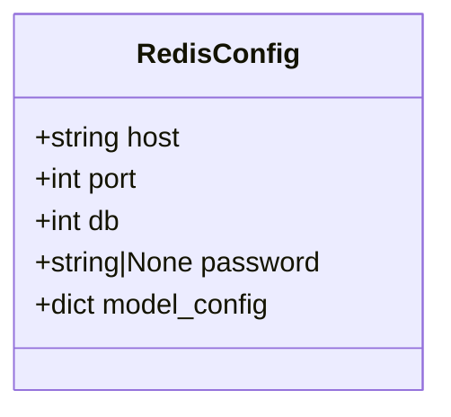
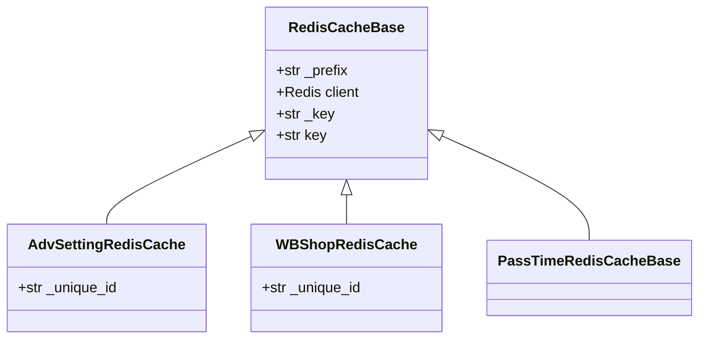
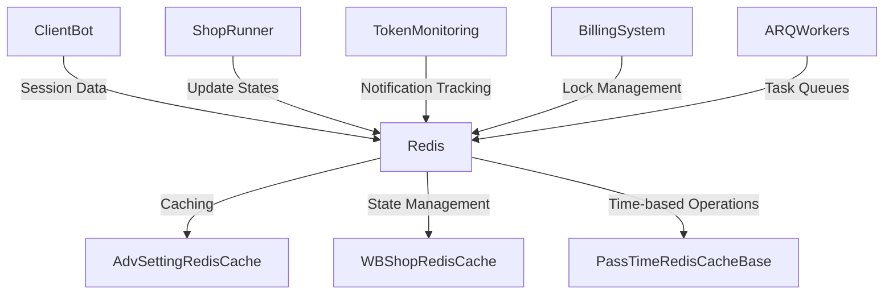
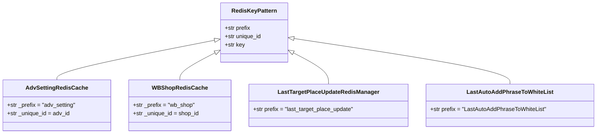
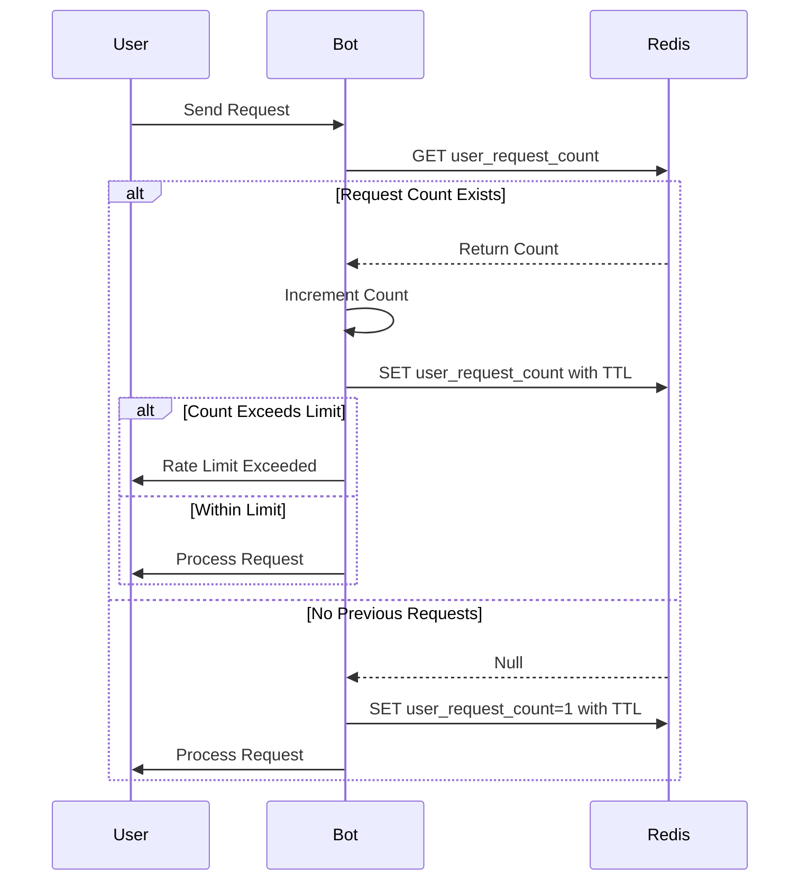
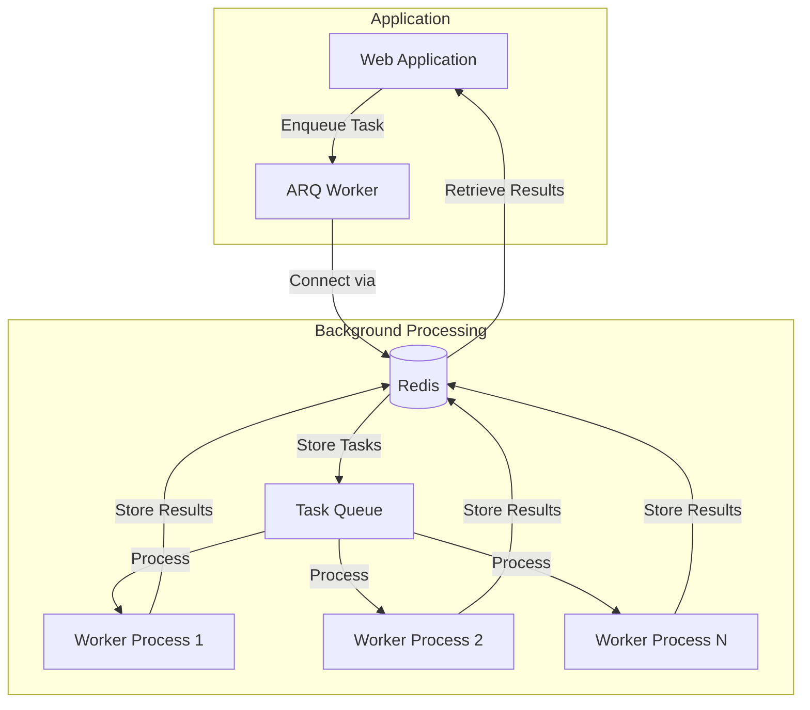
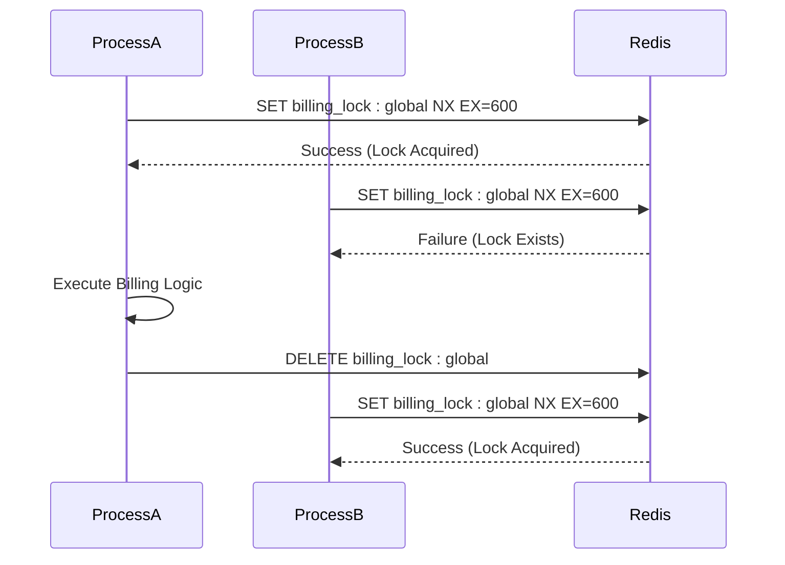
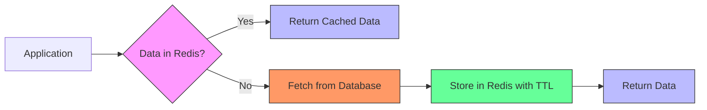

# Redis Configuration

<cite>
**Referenced Files in This Document**   
- [redis_config.py](file://app/configs/infrastructure_config/redis_config.py)
- [redis_cache_base.py](file://app/core/redis_cache/redis_cache_base.py)
- [adv_setting_redis_cache.py](file://app/core/redis_cache/mixins/main_objects_mixins/adv_setting_redis_cache.py)
- [wb_shop_redis_cache.py](file://app/core/redis_cache/mixins/main_objects_mixins/wb_shop_redis_cache.py)
- [arq_redis_settings.py](file://app/arq_workers/arq_redis_settings.py)
- [settings_master.py](file://app/settings/settings_master.py)
- [redis_lock.py](file://app/modules/billing/redis_lock.py)
- [billing_lock.py](file://app/core/redis_manager_v2/mixins/billing_lock.py)
- [last_target_place_update_redis_manager.py](file://app/modules/shop_runner/service_manager/old_modules/auto_updater_target_place/last_target_place_update_redis_manager.py)
- [pass_time_redis_cache_base.py](file://app/core/redis_cache/mixins/data_types/pass_time_redis_cache_base.py)
- [last_auto_update_phrases_to_white_list.py](file://app/modules/shop_runner/service_manager/old_modules/setting_auto_updater/modules/white_list_updater/auto_white_list_updater/redis_cache/last_auto_update_phrases_to_white_list.py)
- [redis_func_cache.py](file://app/utils/redis_func_cache.py)
</cite>

## Table of Contents
1. [Introduction](#introduction)
2. [Redis Configuration Structure](#redis-configuration-structure)
3. [Core Redis Components](#core-redis-components)
4. [Redis Usage Patterns](#redis-usage-patterns)
5. [Key Pattern Design](#key-pattern-design)
6. [Rate Limiting and Throttling](#rate-limiting-and-throttling)
7. [Session and State Management](#session-and-state-management)
8. [Inter-Process Communication with ARQ](#inter-process-communication-with-arq)
9. [Billing and Lock Contention](#billing-and-lock-contention)
10. [Performance Optimization](#performance-optimization)
11. [Error Handling and Connection Management](#error-handling-and-connection-management)
12. [Common Issues and Solutions](#common-issues-and-solutions)
13. [Best Practices](#best-practices)

## Introduction
This document provides comprehensive documentation of the Redis configuration and usage patterns in the advertising automation system. Redis serves as a critical component for caching, session management, rate limiting, and inter-process communication across multiple system components including the client bot, shop runner, and token monitoring services. The configuration supports various use cases such as temporary state storage, workflow coordination, and performance optimization through strategic caching strategies.

**Section sources**
- [redis_config.py](file://app/configs/infrastructure_config/redis_config.py)
- [redis_cache_base.py](file://app/core/redis_cache/redis_cache_base.py)

## Redis Configuration Structure
The Redis configuration is implemented using Pydantic settings with environment variable integration. The `RedisConfig` class defines the core connection parameters including host, port, database index, and optional password authentication. Configuration values are automatically loaded from environment variables with the "REDIS_" prefix, enabling flexible deployment across different environments.

The system uses a single Redis instance for multiple purposes, with different database indices potentially used to separate concerns. Connection settings are managed through environment variables, allowing for easy configuration without code changes. The configuration supports password authentication for enhanced security in production environments.



**Diagram sources**
- [redis_config.py](file://app/configs/infrastructure_config/redis_config.py)

**Section sources**
- [redis_config.py](file://app/configs/infrastructure_config/redis_config.py)
- [settings_master.py](file://app/settings/settings_master.py)

## Core Redis Components
The Redis implementation is built on a modular architecture with base classes and mixins that provide reusable functionality across different use cases. The `RedisCacheBase` class serves as the foundation for all Redis operations, providing common functionality for key generation, client access, and prefix management.

Two primary mixin classes, `AdvSettingRedisCache` and `WBShopRedisCache`, provide specialized functionality for advertising settings and shop-related data respectively. These mixins inherit from both the base Redis cache and an abstract protocol, ensuring consistent interface implementation across the system.



**Diagram sources**
- [redis_cache_base.py](file://app/core/redis_cache/redis_cache_base.py)
- [adv_setting_redis_cache.py](file://app/core/redis_cache/mixins/main_objects_mixins/adv_setting_redis_cache.py)
- [wb_shop_redis_cache.py](file://app/core/redis_cache/mixins/main_objects_mixins/wb_shop_redis_cache.py)

**Section sources**
- [redis_cache_base.py](file://app/core/redis_cache/redis_cache_base.py)
- [adv_setting_redis_cache.py](file://app/core/redis_cache/mixins/main_objects_mixins/adv_setting_redis_cache.py)
- [wb_shop_redis_cache.py](file://app/core/redis_cache/mixins/main_objects_mixins/wb_shop_redis_cache.py)

## Redis Usage Patterns
Redis is utilized across multiple system components for various purposes including caching, state management, and workflow coordination. The client bot uses Redis for user session management and temporary state storage during interactive workflows. The shop runner component leverages Redis for tracking update states and coordinating automated processes.

The token monitoring service employs Redis to track notification states and prevent duplicate alerts. Different components use distinct key prefixes to organize their data within the shared Redis instance. The system implements time-to-live (TTL) policies for temporary data to ensure automatic cleanup and prevent memory bloat.



**Diagram sources**
- [redis_cache_base.py](file://app/core/redis_cache/redis_cache_base.py)
- [adv_setting_redis_cache.py](file://app/core/redis_cache/mixins/main_objects_mixins/adv_setting_redis_cache.py)
- [wb_shop_redis_cache.py](file://app/core/redis_cache/mixins/main_objects_mixins/wb_shop_redis_cache.py)

**Section sources**
- [redis_cache_base.py](file://app/core/redis_cache/redis_cache_base.py)
- [adv_setting_redis_cache.py](file://app/core/redis_cache/mixins/main_objects_mixins/adv_setting_redis_cache.py)
- [wb_shop_redis_cache.py](file://app/core/redis_cache/mixins/main_objects_mixins/wb_shop_redis_cache.py)

## Key Pattern Design
The system implements a consistent key pattern strategy using prefixes to organize Redis data by function and component. The `RedisCacheBase` class automatically generates keys using the format "{prefix}:{unique_id}", ensuring uniqueness and providing clear namespace separation.

Specific components define their own prefixes, such as "last_target_place_update" for tracking target place updates and "LastAutoAddPhraseToWhiteList" for white list management. The `adv_setting_redis_cache` and `wb_shop_redis_cache` implementations use advertising ID and shop ID as unique identifiers respectively, enabling efficient data retrieval and management.



**Diagram sources**
- [redis_cache_base.py](file://app/core/redis_cache/redis_cache_base.py)
- [adv_setting_redis_cache.py](file://app/core/redis_cache/mixins/main_objects_mixins/adv_setting_redis_cache.py)
- [wb_shop_redis_cache.py](file://app/core/redis_cache/mixins/main_objects_mixins/wb_shop_redis_cache.py)
- [last_target_place_update_redis_manager.py](file://app/modules/shop_runner/service_manager/old_modules/auto_updater_target_place/last_target_place_update_redis_manager.py)
- [last_auto_update_phrases_to_white_list.py](file://app/modules/shop_runner/service_manager/old_modules/setting_auto_updater/modules/white_list_updater/auto_white_list_updater/redis_cache/last_auto_update_phrases_to_white_list.py)

**Section sources**
- [redis_cache_base.py](file://app/core/redis_cache/redis_cache_base.py)
- [adv_setting_redis_cache.py](file://app/core/redis_cache/mixins/main_objects_mixins/adv_setting_redis_cache.py)
- [wb_shop_redis_cache.py](file://app/core/redis_cache/mixins/main_objects_mixins/wb_shop_redis_cache.py)
- [last_target_place_update_redis_manager.py](file://app/modules/shop_runner/service_manager/old_modules/auto_updater_target_place/last_target_place_update_redis_manager.py)
- [last_auto_update_phrases_to_white_list.py](file://app/modules/shop_runner/service_manager/old_modules/setting_auto_updater/modules/white_list_updater/auto_white_list_updater/redis_cache/last_auto_update_phrases_to_white_list.py)

## Rate Limiting and Throttling
The system implements rate limiting through Redis-based throttling mechanisms, particularly in the client bot middleware. The `throtting.py` module uses Redis to track request rates and enforce limits on user interactions, preventing abuse and ensuring fair resource usage.

Time-based operations are facilitated by the `PassTimeRedisCacheBase` mixin, which provides methods for checking elapsed time since a timestamp was recorded. This enables workflows that require cooldown periods or time-based triggers, such as preventing frequent updates to advertising settings or shop configurations.



**Diagram sources**
- [pass_time_redis_cache_base.py](file://app/core/redis_cache/mixins/data_types/pass_time_redis_cache_base.py)
- [client_bot/middlewars/throtting.py](file://app/client_bot/middlewars/throtting.py)

**Section sources**
- [pass_time_redis_cache_base.py](file://app/core/redis_cache/mixins/data_types/pass_time_redis_cache_base.py)

## Session and State Management
Redis serves as the primary storage mechanism for temporary state data across various system components. The client bot uses Redis to maintain user interaction states during multi-step workflows, allowing the system to remember user context between messages.

The shop runner component leverages Redis to track the state of automated processes, such as the last time a target place was updated or when phrases were added to a white list. These state markers use time-based expiration to ensure data doesn't persist indefinitely while providing sufficient duration for workflow coordination.

```mermaid
flowchart TD
Start --> |User Interaction| StoreState["Store state in Redis"]
StoreState --> |State Key| GenerateKey["Generate key: user_state:{user_id}"]
GenerateKey --> |Set with TTL| Redis["Redis SET with expiration"]
Redis --> |Subsequent Requests| RetrieveState["Retrieve state from Redis"]
RetrieveState --> |State Exists| ProcessContinuation["Continue workflow"]
RetrieveState --> |State Expired| RestartWorkflow["Restart from beginning"]
class Redis[Redis Database]
class StoreState[Store State]
class RetrieveState[Retrieve State]
```

**Diagram sources**
- [redis_cache_base.py](file://app/core/redis_cache/redis_cache_base.py)
- [client_bot/middlewars/user_data.py](file://app/client_bot/middlewars/user_data.py)

**Section sources**
- [redis_cache_base.py](file://app/core/redis_cache/redis_cache_base.py)
- [pass_time_redis_cache_base.py](file://app/core/redis_cache/mixins/data_types/pass_time_redis_cache_base.py)

## Inter-Process Communication with ARQ
The system uses ARQ workers for background task processing, with Redis serving as the message broker. The `arq_redis_settings.py` file configures the ARQ connection using the Redis master host specified in the application settings, enabling distributed task execution and workload distribution.

ARQ workers leverage Redis for task queuing, result storage, and job coordination. This architecture allows long-running processes like shop updates and keyword parsing to execute asynchronously without blocking the main application. The Redis-based queue system provides reliability through persistence and supports multiple worker processes for improved throughput.



**Diagram sources**
- [arq_redis_settings.py](file://app/arq_workers/arq_redis_settings.py)
- [arq_workers/workers.py](file://app/arq_workers/workers.py)

**Section sources**
- [arq_redis_settings.py](file://app/arq_workers/arq_redis_settings.py)

## Billing and Lock Contention
The billing system implements Redis-based distributed locks to prevent concurrent execution of critical operations. The `RedisLock` class, combined with the `BillingLockMixin`, provides a robust locking mechanism that ensures only one billing process runs at a time across the entire system.

The lock implementation includes automatic expiration (TTL) to prevent deadlocks if a process fails unexpectedly. The system uses a global lock key ("billing_lock:global") to coordinate access, with methods for acquiring, releasing, checking, and extending the lock. Context managers are provided for safe lock usage in asynchronous code.



**Diagram sources**
- [redis_lock.py](file://app/modules/billing/redis_lock.py)
- [billing_lock.py](file://app/core/redis_manager_v2/mixins/billing_lock.py)

**Section sources**
- [redis_lock.py](file://app/modules/billing/redis_lock.py)
- [billing_lock.py](file://app/core/redis_manager_v2/mixins/billing_lock.py)

## Performance Optimization
The system implements several performance optimization strategies for Redis usage. Connection pooling is implicitly handled by the Redis client library, reducing connection overhead for frequent operations. The configuration uses efficient data serialization formats and minimizes network round trips through pipelining where appropriate.

Caching strategies are designed to reduce database load by storing frequently accessed data in Redis with appropriate TTL values. The system avoids storing large data structures in Redis, instead using it for small, frequently accessed values and state markers. Key naming conventions enable efficient data retrieval and prevent key collisions.



**Section sources**
- [redis_cache_base.py](file://app/core/redis_cache/redis_cache_base.py)
- [redis_func_cache.py](file://app/utils/redis_func_cache.py)

## Error Handling and Connection Management
The Redis implementation includes comprehensive error handling for connection failures and network issues. The system uses environment variables to configure connection parameters, allowing for easy reconfiguration without code changes. Default values are provided for critical parameters to ensure resilience in case of configuration errors.

Connection timeouts and retry logic are managed by the underlying Redis client library, with socket connection timeouts set to prevent hanging operations. The system gracefully handles Redis unavailability by implementing fallback behaviors where appropriate, such as proceeding without caching rather than failing entirely.

**Section sources**
- [redis_config.py](file://app/configs/infrastructure_config/redis_config.py)
- [redis_cache_base.py](file://app/core/redis_cache/redis_cache_base.py)

## Common Issues and Solutions
The system addresses several common Redis-related issues through its architecture and implementation. Cache invalidation is handled through TTL-based expiration and explicit deletion when data changes. Stale data is prevented by using appropriate expiration times and updating cache entries when source data changes.

Lock contention in billing and shop update workflows is managed through the distributed locking mechanism with timeout protection. The system prevents thundering herd problems by using randomization in cache expiration where appropriate and implementing queue-based processing for high-volume operations.

**Section sources**
- [redis_lock.py](file://app/modules/billing/redis_lock.py)
- [billing_lock.py](file://app/core/redis_manager_v2/mixins/billing_lock.py)
- [last_target_place_update_redis_manager.py](file://app/modules/shop_runner/service_manager/old_modules/auto_updater_target_place/last_target_place_update_redis_manager.py)

## Best Practices
The Redis implementation follows several best practices for optimal performance and reliability. Key naming conventions use consistent prefixes and unique identifiers to prevent collisions and enable efficient data organization. Data is kept small and focused, with Redis used primarily for state tracking and frequently accessed values rather than large data storage.

TTL values are set appropriately for different use cases, balancing data freshness with performance. The system avoids complex Redis operations that could impact performance, favoring simple get/set operations with atomic updates where needed. Monitoring and logging are implemented to track Redis usage patterns and identify potential issues.

**Section sources**
- [redis_cache_base.py](file://app/core/redis_cache/redis_cache_base.py)
- [redis_config.py](file://app/configs/infrastructure_config/redis_config.py)
- [redis_func_cache.py](file://app/utils/redis_func_cache.py)